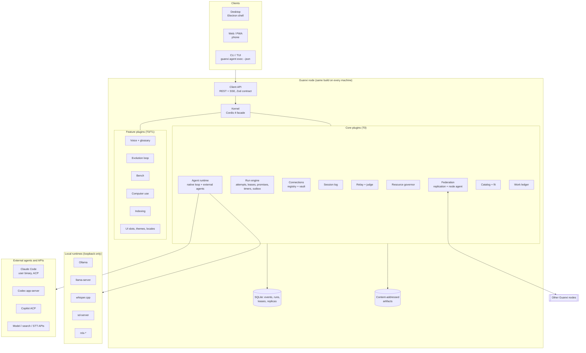
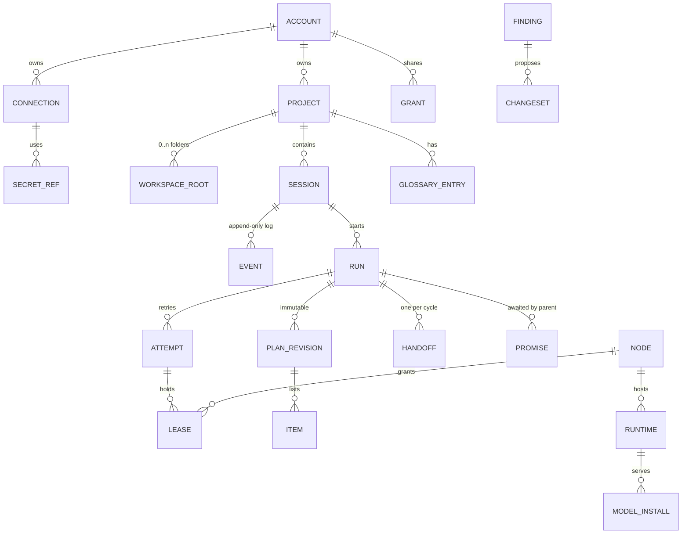
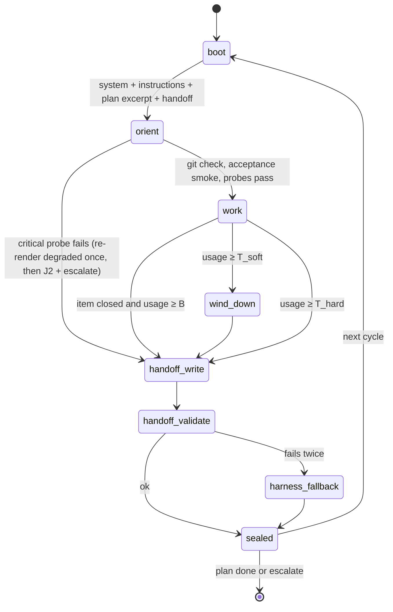

# Target architecture

**Status:** proposed (direction accepted by owner decisions D-101–D-113; each part becomes
`accepted` with its ADR) · **Updated:** 2026-10-19

This document describes where Guanxi is going. The code in `packages/` today is the Alamo-era
implementation described in [`docs/legacy/alamo/`](../legacy/alamo/NAVIGATION.md); it is
ported into this architecture step by step (see [Migration](#11-migration-from-the-legacy-code)).

## 1. System at a glance



Diagram source: [`diagrams/target-system.mmd`](diagrams/target-system.mmd).

## 2. Nodes and roles

- **One build, many nodes.** Every machine runs the same Guanxi service (a user-level
  LaunchAgent / `systemd --user` unit / Windows per-user service). Clients never own the
  process; closing a window never stops work.
- **Capabilities, not roles.** A node advertises capabilities: `interactive` (a person uses
  it), `compute` (it has runtimes), `always_on` (expected to stay awake), `cloud_ephemeral`.
  Placement prefers `always_on` nodes for long lead sessions and phone access; this is a
  scheduling preference, not a required hub (D-105).
- **Single writer per node database.** Each node has one SQLite database written by one module
  in one process; other processes talk to it over the API.

## 3. Kernel and plugins

- `@guanxi/kernel` is a thin facade over **Cordis 4** (context, services, `inject`, revertible
  effects, loader, HMR), pinned to an exact version and vendored with a change log if upstream
  needs patches ([ADR-0015](../decisions/0015-refoundation-on-own-cordis-kernel.md)).
- A running node is a **plugin tree assembled from profiles** (`desktop`, `headless`,
  `cloud-ephemeral`, `bench`) plus user patches, the model DeepSeek Harness uses.
- **Trust tiers** ([ADR-0022](../decisions/0022-plugin-trust-tiers-ui-slots-and-design-tokens.md)):
  T0 core (in-process), T1 trusted (in-process, admin-installed, pinned with integrity),
  T2 untrusted (out-of-process MCP server in an OS sandbox, or WASM; UI only as an MCP App in
  a sandboxed iframe). Agent-written plugins and every MCP server start as T2.
- **UI extension** uses typed slots (`single`, `list`, `keyed`, `chain`). Plugins contribute
  sidebar entries, panels, message renderers, composer actions, settings pages, themes and
  locales; they cannot rearrange the shell.

## 4. Domain model



Key terms (full glossary to be rebuilt in English in stage U1):

| Term | Meaning |
| --- | --- |
| Node | One machine running Guanxi. Owns its hardware leases. |
| Connection | A configured way to reach a model or service: subscription agent, API key, local runtime, search/STT API. |
| Secret ref | `secret://<account>/<connection>/<name>`; resolved only at the HTTP client or process-spawn boundary. |
| Project | Logical container with optional workspace roots, defaults (models, access mode, budgets) and a glossary. |
| Session | A conversation with one append-only event log and one writer node. |
| Run | A durable unit of agent work (Job). Has attempts, may be delegated to another node, may await child runs. |
| Attempt | One execution of a run on one node under a lease with a fencing token. |
| Lease | Time-bounded ownership of a resource (attempt, accelerator slot, port range, container namespace, worktree, VM slot), granted by the resource's owner node. |
| Plan revision | Immutable plan written by a lead: items with acceptance commands and estimates. |
| Handoff | Sealed `guanxi.handoff/v1` artifact that carries a relay executor from one context cycle to the next. |
| Promise | Durable placeholder a sleeping lead awaits; resolved exactly once by a child's terminal transition or a deadline. Escalations are separate signals. |
| Work ledger | Project- or run-scoped graph of plan items whose status is derived from evidence; the board is its projection (ADR-0032). |
| Trust class | `owner_device`, `shared_device` or `cloud_ephemeral`; decides what a node may replicate (ADR-0018 §2). |
| Finding / ChangeSet | Output of the evolution loop: evidence-linked friction and a proposed, risk-classed change. |

## 5. Ownership and replication (multi-master without conflicts)

Design: [ADR-0018](../decisions/0018-federation-ownership-and-leases.md).

| Data | Writer | Replication | Conflict rule |
| --- | --- | --- | --- |
| Session log | the session's home node | append-only stream to the owner's `owner_device` nodes only, keyed `(stream, home_epoch, seq)` + content hash | none: single writer |
| Run state | the run's home node (always-on for delegating runs) | as session log | none: single writer |
| Attempt stream | the executing node, under a fencing token from the run's home | ingested by the home into the session log | stale token rejected (`409`) |
| Hardware and local leases | the machine that owns the resource | gossiped status | that machine's governor admits Guanxi work |
| Shared configuration (accounts, grants, projects, connection metadata, glossary, settings) | any node; identity and grants only admin-capable interactive nodes | op-log with hybrid logical clocks (drift bound 60 s) | last-writer-wins per field; grants as a remove-wins set |
| Secrets | the account vault on opted-in `owner_device` nodes | encrypted envelope; node-key wrapping only for `unattended` connections | whole-value replace with version |
| Reasoning events | the home node | never replicated | — |
| Artifacts | producer; sealed handoffs and git bundles uploaded to the run's home | content-addressed blobs | none: immutable |

`cloud_ephemeral` nodes get no session replicas and no vault, only per-attempt scoped secret
grants. Two offline owner devices can both create sessions and edit settings, and merge on
reconnect. A session can be *continued* only on its home node; elsewhere it can be read or
forked. Moving a home is an explicit, fenced handover. A peer that cannot reach a home shows
`home_unreachable`; it never writes a transition for a run it does not own.

## 6. Agent runtime

Design: [ADR-0021](../decisions/0021-orchestration-roles-and-delegation.md).

- **Two kinds of agents.**
  - *Native agents* run Guanxi's own loop on `pi-agent-core` with any `pi-ai` provider (API
    keys, local runtimes, vendor-sanctioned sign-in). Guanxi controls prompts, tools,
    compaction, relay and tracing.
  - *External agents* are vendor CLIs driven over ACP or their app-server (Claude Code with the
    user's own binary and login, Codex, Copilot). They bring subscription access; Guanxi sees
    what the protocol exposes (messages, tool calls, plans, usage) and treats their internals
    as a black box.
- **Roles.** Lead/planner, executor, reviewer, judge, advisor, scout. A role binds to a
  connection and model by session setting, project default or delegation policy.
- **Light prompts.** The system prompt orients: node, OS, cwd, project roots, access mode,
  available tools and skills, budgets, `AGENTS.md`. Anything more must win on the benchmark
  ([ADR-0025](../decisions/0025-bench-stage-and-ab-gate.md)).
- **Access modes** ([ADR-0027](../decisions/0027-accounts-sharing-and-access-modes.md)):
  *Read-only* (no writes outside scratch, no side-effecting shell, network only through the
  GET/HEAD egress proxy) and *Full access* (the user's OS rights inside the project's roots and
  network allowlist; scratch only for zero-root projects). Both run tools under the OS sandbox
  so the mode is enforced by the kernel, not by the prompt. Neither prompts for approval; a run
  stops for a person only on `input_required` or a `requires_confirmation` action (D-118).

## 7. Runs, delegation and hibernation

Design: [ADR-0019](../decisions/0019-durable-runs-hibernation-and-wake.md).

```mermaid
sequenceDiagram
  participant L as Lead session (home node A)
  participant A as Run engine on A
  participant B as Node B (executor host)
  participant U as User
  L->>A: delegate(plan rev, policy, wake_on, deadline)
  A->>A: TX: child run queued + promise + lead → waiting_children
  Note over L: lead sleeps, no tokens, no process
  A->>B: offer attempt with fencing token k (run:child/exec)
  B->>B: local governor admits; B leases its own GPU slot
  B-->>A: attempt events (token k), heartbeats
  B--xA: node B lost
  A->>A: lease expires → attempt lost → retry policy
  A->>B: attempt 2 on another node, token k+1 (resume from the last handoff sealed on A)
  B-->>A: complete(token k+1); A advances the canonical branch
  A->>A: TX: run terminal + resolve promise + outbox(wake) + notification
  A->>L: resume lead with wake packet (≤4k tokens + links)
  A->>U: notification
```

States: `submitted → working ⇄ input_required`, `working → waiting_children → working`,
`working → wrapping_up → completed | failed | canceled | rejected`, plus `interrupted` after a
restart; ADR-0019 maps them to A2A task states and defines restart reconciliation per state.
The run's home must be `always_on` while it waits for children (ADR-0018 §5).

## 8. Relay executor and judge

Design: [ADR-0020](../decisions/0020-relay-executor-handoff-and-judge.md).



Thresholds are computed from token reserves, not fixed percentages. Sealing is a fenced upload
to the run's home. The judge is a cascade: J0 deterministic watchdog → J1 loop and progress
heuristics → J1.5 checker written by the lead → J2 local LLM judge with a rubric → J3
strong-model review only on flagged cases.

## 9. Fleet: placement and resources

Design: [ADR-0018](../decisions/0018-federation-ownership-and-leases.md) and
[ADR-0031](../decisions/0031-compute-fabric-node-agent-and-runtimes.md).

- Nodes publish telemetry with source, observation time and confidence.
- The node that wants work done scores candidates (capability, fit confidence, expected start,
  throughput history, affinity, cost, waking a sleeping host) and sends an offer. The target
  node's governor accepts or rejects; only the target grants leases on its hardware. The
  governor admits Guanxi work; load from other programs is observed as telemetry.
- Leases carry monotonic fencing tokens; the holder self-fences at its local monotonic
  deadline. Ownership changes only by a transaction on the granter: grant, release, expiry,
  fenced handover or an audited admin break. Effects outside the granter are fenced too:
  attempts push to their own git refs and use idempotency keys for external APIs. Reapers
  remove labelled leftovers.
- Typed lease kinds include accelerator slots, port ranges, Docker namespaces, database names,
  worktrees, displays, browser profiles, input seat and VM slots, so parallel agents never
  collide.
- Optional cloud nodes are leased through provider adapters with a budget ledger and a
  dead-man switch.

## 10. Security, privacy and observability

- **Default bind is loopback.** Remote access requires the remote security profile: account
  authentication, TLS (for example over Tailscale), scoped node credentials, allowed roots per
  node, audit of remote execution. Runtimes stay loopback on their own node.
- **Secrets** live in a per-account vault whose key is wrapped by the OS keychain; models,
  logs, traces and auditors only ever see references; one egress scrubber removes known
  values at model-request construction, artifact write, event write and every export.
- **Session event log is the trace**
  ([ADR-0023](../decisions/0023-session-event-log-and-tracing.md)): prompts with origin
  (typed, voice, queued, remote, delegated), visible reasoning (never replicated, served only to
  local agents), tool calls and results, sub-agent spans, handoffs, judge verdicts, costs.
  OpenTelemetry GenAI export is an optional projection without reasoning.
- **Self-evolution** never edits its own evaluator, gate, redaction, permission policy or
  rollback ([ADR-0024](../decisions/0024-self-evolution-loop.md)).

## 11. Migration from the legacy code

The Alamo-era code already has valuable, tested pieces: durable Chat jobs with replay and
recovery, the Resource Governor, runtime reconciliation, capability evidence with
provenance, the Hugging Face/Ollama catalog, logical Projects, retention, attachments,
recipes and locale keys. They are ported into plugins with a strangler approach:

1. Stage K1 wraps the Resource Governor and the Ollama adapter as kernel plugins (spike).
2. Stage K2 moves the job/event store under the session log contract.
3. Stage R1 extends it with attempts, leases, promises, timers and the outbox.
4. Stage W1 ports the catalog and capability evidence.
5. Legacy packages keep passing their tests until their replacement passes the same
   assertions; then they are deleted with a cleanup review.

`packages/contract` stays the single Zod wire contract between clients and nodes;
`packages/contract/federation` is the versioned node↔node contract; plugin RPC inside a node
uses kernel services.

## 12. Target package layout

```text
apps/desktop        Electron shell (thin)
apps/web            React SPA (also the PWA)
apps/cli            guanxi CLI and TUI, agent exec --json
packages/kernel     Cordis facade, manifest, profiles, trust tiers
packages/contract   Zod REST/SSE + event schemas (wire contract)
packages/session-log
packages/runs       durable runs engine
packages/connections
packages/llm        pi-ai integration, local runtime adapters
packages/agent      native loop, tools, access modes
packages/agents-acp external agent adapters
packages/relay      relay cycles, notes, judge, ETA
packages/work       work ledger (run and project scope), board projection, tracker sync API
packages/fleet      node agent, federation, telemetry, leases
packages/governor
packages/catalog
packages/voice
packages/evolution
packages/bench
packages/ui-tokens  DTCG tokens → CSS vars, Tailwind, MCP Apps vars
packages/ui         primitives, slots, shell
```

Legacy `packages/server`, `packages/web`, `packages/cli` remain until their parts are ported.
