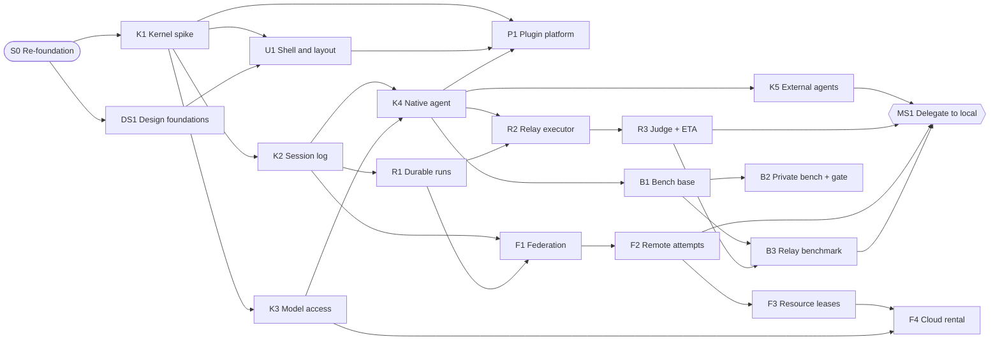

# Roadmap

**Status:** proposed structure (the owner asked for a dependency graph; stage contents follow
their ADRs) · **Updated:** 2026-10-20 (owner answers D-141–D-182 linked per stage)
**Supersedes:** the legacy Phase 0–9 roadmap in
[`docs/legacy/alamo/plans/ROADMAP.md`](../legacy/alamo/plans/ROADMAP.md) (Phases 0–3 are
implemented in the legacy code and are ported, not repeated).

The roadmap is a dependency graph, not a line. A stage may start when all its dependencies
have passed their exit gates. Stages without a dependency between them can run in parallel
sessions when they touch different packages. The last node, **Guanxi 1.0**, is reached when
all five milestones are done. Requirement IDs are written `REQ-A1`; bare IDs such as `K1` or
`F1` are stages.

The full graph with every track is [`roadmap.mmd`](roadmap.mmd), the canonical render. An
interactive view exists as a private page for the owner; it is a convenience, not a source.

## How to read a stage

Each stage lists: **Goal**, **Depends on**, **Scope**, **Reuse**, **Exit gate** (every bullet
needs an assertion that fails when the property is violated, per [WORKFLOW](WORKFLOW.md)),
**Before starting** (design obligations the S0 review attached to the stage), **Owner
answers** (the decisions that closed the stage's former questions in
[OPEN_QUESTIONS](OPEN_QUESTIONS.md); a question raised later may proceed on its recommended
default and must record that it did), and an estimate in full agent sessions.

UI built in a stage before U1 is interim (legacy components) and is migrated by U1's gate.

## Critical path to the north star (MS1)

`S0 → K1 → K2 → {R1, K4 (needs K3)} → R2 → R3 → B3 → MS1`, with `F1 → F2`, `K5` and `B1`
joining before MS1.

DS1 starts right after S0, in parallel with K1. Parallel lanes after K1: **(a)** K2 → R1 → F1;
**(b)** K3; **(c)** U1 once DS1 is done. After K4: **(d)** B1; **(e)** K5; **(f)** P1 (also needs
U1); **(g)** X1. After K3, K4 and U1: C1, then C4. After K2, K4 and U1: E1.

---

## S0 — Re-foundation (in review)

- **Goal:** rename to Guanxi, relicense, research, rewrite canonical docs in English.
- **Scope:** clean rename (D-101), Apache-2.0 + NOTICE + THIRD_PARTY_NOTICES (D-102), seven
  research lanes, requirements, target architecture, ADR-0015–0032, this roadmap, legacy docs
  archived, independent docs review and its fixes, `npm run lint:md`, `npm run check:licenses`.
- **Exit gate:** no `alamo` identifier remains outside Markdown (code, config, package names,
  runtime data paths, storage keys; the archive folder `docs/legacy/alamo/` is intentional);
  typecheck, unit, component and build gates pass; the browser gate passes or its residual is
  recorded by name; `npm run lint:md` reports 0 errors; `npm run check:licenses` reports 0
  disallowed licenses; every independent-review finding is fixed or explicitly deferred to a
  named stage.

## Kernel and agent core

### K1 — Kernel spike

- **Goal:** prove Cordis 4 can carry Guanxi ([ADR-0015](../decisions/0015-refoundation-on-own-cordis-kernel.md)).
- **Outcome so far:** the spike met every budget, but upstream lifecycle races stay unfixed;
  the owner rejected Cordis (D-183). K1 continues with the own-kernel fallback behind the same
  exit gate.
- **Depends on:** S0.
- **Scope:** `packages/kernel` facade (context, services, inject, effects, loader, HMR,
  profiles); port the legacy Resource Governor and Ollama adapter into plugins; one web UI
  slot; leak counters; pin upstream Cordis (DSH's hardened copy only as vendored source).
- **Reuse:** Cordis 4 (MIT); DSH profile/patch loader and slot code (copy, MIT).
- **Exit gate:** legacy governor and Ollama tests pass through the facade; 100 unload/reload
  cycles leave 0 leaked listeners, timers, handles and slot entries, and heap growth after GC
  ≤ 5%; a slot contribution appears, hot-updates and disappears on unload; an empty node boots
  in ≤ 2 s and idles at ≤ 200 MB RSS on Apple Silicon; Cordis is rejected if ADR-0015's
  rejection criteria hit.
- **Estimate:** 2–3 sessions.

### K2 — Session log and inspector

- **Goal:** one append-only event log per session is the trace ([ADR-0023](../decisions/0023-session-event-log-and-tracing.md)).
- **Depends on:** K1.
- **Scope:** port the legacy job/event store behind a `SessionHandle`-style contract (single
  writer, crash-safe append, replay); event schemas in `packages/contract`; egress scrubber at
  event write; reasoning event class with retention, served only to local agents; interim
  inspector (timeline, spans, FTS5 search, token meter); agent query tool.
- **Reuse:** legacy durable job store; DSH session-handle contract and inspector ideas (copy).
- **Exit gate:** crash at every append point never yields a torn or duplicated event; reload
  replay reproduces UI state (count assertions); a planted secret never appears in events or
  exports; an agent on a remote provider receives 0 reasoning events from the query tool.
- **Owner answers:** D-141 (Q-201).
- **Estimate:** 2–3 sessions.

### K3 — Model access

- **Goal:** one connection registry for subscriptions, keys, local runtimes and services
  ([ADR-0017](../decisions/0017-model-access-connections-and-secrets.md)).
- **Depends on:** K1.
- **Scope:** connection kinds and capability facts with provenance; vault with keychain-wrapped
  key; `secret://` refs and JIT injection; the egress scrubber at model-request construction
  and artifact write; `pi-ai` integration with the Anthropic OAuth path disabled; balance
  probes; cost ledger per connection; local runtime adapters on this node; search and STT
  connections.
- **Reuse:** `pi-ai`, models.dev data, legacy capability evidence and Ollama adapter.
- **Exit gate:** a secret printed by a tool never reaches the next model request (end-to-end
  trace test); balances without `observedAt` render `unknown`; recorded-fixture contract tests
  per probe.
- **Owner answers:** D-141 (Q-201), D-145 (Q-205).
- **Estimate:** 3–4 sessions.

### K4 — Native agent, tools, access modes, projects

- **Goal:** a usable light agent on any connection
  ([ADR-0021](../decisions/0021-orchestration-roles-and-delegation.md),
  [ADR-0027](../decisions/0027-accounts-sharing-and-access-modes.md)).
- **Depends on:** K2, K3.
- **Scope:** loop on `pi-agent-core`; tools (files, shell, search, fetch, attachments,
  plan/queue, `note.add`); orientation block (≤300 tokens); Read-only and Full access enforced
  by `sandbox-runtime`, with the egress proxy and the deny-write profile; projects with zero or
  more roots; interim new-session screen; `guanxi agent exec --json` (REQ-M1); session-level
  progress view (REQ-C9).
- **Before starting:** define Read-only network as the GET/HEAD/OPTIONS egress proxy and Full
  access with zero roots as scratch-only (done in ADR-0027; review M-7).
- **Reuse:** `pi-agent-core`; Anthropic `sandbox-runtime`; legacy projects, attachments,
  retention.
- **Exit gate:** Read-only cannot write outside scratch and its `POST`/raw-socket attempts are
  blocked; Full access acts only inside roots and the allowlist; zero-root projects write only
  to scratch; `exec --json` emits a stable schema (snapshot test); the orientation block is
  ≤300 tokens (asserted).
- **Estimate:** 4–6 sessions.

### K5 — External agents and role routing

- **Goal:** subscriptions through official agents; roles bound to connections (REQ-A1, REQ-C1,
  REQ-C2 manual part).
- **Depends on:** K4.
- **Scope:** ACP client adapters (Claude Code with the user's binary, Copilot, Gemini CLI,
  OpenCode, Goose); Codex app-server adapter; "Sign in with ChatGPT" provider; per-adapter
  capability declaration; role resolution (session → project); isolated vendor config dirs;
  quota facts from the agents (Claude Code `rate_limits`, Codex `account/rateLimits`);
  subscription agents on any node, each signed in on that node with the unmodified CLI;
  owner-bound subscription connections (D-190); account-wide limit aggregation and learned
  concurrency per account.
- **Reuse:** ACP v1 SDK, Codex app-server protocol, Copilot SDK (MIT).
- **Exit gate:** recorded-session tests per adapter version; role precedence golden tests; the
  Claude Code `--bare`/subscription state is detected and reported; a second account's prompt
  that would reach a subscription connection is refused; no Guanxi code reads a vendor token
  file (static check plus test).
- **Owner answers:** D-142 (Q-202), D-143 (Q-203), D-144 (Q-204), D-190.
- **Estimate:** 3–4 sessions.

## Durable runs and relay

### R1 — Durable runs, hibernation and wake (single node)

- **Goal:** a lead can delegate, sleep at zero tokens and wake exactly once
  ([ADR-0019](../decisions/0019-durable-runs-hibernation-and-wake.md)).
- **Depends on:** K2.
- **Scope:** additive migrations `run_attempts`, `leases`, `promises`, `timers`, `outbox`;
  states incl. `waiting_children` and `wrapping_up` with the A2A mapping; restart
  reconciliation table; signals vs promises; wake vs delivery; retained run-scoped resources;
  cancel along the chain; cost ledger per run.
- **Before starting:** reconciliation table, escalation-as-signal, deadline child policy,
  retained resources (done in ADR-0019; review H-6, M-14, M-15, H-11).
- **Exit gate:** property test over every crash point of hibernation **and** wake: one
  resolution, one acknowledged wake; a deadline wakes the lead when the child never finishes;
  a stale completion wakes nobody; an escalation then a completion produce two wakes and one
  resolution; the lead's worktree survives an 8-hour hibernation; canceling a hibernating lead
  cancels children exactly once.
- **Owner answers:** D-145 (Q-205).
- **Estimate:** 3–4 sessions.

### R2 — Relay executor v1

- **Goal:** a small-context model works through unlimited cycles without losing the task
  ([ADR-0020](../decisions/0020-relay-executor-handoff-and-judge.md)).
- **Depends on:** K4, R1.
- **Scope:** cycle state machine; thresholds from reserves using the runtime's actual `W`;
  truncation detection; run-scoped work ledger (ADR-0032 `run` mode), typed notes with
  deterministic selection and `notes.search`, fresh-context narrative writer;
  `guanxi.handoff/v1`; sealing by fenced upload to the home; probes with defined failure
  transitions; observed-progress counter; normative caps; protected paths and clean-checkout
  gates.
- **Before starting:** sealing, observed progress, caps, protected paths (done in ADR-0020;
  review H-8, M-12, M-13).
- **Reuse:** handoff patterns from Codex, OpenCode, OpenHands, Cline (copy where licensed).
- **Exit gate:** no request exceeds `H`; ledger↔handoff hash consistency 100%; a corrupted
  handoff is caught by probes; a failed narrative falls back to `degraded` without losing
  progress; a stale attempt's seal is rejected; a cycle that only adds notes does not count as
  progress.
- **Owner answers:** D-158 (Q-218).
- **Estimate:** 4–6 sessions.

### R3 — Judge cascade, ETA, delegation policy

- **Goal:** watch long runs cheaply and escalate only when needed (REQ-C2 agent part, REQ-C3,
  REQ-C6–C8).
- **Depends on:** R2.
- **Scope:** judge layers J0–J3 incl. the J1.5 lead-authored checker and `judge_unavailable`
  handling; ETA; delegation policy with `p_success` and the escalation ladder; delegation
  brief schema with normative caps.
- **Exit gate:** on a replay corpus with injected loops, protected-path edits and premature
  "done": recall ≥ 0.9 and precision ≥ 0.8; J3 wakes ≤ 1 per hour on average over a night run;
  ETA P80 coverage between 0.7 and 0.9 over at least 20 runs.
- **Owner answers:** D-159 (Q-219), D-160 (Q-220), D-161 (Q-221).
- **Estimate:** 3–5 sessions.

## Fleet

### F1 — Federation base

- **Goal:** the same Guanxi on several machines, sharing data without a hub
  ([ADR-0018](../decisions/0018-federation-ownership-and-leases.md)).
- **Depends on:** K2, R1.
- **Scope:** node trust classes and enrollment by device authorization; private-network
  guidance; telemetry with provenance; shared-config op-log (HLC with drift bound, remove-wins
  grants, identity writes from admin nodes only); scoped replication of session and run logs;
  versioned federation contract; command routing bound to state versions.
- **Before starting:** replication scope, merge rules, federation contract (done in ADR-0018;
  review CR-1, M-5, M-17).
- **Exit gate:** replicas converge to an identical state hash after random op interleavings; a
  revoke concurrent with a grant wins; a delayed stop never cancels work started after it; a
  `cloud_ephemeral` or non-owner node receives 0 vault records, 0 session replicas and 0
  reasoning events; unauthenticated nodes are refused; peers on an older major contract are
  read-only.
- **Owner answers:** D-146 (Q-206), D-186 (supersedes D-170).
- **Estimate:** 4–6 sessions.

### F2 — Remote attempts with fenced leases

- **Goal:** run attempts and inference on another machine safely (REQ-C4, REQ-A4 remote).
- **Depends on:** F1.
- **Scope:** offers and accept/reject by the target governor; one fence per run execution
  slot; ownership transitions per ADR-0018 §3; granter clock, grace period and epoch rules;
  side-effect classes (attempt refs for git, namespaced resources, idempotency keys);
  `strict`/`detached` modes; always-on homes and fenced handover; power assertions for
  granters.
- **Before starting:** effect classification, granter clock, keying (done in ADR-0018; review
  CR-3, H-2, H-3, H-7, M-16).
- **Exit gate:** deterministic simulation: ≤1 active lease per key, strictly increasing
  tokens, no accepted stale mutation, one terminal per run; a holder paused past its TTL then
  attempting a git push, a database write and a cloud launch lands **0 effects**; the home
  sleeping mid-run ends in completion or exactly one wake; a home restored from backup bumps
  its epoch and loses no peer events; the target governor is never bypassed.
- **Owner answers:** D-147 (Q-207), D-148 (Q-208).
- **Estimate:** 4–6 sessions.

### F3 — Resource leases, remote tests, fleet dashboard

- **Goal:** parallel agents never collide; tests run where there is room (REQ-B4, REQ-B5,
  REQ-H6).
- **Depends on:** F2.
- **Scope:** typed leases for port ranges, Docker namespaces/compose projects, databases,
  worktrees, heavy slots; reaper by label; `exec.test` run kind with git mirrors and worktrees;
  affinity memory; fleet dashboard. Per [ADR-0038](../decisions/0038-compute-providers-fleet-placement-and-remote-control.md)
  §§2–4: host-pressure signals on three operating systems (PSI; macOS memory pressure, thermal
  state and idle time; a Windows user-session helper); adaptive interactive headroom on the
  machine the owner is using (D-189); residency leases for loaded models (D-191); offers with
  short reservations and late binding; job-size estimates from history; worktree snapshots
  moved as bundles into attempt refs; fenced shared caches; Playwright sharding and
  `run-server` across nodes.
- **Exit gate:** 1,000 randomized allocations never give two worktrees overlapping ports,
  compose names or databases; the reaper removes only its own labels; a placement simulation
  never exceeds a node's allocatable capacity, never evicts a resident model for a test, and
  keeps the interactive headroom under synthetic owner load; an attempt's cache write is
  invisible to other attempts before acceptance and an overwrite is refused.
- **Owner answers:** D-163 (Q-223), D-185, D-186, D-189, D-191.
- **Estimate:** 3–5 sessions.

### F4 — Compute-provider protocol and cloud budget

- **Goal:** one protocol for every compute source; paid machines only within approved money
  (REQ-B4, REQ-B7).
- **Depends on:** F3, K3.
- **Scope:** the provider protocol of ADR-0038 §1 (capabilities, offers with provenance,
  reserve, launch with TTL, exec, put/get, artifacts, logs, network policy, teardown, list,
  usage) and a conformance suite; the **owned-node provider** and self-hosted sandbox backends
  for untrusted code (gVisor or Incus on Linux, Lima on macOS, a WSL2 distribution on Windows)
  first (D-188); then paid adapters (E2B first; Modal, RunPod REST v2, Vast later) behind the
  budget ledger: reservation before launch, monthly and per-launch caps, provider TTL,
  dead-man switch, tag reaping, `cloud_ephemeral` enrollment with per-attempt secret grants
  only.
- **Exit gate:** the conformance suite passes against the owned-node provider; untrusted code
  in a self-hosted sandbox cannot reach the host filesystem or the network outside its policy;
  a paid launch without a reservation fails; the dead-man switch stops an instance when its
  owner node disappears; the cloud node holds 0 vault records.
- **Owner answers:** D-149 (Q-209), D-188.
- **Estimate:** 3–4 sessions.

### F5 — Training runs and assisted provider sign-up

- **Goal:** train or fine-tune models on owned GPUs or on a service with the user's key, and
  let an agent help the user sign up for a provider safely (REQ-B9, D-192).
- **Depends on:** F4, C1, K3.
- **Scope:** a `train` run kind through the provider protocol (upload dataset, start, poll,
  download weights or adapter) with adapters for an owned GPU node (Axolotl or Unsloth core)
  and one service (Together or HF Jobs); keys only on the controller node; the assisted
  sign-up flow in the agent browser where the user completes CAPTCHA, email, 2FA, payment and
  terms, and the key enters the vault through OAuth, a device flow or a Guanxi-owned field.
- **Exit gate:** a small LoRA trains end to end on the PC's RTX 3060 from fixture data and its
  adapter returns with a checksum; the sign-up flow stops for the user at each of CAPTCHA,
  payment and terms (assertions); the key never appears in the transcript, events or model
  requests.
- **Owner answers:** D-192.
- **Estimate:** 2–3 sessions.
- **Estimate:** 2–3 sessions.

## Bench

### B1 — Bench base

- **Goal:** measure before adding scaffolding ([ADR-0025](../decisions/0025-bench-stage-and-ab-gate.md)).
- **Depends on:** K4.
- **Scope:** Harbor as a managed external run; mini-swe-agent control arm; Guanxi via ACP or
  `exec --json`; 50 fresh SWE-rebench tasks + 30 Verified tasks as regression; stats module
  (paired bootstrap, McNemar, pass^k, non-inferiority at −5 points, superiority, Holm); HTML
  report; noise floor (one arm × 5 seeds); budget caps.
- **Before starting:** margin matched to sample size and budget matched to cadence (done in
  ADR-0025; review M-11).
- **Exit gate:** stats module matches Inspect AI reducers on a fixture; a planted 10-point
  regression is detected; infra errors are reported separately; spend stays within the cap.
- **Owner answers:** D-150 (Q-210), D-151 (Q-211), D-163 (Q-223), D-167 (Q-227).
- **Estimate:** 2–3 sessions.

### B2 — Private bench and gate

- **Goal:** gate harness changes on the owner's own work (REQ-M2, REQ-M5).
- **Depends on:** B1, U1.
- **Scope:** task factory (PR mining, RepoLaunch/SWE-smith builds, validation), splits
  (dev/val/holdout/regression/canary), feature and epic tasks, graders (tests as gate; diff and
  plan-level judges as guardrails, D-119), owner calibration queue, Bench section in the UI,
  gate API for evolution, orientation series O0–O4 and TOOLS-1, the WL series (ADR-0032),
  cadence scheduler.
- **Exit gate:** each task passes oracle 3/3 and no-op fail; 100% of canary hacks are caught;
  holdout access is audited; each experiment series ends with a recorded decision that cites
  its CI; judge agreement with owner labels (κ) is reported.
- **Owner answers:** D-150 (Q-210), D-152 (Q-212), D-153 (Q-213), D-165 (Q-225), D-166 (Q-226).
- **Estimate:** 4–6 sessions.

### B3 — Relay benchmark

- **Goal:** prove the relay does not degrade (REQ-M4).
- **Depends on:** B1, R3.
- **Scope:** about 20 tasks requiring ≥5 cycles at `W = 32k`; arms: ledger relay, naive
  summary compaction, observation masking, single large window; effective-length calibration
  `E` per model×quant.
- **Exit gate:** the lower bound of the 95% CI of the per-cycle slope of item success is
  ≥ −1 point per cycle; relay item success ≥ naive compaction with a 3-point non-inferiority
  margin; probe accuracy ≥ 95%; zero guarded dead-end repeats; zero truncation events.
- **Estimate:** 3–4 sessions.

## UX and clients

### DS1 — Design foundations

- **Goal:** one design system that many agents can follow deterministically (REQ-F8, REQ-F9;
  [ADR-0034](../decisions/0034-design-system-tokens-catalog-and-gates.md),
  [docs/design](../design/README.md)).
- **Depends on:** S0 (can run in parallel with K1).
- **Scope:** DTCG token sources and resolver from FOUNDATIONS (Glacier light, brand-ink dark,
  verdigris, IBM Plex, glass levels, motion, density, high-contrast themes); Style Dictionary
  build and generated outputs; self-hosted Plex fonts with `unicode-range` slices and `OFL.txt`;
  `@guanxi/ui` with primitives copied in from shadcn/ui on Base UI and the first patterns;
  portable stories, docs and review records; Storybook and the in-app catalog behind Developer
  mode; app-signed owner approvals; gates G1–G17 with seeded violations; ESLint bulk
  suppressions as a ratchet; codemod for `bg-[var(--x)]`; fix the undefined `--warning` and
  `--focus`; logo assets wired; `guanxi-ui` skill scripts (`find-component`, `ui-check`,
  `new-component`) and `packages/ui/AGENTS.md`.
- **Exit gate:** G17 green (every seeded violation fails its gate); G4 reports zero unresolved
  variables; the catalog shows every existing primitive with all declared states in light,
  dark, both high-contrast themes, both densities and three glass levels; switching theme
  recolours a sample T2 iframe plugin without code changes; an agent-written `approved` record
  fails G12; the app makes zero font requests to any CDN (network assertion).
- **Estimate:** 4–6 sessions.

### DS2 — Approval signing helper

- **Goal:** the owner's approval key can only sign with the owner present, so agent-edited
  node code can neither capture the key nor sign by itself (D-184; DS1-b residual C1/H1).
- **Depends on:** DS1.
- **When:** before the owner approves any component; the shell stage can start in parallel.
- **Scope:** a small code-signed helper installed outside the checkout that alone can read the
  key (keychain item limited to the helper) and asks for Touch ID or the login password on
  every signature, naming the component and its hash in the prompt (LocalAuthentication); the
  node sends a signing request and receives a signature, never the key; migration of any key
  created in DS1 to the helper; first confirm on this Mac that no Apple Developer membership is
  needed, and stop for an owner decision if it is.
- **Exit gate:** a modified node process cannot obtain the key bytes (assertion over the
  request/response protocol and the keychain item's access list); a signature without the
  owner's confirmation fails; the prompt text contains the component id and hash; "Always
  Allow" cannot remove the per-signature confirmation; G12 accepts only helper-made
  signatures; tests run against a throwaway keychain.
- **Estimate:** 1–2 sessions.

### U1 — Shell, workspace layout and experience modes

- **Goal:** the Guanxi shell and a layout the user owns (REQ-F3, REQ-F6, REQ-F7, REQ-D2,
  REQ-D7; [ADR-0036](../decisions/0036-workspace-layout-and-experience-modes.md),
  [LAYOUT_AND_SCREENS](../design/LAYOUT_AND_SCREENS.md)).
- **Depends on:** DS1, K1.
- **Scope:** navigation sidebar (movable, collapsible, four fixed entries), status strip,
  command palette, new-session screen, session workspace with dock lanes and composer;
  Dockview behind the `WorkspaceLayout` adapter; the `workspace.block` slot and built-in blocks
  (Context, Changes, Plan, Processes, Environment, Files, Terminal, Artifacts, Browser
  placeholder, Sub-agents); Developer and Visual modes; layout documents; side chats; English
  glossary; migration of interim UI onto `@guanxi/ui`.
- **Exit gate:** ADR-0036 spike criteria 1–5 hold; colour lint rules have zero suppressions
  across the web package; a block moves by keyboard without dragging and the move is announced;
  layouts resolve in the documented order and survive a mode switch; an unsaved side chat
  leaves no event in the session log (count assertion); keyboard and screen-reader checks on
  the new-session flow pass with 0 critical findings.
- **Estimate:** 4–6 sessions.

### U2 — macOS desktop

- **Depends on:** U1, K4.
- **Scope:** Electron thin shell, service handshake, sandboxed renderer, DMG with
  notarization, auto-update.
- **Exit gate:** closing the window during a run does not stop the run; the renderer has no
  Node access (test).
- **Estimate:** 2–4 sessions.

### U3 — Accounts and remote security profile

- **Depends on:** K3, U1.
- **Scope:** Better Auth (minimal plugins), grants, private-by-default ownership, sharing
  (viewer/editor), per-account connections, vault and cost ledger, remote bind only with
  accounts, TLS and allowed roots.
- **Exit gate:** authorization matrix test over all roles × actions; remote bind refuses to
  start without TLS, accounts and allowed roots.
- **Owner answers:** D-154 (Q-214), D-155 (Q-215).
- **Estimate:** 3–5 sessions.

### U4 — PWA remote client

- **Depends on:** U3, F1.
- **Scope:** live session and sub-agent view, prompt, stop, queue, voice upload, Web Push
  (VAPID) for notification-center events with their actions, offline read cache and outbox;
  Guanxi's own end-to-end encrypted relay from the start (D-187, ADR-0038 §5) on `keykomi`
  behind Caddy, with QR pairing and outbound-only node connections; a phone prompt becomes a
  durable run at the always-on home (the Fedora PC, D-186).
- **Exit gate:** SSE resume by offset never duplicates events (count assertion); push arrives
  on run completion on iOS and Android test devices; the relay stores and logs no plaintext;
  pairing rejects replayed or forged handshakes.
- **Owner answers:** D-168 (Q-228), D-186, D-187 (D-170 superseded).
- **Estimate:** 3–4 sessions.

### U5 — Native mobile

- **Depends on:** U4, V1.
- **Scope:** spike Capacitor vs Expo on locked-screen audio capture; then iOS and Android apps,
  push relay or ntfy, voice mode.
- **Exit gate:** a 5-minute dictation with the screen locked arrives complete on both
  platforms; a content-free push wakes the app on run completion; the app's dependency tree
  passes the license gate with 0 GPL/AGPL packages.
- **Owner answers:** D-156 (Q-216), D-168 (Q-228).
- **Estimate:** 4–8 sessions.

### U6 — Linux and Windows packaging

- **Depends on:** U2.
- **Scope:** AppImage, rpm (Fedora), Flatpak, NSIS; CI matrix; headless node package.
- **Exit gate:** install, start, run a chat and uninstall on Fedora and Windows 11 in CI or a
  recorded manual check.
- **Estimate:** 2–4 sessions.

### NC1 — Notification center and quota alerts

- **Goal:** warn before balances and usage windows run out and act from the notification
  (REQ-J3, REQ-J4, REQ-J5; [ADR-0033](../decisions/0033-notification-center-and-quota-alerts.md)).
- **Depends on:** K3, R1, U1.
- **Scope:** quota facts per window and balance with provenance and local metering;
  threshold and forecast rules (20/10/5%, once per window); durable per-account inbox for all
  attention events; typed idempotent actions (open, add prompt, accept or choose action, wake
  leads, switch connection, pause/resume runs, snooze, raise budget); deterministic
  recommendations; automatic reactions only from run policy; in-app center and OS
  notifications; quiet hours.
- **Exit gate:** a window crossing 20/10/5% with jitter yields exactly three notifications and
  re-arms after reset; a forecast alert fires only when the burn rate exhausts the window
  before a dependent run's P80 ETA; `wake_leads` signals each hibernating lead exactly once
  across a crash; without a policy fallback nothing happens automatically; OS payloads carry
  no session content.
- **Estimate:** 2–4 sessions.

## Plugins

### P1 — Plugin platform

- **Depends on:** K1, U1, K4 (the OS sandbox for MCP servers).
- **Scope:** manifest, plugin manager with rollback and engine checks (adapted from DSH), T1
  installs, safe mode, sandboxed MCP client (default off), Agent Skills with progressive
  disclosure, AGENTS.md loading with a size budget
  ([ADR-0022](../decisions/0022-plugin-trust-tiers-ui-slots-and-design-tokens.md) §§9–10).
- **Exit gate:** a failed install rolls back manifest and lockfile; safe mode boots with all
  T1/T2 disabled; contributing to an undeclared slot fails at load; an MCP server cannot read
  outside its roots or reach a host outside its allowlist; skill bodies are absent from the
  context until invoked (token count).
- **Estimate:** 3–4 sessions.

### P2 — Untrusted plugins

- **Depends on:** P1.
- **Scope:** agent-written and unreviewed T2 plugins out of process, capability broker, MCP
  Apps host with theme variables, style/lint/a11y plugin gate (REQ-F5).
- **Exit gate:** sandbox escape tests (fs, network, secrets) fail closed; a theme change
  recolours T2 UI without plugin changes.
- **Estimate:** 3–5 sessions.

## Work

### WG1 — Project work ledger and board

- **Goal:** one evidence-driven work graph per project, visible as a board (REQ-C9, REQ-C10;
  [ADR-0032](../decisions/0032-work-ledger-board-and-tracker-sync.md)).
- **Depends on:** R2, U1.
- **Scope:** `packages/work` (plan revisions, items, dependencies, evidence, derived status)
  in `project` mode; activation rules; ≤300-token strip; `work.query`; board view; optional
  Markdown export; WIP limits from capacity.
- **Exit gate:** an agent's "done" without passing acceptance leaves the item open; the strip
  never exceeds its budget; `project` mode is not the default until the WL series shows a gain.
- **Owner answers:** D-171 (Q-233), D-172 (Q-234), D-173 (Q-235), D-174 (Q-236), D-176 (Q-238).
- **Estimate:** 2–4 sessions.

### WG2 — Tracker sync: GitHub Issues and Jira

- **Depends on:** WG1, P1.
- **Scope:** sync plugins (D-115): link issues to items, write status outward at transitions,
  read by polling, honour rate limits; no tracker tools in agent context by default.
- **Exit gate:** recorded-fixture tests: business fields never overwritten, one status comment
  per transition, rate-limit backoff honoured.
- **Owner answers:** D-121 (Q-232), D-171 (Q-233), D-175 (Q-237).
- **Estimate:** 2–3 sessions.

## Models workbench

### W1 — Catalog and fit

- **Depends on:** K3, F1, U1.
- **Scope:** port legacy catalog and capability evidence; Hugging Face, Ollama (unofficial
  label), models.dev; fit ladder FIT0–FIT4; model installs as node-owned runs with resumable
  downloads (D-147); Models section UI
  ([ADR-0031](../decisions/0031-compute-fabric-node-agent-and-runtimes.md)).
- **Exit gate:** only FIT3/FIT4 may display "fits"; every fact shows source, time and
  confidence; an interrupted download resumes.
- **Owner answers:** D-147 (Q-207).
- **Estimate:** 3–5 sessions.

### W2 — Media runtimes and adaptive composer

- **Depends on:** W1, U1.
- **Scope:** adapters for sd-server, ComfyUI (process), whisper.cpp, TTS; typed media
  artifacts; per-model capability manifests; composer adapts to input modalities; every model
  parameter exposed with presets (ADR-0031 §9); model composition tools.
- **Exit gate:** an image-only model hides text input; no parameter is capped below the
  adapter's declared limit (audit test like legacy P1-M).
- **Owner answers:** D-164 (Q-224).
- **Estimate:** 4–6 sessions.

### W3 — Media UX and batch jobs

- **Depends on:** W2, R1.
- **Scope:** previews, image editor (Filerobot + Konva), batch runs in `detached` mode,
  progress and ETA.
- **Exit gate:** a batch of N files produces exactly N outputs after an interruption and resume.
- **Estimate:** 3–4 sessions.

## Voice

### V1 — Dictation and glossary

- **Depends on:** K3, U1.
- **Scope:** STT adapters with biasing capability evidence; per-project glossary;
  transliteration-aware post-ASR replacement; voice-origin markers; `voice.flag_term`
  ([ADR-0028](../decisions/0028-voice-and-glossary.md)).
- **Exit gate:** golden transliteration tests; on the eval set, term F1 rises by ≥ 10 points
  while U-WER rises by ≤ 1 point.
- **Owner answers:** D-157 (Q-217).
- **Estimate:** 3–4 sessions.

### V2 — Glossary learning

- **Depends on:** V1, E2.
- **Scope:** three candidate sources, RC0 pre-apply gate, auto-apply with revert, review
  queue, B-WER/U-WER/term-F1 tracking.
- **Exit gate:** a candidate that lowers term F1 on the eval set is not applied; an applied
  entry reverts in one action.
- **Estimate:** 2–3 sessions.

## Self-evolution

### E1 — Audit v1 (read-only)

- **Depends on:** K2, K4, U1.
- **Scope:** trajectory normalization, redaction (no reasoning in remote views), deterministic
  detectors, sampled local facets with event evidence, clustering, Audit Report UI, friction
  per 100 sessions ([ADR-0024](../decisions/0024-self-evolution-loop.md)).
- **Exit gate:** seeded friction corpus recall ≥ 0.8 and precision ≥ 0.7; no secret and no
  remote-bound reasoning in any auditor input.
- **Owner answers:** D-141 (Q-201).
- **Estimate:** 3–4 sessions.

### E2 — RC0/RC1 changes through the gate

- **Depends on:** E1, B2.
- **Scope:** ChangeSets for glossary, project memory, AGENTS.md, skills and docs; per-class
  pre-apply gates; provenance; revert.
- **Exit gate:** a planted test-editing ChangeSet is rejected; an RC0 entry failing its eval is
  not applied; accepted RC1 changes stay within the instruction token budget.
- **Owner answers:** D-161 (Q-221).
- **Estimate:** 3–4 sessions.

### E3 — RC2 canary

- **Depends on:** E2.
- **Scope:** per-run harness version registry; concurrent canary; auto-rollback triggers.
- **Exit gate:** an injected regression rolls back automatically within one canary window.
- **Estimate:** 2–3 sessions.

### E4 — RC3 sandboxed plugins and idle restart

- **Depends on:** E3, P2, U2.
- **Scope:** agent-written T2 plugin through the full gate; A/B version slots; idle restart
  with drain and health check; expand/contract migrations.
- **Exit gate:** a failing post-boot check falls back to the previous slot; restart never
  happens with a running inference; in-process code is never changed by the loop.
- **Estimate:** 3–5 sessions.

### E5 — RC4 pull requests

- **Depends on:** E2.
- **Scope:** fork/branch/PR with provenance and redacted evidence only, for upstream and for
  any in-process code.
- **Exit gate:** every generated PR carries provenance trailers; a planted unredacted excerpt
  blocks PR creation.
- **Estimate:** 1–2 sessions.

## Computer use

- **C1 Agent browser** (depends on K3, K4, U1): `browser-host` in the node service on
  `playwright-core`; per-run ephemeral contexts and a personal profile with real at-rest
  encryption; the Browser block with screencast, takeover and pop-out; login inside Guanxi with
  `fill_secret`; origin sets, Read-only enforcement, download quarantine, egress proxy;
  browser leases ([ADR-0035](../decisions/0035-agent-browser-and-site-sessions.md)). Exit:
  injection pages cause no out-of-scope action; a planted cookie never appears in events, logs
  or model requests; a Read-only run cannot submit a form (explicit assertion); owner answer
  D-143 (Q-203); 4–6 sessions.
- **C2 VM tier** (depends on C1, F3): Lume, Docker + Xvfb + noVNC, Windows Sandbox; VM-slot
  leases. Exit: two agents never share a VM slot; owner answer D-163 (Q-223); 3–4 sessions.
- **C3 Accessibility tier** (depends on C2): Cua Driver background actions with an overlay
  cursor; input-seat lease for tier 4. Exit: the system cursor never moves in tier 3; injected
  page instructions cause no out-of-scope action; owner answer D-162 (Q-222); 3–5 sessions.
  ([ADR-0029](../decisions/0029-computer-use-tiers.md))
- **C4 Browser Bridge and site grants** (depends on C1): the Guanxi Bridge extension
  (per-site optional host permissions, native messaging), the Connections → Browser grant page,
  sync once / on run start / live, one-click revoke, delegated live Chrome, bookmark and history
  import from files, the import assistant (plans typed steps; code executes after the user
  approves). Exit: grants are per site only; revoking closes a live context within one lease
  TTL; an agent cannot install the extension or grant itself a site; no cookie value in any
  log; owner answers D-178–D-182 (Q-240–Q-244); 3–4 sessions.

## Indexing

- **X1 Repo map + FTS** (depends on K4): tree-sitter map, FTS5 trigram, content-hash keys,
  LSP. Exit: index fresh after branch switch across worktrees; owner answer D-169 (Q-229);
  2–3 sessions.
- **X2 Embeddings after A/B** (depends on X1, B2): enable IX3 only if the localisation A/B
  wins; 2–3 sessions. ([ADR-0030](../decisions/0030-project-knowledge-indexing.md))

## Milestones

| Milestone | Requires | Exit gate |
| --- | --- | --- |
| **MS1 Delegate to local** (north star, D-106) | K5, R3, F2, B3 | A Claude Code or API lead delegates a plan to a local 30B-class model on another node and hibernates; instead of a ≥ 6-hour duration (superseded by D-214) the real run survives the injected edge cases — a dropped node link during a call, an executor restart, and (in a separate run) a home restart while the lead hibernates, which must end `interrupted` with one honest wake; the lead's token counter does not change between `delegate()` and the wake (cost ledger assertion); all plan items close with gates green in a clean checkout; exactly one wake; the B3 gate holds. Lead billing per D-142 (Q-202). |
| **MS2 Daily driver** | U2, U3, P1, V1, X1, C1, C4, K5, WG1, WG2, NC1, DS2 | The owner uses Guanxi daily on the Mac for two weeks without falling back to another harness for a task Guanxi supports; all listed stage gates hold. |
| **MS3 Fleet and media** | F4, F5, W3, C2, U4 | A batch, a remote test and a cloud burst run in one week within budget, controlled from the phone; all listed stage gates hold. |
| **MS4 Self-evolving** | E4, E5, V2, X2 | Over a month, at least one change per risk class ships through its gate, none is rolled back by the owner, and friction per 100 sessions does not rise. |
| **MS5 Everywhere** | U5, U6, C3, P2 | Native phone apps, Linux and Windows desktops, the full computer-use ladder and untrusted plugins all pass their stage gates. |
| **Guanxi 1.0** | MS1–MS5 | The vision in [VISION](../vision/VISION.md). |

## Effort

Sum of stage estimates: 127–194 full agent sessions including independent reviews; the
ancestors of MS1 sum to 37–54. This is a complexity range, not a schedule.

## Cross-stage rules

- Every stage updates [PHASE_STATUS](PHASE_STATUS.md) and rewrites
  [NEXT_AGENT_PROMPT](NEXT_AGENT_PROMPT.md).
- After B1 exists, every change to prompts, tools, routing or compaction carries a bench
  result per ADR-0025 (simplifications: non-inferiority; additions: superiority or
  non-inferiority with a ≥15% cost or time win).
- Migrations are additive; schema changes follow expand/contract once E4 slots exist.
- No stage claims a property in docs without an assertion that fails when it is violated.
- Reused code is attributed in the same commit (ADR-0016).
