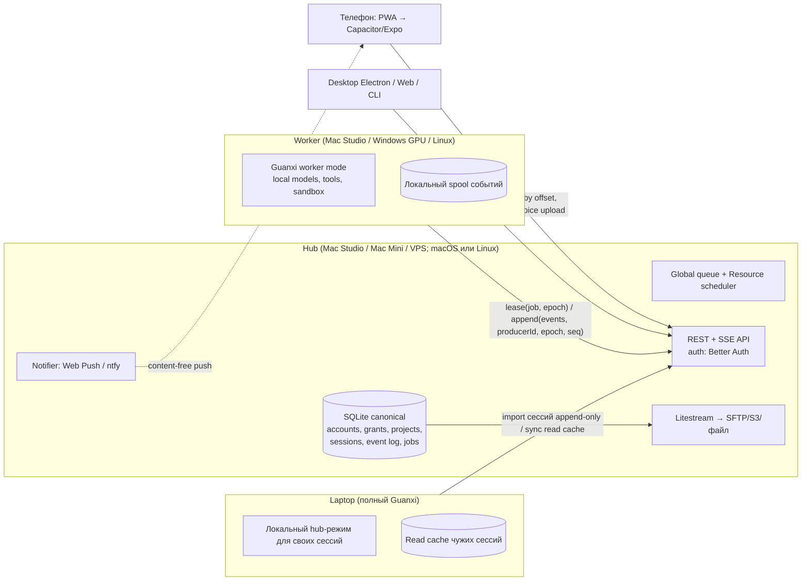

# Lane 2 — плагины, app shell, design system, multi-user, sync, клиенты

**Статус документа:** `proposed`, это исследование, а не принятое решение и не реализация.
**Дата исследования:** 2026-10-19. Все внешние источники открыты в этот день.
**Область:** вопросы F1–F4, B2–B3, D5, E1–E2, G4, I3, L1–L4 из brief владельца.
**Состояние Guanxi на момент чтения:** monorepo `packages/{contract,server,web,cli}`, MIT. ADR-0013 разрешает ровно одного SQLite writer на data directory, loopback-only HTTP, один локальный profile, LaunchAgent или `systemd --user` [1]. ADR-0014 задаёт content-free уведомления с at-most-once доставкой [2].

**Как проверялись факты.**
- Звёзды, SPDX-лицензия, `pushed_at` и последний release взяты из GitHub REST API (`gh api repos/...`) 2026-10-19.
- Нестандартные лицензии прочитаны в самих файлах `LICENSE`.
- Версии npm взяты из `npm view` и npm downloads API.
- Код читался в shallow-клонах из scratchpad, сборка и запуск не выполнялись.
- Часть фактов собрали три вспомогательных research-агента (shell, auth, sync) с тем же правилом маркировки.

**Маркировка:**
- **[V]** — прочитано в первичном источнике (репозиторий, `LICENSE`, официальная документация, спецификация, статья).
- **[I]** — вывод или рекомендация автора.
- **[S]** — вторичный источник или поисковый сниппет, первичный документ не открывался.

Числа в квадратных скобках — ссылки на нумерованный список источников в конце документа.

---

## 0. Короткий итог

1. **Плагинное ядро. [I]** Самый сильный кандидат — семантика **Cordis**: context, service, `inject`, обратимые effects и HMR.
   - У модели есть формальная статья [3].
   - Её использует крупный живой проект **DeepSeek Harness**, MIT, «Everything is a Plugin» [4]. Сам DSH при этом остаётся developer preview.
   - Upstream Cordis 4 всё ещё в RC, автор пишет, что «API is not yet stable» [5].
   - DSH держит vendored-форк с 24 локальными правками lifecycle [6].
   - Рекомендация: брать Cordis 4 через тонкий фасад `@guanxi/kernel` с точным pin версии. UI-модель slots и profiles/patches перенять у DSH с атрибуцией.
2. **Главный вопрос к владельцу. [I]** Guanxi можно строить как собственное ядро на Cordis. Альтернатива — дистрибутив поверх DeepSeek Harness: свои profile, bundles и плагины. От этого решения зависит половина остального. DSH уже содержит plugin manager, market, typed UI slots, Electron desktop, remote-access RBAC и session log. В нём нет multi-user аккаунтов, мобильного клиента и fleet, а API помечен как нестабильный.
3. **Недоверенные плагины, включая сгенерированные агентом.** Ни одна из изученных систем не изолирует in-process плагины: VS Code, Obsidian, OpenCode, Pi, DSH, Cordis [V]. Рекомендация [I] — два уровня доверия:
   - доверенные плагины работают in-process на Cordis;
   - недоверенные — вне процесса, как MCP server в OS-sandbox, а их UI идёт как **MCP Apps** в sandboxed iframe [7].
   - Design tokens передаются в UI через `HostContext.styles.variables` [8]. Так UI агента соответствует style guide по построению.
4. **App shell. [I]**
   - Desktop — **Electron** как тонкая оболочка над user-level сервисом из ADR-0013. Так сделаны OpenCode (ушёл с Tauri из-за WebKit и хрупкого sidecar), DSH, Goose, Cherry Studio и Chatbox [9].
   - Mobile — сначала **PWA**, который раздаёт hub, с Web Push.
   - Нативный клиент позже: **Capacitor** (максимальный реюз SPA) или **Expo** (лучший фоновый голос). Выбирать spike-ом.
   - Tauri — наблюдать (v3 alpha с CEF).
5. **Design system. [I]**
   - Источник истины — токены в формате W3C DTCG 2025.10 [10], сборка через Style Dictionary [11].
   - Из токенов генерируются CSS variables, Tailwind v4 theme и mapping в MCP Apps.
   - Компоненты: shadcn/ui на Base UI, copy-in, MIT [12]. Иконки Lucide, ISC [13], уже в репо. Чат — assistant-ui, MIT [14]. Markdown — Streamdown, Apache-2.0 [15]. Редактор кода — CodeMirror 6 [16]. Изображения — Filerobot или Konva, MIT [17].
   - **Не копировать код** Open WebUI (нестандартная лицензия), LobeHub, Cherry Studio (AGPL), Chatbox (GPL), tldraw (license key) [V].
6. **Аккаунты. [I]**
   - Аутентификация: Better Auth, MIT, встраивается в Hono, есть dialect `node:sqlite`, passkeys [18].
   - Авторизация: своя таблица grants в SQLite в форме Zanzibar-кортежей плюс маленький RBAC (admin/member). Без внешнего OpenFGA или SpiceDB.
7. **Мульти-девайс. [I]**
   - Hub-and-spoke: канонический hub с SQLite, worker-узлы берут jobs по lease с fencing epoch, клиенты чисто потребляют API.
   - Single-writer на каждую сессию и append-only импорт офлайн-сессий. Multi-master CRDT не нужен.
   - Транспорт: Tailscale или Headscale, `tailscale serve` даёт TLS.
   - Push: Web Push (VAPID) для PWA; ntfy или relay — только для нативного приложения.
   - Резервная копия hub: Litestream.

---

## 1. Архитектура «всё — плагин» (F1, F2, H4, K4)

### 1.1 Критерии, выведенные из brief [I]

| Критерий | Откуда в brief | Что нужно на практике |
|---|---|---|
| TypeScript, один язык на сервере и в UI | текущий стек | типизированные сервисы и события, declaration merging |
| DI и lifecycle сервисов | F1: «всё — плагин», включая core | зависимости, ожидание сервиса, корректный teardown |
| Hot reload | K4: агент выкатывает плагин и перезапускает harness | выгрузка без утечек, без полного рестарта процесса |
| Изоляция и capability permissions | K4: плагины пишет агент; L2: безопасность | уровни доверия, sandbox для недоверенного кода |
| UI extension points | F1: темы, языки, редактор, viewer, pricing | slots или contributions, ленивые UI-бандлы |
| Версионированный plugin API | L2, L4 | `engines`-совместимость, deprecation policy |
| Соответствие style guide | F2 | токены, общие primitives, lint и visual-гейты |
| Зрелость и лицензия | L1, L3 | живой проект, MIT или Apache-совместимость |

### 1.2 Сравнение систем

| Система | DI и lifecycle | Hot reload | Изоляция и permissions | UI extension points | Версия API | Зрелость | Лицензия |
|---|---|---|---|---|---|---|---|
| **Cordis 4** [5] [3] | Context как реестр сервисов; `inject` — декларативные зависимости (плагин ждёт сервис); `ctx.effect()` и `ctx.on()` — обратимые регистрации; Fiber lifecycle [V] | Пакет `@cordisjs/plugin-hmr` и Loader с реконсиляцией YAML-конфига [V] | Нет. `isolate` — это изоляция пространства имён сервисов (realm), а не песочница; всё в одном процессе [V по коду `context.ts` и `reflect.ts`] | Встроенных нет. В Koishi это Vue-страницы `ctx.page` [19], в DSH — React slots [V] | npm semver и peerDependencies; RC без гарантий [V] | 9 264★, v4.0.0-rc.11 от 2026-10-14; 306 тыс. загрузок npm в месяц; Koishi сидит на **v3** (`cordis ^3.18.1`) [20] [21] | MIT |
| **DeepSeek Harness на Cordis** [4] [22] | Всё — плагины Cordis: model adapters, tools, session log, agent loop. Profiles и bundles — упорядоченные YAML-patch слои [V] | HMR управляется YAML; plugin manager ставит, включает и удаляет bundles на ходу [23] [V] | Нет: «installed Host code executes in-process outside the workspace sandbox» [23]. SAFETY: проект не прошёл аудит [24] [V] | Typed Slots четырёх видов (`single`, `list`, `keyed`, `chain`) и Component Factories; ui-theme с токенами `--dsw-*`; ui-primitives [25] [26] [V] | Проверка `engines.dsh` и peerDependencies до установки; явные exemptions для несовместимых версий [23] [V] | 254 349★, создан 2026-08-13; developer preview, «THERE WILL BE COMPATIBILITY-BREAKING CHANGES»; `@deepseek-ai/cordis` 4.0.5, 2,46 млн загрузок в месяц [V] | MIT |
| **VS Code extension host** [27] [28] | Activation events, contribution points в `package.json`, disposables в `ExtensionContext` [V] | Новая версия расширения требует перезапуска extension host или окна [I] | Extension host бывает локальным (Node), веб (Web Worker) и remote [V]. Права: «the same permissions as VS Code itself». Защита — malware-scan и подпись в Marketplace, publisher trust с 1.97 [V] | Декларативные contribution points (views, commands, menus) и webviews (iframe) [V] | `engines.vscode` [I] | 193 973★, 1.142.0 [29] | MIT (код Code-OSS) |
| **Eclipse Theia** [30] | Theia extensions — DI `ContainerModule` на этапе сборки; VS Code extensions подключаются в runtime в отдельном plugin host на каждое frontend-соединение [V] | Theia extensions — только пересборка; VS Code extensions — в runtime [V] | VS Code extensions ограничены своим API; Theia extensions имеют полный доступ [V] | Theia extensions могут менять почти всё; Theia plugins «not recommended» [V] | Через VS Code API [V] | 21 711★, v1.76.0 | **EPL-2.0** (слабый copyleft на уровне файлов) [V] |
| **Backstage** [31] [32] | Backend: plugins, modules, services, extension points с DI. Frontend: дерево extensions, overrides, Utility APIs, routes [V] | Композиция при сборке [I] | Backend-плагины не общаются через код, только по сети [V]; sandbox нет [I] | Extension tree, extension overrides, blueprints [V] | Миграция через `/alpha` sub-path exports [V] | 34 655★, v1.55.3 | Apache-2.0 |
| **OpenCode V2 plugins и GUI extensions** [33] [34] | `Plugin.define({id, setup})`; transform hooks по доменам (agent, model, provider, tool, mcp…); `dispose`; есть вариант API на Effect 4. GUI extensions описываются `Extension.define` с полями `provides`, `uses`, `requires`, `stores`, `i18n` [V, клон] | `reload` реального домена; cleanup при выгрузке [V] | Sandbox или permissions для плагинов в документации нет [V] | TUI plugin API; GUI extensions: window entry и Electron main entry, registries и contracts [V] | Effect 4 как peer, `@opencode/plugin` [V] | 217 500★, v1.19.3 | MIT |
| **Pi extensions** [35] | Factory `ExtensionAPI`, события `session_start` и `session_shutdown` [V] | `ctx.reload()` заменяет runtime [V] | «same operating-system permissions» [V] | TUI (`ctx.ui`) [V] | — | 116 390★, v1.3.0 | MIT |
| **Obsidian** [36] [37] | `onload` и `onunload`, хелперы `register*` с автоматической очисткой [V] | Выключение и включение плагина [I] | «cannot reliably restrict plugins»; по умолчанию Restricted mode; автоматическое сканирование и scorecard [V] | Views и leaves, команды [I] | `minAppVersion` [I] | Типы `obsidian-api` 2 339★ | Само приложение проприетарное, API — MIT |
| **Effect 4** [38] | Layers и Context services, Scope и finalizers (`acquireRelease`) [V] | Не plugin loader [I] | Нет | Нет | semver; 4.0.0 вышел 2026-10-01 [V] | 17 333★ | MIT |
| **MCP Apps** (стандарт UI для недоверенного кода) [7] [8] | Ресурс `ui://`, привязанный к tool; JSON-RPC диалект MCP поверх `postMessage` [V] | Перезагрузка iframe [I] | Обязательный sandboxed iframe через sandbox-proxy с другим origin; CSP из `_meta.ui.csp`; хост выдаёт permissions (mic, camera, clipboard) [V] | Встраивание в сообщение; `HostContext.theme` и `styles.variables` (CSS variables) [V] | Спецификация 2026-01-26; SDK v2.0.3 [V] | Поддерживают Claude, VS Code Copilot, M365 Copilot, Goose, Postman и другие [V] | Apache-2.0 (переход с MIT) |

**Изоляция в процессе и вне его** [V, кроме выводов]:

| Техника | Статус | Применимость |
|---|---|---|
| Node Permission Model `--permission` [39] | Stable с v23.5.0/v22.13.0, но «does not protect against malicious code»; символьные ссылки и существующие fd обходят ограничения [V] | Только как ремень безопасности для дочерних процессов [I] |
| Figma: Realms → VM в Wasm [40] | После приватно раскрытой уязвимости в Realms-shim Figma перешла на VM в WebAssembly [V] | Прецедент: in-process JS-песочницы хрупки [I] |
| QuickJS в Wasm [41], isolated-vm (V8 isolates) [42], SES/Endo [43] | MIT; ISC (v6 под Node 24); Apache-2.0 [V] | Для чистых вычислений или скриптов; для «полноценного» плагина с fs/net слишком дорого [I] |
| Extism (WASM-плагины с host functions) [44] | BSD-3, v1.41.0 [V] | Capability-модель через host functions; подходит для трансформеров и парсеров [I] |
| Out-of-process MCP server в OS-sandbox | Стандарт MCP | Основной путь для backend-части недоверенного плагина [I] |

### 1.3 Cordis подробнее

**Что это [V]** [3]:
- Статья «A Programming Paradigm for Spatiotemporal Composability» (arXiv:2608.25512, 2026-08-26; авторы из Peking University и DeepSeek-AI) делит динамическую композицию на два измерения:
  - **временное** — revertible effects, у каждого изменения контекста есть обратное;
  - **пространственное** — reactive coeffects, компонент активируется, когда выполнены его требования.
- Статья вводит calculus с наблюдаемой эквивалентностью и реализует его в Cordis: effect tracking, coeffect resolution, декларативный loader, реконсиляция конфига, HMR.
- Для нас это научное обоснование (L3) именно той операции, которая нужна K4: выгрузить и заменить плагин без перезапуска, ничего не потеряв.

**Риски [V]:**
- Upstream README: «Cordis is under active development. The API is not yet stable» [5]. На npm `latest` — `4.0.0-rc.11` [21].
- DSH вендорит Cordis 4.0.0-rc.7 и ведёт журнал из **24 локальных изменений** [6]:
  - закрытие reentrant-гонок disposal в `fiber.ts`;
  - отложенное (lazy) разрешение config;
  - long-lived идентичность fiber;
  - durable debounced writes конфига на Windows;
  - детекция внутреннего ESM-loader Node 24.0–24.11;
  - и другие.
  Значит, в production-нагрузке upstream RC требовал заметной доработки.
- Koishi, исторический пользователь Cordis, стоит на **v3** [20]. Экосистема плагинов Koishi напрямую с v4 несовместима [I].
- `isolate` — это изоляция пространства имён сервисов, а не безопасность [V по коду].

**Плюсы [V]:**
- Модель уже покрывает F1 как на сервере, так и в браузере. DSH запускает тот же Cordis Loader в браузере поверх своей module system и получает HMR UI-плагинов [45].
- `@deepseek-ai/cordis` скачивают около 2,5 млн раз в месяц [21].

### 1.4 Что можно взять у DeepSeek Harness (MIT) [V, кроме выводов]

| Механизм DSH | Суть | Для Guanxi [I] |
|---|---|---|
| Profiles, bundles, `cordis.patch.yml` [22] | Дерево плагинов собирается из упорядоченных слоёв-патчей; любую строку можно заменить или отключить по id | Перенять как модель «дистрибутивов»: `desktop`, `hub`, `worker`, `headless` |
| Plugin manager [23] | Установка через pnpm с откатом manifest и lockfile; проверка `engines` и peerDependencies до скачивания; отдельное одобрение build scripts; инструмент `plugin_manager` для агента | Взять почти дословно с атрибуцией: это ровно K4 и H4 |
| UI Slots: `single`, `list`, `keyed`, `chain` [25] | Объявить slot — значит владеть им; регистрация в чужой необъявленный slot падает при загрузке; disposer рекурсивно схлопывает дочерние slots | Модель UI extension points для Guanxi |
| ui-theme, ui-primitives, правила стилей [26] | Семантические токены, запрет литеральных цветов, «reuse the control before restyling one», spec-тесты темы | Шаблон для F2 и для lint-гейта плагинов агента |
| Remote access и peer principals [46] | Principal (owner, share-viewer) отделён от peer (соединения); RBAC-решение в одном месте на хосте; клиент получает снимок прав | Хорошая база для D5 (шаринг сессий) |
| Electron thin wrapper [47] | Desktop Host работает как Node-процесс Electron и поднимает тот же web-профиль; renderer `sandbox: true` | Пример схемы с sidecar (§2) |

**Чего в DSH нет [V по структуре репозитория и докам]:**
- аккаунтов нескольких пользователей: есть owner и share-principals;
- мобильного клиента: в `apps/` только cli, desktop, desktop-host, web и генератор маркета;
- fleet или hub;
- изоляции плагинов.

### 1.5 Рекомендация по плагинной архитектуре Guanxi [I]

**Ядро.**
- `@guanxi/kernel` — тонкий фасад, который реэкспортирует `Context`, `Service`, `inject`, `effect` и events из Cordis 4.
- Версия пинится точно. Кандидаты: `@deepseek-ai/cordis` 4.0.x (hardened) или upstream `cordis@4.0.0-rc.11`. Выбор по итогам spike.
- Если upstream не стабилизируется, используется vendor-политика как в DSH: копия исходников и журнал локальных изменений.
- Существующие подсистемы становятся сервисами: Resource Governor, Job store, Event log, Ollama adapter, Catalog, Notifications.

**Уровни доверия:**

| Уровень | Кто | Где исполняется | Права | Как попадает |
|---|---|---|---|---|
| T0 core | Код из репозитория Guanxi | in-process (Cordis) | полные | сборка релиза |
| T1 trusted | Плагины, которые установил admin; официальный маркет | in-process (Cordis) | полные (честно: как VS Code или Obsidian) | pinned spec с integrity, проверка `engines.guanxi` |
| T2 untrusted | Сгенерированные агентом, сторонние непроверенные | **вне процесса**: MCP server в OS-sandbox (см. lane по sandbox) и/или WASM (Extism); UI — MCP Apps | только объявленные capabilities через broker: fs roots, net allowlist, ссылки на секреты, бюджет моделей | по умолчанию для K4; перевод в T1 только после review владельца, тестов и подписи |

**Manifest** — поле `guanxi` в `package.json`. Источники идей: VS Code contribution points, OpenCode `Extension.define`, поле `dsh` в DSH.
- Поля: `id`, `engines.guanxi`, `provides`, `requires`, `uses`, `contributes` (slots, settings pages, locales, themes, commands, tools, message renderers по MIME или имени tool, composer actions), `capabilities` (только для T2), `trust`.

**UI:**
- Typed Slots в стиле DSH для T0 и T1.
- Для T2 — только MCP Apps iframe, в который хост передаёт DTCG-токены через `styles.variables` [8].
- Хост-сторону можно взять готовой: AppBridge из `@modelcontextprotocol/ext-apps` или React-компоненты `@mcp-ui/client` [48].
- Это закрывает F2 для плагинов агента без доверия к их коду.

**Версионирование:**
- Отдельный пакет `@guanxi/plugin-api` по semver.
- Wire-контракт для UI↔server плагинов — Zod-схемы из `packages/contract`.
- Deprecation окно — одна минорная версия.

**Hot reload и K4:**
- Обновление T1-плагина идёт через Cordis HMR и Loader без рестарта.
- Обновление core идёт через существующий drain и restart из ADR-0013, только когда нет активных Jobs.
- Нужен safe mode при загрузке (аналог Restricted mode в Obsidian): все T1 и T2 отключены. Это путь восстановления.

**Spike на 1–2 дня (критерий выбора):**
- Перенести Resource Governor и Ollama adapter в Cordis-плагины.
- Выгрузить и заново загрузить плагин под нагрузкой: 100 циклов, ноль утечек listeners и timers.
- Подключить UI-slot в web.
- Если spike провалится, запасной вариант — собственное ядро на 1–2 тыс. строк: семантика Cordis на Effect 4 или без него.

---

## 2. Кроссплатформенный shell (F4, B3, I3)

### 2.1 Ограничения, которые задаёт сам Guanxi [I]

- **Runtime живёт в фоновом сервисе, а не в окне.** По ADR-0013 runtime — это user-level service: LaunchAgent или `systemd --user`. Он единственный writer SQLite, клиенты подключаются по loopback HTTP [1].
  - Desktop shell не должен владеть процессом runtime.
  - Shell запускает сервис или подключается к уже работающему, а при закрытии окна не убивает его.
  - Так Jobs переживают закрытие UI, что прямо требуется для C4 и B4.
- **Телефон — удалённый клиент hub.**
  - Node-runtime на телефон не нужен.
  - Нужны: live-просмотр сессий, prompt и stop, push-уведомления, голос.
- **Всё должно собираться из одного React SPA и одной design system** (L2, F2).

### 2.2 Сравнение shell-вариантов

| Shell | Desktop | Mobile | Sidecar и Node | Обновления и упаковка | Риски |
|---|---|---|---|---|---|
| **Electron 44** (44.9.0 от 2026-10-17: Chromium 152, Node 24.22) [49] [50] | macOS 13+, Windows, Linux; везде свой Chromium | Нет | Встроенный Node: `utilityProcess.fork()` [51] или Electron-as-Node, как в DSH [47]; `node:sqlite` работает с ветки 38 [52] [V] | `autoUpdater` требует подписанного macOS-приложения, на Linux его нет [53]. electron-builder собирает AppImage, deb, rpm, flatpak, snap; electron-updater обновляет AppImage, deb, rpm [54]. У Forge нет AppImage maker [V] | Размер дистрибутива; Electron 44 несёт Node 24, а Guanxi объявляет `engines.node >=22.5` — нужна матрица версий [V] |
| **Tauri 2.12** (2.12.4) / **Tauri 3 alpha** [55] [56] | Системный webview: WKWebView, WebView2, WebKitGTK 4.1. На Linux версии WebKitGTK разные по дистрибутивам, известны регрессии [57] [V/I]. CEF-runtime есть только в 3.0 alpha и даёт +сотни МБ [58] [V] | iOS и Android в 2.x есть, но DX слабее; официальных плагинов для микрофона и remote push нет [59] [60] [V] | `externalBin` плюс официальный гайд «Node.js as a sidecar» через pkg, только для desktop [61] [V] | Подпись обновлений обязательна; на Linux updater работает только с AppImage. Flatpak собирается через flatpak-builder поверх `.deb` [62] [63] [V] | Расхождения рендеринга WebKit; хрупкий запуск sidecar (это опыт OpenCode, см. ниже) |
| **Expo SDK 58 / RN 0.88** [64] | macOS: react-native-macos 0.83 отстаёт, SDK 58 macOS не поддерживает. Windows: RNW 0.84 [65] [V] | Первоклассная поддержка: `expo-audio` (PCM-стрим, запись в фоне) [66], push, `expo-background-task` [67]. `'use dom'` рендерит web-React внутри WebView [68] [V] | Не применимо | EAS / App Store / Play | UI на RN отдельный от web: реюз только через `'use dom'` или react-native-web 0.21 [69] [I] |
| **Capacitor 8.5** [70] | Только сторонняя Electron-платформа (Capawesome) [71] [V] | Оборачивает существующий SPA в WKWebView или Android WebView; push через APNs и FCM, без silent push на iOS [72]; Background Runner на iOS ~30 с [73] [V] | Не применимо | `npx cap sync` | Микрофон в WebView глушится в фоне без audio background mode [I, по сообщениям пользователей] |
| **Flutter 3.47** [74] | Windows, macOS, Linux (в списке только Debian и Ubuntu, Fedora не указана) [V] | Первоклассная поддержка | Не применимо | — | Полное переписывание UI на Dart [I] |
| **PWA, раздаваемый hub** [75] [76] | Браузер | iOS 16.4+: Web Push только для приложения на Home Screen, без Apple Developer Program. Declarative Web Push в iOS 18.4, silent push нет. `getUserMedia` в standalone-режиме работает с iOS 13.4 [77] [V] | Не применимо | Обновляется вместе с hub | Фоновой работы на iOS нет [I] |

**Что используют аналоги** [V, кроме LM Studio]:

| Приложение | Desktop | Mobile | Как связан runtime |
|---|---|---|---|
| OpenCode Desktop | **Electron** (переехал с Tauri в 1.14.34) [9] | Нет | Раньше в Tauri был sidecar `opencode serve`. Автор пишет, что WebKit был медленнее Chromium, а sidecar «impacted startup time, and occasionally just failed». Теперь сервер работает в Node внутри Electron |
| DeepSeek Harness | **Electron** [47] | Нет | Desktop Host — Node-процесс Electron с authenticated loopback URL |
| Goose | **Electron 43** + Forge (deb, rpm, flatpak) [78] | Нет | Sidecar `goose serve` на 127.0.0.1 со secret key |
| Cherry Studio | **Electron 44** + electron-builder | Отдельное **Expo**-приложение (Expo ~57, RN 0.86), пейринг по LAN через Noise + JSON-RPC [79] | Встроенный |
| Chatbox | **Electron 35** | **Capacitor 7** [80] | Встроенный |
| Jan | **Tauri 2** (tauri 2.8.5; mobile-конфиги есть, мобильного приложения не найдено) [81] | Нет [I] | Rust backend |
| Open WebUI Desktop | **Electron** 39, early alpha [82] | — | Локальный режим |
| LM Studio | **Electron** (по bug tracker, косвенно) [83] [S] | — | Закрытый код |

### 2.3 Мобильные ограничения, влияющие на архитектуру [V]

**iOS:**
- `BGAppRefreshTask` и фоновый push дают около 30 секунд [84].
- Silent push «doesn't guarantee their delivery», не чаще 2–3 раз в час [85].
- iOS 26 `BGContinuedProcessingTask` запускается только по действию пользователя [86].
- Background modes разрешены только «for their intended purposes» (App Review 2.5.4) [87].
- Вывод [I]: держать постоянное SSE-соединение в фоне нельзя. Будить телефон можно только push-уведомлением, и только видимым.

**Android:**
- С Android 14 обязателен `foregroundServiceType` [88].
- С Android 15 `dataSync` ограничен 6 часами в сутки [89].
- Microphone foreground service можно запустить только пока приложение видимо [90].

**Голос:**
- `expo-audio` умеет PCM-стрим и фоновую запись: на iOS через `UIBackgroundModes audio`, на Android через microphone FGS [66].
- В WebView-оболочках (Capacitor, Tauri mobile) микрофон в фоне не гарантирован [I].
- Apple `SFSpeechRecognizer` ограничен минутой аудио; новый `SpeechAnalyzer` работает на iOS и macOS 26+ on-device [91].
- Для macOS-сборки нужен `NSMicrophoneUsageDescription` [92], в Electron — `askForMediaAccess` [93].

### 2.4 Рекомендация по shell [I]

**Desktop (macOS → Linux → Windows): Electron как тонкая оболочка над web-клиентом.**
- **Почему.** Это общий выбор OpenCode, DSH, Goose, Cherry Studio, Chatbox и, судя по косвенным данным, LM Studio. Решающий довод — опыт OpenCode с WebKit и Tauri-sidecar [9].
- **Runtime.** Он остаётся user-level сервисом по ADR-0013.
  - Electron при старте делает authenticated handshake с сервисом. Если сервиса нет, Electron запускает его как Electron-as-Node child (так в DSH) или регистрирует LaunchAgent.
  - Окно грузит тот же SPA, что раздаёт сервис.
  - Renderer: `sandbox: true`, `contextIsolation: true`, без Node в renderer (как в DSH).
- **Упаковка.**
  - macOS: DMG и zip, Developer ID, notarization.
  - Linux: AppImage и rpm для Fedora с electron-updater; Flatpak (Flathub) — без auto-update, обновляет Flathub.
  - Windows: NSIS.
- **Headless-узлы (VPS, worker без GUI).** Обычный Node-пакет (`npx`/npm) или Node SEA, но у SEA CI-тесты только для macOS arm64 [94].
- **Tauri** — наблюдать. Расчёт может измениться, когда Tauri 3 с CEF станет stable, но тогда пропадает главный плюс Tauri — маленький размер.

**Mobile (позже): три ступени.**
1. **M1 — PWA, раздаваемый hub.**
   - Ноль стоимости и тот же SPA.
   - Web Push с VAPID-ключами на каждом hub, поэтому нет проблемы «чей APNs-ключ».
   - Голосовой ввод через `getUserMedia` с отправкой в hub.
   - Ограничения iOS: только Home Screen и нет фона.
2. **M2 — нативная оболочка, когда понадобятся стор, фоновый голос и надёжный push.** Это решение владельца:
   - **Capacitor 8** — максимальный реюз SPA (путь Chatbox);
   - **Expo SDK 58** — лучший нативный аудиостек и background recording (путь Cherry Studio). Сложные web-виды вроде trace viewer остаются web через `'use dom'`.
   - **Склоняюсь к Expo из-за I3 (голосовой режим).** Окончательно решить spike-ом на запись и стрим аудио с заблокированным экраном.
3. **Push для нативного приложения из open-source проекта.**
   - Каждый self-hoster не может держать APNs-ключ проекта, а ключи Apple ограничены по окружениям [95].
   - Варианты: ntfy (self-host с `upstream-base-url` к ntfy.sh, уходит только poll-id) [96] или relay, который держит проект, как у Home Assistant [97].
   - Payload в любом случае content-free, как в ADR-0014.
4. **Транспорт голосового режима (I3).**
   - Начать с потоковой загрузки аудио в STT на hub (whisper.cpp и другие из voice-lane).
   - Полнодуплексный режим с прерыванием — через WebRTC: self-host LiveKit server и agents (Apache-2.0) или Pipecat (BSD-2) [98]. Это решение voice-lane.

---

## 3. Chat/agent UI и design system (F2, F3, G4, D6, J1)

### 3.1 Готовые chat-клиенты: что можно копировать

| Проект | Лицензия (проверено по `LICENSE`) | ★ / релиз | Стек | Вердикт [I] |
|---|---|---|---|---|
| Open WebUI [99] | **Open WebUI License**: BSD-3 плюс п.4 — запрет менять брендинг, если больше 50 пользователей за 30 дней без enterprise-лицензии; CLA. Код до коммита `60d84a3` остаётся под BSD-3 (`LICENSE_HISTORY`) [V] | 156 178★, v0.12.3 | Svelte + Python | **Не копировать.** Лицензия не OSI. Брать только идеи: модель `access_grant`, шаринг чатов |
| LobeHub (бывш. LobeChat) [100] | **LobeHub Community License**: Apache-2.0 плюс условие, что распространение derivative work требует коммерческой лицензии [V] | 83 333★, v2.2.20 | Next.js | **Не копировать** |
| Cherry Studio [101] | **AGPL-3.0** (есть коммерческая лицензия) [V] | 52 761★, v2.1.7 | Electron + React | Копирование делает Guanxi AGPL и закрывает App Store. **Не копировать** |
| Chatbox CE [102] | **GPL-3.0** [V] | 42 075★ | Electron + Capacitor | **Не копировать** (GPL плюс App Store) |
| LibreChat [103] | MIT [V] | 45 994★ | React + Node + MongoDB | Можно копировать с атрибуцией (ACL permBits, share links) |
| AnythingLLM [104] | MIT [V] | 67 318★ | React + Node | Можно копировать с атрибуцией |
| Jan [105] | Apache-2.0 («Attribution is requested») [V] | 45 015★ | Tauri + React | Можно копировать (NOTICE) |
| DeepSeek Harness [4] | MIT [V] | 254 349★ | React 18 + CSS Modules + Cordis | Можно копировать: slots, theme, primitives, ui-trajectory |
| OpenCode [34] | MIT [V] | 217 500★ | SolidJS + Electron 44.4.5 [V, клон] | Можно копировать: идеи session-ui и GUI extensions |

### 3.2 Компоненты-строительные блоки

| Слой | Рекомендация | Альтернативы | Лицензия и зрелость | Комментарий |
|---|---|---|---|---|
| Чат-примитивы | **assistant-ui** [14] | Собственные компоненты | MIT, 12.6k★; React 18/19 | Runtimes `ExternalStoreRuntime` и `AssistantTransport` подходят, когда state и стрим принадлежат своему серверу (как Guanxi Job/events) [V]. Есть адаптеры AG-UI и OpenCode (experimental) |
| Агентные паттерны | **shadcn «AI Elements» + Trace + Code Block** (октябрь 2026) [12] | `vercel/ai-elements` (Apache-2.0) [106], shadcn планирует его deprecate [V] | MIT, copy-in | Trace — «a list of lines for the steps an agent takes», с вложенностью [V]. Это база для D6 и C9 |
| Streaming markdown | **Streamdown** [15] | `marked` (уже в repo) | Apache-2.0, 2.7.1 | Рассчитан на незакрытый markdown во время стрима [I] |
| Протокол UI↔agent | Оставить свой Zod-контракт; **AG-UI** [107] держать референсом | CopilotKit | MIT (AG-UI 16.7k★) | Не вводить второй протокол без решения contract-lane [I] |
| Примитивы и доступность | **shadcn/ui на Base UI** (по умолчанию с июля 2026) [12] [108] | Radix (MIT), React Aria (Apache-2.0) | MIT; Base UI v1.9.0 | Copy-in: код становится нашим и проходит design-review |
| Иконки | **Lucide** (уже `lucide-react` в repo) [13] | Tabler (MIT, тот же 24-px outline-стиль [I]); Phosphor (MIT, но core не релизился с 2024) [109] | ISC (+MIT для Feather-части) | Есть `mic`, `paperclip`, `plus`, `notebook-pen`, `audio-lines` [V]. Логотипы провайдеров — simple-icons (CC0, но товарные знаки) |
| Редактор кода | **CodeMirror 6** [16] | Monaco как опциональный desktop-плагин [110] | MIT. CodeMirror переехал с GitHub на `code.haverbeke.berlin`, npm активен [V] | README Monaco: мобильные браузеры — «No.» [V]. Для F1 «редактор как плагин» по умолчанию нужен CodeMirror |
| Терминал | xterm.js [111] | — | MIT | — |
| Редактор изображений (G4) | **Filerobot** (crop, rotate, фильтры, аннотации) + **Konva/react-konva** для маски inpainting [17] [112] | Excalidraw (MIT) для скетчей; Fabric.js (MIT) | MIT. Filerobot: stable 4.9.1 (2024-12), npm latest — 5.0.0-beta (React ≥19, styled-components) [V] | **tldraw**: в production нужен License Key, есть trial и hobby, open-source исключения нет [113]. **Не использовать.** tui.image-editor архивирован |
| Trace и timeline (J1) | shadcn Trace плюс свой timeline; **Jaeger UI** (Apache-2.0) как референс [114] | Langfuse (MIT вне `ee/`) | — | **Arize Phoenix — Elastic License 2.0**, Grafana Tempo — AGPL: не копировать [V] |
| Аудио-волна (I) | wavesurfer.js [111] | — | BSD-3 | — |

### 3.3 Design system и style guide (F2) [I]

1. **Источник истины — токены** в формате W3C DTCG Format Module 2025.10 (Community Group Final Report от 2025-10-28; это не Recommendation) [10].
   - Сборка через **Style Dictionary** v5. DTCG поддерживается с v4; полная поддержка 2025.10 пока в работе [11] [V].
2. **Из токенов генерируются:**
   - CSS custom properties (семантический слой, как `--dsw-alias-*` в DSH [26]);
   - Tailwind v4 `@theme`;
   - TS-типы;
   - mapping в стандартные MCP Apps variables (`--color-background-primary` и т.п.) [8];
   - позже — RN theme для мобильного клиента.
3. **Правила по образцу DSH:**
   - в фичах нет литеральных цветов;
   - сначала переиспользовать primitive, а не перестилизовывать;
   - один каталог primitives;
   - spec-тесты темы.
   - Включить их в **гейт плагинов**: ESLint и stylelint правила, visual snapshot, a11y-проверка. Агент получает skill «guanxi-ui» с каталогом компонентов.
4. **Sidebar F3** (New, Projects, Models, Settings/Profile) — это `list`-slot. Плагины добавляют пункты в него, а не меняют layout.
5. **Темы и языки как плагины:**
   - тема — это набор токенов (JSON);
   - язык — словарь locale keys (как сейчас в Guanxi);
   - кода в обоих нет, поэтому они безопасны даже как T2.

### 3.4 Лицензионная совместимость (L1)

| Класс | Примеры | Копировать код в MIT-Guanxi? | В iOS App Store? |
|---|---|---|---|
| Permissive (MIT, ISC, BSD, Apache-2.0) | Cordis, DSH, OpenCode, assistant-ui, shadcn, Lucide, CodeMirror, Filerobot, Better Auth, Litestream | Да. Сохранить copyright и NOTICE (у Apache-2.0 — файл NOTICE и пометки об изменениях) [I] | Да |
| Weak copyleft (EPL-2.0, MPL-2.0) | Theia; `react-logviewer` (MPL-2.0) | Как отдельную зависимость — да; изменённые файлы публиковать под той же лицензией [I] | Обычно да [I] |
| Strong copyleft (GPL-3.0, AGPL-3.0) | Cherry Studio, Chatbox, Triplit, Grafana Tempo, серверная часть NetBird | Нет: весь дериватив становится (A)GPL [I] | **Конфликт.** FSF считает условия App Store несовместимыми с GPL; GNU Go был удалён в 2010 [115] [V] |
| Source-available, не OSI | Open WebUI License, LobeHub Community, tldraw, ELv2 (Phoenix), FSL (PowerSync service) | Нет [I] | Нет [I] |

**Практика [I]:**
- CI-гейт по лицензиям зависимостей через allowlist SPDX.
- `THIRD_PARTY_NOTICES.md` по образцу DSH [4].
- Метка «adapted from X @ commit» в заголовке скопированных файлов.

---

## 4. Аккаунты, приватность, шаринг (E1, E2, D5, A6)

### 4.1 Варианты аутентификации

| Вариант | Тип | Лицензия | Встраивается в Node | Passkeys | Зрелость | Вывод [I] |
|---|---|---|---|---|---|---|
| **Better Auth 1.7.11** [116] [117] | TS-фреймворк | MIT | Да: официальная Hono-интеграция [118]; dialect `node:sqlite` `DatabaseSync` через Kysely — first-party [18] [V] | `@better-auth/passkey` на SimpleWebAuthn ^13.3.1 [119] [V] | ~30.4k★. С 2025-09 команда также сопровождает Auth.js [120]. **37 advisories**: 3 critical, 22 high; большинство в SSO, SCIM, OAuth и MCP-плагинах [121] [V] | Основной кандидат, но с минимальным набором плагинов |
| Lucia (+ `@oslojs/*`) [122] [123] | Устаревшая библиотека; теперь гайд и примитивы | MIT | Да (копировать код к себе) | Сами, через `@oslojs/webauthn` или SimpleWebAuthn 14 [124] | Deprecated с марта 2025 [V] | Запасной путь: свой код без чужого churn |
| Pocket ID / Authelia / Ory Kratos [125] | Отдельные Go-серверы, OIDC | BSD-2 / Apache-2.0 / Apache-2.0 | Нет | Pocket ID — только passkeys; у Authelia нет саморегистрации [V] | Активны | Только как опциональный внешний IdP через Generic OAuth |

**Passkeys и hostname** [V, кроме выводов]:
- WebAuthn Level 3 стал W3C Recommendation 2026-08-25 [126].
- RP ID — это домен, **IP-адреса запрещены**. Нужен secure context (https или localhost) [127].
- Следствия [I]:
  - `http://192.168.x.x` не подходит.
  - Пароль обязателен как базовый способ входа, passkey добавляется к нему.
  - Для удалённого доступа нужен один канонический HTTPS-hostname: свой домен или `*.ts.net`.
  - Сертификаты `tailscale cert` выпускает Let's Encrypt. Имена машин попадают в публичные CT-логи [128] [V].

### 4.2 Варианты авторизации

| Вариант | Встраиваемость | Вывод [I] |
|---|---|---|
| Zanzibar (USENIX ATC '19) [129] → OpenFGA (CNCF Incubating с 2025-10-28; SQLite beta) [130], SpiceDB (Go `pkg/embedded`, только Check) [131] | Нужен отдельный Go-сервер [V] | Избыточно для 2–20 пользователей. Оставить форму кортежей совместимой для будущей миграции |
| Casbin (Apache Incubating с 2026-02) [132], CASL 7 (MIT) [133], Oso OSS (deprecated) [134] | Встраиваются [V] | CASL можно использовать как помощник для условий. Casbin тяжелее, чем нужно; Oso — нет |
| **Своя таблица grants + маленький RBAC** — паттерн Open WebUI `access_grant` [135] и LibreChat AclEntry [136] | Да | **Рекомендуется** |

Теоретическая база [V]: RBAC по ANSI/INCITS 359 [137], ABAC по NIST SP 800-162 [138]. Роли `viewer`, `editor` и `owner` повторяют модель Google Drive [139].

### 4.3 Рекомендация [I]

**Аутентификация: Better Auth**, встроенный в Hono-сервер, на `node:sqlite`.
- Плагины только такие:
  - email и password (core);
  - `passkey`;
  - `admin` (создание по приглашению, ban, revoke sessions);
  - `twoFactor` (опционально);
  - `device-authorization` — пейринг телефона, CLI и worker-узла по RFC 8628. По умолчанию он возвращает session token [140];
  - `api-key` — ключи хешируются, имеют scope и срок [141].
- **Не включать** SSO, SCIM, OAuth-proxy, oauth-provider и MCP-плагины без отдельной причины: на них приходится основная масса critical и high advisories.
- Версию пинить и подписаться на GHSA.
- Миграции: SQL, который генерирует Better Auth CLI, коммитить как обычные append-only миграции Guanxi. Совместимость CLI-мигратора с `node:sqlite` не проверена.

**Авторизация.**
- Глобальные роли: `admin` и `member`.
- Таблица `grant(resource_type, resource_id, relation ∈ {owner, editor, viewer}, subject_type ∈ {user, group, link}, subject_id, created_by, created_at, expires_at)` с уникальным ключом и индексами в обе стороны.
- Проверка — единая функция `can(principal, action, resource)` на сервере.
- Клиент получает снимок прав и прячет недоступные действия. Это паттерн peer principal и remote-access из DSH [46].

**Приватность и данные аккаунта.**
- Все Projects, Sessions и Connections принадлежат `owner_user_id`, приватно по умолчанию.
- Connections и секреты хранятся per-account (A6).
- Admin не видит содержимое чужих чатов через UI. Это политика, а не криптография, и это надо честно описать в документации.

**Шаринг сессии (D5):**
- `viewer` — live read-only, включая сабагентов.
- `editor` — может отправлять prompt и делать stop.
- Публичной ссылки без входа по умолчанию нет.

**Открытый вопрос (решение владельца).** Чьими подключениями и бюджетом платится ход, который `editor` отправил в чужую сессию? Предложение: по умолчанию подключениями владельца сессии и только если владелец явно разрешил; иначе подключениями самого editor. Атрибуция `prompt/origin` пишется в event log (как в DSH [46]).

**Безопасность выставления наружу.** Multi-user требует уйти от loopback-only. По AGENTS.md это допустимо только с отдельным security profile: аутентификация, TLS, allowed roots.

---

## 5. Мульти-девайс: hub, workers, клиенты, sync (B1–B5, C4)

### 5.1 Механизмы репликации SQLite и движки sync

| Вариант | Категория | Нужен Postgres или облако? | Лицензия | Последний релиз | Пригодность для Guanxi [I] |
|---|---|---|---|---|---|
| cr-sqlite [142] | CRDT-расширение SQLite | Нет | MIT | v0.16.3, 2024-01-17 | Плохо: проект фактически спит |
| Turso DB + Turso Sync [143] [144] | Переписанный SQLite плюс push/pull | Turso Cloud; локальный sync-сервер только для dev, без auth | MIT | v0.8.3, pre-1.0; Sync в 2025 был beta; конфликты — «last push wins» | Наблюдать; заменяет `node:sqlite` |
| libSQL embedded replicas [145] | Чтение локально, запись в primary | Нужен primary | MIT | — | Мало пользы |
| **Litestream** [146] | Стриминговый бэкап WAL (LTX), point-in-time restore, VFS read-replica | S3, SFTP, файл | Apache-2.0 | v0.5.17, 2026-08-31; **Windows официально не поддерживается** | **Хорошо**: DR для hub |
| LiteFS [147] | FUSE-репликация | Linux, Consul | Apache-2.0 | v0.5.14; «not able to provide support» | Нет |
| sqlite-sync [148] | CRDT | Postgres, Supabase или SQLite Cloud | **Apache-2.0 с 2026-10-19**, до этого modified ELv2 | 1.2.0 | Низкая: лицензию только что сменили, и это CRDT |
| SQLite session extension [149] | Changesets | Нет | Public domain; в `node:sqlite` с 22.12 | — | Опциональный примитив |
| Automerge 3 / Yjs [150] [151] | CRDT-документы | Нет | MIT / MIT | 3.5.0 / 13.6.33 | Только для совместного редактирования документов, если такое появится |
| Electric [152] / Zero [153] / PowerSync [154] | Sync из Postgres | **Postgres**; у PowerSync сервис под FSL | Apache / Apache / FSL + Apache | GA / 1.x / GA | Нет: требуют Postgres |
| LiveStore [155] | Event-sourcing + SQLite, глобальный порядок, rebase | Sync backend | Apache-2.0 | v0.5.0 | Концептуально близко, но тяжело внедрять |
| Jazz [156] / Replicache [157] / Triplit [158] | — | — | MIT / архив / AGPL | alpha / maintenance / заглох | Нет |
| **Durable Streams** [159] | HTTP-протокол append-log: offsets, SSE, идемпотентные producers, epochs | Любой сервер | MIT | DRAFT | **Хорошая модель протокола** для event log сессии |

### 5.2 Hub-and-spoke против multi-master [I]

| Свойство | Hub-and-spoke + single-writer на сессию | Multi-master (CRDT или LWW) |
|---|---|---|
| Job, lease, stop, Resource Governor | Корректно. Решения принимаются в одной точке; fencing epoch отсекает «зомби» [160] | Некорректно. Stop и permits не коммутируют; LWW может потерять stop |
| Event log сессии | Порядок задаёт владелец lease, без конфликтов [161] [162] | Нужен merge порядка событий, а replay модели становится неоднозначным |
| Офлайн-ноутбук | Сессии, созданные офлайн, принадлежат ноутбуку и потом импортируются append-only. Чужие сессии офлайн только читаются или форкаются | Можно писать всё, но платим конфликтами |
| Сложность | Низкая, укладывается в текущий код (Jobs, events) | Высокая |
| Научная база | Local-first ideals [163], event sourcing, single writer, fencing | CRDT [164] |

### 5.3 Рекомендуемая архитектура [I]

**Роли:**
- Один и тот же бинарь работает в одном из режимов: `hub`, `worker` или `standalone`. Ноутбук офлайн работает в режиме `standalone`.
- **Hub** — единственный writer канонической SQLite (продолжение ADR-0013 на уровень fleet). Он владеет accounts и grants, глобальной очередью и планировщиком ресурсов (B4), push и бэкапом.

**Jobs:**
- Worker сам подключается к hub (dial-out) и берёт job по lease с TTL и монотонным **fencing epoch** [160].
- События отправляются с `producerId=worker`, `epoch=lease epoch` и `seq`, как в Durable Streams [159].
- Дубликат — no-op; запись с устаревшим epoch отклоняется.
- Stop — это команда hub, которую worker получает через свой канал.

**Клиенты:**
- Только потребляют API.
- Возобновляют SSE по offset (`Last-Event-ID`).
- Держат read-only кэш и outbox prompt-ов с idempotency key.

**Время:**
- Для упорядочивания и отображения событий, созданных офлайн, используются HLC-метки [165].
- Канонический порядок внутри сессии — `seq` от её единственного writer.

**Отказы:**

| Отказ | Поведение |
|---|---|
| Ноутбук офлайн | Свои сессии и локальные модели работают в `standalone`. Новые сессии получают ULID и `origin_node`. При подключении идёт append-only импорт без merge. Сессии hub доступны только из кэша для чтения; продолжать их можно только через fork |
| Hub недоступен | Workers дописывают текущие jobs в spool и новых не берут. Клиенты читают кэш, prompts ждут в outbox. Push не приходит |
| Hub умер насовсем | Ручное восстановление из Litestream (point-in-time) на другом узле. Новый hub получает новый epoch, старые leases недействительны. Автоматический failover через Raft [166] для 5 своих машин избыточен, и с ним есть риск split-brain |
| Worker пропал (C4) | Lease истекает, job переходит в `interrupted` или retry по политике, лид-сессия получает callback, пользователь — уведомление |

**Транспорт [V для фактов, I для выбора]:**
- **Tailscale** [167]: клиент BSD-3, Personal-план — до 6 пользователей, некоммерческое использование. Либо **Headscale** [168] (BSD-3, iOS-клиент умеет custom coordination server).
- Hub публикуется через `tailscale serve`: TLS для `*.ts.net`, только внутри tailnet. Поверх — аутентификация Guanxi (defense in depth).
- **Funnel и Cloudflare Tunnel не использовать для agent API.** Funnel публичный. У Cloudflare таймаут прокси 125 секунд [169], это ломает SSE без heartbeat.
- NetBird [170] подходит, но его серверная часть под AGPL (self-host допустим). **iroh 1.x** [171] — P2P QUIC: наблюдать как встроенный транспорт без внешнего VPN; Node-биндинг пока ограничен [S].
- В основе всех mesh-вариантов WireGuard [172].

**Push [V]:**
- Web Push по RFC 8030/8291/8292 [173], на iOS через Home Screen [75].
- ntfy [96] или relay проекта — только для нативного приложения.
- UnifiedPush на iOS не работает [174].
- Sygnal (Matrix) и Expo push [175] [176] — референсы архитектуры relay.

---

## 6. Сквозная целевая картина [I]

| Слой | Решение | Статус |
|---|---|---|
| Plugin kernel | Cordis 4 за фасадом `@guanxi/kernel`; уровни доверия T0, T1, T2 | proposed; нужен spike |
| UI extension | Typed Slots (модель DSH) + manifest `contributes`; T2 UI — MCP Apps | proposed |
| Design system | DTCG → Style Dictionary → CSS vars, Tailwind, MCP Apps vars; shadcn + Base UI; Lucide; assistant-ui; Streamdown; CodeMirror 6 | proposed |
| Desktop | Electron thin shell над user-level сервисом (ADR-0013); electron-builder: DMG, AppImage, rpm, Flatpak, NSIS | proposed |
| Mobile | PWA → Capacitor или Expo (spike по голосу) | proposed |
| Accounts | Better Auth (минимум плагинов) + grant-таблица + RBAC admin/member | proposed |
| Fleet | Hub-and-spoke, lease с fencing, event log с single writer, Litestream DR, Tailscale или Headscale | proposed |
| Push | Web Push → ntfy или relay | proposed |

**Порядок внедрения** (зависит от ROADMAP, который ведёт владелец):
1. Kernel spike и фасад.
2. Токены и design system.
3. Аккаунты и security profile.
4. Hub и worker с lease.
5. Electron shell.
6. PWA.
7. Нативный mobile.

---

## 7. Риски

1. **Нестабильность Cordis 4 и DSH API** [V].
   - Митигация: фасад, точный pin, vendor-журнал, собственные тесты lifecycle.
2. **Ложное ощущение безопасности плагинов.** In-process плагины никто не изолирует [V].
   - Митигация: честная модель T1 и T2 и документация, как SAFETY.md в DSH.
3. **Объём advisories Better Auth** [V].
   - Митигация: минимум плагинов, pin, мониторинг GHSA, e2e-тесты авторизации.
4. **`node:sqlite` всё ещё experimental или RC** [V через auth-агента]. В Electron 44 работает Node 24, а не 22.
   - Митигация: явная матрица версий Node.
5. **Litestream не поддерживает Windows** [V].
   - Митигация: hub только на macOS или Linux; Windows PC — worker.
6. **App Store.** В дереве зависимостей мобильного клиента не должно быть GPL или AGPL [V].
   - Митигация: CI-гейт лицензий.
7. **Passkeys и hostname.** Смена имени tailnet или домена делает зарегистрированные passkeys непригодными [I].
8. **Push для нативного приложения требует инфраструктуры проекта**: APNs-ключ и relay [I].

---

## 8. Открытые вопросы владельцу

1. **Строить Guanxi как собственное ядро на Cordis или как дистрибутив DeepSeek Harness** (profile, bundles, свои плагины)? Это решение влияет на lanes 1 и 2.
2. Готовы ли вы принять двухуровневую модель доверия? Плагины агента по умолчанию работают вне процесса и в T1 попадают только через ваш review.
3. Mobile: достаточно ли сначала PWA? И что важнее для нативной версии — реюз кода (Capacitor) или голосовой режим в фоне (Expo)?
4. Кто будет **hub** по умолчанию: Mac Studio, Mac Mini или VPS? Нужен ли ручной warm standby?
5. Транспорт: управляемый Tailscale (бесплатно до 6 пользователей, некоммерческое использование) или self-host Headscale?
6. Шаринг сессии с правом записи: **чьи подключения и бюджет** используются для хода editor-а?
7. Готов ли проект держать Apple Developer account, APNs-ключ и push-relay ради нативного iOS-клиента?
8. Нужен ли admin-у доступ к чужим чатам, например для семьи с детьми, или приватность абсолютна?
9. Нужна ли публичная ссылка на сессию без входа, или только внутри инсталляции?

---

## Источники

Все источники открыты 2026-10-19. Метаданные GitHub (★, SPDX, `pushed_at`, release) получены через GitHub REST API в тот же день.

1. Guanxi ADR-0013 (один writer, loopback HTTP, LaunchAgent/systemd --user). docs/decisions/0013-phase-4-service-control-and-clients.md — доступ 2026-10-19.
2. Guanxi ADR-0014 (content-free notifications, at-most-once). docs/decisions/0014-notification-persistence-and-delivery.md — доступ 2026-10-19.
3. Shi, Zhang, Cui. A Programming Paradigm for Spatiotemporal Composability. arXiv:2608.25512, 2026-08-26. https://arxiv.org/abs/2608.25512 — доступ 2026-10-19.
4. deepseek-ai/deepseek-harness — 254 349★, MIT, создан 2026-08-13, README «developer preview… COMPATIBILITY-BREAKING CHANGES» (клон, commit 687f282, 2026-10-17). https://github.com/deepseek-ai/deepseek-harness — доступ 2026-10-19.
5. cordiverse/cordis — repo, README («API is not yet stable»), GitHub API: 9 264★, MIT, v4.0.0-rc.11 (2026-10-14). https://github.com/cordiverse/cordis — доступ 2026-10-19.
6. DSH vendor/README.md: Cordis 4.0.0-rc.7 vendored + 24 local modifications. https://github.com/deepseek-ai/deepseek-harness/blob/main/vendor/README.md — доступ 2026-10-19.
7. MCP Apps overview (ui:// resources, sandboxed iframe, postMessage JSON-RPC, supported hosts). https://modelcontextprotocol.io/extensions/apps/overview — доступ 2026-10-19.
8. MCP Apps spec 2026-01-26 (sandbox proxy, CSP, HostContext.styles.variables); repo 2 980★, Apache-2.0 (переход с MIT), v2.0.3 (2026-09-25). https://github.com/modelcontextprotocol/ext-apps/blob/main/specification/2026-01-26/apps.mdx — доступ 2026-10-19.
9. OpenCode Desktop moved Tauri → Electron (1.14.34); post https://dev.to/brendonovich/moving-opencode-desktop-to-electron-4hip. https://github.com/anomalyco/opencode/issues/25879 — доступ 2026-10-19.
10. W3C Design Tokens CG — Design Tokens Format Module 2025.10 (CG Final Report, 2025-10-28). https://www.w3.org/community/reports/design-tokens/CG-FINAL-format-20251028/ — доступ 2026-10-19.
11. Style Dictionary DTCG support (v4+; 2025.10 full support WIP in v5); repo 4 867★, Apache-2.0, v5.7.0 (2026-10-16). https://styledictionary.com/info/dtcg/ — доступ 2026-10-19.
12. shadcn/ui changelog (Base UI default Jul 2026; Trace, Code Block, AI Elements Oct 2026); repo 125 953★, MIT, shadcn@4.22.1 (2026-10-18). https://ui.shadcn.com/docs/changelog — доступ 2026-10-19.
13. lucide — 25 146★, ISC (+MIT для Feather-производных), 1.59.0 (2026-10-17); иконки mic, paperclip, notebook-pen, audio-lines есть в icons/. https://github.com/lucide-icons/lucide — доступ 2026-10-19.
14. assistant-ui runtimes; repo assistant-ui/assistant-ui 12 618★, MIT; npm @assistant-ui/react 0.15.29 (React 18/19). https://www.assistant-ui.com/docs/runtimes/pick-a-runtime — доступ 2026-10-19.
15. vercel/streamdown — 5 710★, Apache-2.0, 2.7.1 (2026-10-19). https://github.com/vercel/streamdown — доступ 2026-10-19.
16. codemirror/dev — архивирован на GitHub, «moved to https://code.haverbeke.berlin/codemirror/dev»; npm @codemirror/view 6.43.15 (обновлён 2026-10-19). https://github.com/codemirror/dev — доступ 2026-10-19.
17. filerobot-image-editor — 1 922★, MIT, v4.9.1 (2024-12-30); npm react-filerobot-image-editor latest 5.0.0-beta.159 (React ≥19, react-konva, styled-components). https://github.com/scaleflex/filerobot-image-editor — доступ 2026-10-19.
18. Better Auth: SQLite adapter (better-sqlite3, node:sqlite DatabaseSync, bun:sqlite via Kysely). https://www.better-auth.com/docs/adapters/sqlite — доступ 2026-10-19.
19. Koishi console: client entry, ctx.page, Vue. https://koishi.chat/en-US/guide/console/ — доступ 2026-10-19.
20. koishijs/koishi — 6 260★, MIT, 4.18.11 (2026-03-09); packages/core/package.json: cordis ^3.18.1. https://github.com/koishijs/koishi — доступ 2026-10-19.
21. npm: cordis latest 4.0.0-rc.11; 306 006 загрузок/мес; @deepseek-ai/cordis latest 4.0.5, 2 464 713 загрузок/мес (https://api.npmjs.org/downloads/point/last-month/@deepseek-ai/cordis). https://api.npmjs.org/downloads/point/last-month/cordis — доступ 2026-10-19.
22. DSH docs/architecture.md (profiles, bundles, Electron Desktop Host, extension points). https://github.com/deepseek-ai/deepseek-harness/blob/main/docs/architecture.md — доступ 2026-10-19.
23. DSH plugin-manager README («installed Host code executes in-process outside the workspace sandbox»). https://github.com/deepseek-ai/deepseek-harness/blob/main/packages/boot/plugin-manager/README.md — доступ 2026-10-19.
24. DSH SAFETY.md (not audited, untrusted plugins risk). https://github.com/deepseek-ai/deepseek-harness/blob/main/SAFETY.md — доступ 2026-10-19.
25. DSH ui-slots README (single/list/keyed/chain slots, Component Factories) + packages/client/README.md. https://github.com/deepseek-ai/deepseek-harness/blob/main/packages/client/ui-slots/README.md — доступ 2026-10-19.
26. DSH docs/web-styling.md (ui-theme tokens --dsw-*, CSS Modules, no Tailwind, ui-primitives catalog). https://github.com/deepseek-ai/deepseek-harness/blob/main/docs/web-styling.md — доступ 2026-10-19.
27. VS Code Extension Host (local / web worker / remote). https://code.visualstudio.com/api/advanced-topics/extension-host — доступ 2026-10-19.
28. VS Code extension runtime security («same permissions as VS Code itself», marketplace scan/signing, publisher trust since 1.97). https://code.visualstudio.com/docs/configure/extensions/extension-runtime-security — доступ 2026-10-19.
29. microsoft/vscode — 193 973★, MIT, 1.142.0 (2026-10-14). https://github.com/microsoft/vscode — доступ 2026-10-19.
30. Theia extension mechanisms (Theia extensions build-time DI, VS Code extensions runtime, headless plugins); repo eclipse-theia/theia 21 711★, EPL-2.0, v1.76.0 (2026-09-24). https://theia-ide.org/docs/extensions/ — доступ 2026-10-19.
31. Backstage new frontend system architecture (extension tree, overrides, Utility APIs, routes). https://backstage.io/docs/frontend-system/architecture/index — доступ 2026-10-19.
32. Backstage backend system (plugins, modules, services, extension points); repo 34 655★, Apache-2.0, v1.55.3 (2026-09-29). https://backstage.io/docs/backend-system/architecture/index — доступ 2026-10-19.
33. OpenCode plugins docs (hooks, custom tools, no sandbox documented). https://opencode.ai/docs/plugins/ — доступ 2026-10-19.
34. anomalyco/opencode (ранее sst/opencode) — 217 500★, MIT, v1.19.3 (2026-10-16); клон b56e253: packages/plugin (V2 Promise/Effect API, TUI API), packages/gui-extensions (Extension.define, Electron main + window), packages/desktop (electron-builder). https://github.com/anomalyco/opencode — доступ 2026-10-19.
35. earendil-works/pi (ранее badlogic/pi-mono) — 116 390★, MIT, v1.3.0 (2026-10-15); packages/coding-agent/docs/extensions.md («same operating-system permissions»). https://github.com/earendil-works/pi — доступ 2026-10-19.
36. Obsidian plugin security (Restricted mode, «cannot reliably restrict plugins»). https://obsidian.md/help/plugin-security — доступ 2026-10-19.
37. Obsidian plugin guidelines (cleanup on unload, register* helpers). https://docs.obsidian.md/Plugins/Releasing/Plugin+guidelines — доступ 2026-10-19.
38. Effect Layers/services; репо Effect-TS/effect 17 333★, MIT; npm effect 4.0.0 опубликован 2026-10-01, latest 4.0.5. https://effect.website/docs/requirements-management/layers/ — доступ 2026-10-19.
39. Node.js Permission Model (Stable since v23.5.0/v22.13.0; «does not protect against malicious code»). https://nodejs.org/api/permissions.html — доступ 2026-10-19.
40. Figma: How we built the Figma plugin system (2019-08-22; Realms → позже VM в Wasm после уязвимости). https://www.figma.com/blog/how-we-built-the-figma-plugin-system/ — доступ 2026-10-19.
41. quickjs-emscripten — 1 729★, MIT. https://github.com/justjake/quickjs-emscripten — доступ 2026-10-19.
42. isolated-vm — 2 938★, ISC, v6.0.2 (2025-10-16). https://github.com/laverdet/isolated-vm — доступ 2026-10-19.
43. endojs/endo (SES/Hardened JS) — 1 067★, Apache-2.0. https://github.com/endojs/endo — доступ 2026-10-19.
44. extism/extism — 5 808★, BSD-3-Clause, v1.41.0 (2026-10-09). https://github.com/extism/extism — доступ 2026-10-19.
45. DSH Agent Note: client plugin loading model (browser module system + Cordis Loader, HMR). https://github.com/deepseek-ai/deepseek-harness/blob/main/.agents/notes/implemented/architecture/2026-07-23-client-plugin-loading-model.md — доступ 2026-10-19.
46. DSH remote-access README + .agents note 2026-10-12 peer principals (owner / share-viewer, RBAC bindings). https://github.com/deepseek-ai/deepseek-harness/blob/main/packages/api/remote-access/README.md — доступ 2026-10-19.
47. DSH Agent Note: Electron desktop packaging/updates (thin wrapper, Desktop Host via Electron RunAsNode, sandbox: true). https://github.com/deepseek-ai/deepseek-harness/blob/main/.agents/notes/implemented/architecture/2026-08-25-electron-desktop-packaging-and-updates.md — доступ 2026-10-19.
48. MCP-UI (@mcp-ui/client 7.1.1) — 5 222★, Apache-2.0. https://github.com/MCP-UI-Org/mcp-ui — доступ 2026-10-19.
49. Electron releases: 44.9.0 (2026-10-17), Chromium 152, Node 24.22.0; repo 123 409★ MIT. https://releases.electronjs.org/ — доступ 2026-10-19.
50. Electron 44 (2026-08-25). https://www.electronjs.org/blog/electron-44-0 — доступ 2026-10-19.
51. Electron utilityProcess.fork. https://www.electronjs.org/docs/latest/api/utility-process — доступ 2026-10-19.
52. Electron PR #47757: node:sqlite fixed (merged 2025-07-16). https://github.com/electron/electron/pull/47757 — доступ 2026-10-19.
53. Electron autoUpdater (signed macOS app; no Linux). https://www.electronjs.org/docs/latest/api/auto-updater — доступ 2026-10-19.
54. electron-builder Linux targets (AppImage, deb, rpm, snap, flatpak…); auto-update https://www.electron.build/docs/features/auto-update. https://www.electron.build/docs/linux — доступ 2026-10-19.
55. Tauri releases: v2.12.4 (14 Oct), v3.0.0-alpha.0 (13 Sep) … alpha.5 (14 Oct); runtime selection wry/CEF; repo 112 021★ Apache-2.0/MIT. https://github.com/tauri-apps/tauri/releases — доступ 2026-10-19.
56. Announcing Tauri 2.12 (2026-09-26). https://v2.tauri.app/blog/tauri-2.12/ — доступ 2026-10-19.
57. Tauri webview versions (WebKitGTK per distro); prerequisites webkit2gtk-4.1. https://v2.tauri.app/reference/webview-versions/ — доступ 2026-10-19.
58. Tauri 3 alpha CEF runtime (desktop only; «hundreds of megabytes larger»). https://v3.tauri.app/develop/cef/ — доступ 2026-10-19.
59. Tauri 2.0 stable (2024-10-02): mobile DX caveats. https://v2.tauri.app/blog/tauri-20/ — доступ 2026-10-19.
60. Tauri official plugin list (no audio/mic/remote-push). https://v2.tauri.app/plugin/ — доступ 2026-10-19.
61. Tauri sidecar (externalBin) + Node.js sidecar guide https://v2.tauri.app/learn/sidecar-nodejs/ (desktop only). https://v2.tauri.app/develop/sidecar/ — доступ 2026-10-19.
62. Tauri updater (signature mandatory; Linux AppImage only). https://v2.tauri.app/plugin/updater/ — доступ 2026-10-19.
63. Tauri Flatpak guide (flatpak-builder over .deb); distribute https://v2.tauri.app/distribute/. https://v2.tauri.app/distribute/flatpak/ — доступ 2026-10-19.
64. Expo SDK 58 (2026-10-15): RN 0.88, no macOS yet. https://expo.dev/changelog/sdk-58 — доступ 2026-10-19.
65. react-native-macos 0.83.0 (lags RN 0.88); react-native-windows 0.84.0 (https://github.com/microsoft/react-native-windows/releases). https://github.com/microsoft/react-native-macos/releases — доступ 2026-10-19.
66. expo-audio (recorder, PCM stream, background recording). https://docs.expo.dev/versions/latest/sdk/audio/ — доступ 2026-10-19.
67. expo-background-task (WorkManager/BGTaskScheduler, ≥15 min). https://docs.expo.dev/versions/latest/sdk/background-task/ — доступ 2026-10-19.
68. Expo DOM components ('use dom'). https://docs.expo.dev/guides/dom-components/ — доступ 2026-10-19.
69. react-native-web 0.21.4. https://github.com/necolas/react-native-web/releases — доступ 2026-10-19.
70. Capacitor 8.5.3 (2026-10-07); 16 902★ MIT; getting started https://capacitorjs.com/docs/getting-started. https://github.com/ionic-team/capacitor/releases — доступ 2026-10-19.
71. Capawesome Capacitor Electron platform. https://capawesome.io/blog/announcing-the-capacitor-electron-platform/ — доступ 2026-10-19.
72. @capacitor/push-notifications (APNs/FCM, no iOS silent push). https://capacitorjs.com/docs/apis/push-notifications — доступ 2026-10-19.
73. Capacitor Background Runner (iOS ~30 s). https://capacitorjs.com/docs/apis/background-runner — доступ 2026-10-19.
74. Flutter supported platforms (Linux: Debian/Ubuntu only); whats-new https://docs.flutter.dev/release/whats-new (3.47, 2026-08-12). https://docs.flutter.dev/reference/supported-platforms — доступ 2026-10-19.
75. WebKit: Web Push for Web Apps on iOS/iPadOS 16.4 (Home Screen only). https://webkit.org/blog/13878/web-push-for-web-apps-on-ios-and-ipados/ — доступ 2026-10-19.
76. WebKit: Declarative Web Push (iOS 18.4; no silent push). https://webkit.org/blog/16535/meet-declarative-web-push/ — доступ 2026-10-19.
77. WebKit bug 185448: getUserMedia in standalone web apps (fixed iOS 13.4). https://bugs.webkit.org/show_bug.cgi?id=185448 — доступ 2026-10-19.
78. Goose desktop: Electron 43.4.0 + Forge; gooseServe.ts sidecar (127.0.0.1, secret key); repo 55 439★ Apache-2.0. https://github.com/aaif-goose/goose/tree/main/ui/desktop — доступ 2026-10-19.
79. Cherry Studio mobile app (Expo ~57, RN 0.86.3; LAN pairing Noise + JSON-RPC); desktop package.json Electron 44.4.4. https://github.com/CherryHQ/cherry-studio-app — доступ 2026-10-19.
80. Chatbox package.json: Electron ^35.7.5; mobile Capacitor 7. https://raw.githubusercontent.com/chatboxai/chatbox/main/package.json — доступ 2026-10-19.
81. Jan src-tauri/Cargo.toml (tauri 2.8.5; mobile configs present). https://raw.githubusercontent.com/janhq/jan/main/src-tauri/Cargo.toml — доступ 2026-10-19.
82. Open WebUI Desktop (Electron ^39.2.6, early alpha). https://github.com/open-webui/desktop — доступ 2026-10-19.
83. LM Studio bug tracker #1144 (Electron 37.2.0 in bundle) — косвенное. https://github.com/lmstudio-ai/lmstudio-bug-tracker/issues/1144 — доступ 2026-10-19.
84. Apple: Choosing background strategies (BGAppRefreshTask ~30 s; background push limits). https://developer.apple.com/documentation/backgroundtasks/choosing-background-strategies-for-your-app — доступ 2026-10-19.
85. Apple: Pushing background updates (no delivery guarantee, 2–3/hour). https://developer.apple.com/documentation/usernotifications/pushing-background-updates-to-your-app — доступ 2026-10-19.
86. Apple iOS 26 BGContinuedProcessingTask. https://developer.apple.com/documentation/backgroundtasks/bgcontinuedprocessingtask — доступ 2026-10-19.
87. App Store Review Guidelines 2.5.4 (background modes only for intended purpose). https://developer.apple.com/app-store/review/guidelines/ — доступ 2026-10-19.
88. Android 14: foregroundServiceType required. https://developer.android.com/about/versions/14/changes/fgs-types-required — доступ 2026-10-19.
89. Android 15: dataSync/mediaProcessing 6 h / 24 h. https://developer.android.com/about/versions/15/behavior-changes-15 — доступ 2026-10-19.
90. Android FGS types (microphone while-in-use only). https://developer.android.com/develop/background-work/services/fgs/service-types — доступ 2026-10-19.
91. Apple SFSpeechRecognizer (1-minute limit); SpeechAnalyzer iOS/macOS 26 (https://developer.apple.com/documentation/speech/speechanalyzer). https://developer.apple.com/documentation/speech/sfspeechrecognizer — доступ 2026-10-19.
92. Tauri macOS bundle (NSMicrophoneUsageDescription). https://v2.tauri.app/distribute/macos-application-bundle/ — доступ 2026-10-19.
93. Electron systemPreferences.askForMediaAccess (macOS). https://www.electronjs.org/docs/latest/api/system-preferences — доступ 2026-10-19.
94. Node.js SEA (Stability 1.1; macOS arm64 only CI-tested). https://nodejs.org/api/single-executable-applications.html — доступ 2026-10-19.
95. APNs token-based connection (.p8, ES256 JWT, per-environment team keys). https://developer.apple.com/documentation/usernotifications/establishing-a-token-based-connection-to-apns — доступ 2026-10-19.
96. ntfy config: upstream-base-url (iOS via ntfy.sh poll request); repo 34 916★ Apache-2.0 (GitHub SPDX), v2.32.0. https://docs.ntfy.sh/config/ — доступ 2026-10-19.
97. Home Assistant companion push (FCM relay, 500/day). https://companion.home-assistant.io/docs/notifications/notification-details/ — доступ 2026-10-19.
98. LiveKit server 21 654★ Apache-2.0 v1.13.10; livekit/agents 14 843★ Apache-2.0; pipecat 16 607★ BSD-2-Clause. https://github.com/livekit/livekit — доступ 2026-10-19.
99. Open WebUI License (BSD-3 + branding clause, ≤50 users exemption, CLA) + LICENSE_HISTORY; repo 156 178★, v0.12.3 (2026-10-16). https://github.com/open-webui/open-webui/blob/main/LICENSE — доступ 2026-10-19.
100. LobeHub Community License (Apache-2.0 + derivative distribution requires commercial license); repo 83 333★, v2.2.20 (2026-10-18). https://github.com/lobehub/lobehub/blob/main/LICENSE — доступ 2026-10-19.
101. CherryHQ/cherry-studio — 52 761★, AGPL-3.0 (+коммерческая лицензия), v2.1.7 (2026-10-19); electron-builder.yml. https://github.com/CherryHQ/cherry-studio — доступ 2026-10-19.
102. chatboxai/chatbox — 42 075★, GPL-3.0, v1.23.5 (2026-09-24). https://github.com/chatboxai/chatbox — доступ 2026-10-19.
103. LibreChat-AI/LibreChat (ранее danny-avila) — 45 994★, MIT. https://github.com/LibreChat-AI/LibreChat — доступ 2026-10-19.
104. Mintplex-Labs/anything-llm — 67 318★, MIT, v1.18.0 (2026-10-13). https://github.com/Mintplex-Labs/anything-llm — доступ 2026-10-19.
105. janhq/jan — 45 015★, Apache-2.0 (Menlo Research), v0.8.6 (2026-10-09); src-tauri/. https://github.com/janhq/jan — доступ 2026-10-19.
106. vercel/ai-elements — 2 494★, Apache-2.0, 1.9.1 (2026-10-14); vercel/chatbot 20 997★ Apache-2.0; vercel/ai 27 400★ Apache-2.0. https://github.com/vercel/ai-elements — доступ 2026-10-19.
107. CopilotKit — 38 118★, MIT; ag-ui-protocol/ag-ui 16 694★, MIT. https://github.com/CopilotKit/CopilotKit — доступ 2026-10-19.
108. mui/base-ui — 11 181★, MIT, v1.9.0 (2026-10-09); radix-ui/primitives 19 406★ MIT; adobe/react-spectrum 15 965★ Apache-2.0. https://github.com/mui/base-ui — доступ 2026-10-19.
109. tabler-icons 22 371★ MIT v3.49.0; phosphor-icons/core 393★ MIT v2.0.8 (2024-02-01); simple-icons 26 039★ CC0-1.0. https://github.com/tabler/tabler-icons — доступ 2026-10-19.
110. monaco-editor — 46 879★, MIT, v0.57.0 (2026-09-24); README: mobile browsers — «No.». https://github.com/microsoft/monaco-editor — доступ 2026-10-19.
111. xterm.js 21 278★ MIT; wavesurfer.js 10 443★ BSD-3-Clause. https://github.com/xtermjs/xterm.js — доступ 2026-10-19.
112. excalidraw 134 188★ MIT v0.18.1; konvajs/konva 14 874★ MIT 10.9.0; react-konva 6 436★ MIT; fabric.js 31 505★ MIT; nhn/tui.image-editor archived. https://github.com/excalidraw/excalidraw — доступ 2026-10-19.
113. tldraw license (production требует License Key) + https://tldraw.dev/pricing (trial, hobby, commercial); repo 50 992★, v5.5.2. https://github.com/tldraw/tldraw/blob/main/LICENSE.md — доступ 2026-10-19.
114. jaeger-ui 1 537★ Apache-2.0; langfuse LICENSE (MIT вне ee/), Arize phoenix LICENSE (Elastic License 2.0), grafana/tempo AGPL-3.0. https://github.com/jaegertracing/jaeger-ui — доступ 2026-10-19.
115. FSF: GPL enforcement in Apple's App Store (GNU Go, 2010-05-25). https://www.fsf.org/news/2010-05-app-store-compliance — доступ 2026-10-19.
116. better-auth — ~30.4k★, MIT, 1.7.11 (npm latest); 37 GitHub security advisories. https://github.com/better-auth/better-auth — доступ 2026-10-19.
117. Better Auth plugins index (passkey, 2FA, admin, organization, api-key, bearer, jwt, device authorization, OAuth 2.1 provider, MCP). https://www.better-auth.com/docs/plugins — доступ 2026-10-19.
118. Better Auth: Hono integration. https://www.better-auth.com/docs/integrations/hono — доступ 2026-10-19.
119. @better-auth/passkey (SimpleWebAuthn ^13.3.1). https://www.better-auth.com/docs/plugins/passkey — доступ 2026-10-19.
120. Auth.js maintained by Better Auth team (2025-09-22). https://better-auth.com/blog/authjs-joins-better-auth — доступ 2026-10-19.
121. Better Auth security advisories (37; 3 critical, 22 high). https://github.com/better-auth/better-auth/security/advisories — доступ 2026-10-19.
122. Lucia README: deprecated March 2025; discussion #1714. https://github.com/lucia-auth/lucia — доступ 2026-10-19.
123. @oslojs/* primitives (webauthn, otp, jwt, …), MIT. https://oslojs.dev/ — доступ 2026-10-19.
124. SimpleWebAuthn — @simplewebauthn/server 14.0.3 (2026-09-25), MIT. https://github.com/MasterKale/SimpleWebAuthn — доступ 2026-10-19.
125. Pocket ID 9.6k★ BSD-2 v2.18.0 (passkey-only OIDC); Authelia 29.3k★ Apache-2.0 v4.39.28; Ory Kratos/Keto Apache-2.0 v26.2.0. https://github.com/pocket-id/pocket-id — доступ 2026-10-19.
126. W3C Web Authentication Level 3 — Recommendation 2026-08-25 (RP ID = domain, no IP; secure context). https://www.w3.org/TR/webauthn-3/ — доступ 2026-10-19.
127. MDN Secure Contexts. https://developer.mozilla.org/en-US/docs/Web/Security/Secure_Contexts — доступ 2026-10-19.
128. Tailscale HTTPS certs (Let's Encrypt, MagicDNS, CT logs). https://tailscale.com/kb/1153/enabling-https — доступ 2026-10-19.
129. Pang et al. Zanzibar: Google's Consistent, Global Authorization System. USENIX ATC '19. https://www.usenix.org/conference/atc19/presentation/pang — доступ 2026-10-19.
130. OpenFGA — CNCF Incubating (2025-10-28); repo 6.0k★ Apache-2.0 v1.22.0; SQLite storage beta. https://www.cncf.io/projects/openfga/ — доступ 2026-10-19.
131. SpiceDB 7.2k★ Apache-2.0 v1.56.2; pkg/embedded (Go, Check-only). https://github.com/authzed/spicedb — доступ 2026-10-19.
132. Apache Casbin (Incubating, 2026-02-07); node-casbin 5.51.1, Apache-2.0. https://github.com/apache/casbin-node-casbin — доступ 2026-10-19.
133. CASL — 7.1k★, MIT, @casl/ability 7.0.2. https://github.com/stalniy/casl — доступ 2026-10-19.
134. Oso OSS library — deprecated (README). https://github.com/osohq/oso — доступ 2026-10-19.
135. Open WebUI access_grant table + chat share docs (https://docs.openwebui.com/features/chat-conversations/chat-features/chatshare/). https://docs.openwebui.com/reference/database-schema/ — доступ 2026-10-19.
136. LibreChat ACL (AclEntry permBits) + shareable links (https://www.librechat.ai/docs/features/shareable_links). https://www.librechat.ai/docs/features/access_control — доступ 2026-10-19.
137. NIST RBAC (ANSI/INCITS 359-2004 → 359-2012). https://csrc.nist.gov/projects/role-based-access-control — доступ 2026-10-19.
138. NIST SP 800-162 ABAC (2014, upd. 2019). https://csrc.nist.gov/pubs/sp/800/162/upd2/final — доступ 2026-10-19.
139. Google Drive roles and permissions. https://developers.google.com/workspace/drive/api/guides/ref-roles — доступ 2026-10-19.
140. Better Auth device authorization (RFC 8628 flow, returns session token). https://www.better-auth.com/docs/plugins/device-authorization — доступ 2026-10-19.
141. @better-auth/api-key (hashed by default, scoped, expiring). https://www.better-auth.com/docs/plugins/api-key — доступ 2026-10-19.
142. cr-sqlite — MIT, last release v0.16.3 (2024-01-17). https://github.com/vlcn-io/cr-sqlite — доступ 2026-10-19.
143. Turso (Rust rewrite) — MIT, v0.8.3 (2026-10-12), pre-1.0, BEGIN CONCURRENT. https://github.com/tursodatabase/turso — доступ 2026-10-19.
144. Turso Sync usage (push/pull, last push wins); blog 2025-10-08 beta (https://turso.tech/blog/introducing-databases-anywhere-with-turso-sync); local sync server dev-only (https://docs.turso.tech/sync/local-sync-server). https://docs.turso.tech/sync/usage — доступ 2026-10-19.
145. libSQL embedded replicas. https://docs.turso.tech/features/embedded-replicas/introduction — доступ 2026-10-19.
146. Litestream guides; repo 14 503★ Apache-2.0 v0.5.17 (2026-08-31); v0.5.0 notes «Windows is NOT an officially supported platform»; VFS read replicas (https://litestream.io/guides/vfs/). https://litestream.io/guides/ — доступ 2026-10-19.
147. LiteFS docs («not able to provide support»); repo Apache-2.0 v0.5.14 (2025-04-22). https://docs.fly.io/litefs — доступ 2026-10-19.
148. sqlite-sync — Apache-2.0 с 2026-10-19 (ранее modified ELv2), 1.2.0 (2026-09-28). https://github.com/sqliteai/sqlite-sync — доступ 2026-10-19.
149. SQLite session extension; node:sqlite createSession/applyChangeset (https://nodejs.org/api/sqlite.html). https://www.sqlite.org/sessionintro.html — доступ 2026-10-19.
150. Automerge 3 (memory ×10); repo MIT, js/automerge-3.5.0 (2026-09-16). https://automerge.org/blog/automerge-3/ — доступ 2026-10-19.
151. Yjs — MIT (LICENSE text), 13.6.33. https://github.com/yjs/yjs — доступ 2026-10-19.
152. Electric — read-path sync from Postgres, «does not do write-path sync»; 1.0 GA 2025-03-17. https://electric.ax/docs/guides/writes — доступ 2026-10-19.
153. Zero (Rocicorp) — Postgres ≥15 only; rocicorp/mono Apache-2.0. https://zero.rocicorp.dev/docs/connecting-to-postgres — доступ 2026-10-19.
154. PowerSync service license FSL-1.1-ALv2; SDKs Apache-2.0. https://raw.githubusercontent.com/powersync-ja/powersync-service/main/LICENSE — доступ 2026-10-19.
155. LiveStore syncing (event-sourced, global order, rebase); repo Apache-2.0 v0.5.0 (2026-10-15). https://docs.livestore.dev/reference/syncing/ — доступ 2026-10-19.
156. Jazz — MIT, v2.0.0-alpha.59 (2026-10-04). https://github.com/garden-co/jazz — доступ 2026-10-19.
157. Replicache — maintenance mode, repo archived 2026-06-10. https://replicache.dev/ — доступ 2026-10-19.
158. Triplit joins Supabase (2025-10-08); repo AGPL-3.0, last push 2026-01-19. https://supabase.com/blog/triplit-joins-supabase — доступ 2026-10-19.
159. Durable Streams protocol (DRAFT; offsets, SSE, idempotent producers, epochs), MIT. https://github.com/durable-streams/durable-streams/blob/main/PROTOCOL.md — доступ 2026-10-19.
160. Kleppmann. How to do distributed locking (fencing tokens), 2016. https://martin.kleppmann.com/2016/02/08/how-to-do-distributed-locking.html — доступ 2026-10-19.
161. Thompson. Single Writer Principle (2011). https://mechanical-sympathy.blogspot.com/2011/09/single-writer-principle.html — доступ 2026-10-19.
162. Fowler. Event Sourcing (2005). https://martinfowler.com/eaaDev/EventSourcing.html — доступ 2026-10-19.
163. Kleppmann et al. Local-first software. Onward! 2019, DOI 10.1145/3359591.3359737. https://www.inkandswitch.com/essay/local-first/ — доступ 2026-10-19.
164. Shapiro et al. Conflict-free Replicated Data Types (RR-7687, 2011); survey RR-7506 (http://hal.inria.fr/inria-00555588/). https://hal.inria.fr/inria-00609399 — доступ 2026-10-19.
165. Kulkarni et al. Logical Physical Clocks (HLC), OPODIS 2014. https://cse.buffalo.edu/tech-reports/2014-04.pdf — доступ 2026-10-19.
166. Ongaro & Ousterhout. In Search of an Understandable Consensus Algorithm. USENIX ATC '14. https://www.usenix.org/conference/atc14/technical-sessions/presentation/ongaro — доступ 2026-10-19.
167. Tailscale pricing (Personal: 6 users, non-commercial); serve (https://tailscale.com/kb/1312/serve); funnel (https://tailscale.com/kb/1223/funnel); tsnet (https://tailscale.com/kb/1244/tsnet); client BSD-3, 37 760★, v1.104.1. https://tailscale.com/pricing — доступ 2026-10-19.
168. Headscale clients (iOS custom coordination server); repo 44 793★ BSD-3, v0.29.5 (2026-10-13). https://headscale.net/stable/about/clients/ — доступ 2026-10-19.
169. Cloudflare 524 (125 s proxy read timeout); cloudflared 16 184★ Apache-2.0. https://developers.cloudflare.com/support/troubleshooting/http-status-codes/cloudflare-5xx-errors/error-524/ — доступ 2026-10-19.
170. NetBird LICENSE (BSD-3, AGPLv3 для management/signal/relay/combined); 30 076★, v0.81.3. https://github.com/netbirdio/netbird/blob/main/LICENSE — доступ 2026-10-19.
171. iroh 1.0 (2026-06-15); repo 12 782★ Apache-2.0 v1.3.0; npm @number0/iroh 1.1.0. https://www.iroh.computer/blog/v1 — доступ 2026-10-19.
172. Donenfeld. WireGuard. NDSS 2017. https://www.ndss-symposium.org/ndss2017/ndss-2017-programme/wireguard-next-generation-kernel-network-tunnel/ — доступ 2026-10-19.
173. RFC 8292 VAPID (+ RFC 8030 Web Push, RFC 8291 encryption). https://www.rfc-editor.org/rfc/rfc8292 — доступ 2026-10-19.
174. UnifiedPush FAQ (no iOS). https://unifiedpush.org/users/faq/ — доступ 2026-10-19.
175. Matrix Sygnal push gateway (archived → element-hq/sygnal). https://github.com/matrix-org/sygnal — доступ 2026-10-19.
176. Expo push service. https://docs.expo.dev/push-notifications/sending-notifications/ — доступ 2026-10-19.
