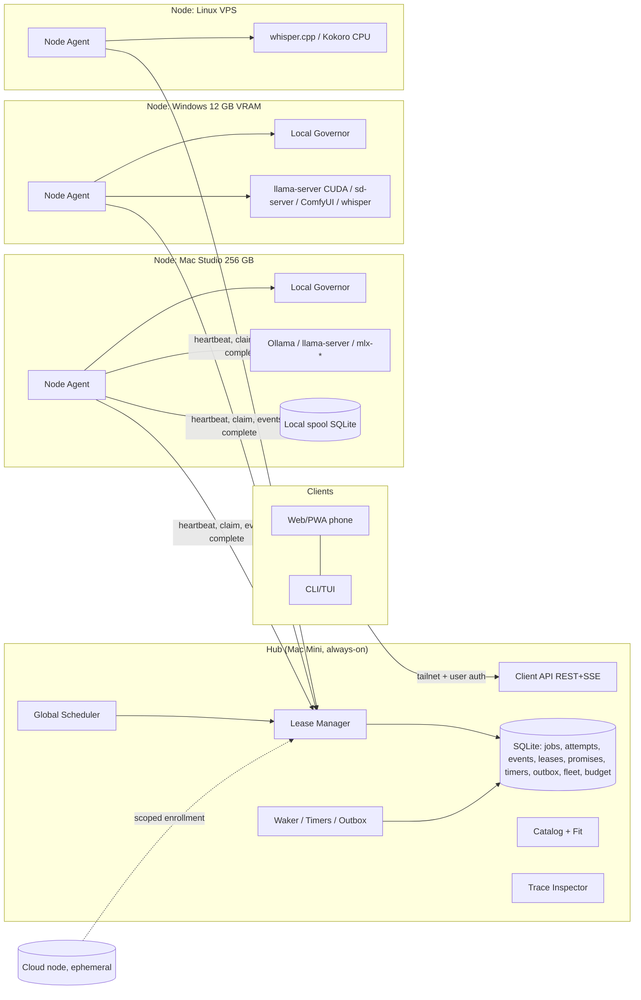
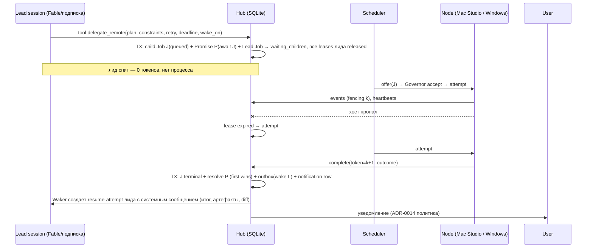

# Lane 3 — Compute Fabric: multi-host inference, модели, планирование ресурсов, durable jobs, observability

**Проект:** Guanxi (бывш. Alamo UI)
**Дата исследования / доступа ко всем источникам:** 2026-10-19
**Статус документа:** `proposed` (исследование и рекомендация; ничего из раздела «Архитектура» не реализовано)
**Область:** требования брифа A4, B1–B5, C4, G1–G6, H6, J1–J2

## Легенда достоверности

- **[V]** — проверено по первичному источнику (GitHub repo/LICENSE/release через GitHub REST API, официальная документация, статья/DOI) 2026-10-19; номер источника в квадратных скобках.
- **[I]** — вывод/инференс автора исследования (инженерное суждение, расчёт или экстраполяция); не выдавать за факт.
- Звёзды, лицензия (SPDX-поле GitHub), дата последнего push и `releases/latest` получены запросом `gh api repos/{owner}/{repo}` и `.../releases/latest` 2026-10-19 [S0]. `NOASSERTION` означает, что GitHub не распознал лицензию автоматически — в таких случаях LICENSE прочитан вручную.

Метод: первичные источники (README/LICENSE/docs/release notes через GitHub API, официальные сайты документации, DOI/arXiv). Для чтения кода сделаны shallow clone `openworkflowdev/openworkflow` и `earendil-works/absurd` в `scratchpad/clones/` (только чтение, скрипты не запускались). Часть фактчекинга выполнена параллельными исследовательскими подагентами по тем же правилам; спорные или неожиданные утверждения (DeepSeek Harness, перенос OTel GenAI semconv, удаление image generation из Ollama, MLX-default в Ollama, новый порт llama-server) перепроверены повторно напрямую.

---

## 0. TL;DR — рекомендации

1. **Не встраивать чужой кластер-менеджер как «node agent».** Ни один из кандидатов не покрывает парк владельца (3× Apple Silicon + Windows/NVIDIA 12 GB + Linux VPS): GPUStack с v2.0 — **только Linux-воркеры** [V 24]; LocalAI distributed требует PostgreSQL + NATS и не имеет нативного Windows [V 22]; Xinference — тяжёлый Python supervisor/worker без auth по умолчанию [V 25]; exo — по сути Apple-only и без документированной auth [V 23]. Писать **тонкий собственный node agent на TypeScript** (тот же бинарь Guanxi в роли `node`), который управляет нативными runtime через адаптеры. [I]
2. **Runtime-адаптеры по уровням:** Tier 1 — Ollama (уже есть; MLX по умолчанию на Apple Silicon с v0.40.0 [V 5]), `llama-server` в router mode (load/unload/download API, `/metrics`) [V 8], whisper.cpp server (STT), stable-diffusion.cpp `sd-server` (image + video: Wan/LTX/Hunyuan) [V 27], mlx-audio / Kokoro-FastAPI (TTS). Tier 2 — ComfyUI (GPL-3.0, только как отдельный процесс по HTTP/WS) [V 26], mlx-vlm, LM Studio (только через опубликованные интерфейсы — app проприетарный) [V 21], exo (пул Mac через TB5 RDMA), Xinference (опционально). Tier 3 — vLLM/SGLang только на Linux CUDA / WSL2 / арендованных GPU [V 17, 20]. `llama-swap` (MIT, Go, macOS/Windows/Linux) — рекомендуемый **опциональный process supervisor** для движков без собственного multi-model управления; Guanxi генерирует его YAML из своей политики, а admission остаётся за Resource Governor [V 12][I].
3. **Каталог и fit:** Hugging Face Hub как основной каталог (`pipeline_tag`, `filter=gguf|mlx`, `apps=`, `expand[]=gguf,safetensors`), `@huggingface/gguf` (MIT, TS, range-чтение заголовков) для метаданных без скачивания [V 35–41]; реестр Ollama — только через **недокументированный** manifest endpoint с пометкой unofficial [V 43]; ModelScope — зеркало; models.dev (MIT) — облачные цены/лимиты [V 46]. Fit — лестница доверия L0–L4 (unknown → heuristic → GGUF-metadata → runtime-estimate на целевом хосте через `llama-fit-params` → observed), совместимая с ADR-0012 [I].
4. **Fleet-планировщик — свой, лёгкий, но корректный:** один hub (single writer SQLite, без consensus), двухуровневое планирование (hub делает placement, node-local Governor делает окончательный admission — модель Mesos/Omega, filter+score как в Borg) [V 96–98][I]. Nomad (BUSL-1.1, IBM), Ray, Slurm, k3s, SkyPilot SSH pools, dstack SSH fleets **не планируют Apple Metal** и/или требуют Linux [V 61–68]. Облачная аренда — опциональный адаптер (SkyPilot как провижнер или прямые API RunPod v2 / Vast / Modal) + собственный budget ledger; **ни SkyPilot, ни dstack не дают жёсткого лимита общей суммы** [V 67, 68].
5. **Корректность = leases + fencing tokens + heartbeats:** владение любым ресурсом (attempt, accelerator, порт, контейнер, БД, worktree, облачный инстанс) меняется только транзакцией hub; каждая мутация от держателя несёт монотонный fencing token (Chubby sequencers, Kleppmann) [V 91, 92]; локальный дедлайн держателя считается по своему monotonic clock от момента отправки renew (Gray & Cheriton) [V 90]; после рестарта hub — grace period (Chubby: 45 s по умолчанию) [V 91]; failure detector (φ-accrual) влияет только на UI/скоринг, но **не передаёт владение** — это делает только истечение lease [I].
6. **Durable execution — оставить собственный SQLite event store** и добавить 5 примитивов: `job_attempts`, `leases`, `promises` (+waiters), `timers`, `outbox`. Внешние движки не подходят для embedded single-binary multi-node: Temporal — SQLite только dev/test [V 103]; Restate — BSL 1.1 [V 104]; Inngest — SSPL (+Apache через 3 года), SQLite только single-node [V 106]; DBOS TS — только Postgres (SQLite PR открыт) [V 105]; Hatchet/absurd/pg-boss/graphile — Postgres; Trigger.dev — тяжёлый self-host без checkpoints [V 107–109, 113]. Семантику заимствовать: таймауты Temporal (schedule-to-start / start-to-close / heartbeat / schedule-to-close) [V 103], события «first emit wins» из Absurd [V 109], `availableAt`-lease из OpenWorkflow [V 110], awakeables/durable promises (Restate, Resonate) [V 104, 111].
7. **Гибернация лида (C4)** = Job в состоянии `waiting_children` без leases + durable promise на terminal-событие ребёнка; terminal-переход ребёнка в одной транзакции резолвит promise и пишет outbox-строку «wake» (тот же паттерн, что ADR-0014 для notifications) [I на базе V R5].
8. **Observability «уровня DeepSeek Harness»:** DeepSeek Harness — реальный официальный проект (`deepseek-ai/deepseek-harness`, MIT, TS, ~254k★, создан 2026-08-13, developer preview, построен на Cordis) [V 121]; его трассировка — это **собственный lossless append-only лог сессии + Session Inspector + Session Query (lineage, FTS5) + token meter**, а OTel там только транспорт продуктовой телеметрии [V 121]. Guanxi должен сделать то же: event store — источник истины, OTel GenAI — опциональная проекция. OTel GenAI semconv всё ещё `Development` и в v1.42.0 **перенесены в отдельный репозиторий без релизов** — пиновать версию [V 115]. Опциональный viewer: otel-desktop-viewer (Apache-2.0, single binary, DuckDB) или Jaeger v2 (Apache-2.0, есть GenAI-view); Phoenix (ELv2) и MLflow (SQLite) — opt-in; Langfuse/Opik/Laminar требуют ClickHouse-стек — только как внешние OTLP-цели [V 116–119].

---

## 1. Исходная точка: что уже есть в Guanxi и что это значит для fleet

| Факт (текущий код/доки) | Источник | Следствие для multi-host |
| --- | --- | --- |
| Один **process-local** Resource Governor, один accelerator permit, FIFO, leases transient (без journal); не защищает внешние Ollama clients и другие процессы | [V R1, R2] | Governor становится **per-node** и остаётся окончательным admission authority на своём хосте; глобальная очередь — новый уровень над ним [I] |
| ADR-0002 инвариант: «remote runtime использует remote hardware profile» | [V R2] | Все факты о памяти/устройствах должны приходить от node agent целевого хоста с provenance, а не вычисляться на клиенте [I] |
| Durable Job + replayable events в SQLite: idempotent create, monotonic sequence, terminal state+event в одной транзакции, persisted-first subscription, startup reconciliation → `interrupted` | [V R1, R3] | Это уже 70% durable-execution движка. Не хватает attempts на других хостах, leases с fencing, durable timers/promises, outbox [I] |
| ADR-0004: «retry создаёт новый attempt», «unsafe mutating action не replay-ится автоматически» | [V R3] | Прямо совпадает с моделью attempt+fencing; нужно формализовать `job_attempts` [I] |
| ADR-0012: verdict `disabled / estimated_allow / estimated_deny / unknown`, каждый numeric fact с source/time/confidence; Apple free pages не являются capacity | [V R4] | Лестница fit L0–L4 и remote telemetry обязаны сохранить эту дисциплину [I] |
| ADR-0014: terminal-переход Job атомарно создаёт notification row; at-most-once delivery claim | [V R5] | Тот же transactional-outbox паттерн подходит для wake-up лида [I] |
| ADR-0013: Phase 4 — один user-level service, authenticated loopback API, remote bind не входит | [V R6] | Fleet требует отдельного remote security profile (уже записано в ROADMAP как условие) [V R1][I] |
| Model pull / HF download — connection-owned, не durable, не replayable | [V R1] | Для удалённого узла установку модели лучше сделать **node-owned Job** с возобновляемой загрузкой (HTTP Range) — это изменение семантики, требует решения владельца [I] |
| `node:sqlite` — Stability 1.2 «Release candidate» (doc v26.12.0) | [V 88] | Допустимо для hub, но writer стоит держать за одним модулем/воркером и batch-ить события [I] |
| SQLite WAL: «All processes using a database must be on the same host computer; WAL does not work over a network filesystem» | [V 87] | Удалённые воркеры **не могут** делить файл SQLite → любые «DB-as-queue» библиотеки на SQLite работают только в пределах одного хоста; межхостовый протокол обязателен [I] |

---

## 2. Q1 — Inference runtimes и multi-modal serving на гетерогенных хостах

### 2.1 Сводная таблица runtime

Звёзды/лицензия/релиз — [V S0]; функциональность — [V] по указанному источнику.

| Проект | Лицензия | ★ | Последний релиз | ОС / ускорители | Модальности | API управления моделями | Multi-host | Роль в Guanxi |
| --- | --- | --: | --- | --- | --- | --- | --- | --- |
| Ollama | MIT | 183.8k | v0.40.6 (2026-10-16); v0.40.7-rc0 (10-18) | macOS (MLX по умолчанию для поддерж. архитектур с v0.40.0 [V 5]), Windows, Linux (docs windows/linux/macos.mdx) [V 11] | text, vision, embeddings (multimodal embed с v0.40.4 [V 34]); **image generation удалён в v0.32.6 (2026-08-04)** «temporarily removed» [V 4] | `/api/pull`, `/api/delete`, `/api/ps` (`size_vram`, `expires_at`, `context_length`), `/api/tags`, `/api/show`, `/api/create`; load = пустой generate, unload = `keep_alive:0`; OpenAI `/v1/*` + Anthropic `/v1/messages` [V 2, 6]; `OLLAMA_MAX_LOADED_MODELS` (3×GPU), `OLLAMA_NUM_PARALLEL` (1), `OLLAMA_MAX_QUEUE` (512) [V 3]; нет Prometheus `/metrics` [V 2] | только удалённый `OLLAMA_HOST` и cloud models (`OLLAMA_NO_CLOUD=1`) [V 3] | Tier 1 (есть) |
| llama.cpp `llama-server` | MIT | 131.7k | v0.7.0 (2026-10-15) + nightly `bNNNN` ежедневно; **v0.7.0 сменил default port 8080 → 9931** [V 7] | все ОС; CUDA/Metal/Vulkan/CPU | text; image/audio/video input через libmtmd (experimental) [V 10]; embeddings, rerank | **router mode**: `GET /models`, `POST /models/load`, `/models/unload`, `/models/sse`, `POST /models` (фоновая загрузка с HF), `--models-max` (4), `--sleep-idle-seconds`; `/metrics` при `--metrics`; `/slots` save/restore [V 8] | RPC: «proof-of-concept… fragile and insecure. Never run the RPC server on an open network»; v0.7.0 — tensor-parallel RPC [V 9] | Tier 1 |
| llama-swap | MIT | 6.0k | v265 (2026-10-14) | macOS/Linux/Windows (brew, WinGet, binaries, Docker) [V 12] | любой OpenAI/Anthropic-совместимый upstream: llama.cpp, vLLM, sd.cpp, whisper, ComfyUI | `/running`, `POST /api/models/unload[/:id]`, `/metrics` (Prometheus, sys+GPU), `ttl`, `routing.groups` (`swap`/`exclusive`/`persistent`) и «matrix», `hooks.preload`, `apiKeys` [V 12] | `peers` — проксирование на удалённый llama-swap/любой `/v1` [V 12] | Опциональный supervisor на узле |
| MLX / mlx-lm | MIT | 28.8k / 7.4k | v0.32.4 / v0.32.2 | Apple Silicon; также Linux CUDA/CPU wheels | text | `mlx_lm.server`: OpenAI-like `/v1/chat/completions`, `/v1/models`; «not recommended for production»; нет load/unload [V 14] | `mlx.launch`: MPI, ring, **JACCL — RDMA over Thunderbolt 5 с macOS 26.2**, включается `rdma_ctl enable` только из Recovery, нужен full-mesh TB5 [V 13] | Tier 2 (чаще через Ollama-MLX) |
| mlx-vlm | MIT | 5.6k | v0.7.9 (2026-10-19) | Apple Silicon | vision, audio (speech/transcriptions), embeddings, rerank, realtime WS | `/unload`, `/metrics`, `/health`; **одна модель за раз; default host 0.0.0.0** [V 15] | — | Tier 2 (обязательно переопределить bind) |
| mlx-audio | MIT | 8.1k | v0.6.0 (2026-10-19) | Apple Silicon | TTS (вкл. Kokoro), STT | `/v1/audio/speech`, `/v1/audio/transcriptions` [V 16] | — | Tier 1 TTS/STT на Mac |
| vLLM | Apache-2.0 | 94.1k | v0.32.0 (2026-10-18) | «OS: Linux»; Windows только WSL; CUDA cc≥7.5 [V 17]; macOS — community-плагин `vllm-metal` (Apache-2.0, 1.9k★, v0.31.0) [V 19] | text, multimodal | sleep mode `/sleep`, `/wake_up` (нужен `VLLM_SERVER_DEV_MODE=1`, «should not be exposed to users») [V 18]; `/metrics` | TP/PP multi-node [I] | Tier 3 (WSL2 / облако) |
| SGLang | Apache-2.0 | 37.4k | v0.5.22 (2026-10-19) | NVIDIA, AMD, TPU, Intel, Apple (`SGLANG_USE_MLX=1`) [V 20] | text, diffusion | `/release_memory_occupation`, `/resume_memory_occupation`, `--enable-metrics` [V 20] | [I] | Tier 3 |
| LM Studio (`lms`, llmster) | `lms` MIT; **app проприетарный** («personal and/or internal business purposes», интеграция только через опубликованные интерфейсы) [V 21] | 5.4k | — | macOS/Windows/Linux | text/vision/embeddings (llama.cpp + MLX) | REST v1: `/api/v1/models/load`, `/unload`, `/download`, `/download/status`; OpenAI `/v1/*`, Anthropic `/v1/messages`; headless daemon `lms daemon up` [V 21] | «LM Link» в партнёрстве с Tailscale [V 21] | Tier 2 adapter, если установлен пользователем |
| LocalAI | MIT | 49.7k | v4.11.0 (2026-10-02) | darwin-arm64, linux; **нет нативного Windows** [V 22] | все (LLM, vision, voice, image, video), 60+ OCI-backend образов | gallery; auth deny-by-default с v4.9 [V 22] | distributed: **PostgreSQL + NATS**, пустой registration token «fails open»; P2P — experimental, sharding только llama.cpp RPC [V 22] | Не как node agent |
| exo | Apache-2.0 | 48.0k | v1.0.71 (2026-04-23); коммиты до 2026-10-13 | macOS 26.2+ (app), Linux — только CPU [V 23] | text | placement API `/instance/previews`, `POST /instance`, `/state`; OpenAI/Claude/Ollama-совместимые [V 23] | auto-discovery, tensor parallel, RDMA TB5 [V 23]; auth не документирована [I] | Опционально: пул Mac Studio + Mac Mini для моделей > 256 GB |
| GPUStack | Apache-2.0 (+ коммерческий Enterprise) | 5.9k | v2.2.3 (2026-07-31); v2.3.0rc3 | **v2.0.0: «Dropped desktop (macOS/Windows) support – now Linux-only»**; воркеры — privileged контейнеры с docker.sock [V 24] | LLM, image/video/TTS (vLLM-Omni), STT (VoxBox) | полный management API, OpenAI `/v1` [V 24] | да: filter→score scheduler, gguf-parser для оценки памяти [V 24] | Отклонить как node agent; использовать как reference scheduler |
| Xinference | Apache-2.0 (+ Enterprise) | 9.6k | v4.0.1 (2026-10-16) | macOS (MLX), Windows (pip), Linux [V 25] | LLM, embedding, rerank, image, audio, video | REST launch/terminate, OpenAI-совместимые, `/anthropic` [V 25] | supervisor/worker; **actor-порты без auth, пока не задан `XOSCAR_AUTH_KEY`** [V 25] | Опциональный адаптер |
| ComfyUI | **GPL-3.0** | 139.5k | v0.42.1 (2026-10-19) | все; CUDA/MPS | image/video/audio workflows | `POST /prompt`, `/ws`, `/history`, `/view`, `/queue`, `/object_info`, `/interrupt`, `/free`, `/system_stats`, `/api/jobs[/{id}/cancel]`; bind 127.0.0.1:8188 [V 26] | multi-GPU узлы (CFG split) [V 26] | Tier 2, только отдельный процесс |
| stable-diffusion.cpp `sd-server` | MIT | 7.7k | `master-975-95b3090` (2026-10-18) | CPU/CUDA/Vulkan/Metal/OpenCL/SYCL; Linux/macOS/Windows | image: SD1–3.5, SDXL, FLUX.1/2, Qwen-Image, Z-Image; **video: Wan2.1/2.2, LTX, HunyuanVideo 1.5** | 127.0.0.1:1234; `/sdcpp/v1`, `/v1`, `/sdapi/v1` [V 27] | — | Tier 1 image/video (лёгкий) |
| whisper.cpp `whisper-server` | MIT | 54.5k | v1.9.5 (2026-10-06) | все | STT (+VAD, `--diarize` stereo) | `POST /inference`, `POST /load` (горячая смена модели), `--inference-path` [V 28] | — | Tier 1 STT |
| faster-whisper | MIT | 26.0k | v1.2.1 (2025-10-31) | CUDA 12 + cuDNN 9, CPU int8 | STT (библиотека, без сервера) [V 29] | — | — | Batch STT worker (G6) |
| WhisperX | BSD-2 | 24.7k | v3.8.6 (2026-05-25) | CUDA/CPU | STT + diarization (pyannote, gated HF-модель) [V 30] | — | — | Batch STT с диаризацией на Windows GPU |
| Speaches | MIT | 3.7k | v0.9.0-rc.3 (2025-12-27); последний коммит 2026-04-18 | — | OpenAI-совм. STT/TTS, realtime [V 31] | dynamic load/TTL | — | Низкая поддержка → не в ядро |
| Kokoro (82M) | Apache-2.0 (веса) | 9.5k | — (push 2025-08) | — | TTS [V 32] | — | — | Через mlx-audio / Kokoro-FastAPI; espeak-ng (GPL) — проверить при бандлинге [I] |
| Kokoro-FastAPI | Apache-2.0 | 5.6k | v0.9.0 (2026-09-10) | CPU/CUDA, MPS нативно | TTS | OpenAI `/v1/audio/speech` :8880 [V 33] | — | Tier 1 TTS на Windows/VPS |

Также под наблюдением (не оценивались глубоко): Docker Model Runner (Apache-2.0, 658★, v1.2.8), RamaLama (MIT, 3.1k★, v0.25.0), Lemonade (Apache-2.0, 5.9k★), Microsoft Foundry Local (NOASSERTION, v2.1.0), vllm-mlx (Apache-2.0, 1.6k★) [V S0].

### 2.2 Ключевые наблюдения

- **API-дрейф высокий.** За 2026 год: Ollama добавил и затем удалил image generation (v0.14 → v0.32.6) [V 4]; Ollama перешёл на MLX по умолчанию и, по release notes, на `llama-server` для GGUF (`LLAMA_ARG_FIT_TARGET` в `llm/llama_server.go`) [V 5, 44]; llama-server сменил порт по умолчанию на 9931 [V 7]. Следствие: адаптер должен опираться на **probe + capability manifest** (ADR-0003), а не на версии/порты по умолчанию [I].
- **Безопасность по умолчанию неоднородна:** mlx-vlm слушает 0.0.0.0 [V 15]; llama.cpp RPC «never on open network» [V 9]; vLLM dev-endpoints «should not be exposed» [V 18]; Xinference actor-порты без ключа [V 25]; LocalAI registration token «fails open» [V 22]. Правило: **все runtime — только loopback на своём хосте, доступ только через node agent** [I].
- **Распределение одной модели между хостами реально только на Apple TB5** (MLX JACCL / exo, macOS 26.2+, RDMA включается из Recovery) [V 13, 23]. Для Windows+Mac комбинаций — только llama.cpp RPC (небезопасный PoC) [V 9]. Для персонального парка правильнее **размещать модель целиком на подходящем хосте** (Mac Studio 256 GB), а не шардировать [I].
- **Video generation локально** на этом парке реально через sd.cpp (Wan2.x/LTX/Hunyuan 1.5) [V 27] или ComfyUI на Windows CUDA 12 GB с квантованными весами [I]; тяжёлое — арендованные GPU [I].

### 2.3 Можно ли взять готовый «node agent»?

| Кандидат | Покрывает парк (3× Mac + Win 12 GB + Linux VPS)? | Плюсы | Минусы | Вердикт |
| --- | --- | --- | --- | --- |
| GPUStack worker | **Нет** — Linux-only privileged Docker [V 24] | настоящий scheduler, gguf-parser, multi-modal бэкенды | исключает все Mac; Windows только через WSL; свой control plane/auth/UI конкурирует с Guanxi | Отклонить; читать как reference |
| Xinference worker | Частично [V 25] | шире всех по модальностям; REST launch/terminate | supervisor-центричная actor-модель; без auth по умолчанию; тяжёлый Python | Опциональный runtime-адаптер, не agent |
| LocalAI | Частично (Windows только Docker/WSL) [V 22] | один Go core, все модальности, auth по умолчанию | distributed требует PostgreSQL + NATS; P2P experimental; огромная пересекающаяся поверхность (agents/MCP/UI) | Опциональный runtime-адаптер |
| llama-swap | **Да** (нативно на всех ОС) [V 12] | модально-агностичный supervisor + router, TTL/groups, `/running`, unload, `/metrics`, API keys, peers | нет каталога/загрузки моделей, нет инвентаря железа и оценки памяти, нет durable jobs [I] | Встроить как **опциональный supervisor** под управлением Guanxi |
| llama.cpp router | Да, но только GGUF [V 8] | нативные load/unload/download + SSE | одна семья движков | Tier 1 runtime |
| exo | Apple-only на практике [V 23] | пул Mac через TB5 RDMA | auth не документирована, релизов нет с апреля | Опциональный адаптер |

**Решение [I]:** Guanxi node agent — собственный тонкий TypeScript-процесс (тот же дистрибутив, роль `node`), отвечающий за: enrollment и heartbeat, инвентарь железа с provenance, runtime discovery/probe, установку моделей (node-owned Job), локальный Resource Governor, исполнение attempts (агентные циклы, shell/test, batch), resource leases (порты/контейнеры/БД/worktree), локальный spool событий. Process supervision для «неуправляемых» движков (whisper-server, sd-server, mlx-* servers, Kokoro-FastAPI) — либо встроенный минимальный supervisor, либо `llama-swap`, YAML которого генерируется из политики Guanxi (группы `swap/exclusive` отражают решения Governor, чтобы не было двух планировщиков).

### 2.4 Предлагаемое размещение по парку владельца [I]

| Хост | Роль | Runtime по умолчанию | Типичные задачи |
| --- | --- | --- | --- |
| Mac Mini 32 GB (always-on) | **hub** + node | Ollama (MLX), whisper.cpp, mlx-audio/Kokoro, embeddings | control plane, STT диктовка, TTS, маленькие LLM (≤14B), embeddings/индексация |
| Mac Studio 256 GB | node (heavy) | Ollama (MLX) / llama-server router / mlx-lm, mlx-vlm, sd-server (Metal) | большие LLM (70B–400B квант.), vision, длинные контексты, локальный «думатель», ревью-циклы C7 |
| Windows PC 32 GB + 12 GB VRAM | node (CUDA) | llama-server (CUDA), sd-server/ComfyUI, faster-whisper/WhisperX, Kokoro-FastAPI; vLLM — только WSL2 | image/video gen, batch STT (G6), 7–14B LLM с полным offload |
| Linux VPS | node (CPU) + edge | whisper.cpp (small), Kokoro CPU, embeddings | relay/ingress для телефона, бэкап hub (Litestream target), лёгкие задачи, health-проверки |
| Облако (по запросу) | эфемерный node | vLLM/SGLang | крупные модели/видео в пределах бюджета |

---

## 3. Q2 — Каталог моделей, fit и «лучшая модель под задачу»

### 3.1 Источники каталога

| Источник | Что даёт | Машинный доступ | Ограничения | Статус |
| --- | --- | --- | --- | --- |
| Hugging Face Hub | поиск по `search`, `pipeline_tag`, `filter` (вкл. `gguf`, `mlx`, лицензии), `apps=` (`ollama`, `llama.cpp`, `lmstudio`, `mlx-lm`, `vllm`, `jan`, `drawthings`; неизвестное значение → 400), `num_parameters=min:6B,max:128B`, `inference_provider`, `sort=trending/downloads/likes`, `expand[]` (`gguf`, `safetensors`, `trendingScore`, `gated`, `config`…) [V 35] | `/api/models` (курсор в `Link: rel="next"`); **эндпоинт не входит в официальный OpenAPI**, де-факто контракт — клиентские библиотеки [V 35] | **`library=gguf` игнорируется API** — использовать `filter=gguf` [V 35]; `expand=gguf.total` — это **число параметров, не байты**; байты файлов — `/tree/main?expand=true` [V 35]; rate limit анонимно 500 API-запросов / 5 мин на IP, с токеном больше; 429 + заголовки `RateLimit` [V 40] | основной |
| HF tasks taxonomy | `/api/tasks` (47 задач), `/api/models-tags-by-type` (52 `pipeline_tag`); канон в `@huggingface/tasks` (MIT) [V 36, 38] | JSON | не в OpenAPI | основной словарь модальностей |
| `@huggingface/gguf` | парсинг **удалённых** GGUF-заголовков через HTTP Range (2 MB чанки), CLI [V 41] | npm, MIT | — | для fit L2 без скачивания |
| HF «Hardware compatibility» | панель для GGUF/MLX по сохранённому железу пользователя; формула **не опубликована** [V 37] | — | эвристика неизвестного качества | показывать только ссылкой [I] |
| HF → Ollama | `ollama run hf.co/{user}/{repo}:{quant}` (по умолчанию Q4_K_M если есть) [V 39] | — | — | путь установки GGUF через Ollama |
| Ollama library | — | **нет документированного публичного search API**; `ollama.com/api/search` → 404; `ollama.com/api/tags` документирован только для cloud models; `registry.ollama.ai/v2/library/<m>/manifests/<tag>` работает, но **не документирован** [V 43] | HTML-поиск = scraping | только manifest, пометка `unofficial`, кэш, ожидание поломок |
| ModelScope | `GET modelscope.cn/openapi/v1/models?filter.task=…`; фильтры task/library/model_type/license/deploy; `page_number×page_size ≤ 3000`; **неизвестные enum молча игнорируются** [V 45] | JSON; SDK Apache-2.0 | — | зеркало/каталог для хостов в КНР |
| models.dev (`anomalyco/models.dev`) | 232 провайдера, 9 078 provider-model записей, 4 070 `open_weights`; cost (input/output/reasoning/cache/audio), limits, modalities, tool_call, reasoning [V 46] | `api.json`, `models.json` | MIT; **нет размеров/квантов** → для облака/A2, не для локального fit | рекомендован для API-ключей и цен |
| LiteLLM `model_prices_and_context_window.json` | 4 223 записи, режимы chat/image/embedding/audio/video/rerank/ocr [V 47] | JSON | MIT вне `enterprise/` | альтернатива models.dev |

### 3.2 Оценщики памяти (fit)

| Инструмент | Что делает | Точность | Лицензия |
| --- | --- | --- | --- |
| llama.cpp `--fit` / `llama-fit-params` | включён по умолчанию; `--fit-target` запас 1024 MiB на устройство; печатает подобранные `-c/-ngl/-ot` и разбивку model/context/compute [V 48] | наивысшая: работает с **реальной свободной памятью целевого устройства**; нужен бинарь и GGUF на хосте [I] | MIT |
| Ollama | с v0.40.x делегирует fitting в llama.cpp (`LLAMA_ARG_FIT_TARGET`), обработка mmproj — «stopgap» [V 44] | runtime-only, нет pre-download API [I] | MIT |
| gguf-parser-go | оценка RAM/VRAM по слоям offload, ctx, batch, flash-attn, mmap, tensor-split/RPC, MLA, SWA, mmproj, SD.cpp моделей; читает удалённые файлы (HF, ModelScope, Ollama registry) [V 49] | метаданные + формулы; «~100 MiB» отклонение — заявление авторов; дефолты могут отставать от llama.cpp (flash-attn теперь `auto`) [I] | MIT, v0.26.4 |
| llmfit | каталог с HF, вшитый в бинарь; память = params × лестница квантов; вердикт по утилизации (≤60% Perfect, ≤85% Good, ≤98% Marginal); скорость = bandwidth/size×0.55; **метки `measured_local / measured_community / calibrated / estimated / unsupported`** [V 50] | эвристика; полезна схема меток доверия | MIT, 38.1k★ |
| Общая формула | weights ≈ байты тензоров GGUF; KV = 2 × n_layers × n_kv_heads × head_dim × ctx × bytes(kv_type) + compute buffers + overhead [I] | неверна для MLA, SWA, hybrid/linear attention, MoE expert offload (поэтому gguf-parser их special-case-ит) [V 49] | — |
| Apple Metal | `MTLDevice.recommendedMaxWorkingSetSize` — «approximation of how much memory… this GPU device can allocate without affecting its runtime performance»; `currentAllocatedSize` — только текущего процесса [V 79] | официальный бюджет GPU на unified memory | — |

### 3.3 Предлагаемая модель fit (совместима с ADR-0012) [I]

Вердикт на пару (host, model, assumptions{ctx, kv_type, flash_attn, mmproj, parallel}): `fits_gpu | fits_partial_offload | fits_cpu_only | too_tight | unknown`.

| Уровень | Основание | Confidence | Может дать allow? |
| --- | --- | --- | --- |
| L0 | нет данных о размере | `unknown` | нет |
| L1 | params × bits/weight (`gguf.total`/`safetensors`) + общая KV-формула | `heuristic/low` | нет (только deny по нижней границе) |
| L2 | разобранный GGUF-заголовок (`@huggingface/gguf`): точные байты тензоров, геометрия KV, флаги SWA/MLA + запас по backend | `estimated/medium` | нет без политики запаса владельца (ADR-0012 уже это фиксирует) |
| L3 | `llama-fit-params` или gguf-parser **на целевом хосте** против его текущей свободной памяти; на Mac бюджет — `recommendedMaxWorkingSetSize`, а не total RAM | `estimated/high` + `observedAt` | да, при утверждённой политике запаса |
| L4 | после загрузки: `/api/ps` `size_vram`, разбивка памяти llama.cpp; ключ = model digest + runtime version + ctx + hardware fingerprint (уже есть exact calibration P1-L) | `observed` (историческое) | да для повторов того же ключа; инвалидация при смене версии runtime |

Немодальные GGUF (diffusers, ASR, TTS) обычно достигают только L1 по dtype-счётчикам safetensors, кроме sd.cpp-GGUF (gguf-parser) [V 49][I].

### 3.4 Сигналы «лучшая модель для задачи»

| Источник | Доступ | Лицензия/условия | Статус / использование |
| --- | --- | --- | --- |
| Arena (бывш. LMArena; `lmarena.ai` → 301 `arena.ai`) | официальный HF dataset `lmarena-ai/leaderboard-dataset` (обновлён 2026-10-19): text, vision, search, document, webdev, text_to_image, image_edit, text_to_video, image_to_video, video_edit, agent (+ style control); score, CI, rank, license [V 51] | **CC-BY-4.0** (атрибуция) [V 51]; код ранжирования `arena-rank` Apache-2.0 | интегрировать первым |
| Artificial Analysis | API v2 с `x-api-key`; free tier 1 000 req/day: LLM, text-to-image, image-edit, TTS, text-to-video, image-to-video; **STT нет** [V 52] | **атрибуция обязательна** на free tier | только с ключом пользователя и видимой атрибуцией |
| HF Open LLM Leaderboard | **retired 2025-03-13** (pinned discussion #1135) [V 53] | — | не использовать как live-сигнал |
| OpenRouter | `/api/v1/models` (modalities, pricing, context, `hugging_face_id`, supported_parameters, `benchmarks`); usage rankings через Datasets API с ключом, 30/min, 500/day [V 54] | Datasets **CC BY 4.0** [V 54] | для облачных моделей и популярности |
| Aider polyglot | YAML в репо; **последнее изменение 2025-10-04** [V 55] | Apache-2.0 | помечать stale |
| SWE-bench | `leaderboards.json` (Verified/Lite/Multimodal/Multilingual) [V 56] | сайт **CC BY-NC 4.0**, harness MIT [V 56] | только ссылка/отображение с атрибуцией; NC — проверить для форков [I] |
| Open ASR Leaderboard | dataset `hf-audio/open-asr-leaderboard-results` (обновлён 2026-10-19) [V 57] | лицензия данных **не заявлена** [V 57] | только ссылка |
| MTEB | `mteb/results`, `embeddings-benchmark/results` [V 58] | результаты **CC0** [V 58] | для embeddings |
| TTS Arena V2 | публичного датасета не найдено [I] | неясно | ссылка |

Научная оговорка: Chatbot Arena (arXiv 2403.04132) [V 59] и «The Leaderboard Illusion» (arXiv 2504.20879, систематические искажения рейтингов) [V 60] → UI показывает сигналы как «community signal: источник, дата, CI», **не автоматический выбор**; финальная рекомендация учитывает локальные измерения (скорость/качество на своих задачах — K5 бенчмарки) [I].

---

## 4. Q3 — Планирование ресурсов по парку, метрики, аренда, leases для worktree, удалённые тесты

### 4.1 Кластерные менеджеры

| Вариант | Лицензия | Mac как узел с Metal | Windows узел | Вес | Вердикт |
| --- | --- | --- | --- | --- | --- |
| Nomad | **BUSL-1.1**, licensor теперь IBM; версии ≥1.7.0, конверсия в MPL-2.0 через 4 года; внутреннее использование разрешено [V 61] | бинарь работает на macOS (`raw_exec`, без изоляции, выключен по умолчанию); **device plugin только NVIDIA (Linux + Docker)**, Apple/AMD нет [V 61] | да | один бинарь | Не брать в ядро (non-OSI, нет Apple GPU); полезен как reference |
| Ray | Apache-2.0 | Apple Silicon поддержан, но «Multi-node clusters are untested»; ресурсы только логические, без CPU-изоляции [V 62] | «Beta» [V 62] | Python + GCS head | Нет |
| Slurm | GPL-2.0 (+ OpenSSL exception) [V 63] | «has run on macOS in the past, but does not currently» [V 63] | нет | HPC | Нет |
| k3s / Kubernetes | Apache-2.0 | Mac — только Linux VM без Metal: Docker Desktop `--gpus` только Windows/WSL2; Podman/krunkit — Vulkan via Venus в госте, не Metal; Apple `container` — GPU passthrough issue открыт [V 66] | **k3s не поддерживает Windows** [V 64] | тяжело для 5 узлов | Нет (максимум позже — только Linux GPU) |
| SkyPilot | Apache-2.0, v0.14.0 | SSH Node Pools — «Debian-based OS», ставит k3s на хосты [V 67] | нет | Python API server (локально авто) | **Опциональный облачный провижнер** (25+ облаков вкл. RunPod, Vast, Lambda; managed spot jobs с восстановлением) [V 67] |
| dstack | MPL-2.0, 0.22.4 | SSH fleets — «must be Linux-based» + Docker [V 68] | нет | Python server | Альтернативный провижнер; `max_price`, `max_duration`, `idle_duration`, `utilization_policy` [V 68] |

**Вывод [I]:** ни один оркестратор не планирует Apple GPU; на Mac Studio Ollama/MLX должны работать нативно вне контейнеров. Значит, fleet-scheduler Guanxi — собственный, но маленький и опирающийся на проверенные идеи: Borg (feasibility filter + scoring) [V 96], Omega/Mesos (разделение глобального решения и локального admission) [V 97, 98], DRF для справедливости между аккаунтами/проектами (E1) [V 99].

### 4.2 Поминутная аренда GPU

| Провайдер | Биллинг | API | Жёсткие лимиты трат |
| --- | --- | --- | --- |
| Modal | посекундно; T4 $0.000164/s, H100 $0.001097/s; Starter $30/мес кредитов [V 69] | Functions только Python; JS/TS SDK (npm `modal`, beta) — Sandboxes, вызов Functions, Images, Secrets, Volumes [V 69] | workspace budget — «hard outer cap», spend limit останавливает workloads [V 69] |
| RunPod | pods «billed by the second» (+storage); serverless посекундно [V 70] | **REST v1 retire 2026-11-15**, GraphQL — «early 2027»; новые интеграции сразу на REST v2 [V 70] | default limit $80/час на все ресурсы; при нулевом балансе pods останавливаются, без network volume — данные теряются [V 70] |
| Vast.ai | посекундно [V 71] | REST `console.vast.ai/api/v0`, Bearer, scoped keys; `vast-cli` MIT [V 71] | документированного spend cap не найдено [I] |
| SkyPilot / dstack | цена провайдера | — | `max_hourly_cost` / `max_price` — фильтр цены инстанса, **не общий бюджет**; autostop/autodown; `sky cost-report` experimental [V 67, 68] |

### 4.3 Метрики хостов

| Агент | Лицензия | Платформы | GPU | Вердикт |
| --- | --- | --- | --- | --- |
| node_exporter (+ windows_exporter) | Apache-2.0 (+ MIT) | Darwin для cpu/mem/disk/net; Windows через windows_exporter (`gpu`, `container`, `process` collectors) [V 72] | NVIDIA через отдельные экспортеры | Совместимость/экспорт, не основной источник |
| Netdata | агент GPL-3.0+, **UI — NCUL1, closed-source** [V 73] | Linux/macOS/FreeBSD/Windows | да | Не бандлить |
| Glances | LGPL-3.0-only; REST `/api/4` + JWT; MCP-сервер [V 74] | кросс-платформа (Python) | NVIDIA/AMD/Intel/ARM на Linux; **Apple GPU нет** [V 74] | Нет |
| Beszel | MIT, v0.21.0, 26.3k★ | hub (PocketBase) + агенты (Windows через Scoop/WinGet, NSSM) [V 75] | NVIDIA (nvidia-smi/NVML), AMD, Intel, Jetson; **Apple Silicon — experimental через `macmon`** (без root) или `powermetrics` (sudo) [V 75] | Если у владельца уже стоит — импортировать как внешний источник; API «may change in minor releases» [V 75] |
| OTel hostmetrics receiver | Apache-2.0, beta | cpu/disk/load/fs/memory/network — все ОС [V 76] | **GPU-скрейпера нет** [V 76] | Схема имён для экспорта |
| DCGM exporter / nvidia_gpu_exporter | Apache-2.0 / MIT | DCGM — Linux, datacenter-GPU; nvidia_gpu_exporter — Linux/Windows/macOS, GeForce/RTX [V 77] | NVIDIA | Для Windows RTX — nvidia-smi/NVML напрямую или этот экспортер |
| macmon | MIT, v0.10.0 (2026-10-14) | Apple Silicon, sudoless через приватный API (IOReport); `pipe` JSON, `serve` Prometheus [V 78] | GPU/ANE power, temp, RAM | **macOS 27 сломал rootless CPU/ANE power** (нужен приватный entitlement); нули могут означать «недоступно» → confidence low [V 78] |
| systeminformation (npm) | MIT, 3.1k★, v6.0.0-beta | Node.js кросс-платформа [V S0] | частично | кандидат для CPU/RAM/disk/net/Docker в node agent [I] |

**Рекомендация [I]:** node agent собирает метрики сам (Node `os` + per-OS адаптеры: Darwin `vm_stat` (уже есть, P1-H) + Metal `recommendedMaxWorkingSetSize` + опционально `macmon pipe`; Windows/Linux — `nvidia-smi --query-gpu … --format=csv` или NVML; Docker Engine API через сокет; список listening-портов; активные сборки/тесты из своих leases). Каждое значение — с `source/observedAt/confidence`. Экспорт наружу — OTel metrics с именами hostmetrics. Beszel/node_exporter — только как опциональные внешние источники. Kubernetes (если появится) — read-only через Kubernetes API по kubeconfig как ещё один внешний источник с provenance [I].

### 4.4 Удалённое выполнение тестов/сборок (B5)

| Вариант | Лицензия / статус | Подходит? |
| --- | --- | --- |
| Plain SSH / агент Guanxi + git worktree/bundle + rsync | — | **Да, основной путь** для npm/Vitest/Playwright-проектов [I] |
| devcontainers CLI (`devcontainer up/exec`) | MIT, активен [V 80] | Да, если в репо есть `.devcontainer` |
| `docker context` / `DOCKER_HOST=ssh://` | Docker docs; SSH-пользователь должен иметь доступ к сокету [V 81] | Да, для контейнерных тестов |
| DeepSeek Harness SSH provider | MIT, TS: удалённый «filesystem/process world» через OpenSSH + helper; «lease expiry start remote cleanup»; «never reconnects to replay a possibly executed action» [V 121] | Кандидат на переиспользование для agentless-хостов [I] |
| DevPod | MPL-2.0; последний релиз 2025-03-10, push 2025-11-14; issue #1992 «not been maintained for over a year»; есть community fork [V 80] | Нет (фактически не поддерживается) |
| Coder | AGPL-3.0, Terraform-воркспейсы [V 80] | Нет (тяжело, AGPL) |
| Bazel REAPI / BuildBuddy / Buildbarn | REAPI Apache-2.0; **BuildBuddy remote execution в `enterprise/`** (не MIT); Buildbarn Apache-2.0 [V 80] | Только для Bazel/Buck2-проектов |
| Nix remote builders | `builders = ssh://…`, `trusted-users` [V 81] | Для Nix-проектов |

### 4.5 Leases для параллельных worktree (H6)

Референсы: Testcontainers **Ryuk** — reaper удаляет контейнеры/сети/тома по label-фильтрам после потери соединения сессии (session-id label + connection timeout) [V 82]; `dagger/container-use` — изолированные окружения для coding agents (Apache-2.0, 4.1k★, последний релиз 2025-08) [V 83]; у владельца уже есть `agent-dev` с файловыми локами ресурса `heavy` для конкурирующих проверок [V R7].

Модель ресурсов [I]:

| Ресурс | Ключ lease | Выдача | Очистка |
| --- | --- | --- | --- |
| Блок портов | `port-block:<node>:<start>` (диапазон хоста, блок N портов) | проверка bind-пробой при выдаче; env `GX_PORT_BASE` | освобождение по истечению lease |
| Docker | `compose:<node>:gx-<lease>` + labels `org.guanxi.lease`, `org.guanxi.token` | `COMPOSE_PROJECT_NAME=gx-<lease>` | reaper по label, как Ryuk |
| Имя БД | `db:<engine>:gx_<project>_<lease>` | префикс + lease id | drop reaper-ом или список «на ручную чистку» |
| Worktree | `worktree:<node>:<path>` | `git worktree add` | удаление/retain-on-failure с TTL |
| Heavy-check слот | `slot:heavy:<node>` (семафор ёмкостью k) | — | совместимость с локами `agent-dev` (брать тот же lock-файл) [I] |
| Образы | refcount-lease `image-pin:<node>:<digest>` | — | защищает от `prune` во время использования |

### 4.6 Субстрат координации: где хранить leases

| Вариант | Факты | Плюсы | Минусы | Вердикт |
| --- | --- | --- | --- | --- |
| SQLite на hub (single writer) | WAL только на одном хосте [V 87] | уже есть, транзакции вместе с Job/events, нет новых зависимостей | SPOF; удалённые узлы только через RPC | **Выбор по умолчанию** [I] |
| NATS JetStream KV | `Create()` только если ключа нет, `Update(key,val,last)` — CAS по revision; per-key TTL с 2.11, но только на `Create()`/`Purge()`, не на `Update` [V 85] | revision монотонна → годится как fencing token [I] | renew не продлевает TTL → нужен expiry в значении; ещё один сервер; кворум для HA | Не нужен при одном hub [I] |
| rqlite | Raft-SQLite, single binary, HTTP API, MIT [V 86] | HA без своего consensus | Raft требует ≥3 голосующих узлов [V 95]; в личном парке 1–2 always-on хоста | Отложить; путь для HA [I] |
| Litestream | репликация одного writer-а; «your responsibility to ensure you do not have multiple applications replicating concurrently» [V 86] | дешёвый DR для hub (например, на VPS/S3) | не координация, только бэкап | **Использовать для DR hub** [I] |
| LiteFS | последний релиз v0.5.14 (2025-04-22); автор: «moved development resources elsewhere… not abandoned» [V 86] | — | фактически заморожен | Нет |

---

## 5. Q4 — Durable execution для долгих агентных задач

### 5.1 Требования C4 в терминах durable execution [I]

Лид (дорогая модель по подписке) пишет план → ставит задачу локальной модели на другом хосте → **засыпает (0 токенов, без процесса)** → исполнитель работает до 8 ч с ретраями, хост может пропасть → по завершению/провалу/дедлайну лид будится, пользователь получает уведомление. Нужны: durable state machine, attempts с leases, **durable timers**, **durable promises/awaitables**, transactional outbox, idempotent resume. Важно: агентный LLM-цикл **недетерминирован**, поэтому replay кода (как в Temporal/DBOS) требует оборачивать каждый LLM/tool-вызов в step; длинная агентная сессия = тысячи шагов, а у Temporal история ограничена 51 200 событиями / 50 MB (после — terminate, лечится Continue-As-New) [V 103]. У Guanxi уже есть лучшая единица durable state — persisted event log транскрипта (ADR-0004): resume = новый LLM-вызов из сохранённого транскрипта/handoff, а не replay функции [I].

### 5.2 Сравнение движков

| Движок | Лицензия (LICENSE прочитан) | ★ / релиз | Инфраструктура | SQLite | Multi-node на SQLite | TS SDK | Примитив «спать и проснуться» | Вердикт для Guanxi |
| --- | --- | --- | --- | --- | --- | --- | --- | --- |
| Temporal | MIT | 23.8k / v1.32.1 (2026-10-08) | сервер + Cassandra/MySQL/PostgreSQL; для production visibility рекомендован Elasticsearch [V 103] | **«only for development and testing, not production usage»** [V 103] | нет | MIT, v1.24.0 | signals, durable timers, activity heartbeat | Нет (тяжело; SQLite dev-only; лимиты истории) — **заимствовать таймауты** |
| Restate | **BSL 1.1** + Additional Use Grant (запрет «Public Restate Platform Service»), Apache-2.0 через 4 года [V 104] | 4.6k / v1.8.0 (2026-10-14) | «single self-contained binary»; бинарники macOS/Linux, Windows не упомянут [V 104] | своё хранилище | кластер (I) | MIT, v1.17.3 | awakeables, durable promises, durable sleep, suspension [V 104] | Нет как зависимость (non-OSI, Windows); **семантика awakeable — образец** |
| DBOS Transact TS | MIT | 1.4k / v5.3 (2026-10-15) | библиотека на Postgres | **нет**: issue #1226 и PR #1288 (SQLite) открыты на 2026-10-19 [V 105]; Python/Go — SQLite есть | через общий Postgres | да | `recv/send`, events, durable sleep, queues, `forkWorkflow` | Кандидат **на будущее**, если hub перейдёт на Postgres |
| Inngest | **SSPL 1.0** + «Grant of Future License» Apache-2.0 через 3 года [V 106] | 6.0k / v1.46.0 | single binary, SQLite по умолчанию + in-process Redis; Postgres/Redis для prod [V 106] | да | **«does not support scaling beyond a single node»** [V 106] | да | `step.waitForEvent` (I) | Нет (SSPL) |
| Hatchet | MIT | 8.1k / v0.110.5 | **PostgreSQL**, RabbitMQ опционально; `hatchet-lite` — один образ [V 107] | нет | через Postgres | да | durable events/sleep (I) | Нет (Postgres + отдельный engine) |
| Trigger.dev | Apache-2.0 | 16.6k / v4.7.4 | webapp + Postgres + Redis + supervisor-контейнеры; **self-host без checkpoints, warm starts, autoscaling** [V 108] | нет | — | да | waits (I) | Нет |
| Absurd | Apache-2.0 | 2.5k / 0.5.0 (2026-08-04) | один `absurd.sql` на Postgres | нет | через Postgres | да | `awaitEvent`, «first emit wins», claim-timeout lease; **«brief overlapping execution is possible»** (без fencing) [V 109] | Образец простоты; fencing добавить своё |
| OpenWorkflow | Apache-2.0 | 1.3k / 0.11.0 | библиотека; worker-driven, БД = очередь | **да** (SQLite/Postgres) [V 110] | только если все воркеры на одном хосте (SQLite WAL) [V 87][I] | да | signals, durable sleep, `availableAt` как lease [V 110] | Образец схемы; pre-1.0 |
| Resonate | Apache-2.0 | 0.7k / v0.9.8 (2026-06-04) | Rust single binary, **SQLite по умолчанию**, Postgres/MySQL…; спецификация в Lean 4 + TLA+ с trace checker [V 111] | да | сервер — одна точка | да (v0.11.5) | durable promises, `context.rpc` на другом воркере [V 111] | Интересен, но молодой/маленький — следить |
| Vercel Workflow SDK | Apache-2.0 | 2.5k / 5.2.2 | компилятор-плагин (`"use workflow"`), local world для dev, self-host — Postgres world [V 112] | dev-only | нет | да | suspend без compute | Нет (build-time трансформация, Postgres) |
| pg-boss / graphile-worker | MIT | 4.1k / 2.4k | Postgres | нет | — | да | очередь, не DE | Нет |
| BullMQ | MIT | 9.5k | Redis | нет | — | да | очередь | Нет (Redis на Windows/Mac) |
| River | MPL-2.0 | 5.8k | Go; Postgres **и SQLite** driver [V 113] | да | — | нет (Go) | очередь | Reference для SQLite-очереди |

Научная база durable execution: Azure Durable Functions — формальная семантика и доказательство observably exactly-once при compute-storage separation (OOPSLA 2021, doi:10.1145/3485510) [V 100]; Beldi — exactly-once для stateful serverless workflows через лог (OSDI 2020) [V 101]; DBOS — «everything is a table» (PVLDB 15(1), 2022) [V 102]; практический разбор SQLite-движка (Morling, 2025-11-20): одна таблица `execution_log` (строка на шаг, ключ `(flowId, step)`), повтор шага возможен при падении между выполнением и записью → idempotency keys [V 114].

### 5.3 Решение [I]

**Оставить собственный SQLite event store как durable execution core** и расширить его аддитивными миграциями (схема в §7.6). Причины:

1. Embedded single-binary и Windows/macOS/Linux — ни один из «серверных» движков не даёт этого с OSI-лицензией и production-SQLite.
2. Multi-node: удалённые узлы всё равно не могут работать с SQLite-файлом hub напрямую [V 87] → нужен свой RPC-протокол claim/heartbeat/complete; «DB-as-queue» библиотеки (OpenWorkflow/absurd/DBOS) этого не решают без общего Postgres, открытого всем узлам.
3. Агентная работа недетерминирована; Guanxi уже хранит транскрипт как event log — это и есть checkpoint.
4. Путь отступления сохраняется: если когда-нибудь понадобится HA hub / multi-writer — порт `JobStore` на Postgres + DBOS или absurd (оба — библиотеки, MIT/Apache) [I].

Что заимствовать:

| Идея | Откуда | Как в Guanxi |
| --- | --- | --- |
| Таймауты `schedule_to_start`, `start_to_close`, `heartbeat_timeout`, `schedule_to_close` + retry policy | Temporal [V 103] | поля Job/attempt spec; heartbeat timeout = lease TTL |
| «First renew before side effects» | GitHub Actions runner: «not even start worker if the first renew fail» [V 89] | node не запускает attempt, пока первый renew не подтверждён |
| Claim с lease и продлением при checkpoint | Absurd `claim_task`/`extend_claim` [V 109], OpenWorkflow `availableAt` [V 110] | renew через heartbeat; каждый durable event продлевает lease |
| События «first emit wins» | Absurd [V 109] | `promises`: первый resolve выигрывает, повтор идемпотентен |
| Awakeable / durable promise | Restate [V 104], Resonate [V 111] | `promises` + `promise_waiters` + wake outbox |
| Fencing (sequencer) | Chubby [V 91], Kleppmann [V 92] | токен в каждой мутации attempt |
| Cold resume + parent settlement notice | DeepSeek Harness subagents (local + external executions) [V 121] | resume-attempt лида с системным сообщением о результате ребёнка |

---

## 6. Q5 — Observability и трассировка

### 6.1 Что такое «уровень DeepSeek Harness»

`deepseek-ai/deepseek-harness` — официальный проект DeepSeek: «DeepSeek Harness: Everything is a Plugin», MIT, TypeScript, ~254k★, создан 2026-08-13, тег `dsh-v0.2.1-rc.2` (2026-10-17), npm `@deepseek-ai/dsh`, «developer preview», построен на Cordis (`cordiverse/cordis`, MIT, 9.3k★, v4.0.0-rc.11) [V 121]. Его трассировка [V 121]:

- append-only **session event log** (JSONL + zstd, checksum-кадры, восстановление «рваного» последнего кадра); события `turn/*`, `step/*`, `assistant/attempt|message` (с компактными raw streams), `tool/call|result`, `request/context|header`, `usage`; fork/sub-session с маркерами наследования;
- **Session Inspector**: виртуализированная таблица Raw Log / Chat Group, Turn→Step→event, дельты текста/reasoning/аргументов tool как timed rows, двусторонняя привязка лог↔чат;
- **Session Query**: деревья lineage, связи `replacedBy`/`sourceEventSeqs`, FTS5, экспорт ZIP; инструменты для **агентов** читать свои прошлые сессии (ограничено тем же cwd);
- token meter (replay-based), CDP inspector;
- OTel — только транспорт продуктовой аналитики/фидбэка, **без GenAI spans**.

[I] Значит «DSH-level» = lossless локальный лог до уровня stream-дельт + lineage саб-агентов + поиск + инспектор для людей и агентов. OTel сам по себе этого не даёт.

### 6.2 OpenTelemetry GenAI semantic conventions — статус

- В semconv **v1.42.0 (2026-06-12)** все `gen_ai.*` и `mcp.*` объявлены deprecated в core и **перенесены в `open-telemetry/semantic-conventions-genai`** (457★, Apache-2.0, **релизов/тегов нет**); последний релизный GenAI-контент — core v1.41.1 (2026-05-11) [V 115].
- Всё — **Status: Development** [V 115].
- Операции: `chat`, `generate_content`, `text_completion`, `embeddings`, `retrieval`, `execute_tool`, `create_agent`, `invoke_agent`, **`invoke_workflow`**, **`plan`**, memory-ops [V 115].
- Контент — **opt-in**: `gen_ai.system_instructions`, `gen_ai.input.messages`, `gen_ai.output.messages`; reasoning — part `{type:"reasoning"}`; событие `gen_ai.client.inference.operation.details` [V 115].
- Метрики в новом репо переименованы (`gen_ai.client.inference.usage.*`, `gen_ai.client.inference.duration`, `gen_ai.invoke_agent.duration`…) против v1.41.1 (`gen_ai.client.token.usage`…) — churn [V 115].
- MCP conventions (`mcp.client`/`mcp.server` spans, propagation через `params._meta`) существуют, Development [V 115].
- [I] Пиновать конкретный commit/версию, маппинг держать в одном модуле.

### 6.3 Платформы трассировки

| Инструмент | Лицензия сервера/UI | Хранилище / вес self-host | OTLP | Агентный UI | Вердикт |
| --- | --- | --- | --- | --- | --- |
| Langfuse | MIT, **кроме `ee/` (коммерческая)**; копирайт «ClickHouse, Inc.»; EE: RBAC, retention, audit, masking, SCIM… [V 116] | Web + Worker + **Postgres + ClickHouse + Redis + S3**; ≥4 CPU / 16 GiB; лёгкого режима в v4 не найдено [V 116] | `/api/public/otel` (HTTP, без gRPC) [V 116] | sessions, agent graphs | Только внешний OTLP-таргет |
| Arize Phoenix | **Elastic License 2.0** [V 117] | один процесс, **SQLite по умолчанию**, Postgres опц. [V 117] | :6006 HTTP, :4317 gRPC; авто-конверсия OTel GenAI → OpenInference с 15.10 [V 117] | sessions, CLI для coding agents | Opt-in, ставит пользователь |
| MLflow 3.17.1 | Apache-2.0 | **SQLite по умолчанию**, один `mlflow server` [V 118] | `/v1/traces`; экспорт `gen_ai.*` (3.11+) [V 118] | trace UI, sessions | Opt-in, хорошая лицензия |
| OpenLIT | Apache-2.0 | ClickHouse + app [V 118] | 4317/4318 | agent traces, GPU | Внешний таргет |
| Laminar | Apache-2.0 | Postgres + ClickHouse + Quickwit… [V 118] | да | MCP/CLI | Внешний таргет |
| Opik | Apache-2.0 | MySQL, Redis, ClickHouse, ZooKeeper, MinIO, Java+Python [V 118] | да | traces/threads | Нет (тяжело) |
| AgentOps | MIT | Supabase + ClickHouse + collector; последний релиз 2025-08 [V 118] | через collector | session replay | Нет (стагнация) |
| Logfire | SDK MIT; **платформа закрыта**, self-host только enterprise [V 118] | — | SDK экспортирует в любой OTel | — | Нет |
| W&B Weave | SDK Apache-2.0; trace server в закрытом `wandb/core` [V 118] | — | — | — | Нет |
| Helicone | Apache-2.0 | Supabase + ClickHouse + MinIO, gateway [V 118] | — | — | Нет |

### 6.4 Лёгкие/встраиваемые viewers

| Viewer | Факты | Роль |
| --- | --- | --- |
| otel-desktop-viewer v0.5.0 | Apache-2.0; Go binary/Homebrew/Docker; collector + **DuckDB** + Svelte; in-memory или `--db file`; UI :8000, OTLP 4317/4318; **CLI для агентов** (`query '<SQL>'`, `trace <id> --json`) + «Agent Usage Skill» [V 119] | лучший опциональный sidecar |
| Jaeger v2.22.0 | Apache-2.0; all-in-one (memory/badger); **UI с GenAI-view** (рендер разговоров, message parts, tool spans) [V 119] | опциональный «богатый» viewer |
| otel-tui v0.7.5 | Apache-2.0; терминальный viewer [V 119] | для TUI/CLI-пользователей |
| SigNoz | MIT вне `ee/`; ClickHouse [V 119] | внешний таргет |
| OpenObserve / Grafana Tempo | **AGPL-3.0** [V 119, S0] | только пользовательская установка |

### 6.5 Инструментирование TS/внешних агентов

OTel JS SDK стабилен (v2.12.0), `sdk-node`/OTLP exporters — experimental 0.2xx [V 120]; Vercel AI SDK эмитит GenAI spans `invoke_agent → step → chat → execute_tool` [V 120]; OpenAI Agents SDK JS — trace processors (`addTraceProcessor`) [V 120]; Claude Code — OTLP metrics/logs (`CLAUDE_CODE_ENABLE_TELEMETRY=1`), traces — beta, контент редактирован по умолчанию, SDK-сессии принимают входящий `TRACEPARENT` [V 120]; Codex — `[otel]` в config, выключен по умолчанию [V 120]. [I] Guanxi может принимать OTLP от внешних агентов (Claude Code/Codex) небольшим receiver-ом и класть в тот же event store.

### 6.6 Рекомендация [I]

1. **Источник истины — собственный event store** (расширение `job_events`): append-only события с `session_id/job_id/attempt_id/seq`, `parent_span`/`lineage`, `host_id/node_id`, `kind` (turn, step, llm_request, stream_delta, reasoning_delta, tool_call, tool_result, subagent_spawn, handoff, compaction, approval, lease_event, error), usage/cost с provenance; крупные payload — content-addressed blobs с классом редакции; FTS5; lineage-проекции.
2. **Инспектор в UI Guanxi** (уровня DSH: Raw Log ↔ Chat, дельты, lineage, фильтры, поиск) + read-only query tools/CLI для агентов (K2 self-audit).
3. **OTel GenAI экспорт — производная проекция**, выключена по умолчанию, контент только opt-in, версия semconv запинена; W3C `traceparent` пропагируется на воркеры и во внешние агенты/MCP.
4. **Политический конфликт:** текущий AGENTS.md запрещает логировать reasoning/thinking, а D6/K2 просят «максимально подробную» трассировку. Нужно решение владельца: отдельный класс данных «private reasoning», local-only, opt-in, с retention, никогда не экспортируется.

---

## 7. Рекомендуемая архитектура Compute Fabric (`proposed`)

### 7.1 Принципы [I]

- **P1 Один дистрибутив, роли.** `hub`, `node`, `client` — флаги одного бинаря (B1). Установка «из коробки» = `hub + node` на одном хосте (текущее поведение = fleet из одного узла).
- **P2 Single-writer hub, без consensus.** Raft требует ≥3 голосующих узлов [V 95]; в личном парке 1–2 always-on хоста → consensus дороже пользы. HA = бэкап + ручное продвижение с **hub epoch** (fencing старого hub).
- **P3 Двухуровневое планирование.** Hub — глобальная очередь и placement (Borg filter+score [V 96]); node — окончательный admission (Governor ADR-0002 знает реальную память и внешних клиентов) — как offers/claims в Mesos/Omega [V 97, 98].
- **P4 Pull-воркеры с leases и fencing.** Узлы сами забирают работу (long-poll), NAT-дружелюбно, естественный backpressure (GitHub runner, absurd, OpenWorkflow, task queues Temporal) [V 89, 109, 110, 103].
- **P5 Факты с provenance.** Любые метрики/fit от удалённого узла — `source/observedAt/confidence` (ADR-0012).
- **P6 Runtimes только loopback.** Наружу смотрит только node agent по аутентифицированному fleet-каналу.
- **P7 Лог событий — это трасса.** OTel — проекция.

### 7.2 Топология



Транспорт: WireGuard-mesh Tailscale или self-hosted Headscale (BSD-3, «a single tailnet») [V 84]; **поверх** — собственная аутентификация узлов (enrollment token → ключ узла, подписанные запросы/mTLS, scopes по видам работы). Tailscale Serve добавляет identity-заголовки, но **не для tagged-устройств** [V 42] → для node-to-hub на них не полагаться; для людей с телефона — можно [I].

### 7.3 Компоненты

**Hub:** Fleet Registry (узлы, роли, железо, runtime, модели); Telemetry store (ограниченный ring); Catalog & Fit; Global Scheduler; Lease Manager (+ sweeper); Job/Attempt store (ADR-0004+); Promises/Timers/Outbox/Waker; Budget Ledger; Trace store/Inspector; Notifications (ADR-0014).

**Node agent:** Enrollment/credential; Heartbeat + lease keeper; Telemetry sampler (per-OS адаптеры); Runtime adapters + supervisor (встроенный или llama-swap); Local Resource Governor (per-node permits, ADR-0002); Executor (агентный цикл, shell/test, batch STT) в sandbox; Workspace manager (git mirror, worktrees); Resource-lease enforcer + reaper (порты/Docker/БД); Local spool (SQLite outbox событий на время partition); CAS-кэш артефактов.

### 7.4 Протокол hub ↔ node (HTTP/2, JSON; все мутации идемпотентны) [I]

| Вызов | Тело | Ответ / семантика |
| --- | --- | --- |
| `POST /fleet/v1/nodes/{id}/heartbeat` | `node_epoch`, `seq`, `observedAt` (monotonic+wall), сводка метрик, runtime health, модели, **список удерживаемых leases с токенами** | подтверждение renew (пакетом), команды (cancel/drain/unload/reap), версия desired state, `hub_epoch` |
| `POST /fleet/v1/claim` (long-poll ≤30 s) | capabilities, свободная ёмкость по мнению узла | offer: `job_id`, `attempt_id`, `fencing_token`, `lease_ttl`, spec (секреты — только ссылки) |
| `POST /fleet/v1/offers/{id}/decision` | `accept` / `reject{reason, retry_after}` от локального Governor | accept → attempt `running`; reject → re-placement |
| `POST /fleet/v1/attempts/{id}/events` | `fencing_token`, `from_seq`, `events[]` | идемпотентно по `(attempt_id, seq)`; продлевает lease; `409 stale_lease` при чужом/старом токене |
| `POST /fleet/v1/attempts/{id}/complete` | `fencing_token`, outcome, ссылки на артефакты | одна транзакция: terminal attempt + Job + terminal event + promise resolve + outbox |
| `PUT /fleet/v1/blobs/{sha256}` | артефакт | content-addressed, повтор безопасен |

### 7.5 Планировщик (hub) [I]

```text
триггеры: enqueue | heartbeat | lease expiry | timer | budget change
для job в очереди по (класс приоритета: interactive > background > batch > prewarm,
                     aging по времени ожидания, DRF-доля владельца/проекта):
  candidates = nodes.filter(alive ∧ ¬draining ∧ hard_constraints(job, node))
     hard: модальность/capability, модель установлена или устанавливаема (лицензия принята),
           политика ("только локальные", "без облака"), OS/arch/backend, наличие данных/worktree,
           fit ≥ L3 для обязательного GPU-fit
  если пусто → typed blocker (no_capable_node | model_not_installed | policy | budget) и continue
  score = w1·fit_confidence + w2·(−оценка старта) + w3·(−оценка длительности: tok/s история)
        + w4·affinity (B5-память: "тесты X быстрее на Mac Studio") + w5·(−стоимость $)
        + w6·(−пробуждение спящего хоста)
  offer(best, ttl=15s) → node Governor: accept | reject(reason) → следующий кандидат с backoff
```

- Preemption по умолчанию только для `prewarm`/`pinned`; активные агентные attempts не вытесняются (дорого) [I].
- Pipeline (STT→LLM→TTS) — предпочтение одного узла (data locality) с возможностью split [I].
- Облачный кандидат появляется только при budget reservation (§7.11).

### 7.6 Модель данных (аддитивные миграции SQLite) [I]

```text
fleet_nodes(node_id PK, name, roles, os, arch, hw_profile_json, agent_version,
            credential_ref, enrolled_at, last_heartbeat_at, liveness, node_epoch)
fleet_samples(node_id, observed_at, summary_json)            -- ring, ограниченный retention
fleet_runtimes(node_id, kind, version, health, probed_at, capabilities_json)
fleet_models(node_id, runtime, model_ref, digest, bytes, observed_at)
job_attempts(attempt_id PK, job_id, attempt_no, node_id, lease_id, fencing_token,
             state, started_at, ended_at, outcome, failure_kind)   -- lost|preempted|...
leases(lease_id PK, resource_key, holder_kind, holder_id, token, hub_epoch,
       ttl_ms, granted_at, renewed_at, expires_at, state)           -- active|released|expired|broken
       UNIQUE(resource_key) WHERE state='active'
lease_tokens(resource_key PK, last_token)                            -- монотонный счётчик
promises(promise_id PK, kind, created_by_job, state, result_ref, deadline_at,
         created_at, settled_at)                                     -- pending|resolved|rejected
promise_waiters(promise_id, waiter_job_id, mode)                     -- all|any|first_failure
timers(timer_id PK, fire_at, target_kind, target_id, payload_json, state)
outbox(id PK, kind, payload_json, created_at, claimed_at, delivered_at)
budget_ledger(id PK, account_id, provider, reservation_ref, reserved, spent, state)
```

Миграции только добавляются (инвариант AGENTS.md); существующие `jobs/job_events` расширяются, не переписываются.

### 7.7 Семантика leases (нормативные правила) [I, обоснование V 89–92]

- **L1 Владение меняется только транзакцией hub:** grant (`token := last_token + 1`), renew (тот же token, новый `expires_at` по часам hub), release (идемпотентно), expire (sweeper; строка не удаляется молча).
- **L2 Fencing:** каждая мутация держателя несёт `(hub_epoch, token)`; hub отвергает меньший/неактивный — `409 stale_lease` (Chubby sequencer [V 91], fencing token Kleppmann [V 92]).
- **L3 Локальный дедлайн держателя** = `local_monotonic(отправка последнего успешного renew) + ttl − ε`, где ε покрывает дрейф часов и задержки (≈10% ttl + 1 s); стеночные часы hub на узле не используются (Gray & Cheriton [V 90]).
- **L4 Первый renew до побочных эффектов** (GitHub runner [V 89]); перед необратимым внешним эффектом (git push, публикация, запуск облака) — синхронный свежий renew + idempotency key `(job_id, step_id)`.
- **L5 Потеря lease → self-fencing:** прекратить приём новых шагов, SIGTERM process group, grace, SIGKILL; несинхронизированные события остаются в spool как диагностика, но **не** публикуются как результат.
- **L6 Restart/restore hub:** grace period = `max_ttl + ε` без переназначения истёкших leases (узлы успевают переподтвердить; аналог Chubby grace period 45 s [V 91]); при восстановлении из бэкапа `hub_epoch++`, токены сравниваются как пара `(epoch, counter)` — откат счётчика из старого бэкапа не ломает монотонность.
- **L7 Иерархия:** порт/контейнер/БД/worktree-leases принадлежат attempt/session; истечение родителя каскадно истекает детей; reaper на узле удаляет ресурсы по label (Ryuk [V 82]), кроме явно `retain_on_failure` с собственным TTL.
- **L8 Нагрузка O(nodes):** renew всех leases узла едет пакетом в heartbeat.
- **L9 Прозрачность:** leases видны в UI (держатель, возраст, токен, истечение); ручной «break lease» — admin-действие с аудитом.
- **L10 Детектор отказов (φ-accrual [V 93]) влияет только на liveness-статус и скоринг**; передача владения — только по истечению lease. SWIM [V 94] не нужен при ≤10 узлах и hub-centric heartbeat.

Режимы при partition по классу задачи:

| Режим | Для чего | Поведение |
| --- | --- | --- |
| `strict` (default) | агентные сессии с внешними эффектами | self-fence на локальном дедлайне |
| `detached` | идемпотентные batch (STT 8 ч, тест в изолированном worktree) | длинный TTL (напр. 10 мин) + прогресс-чекпоинты; результат «кандидатный» до проверки токена при восстановлении связи; при переназначении — отбрасывается или сверяется по content hash |

### 7.8 Модель отказов

| Отказ | Обнаружение | Leases | Восстановление | Видимое состояние |
| --- | --- | --- | --- | --- |
| Падение процесса node agent | нет heartbeat; при рестарте node сообщает `node_epoch+1` | attempt-leases истекают по TTL | retry policy → re-placement (resume из транскрипта/handoff/git) | attempt `lost` → Job `queued` (retry) |
| Сон Mac/Windows | предупредительный «going to sleep» heartbeat (power notifications) [I]; затем тишина | как выше; узел при пробуждении сам признаёт истёкшие leases | политика: удерживать power assertion, пока есть активные leases (решение владельца) | `sleeping` / `suspect` |
| Потеря питания хоста | φ-accrual → `unreachable` | истечение TTL | re-placement; детские ресурсы на хосте — reaper при возвращении | `unreachable` |
| Network partition | обе стороны: таймауты | `strict` — self-fence; `detached` — продолжение | после восстановления: сверка токенов, spool → upload или discard | `partitioned` |
| Crash hub | клиенты/узлы теряют API | leases в SQLite сохранены | рестарт → recovery (P1-E) → grace period → sweeper | `hub recovering` |
| Потеря диска hub | — | — | restore из Litestream [V 86]/снимка → `hub_epoch++` | RPO = интервал репликации |
| OOM / падение runtime | node: exit code, `/api/ps`/health | lease attempt цел | Governor помечает fit-калибровку как fail; retry на большем хосте, не на том же | `failed(oom)` / retry |
| Preemption облака | провайдер/heartbeat | истечение | retry на другом узле или облаке | `preempted` |
| Исчерпан бюджет | ledger | облачные leases → drain | остановка инстансов, Job `blocked(budget)` | уведомление |
| Скачок часов | монотонные часы на узле; hub — монотонные для TTL | не влияет (L3) | — | — |
| Дубликат доставки | `(attempt_id, seq)` unique | — | идемпотентный no-op | — |

### 7.9 Гибернация лида и пробуждение (C4)



Дополнения [I]: дедлайн `schedule_to_close` на J → timer резолвит P как `rejected(deadline_exceeded)` и тоже будит лида; несколько детей можно «склеивать» в одно пробуждение (debounce-окно) ради экономии токенов подписки; resume лида — новый attempt с прежним транскриптом (без replay кода), поэтому недетерминизм LLM не мешает.

### 7.10 Удалённые тесты (B5) и worktree-изоляция (H6) [I]

Job kind `exec.test`: `{repo (origin или git bundle от hub), base commit, patch/ветка, команда, env-ссылки, нужные ресурсы, глобы артефактов}`. Узел: git mirror → `git worktree add` → применяет patch → получает leases (порты/compose/БД/heavy-slot) → запускает нативно или в devcontainer → стримит логи как события → загружает JUnit/отчёты в CAS → reaper освобождает ресурсы. Выбор хоста учитывает affinity-память (B5) как **мягкий** скоринг, не как жёсткое правило. Для хостов без Guanxi — agentless SSH (возможен reuse SSH provider из DeepSeek Harness, MIT).

### 7.11 Облачная аренда и бюджет [I]

- Адаптеры провайдеров: RunPod REST **v2** (v1 выключается 2026-11-15) [V 70], Vast REST v0 [V 71], Modal JS SDK sandboxes (beta) [V 69]; либо SkyPilot как внешний Python-провижнер для широкого охвата облаков и spot-recovery [V 67].
- **Budget ledger:** перед запуском — резервирование `price/h × max_duration + storage`; списание по данным биллинга; остановка при исчерпании резерва; месячный лимит владельца и лимит на запуск.
- **Dead-man switch:** облачный узел стартует с `max_lifetime` и `hub_unreachable_shutdown_after`; плюс provider-side caps (Modal budget, RunPod spending limit, SkyPilot autodown) — потому что ни SkyPilot, ни dstack не ограничивают общую сумму [V 67, 68].
- Облачный узел = эфемерная роль `node` с enrollment-токеном, ограниченным одной задачей; lease `cloud-instance:<provider>:<id>`.

### 7.12 Безопасность [I]

Remote exec = RCE по определению, поэтому: отдельный remote security profile (ROADMAP уже требует auth/TLS/allowed roots [V R1]); scopes узлов (какие kinds может claim-ить); секреты только по ссылке и just-in-time; аудит всех remote exec и break-lease; все runtime loopback-only (явно переопределять 0.0.0.0 у mlx-vlm; не включать llama.cpp RPC вне изолированного линка; не выставлять vLLM dev-endpoints; `XOSCAR_AUTH_KEY` для Xinference).

### 7.13 Оценка нагрузки [I]

≤10 узлов × heartbeat 5 s ≈ 2 tx/s; события стрима батчатся по 100–250 ms → ≤10 tx/s на активный attempt; 5 параллельных attempts ≈ 50 tx/s; телеметрия 10 узлов × 1 сводка/15 s ≈ 57.6k строк/сутки. Это далеко от пределов SQLite WAL на SSD; узкое место — синхронный `node:sqlite` в главном потоке → один writer-модуль/worker thread и batch-коммиты.

### 7.14 Поэтапный ввод (согласовано с ROADMAP «multi-host scheduler только после capacity study») [I]

| Фаза | Содержание | Exit gate (assertion, падающий при нарушении) |
| --- | --- | --- |
| F0 | node agent read-only: enrollment, heartbeat, инвентарь, runtime probe, телеметрия с provenance; capacity study | телеметрия каждого узла имеет source/observedAt/confidence; узел без auth отвергается |
| F1 | удалённый inference-вызов (Job на hub, LLM-вызов на узле через его Governor) | Governor узла не обходится; unload невозможен при активном удалённом lease |
| F2 | удалённые attempts с leases/fencing (batch STT G6, `exec.test` B5) | stale token всегда 409; SIGSTOP узла > TTL не даёт двух принятых завершений |
| F3 | promises/timers/outbox, гибернация лида C4 | ровно один wake на promise; дедлайн будит лида; рестарт hub не теряет wake |
| F4 | resource leases для worktree H6 + reaper | два worktree никогда не получают пересекающиеся порты/compose/БД; reaper убирает только свои labels |
| F5 | облачная аренда + budget ledger | запуск невозможен без резерва; dead-man switch гасит инстанс без hub |
| F6 | DR hub (Litestream/снимки) + ручной promote с `hub_epoch` | восстановление из старого бэкапа не переиспользует токены |

Проверка корректности: детерминированная симуляция (инъекция часов/сети), property-тесты инвариантов (≤1 активный lease на ключ; токены строго растут; нет принятой мутации со stale token; ровно один terminal на Job; ровно одно пробуждение на promise), fault injection (`kill -9`, `SIGSTOP` дольше TTL — сценарий GC-паузы Kleppmann [V 92], разрыв сети, скачок часов); опционально маленькая TLA+ модель протокола leases (прецедент — Resonate держит TLA+/Lean спецификацию [V 111]).


### 7.15 Трассировка требований брифа [I]

| Требование | Где закрывается | Фаза |
| --- | --- | --- |
| A4 локальный inference на любом хосте, все модальности | §2 (адаптеры Tier 1–3, размещение §2.4) | F0–F1 |
| B1 один Guanxi на всех машинах | §7.1 P1 (роли одного бинаря) | F0 |
| B2 «главный» state | §7.1 P2 (single-writer hub, DR через Litestream §4.6) | F0, F6 |
| B3 удалённые клиенты | §7.2 (клиенты только к hub; remote security profile §7.12) | F0+ |
| B4 метрики, глобальная очередь, выбор хоста, аренда в бюджете | §4.3, §7.5, §7.11 | F0, F2, F5 |
| B5 тесты/сборки на другом хосте + память предпочтений | §4.4, §7.10 (affinity в скоринге) | F2 |
| C4 гибернация лида и пробуждение | §5, §7.9 | F3 |
| G1 каталоги и поиск по модальности | §3.1 | F0 |
| G6 batch (8 ч MP3 → TXT) | §2.1 (faster-whisper/WhisperX/whisper.cpp), режим `detached` §7.7 | F2 |
| H6 изоляция worktree (порты, Docker, БД) | §4.5, §7.7 L7 | F4 |
| J1 трассировка/телеметрия | §6 | параллельно с F0–F3 |
| J2 стоимость/балансы | §7.11 budget ledger; models.dev/LiteLLM цены §3.1 | F5 |

---

## 8. Лицензии — сводка для NOTICE/THIRD_PARTY [V по LICENSE/SPDX, выводы I]

| Класс | Проекты | Правило для Guanxi |
| --- | --- | --- |
| Permissive (MIT/Apache-2.0/BSD) | Ollama, llama.cpp, llama-swap, MLX/mlx-lm/mlx-vlm/mlx-audio, sd.cpp, whisper.cpp, faster-whisper, WhisperX (BSD-2), Kokoro (веса Apache-2.0), Kokoro-FastAPI, exo, vLLM, SGLang, LocalAI, GPUStack core, Xinference core, gguf-parser-go, `@huggingface/*`, models.dev, Temporal, DBOS, absurd, OpenWorkflow, Resonate, Jaeger, otel-desktop-viewer, otel-tui, MLflow, OpenLIT, Laminar, Opik, macmon, systeminformation, Beszel, Tailscale/Headscale, rqlite, Litestream, DeepSeek Harness, Cordis | можно зависеть/переиспользовать код с атрибуцией |
| Weak copyleft | River, dstack, DevPod, OpenBao (MPL-2.0); Glances (LGPL-3.0) | можно использовать как внешние компоненты; изменения файлов — под MPL |
| Strong copyleft | ComfyUI, Netdata agent (GPL-3.0); Slurm (GPL-2.0); Coder, Tempo, OpenObserve, Obelisk, LittleHorse (AGPL-3.0); espeak-ng (GPL, транзитивно у Kokoro) | только отдельный процесс, установленный пользователем; не бандлить бинарь без исполнения обязательств |
| Source-available / non-OSI | Nomad (BUSL-1.1, IBM), Restate (BSL 1.1), Inngest (SSPL + отложенный Apache), Phoenix (ELv2), Langfuse `ee/`, BuildBuddy `enterprise/`, LM Studio app (проприетарные terms), Netdata UI (NCUL1), Logfire platform, NativeLink (FSL) | не делать зависимостью ядра; допускаются только как opt-in внешние цели |
| Данные | Arena dataset CC-BY-4.0; MTEB CC0; OpenRouter datasets CC BY 4.0; SWE-bench сайт CC BY-NC 4.0; Open ASR — не заявлена; Artificial Analysis — атрибуция по terms; HF — лицензия и gated per-model | показывать источник/лицензию рядом с сигналом; NC/неясные — только ссылкой |

Примечание: на момент записи (2026-10-19, ~20:52) в рабочем дереве Guanxi видны незакоммиченные изменения от другого участника (≈250 файлов, `LICENSE` MIT → Apache-2.0). Эта lane их не делала. Выводы таблицы верны и для MIT, и для Apache-2.0 как лицензии Guanxi: permissive-зависимости совместимы, а GPL/AGPL-инструменты допустимы только как отдельные процессы, установленные пользователем [I].

---

## 9. Риски

1. **Хрупкая телеметрия Apple GPU** — macmon использует приватный API, macOS 27 уже сломал часть счётчиков [V 78]; публичный бюджет есть только у Metal (`recommendedMaxWorkingSetSize`) [V 79]. Fit на Mac без L4-калибровки останется `estimated`.
2. **API-дрейф runtime** (порт 9931, удалённая image generation, переход Ollama на MLX/llama-server) [V 4, 5, 7] — нужен probe-first адаптер и contract-тесты на фикстурах.
3. **Churn OTel GenAI** — переезд в отдельный репо без релизов [V 115].
4. **SPOF hub** — сознательный trade-off; RPO/RTO определяются бэкапом; автоматического failover нет.
5. **Сон/питание домашних машин** против 8-часовых задач — требует power-политики и `detached`-режима.
6. **Безопасность remote exec** и небезопасные дефолты runtime (0.0.0.0, RPC, dev endpoints) [V 9, 15, 18, 25].
7. **Перерасход облака** — нет общего лимита у SkyPilot/dstack; RunPod v1 выключается 2026-11-15 [V 67, 68, 70].
8. **Сложность собственного scheduler** — держать объём узким (≤10 узлов, один hub, без consensus, без gang-scheduling на старте).
9. **Лицензионное загрязнение** при бандлинге GPL/AGPL/ELv2/BSL/SSPL компонентов.
10. **`node:sqlite` всё ещё RC** [V 88].
11. **Конфликт политики reasoning-логов** (AGENTS.md) с D6/K2.

## 10. Открытые вопросы владельцу

1. Какой хост — hub: Mac Mini (приватно, дома) или VPS (always-on, публичный, но трассы с приватным контентом вне дома)?
2. Допустимые RPO/RTO для hub; устраивает ли ручной promote?
3. Сеть: Tailscale SaaS или self-hosted Headscale на VPS?
4. Разрешить ли захват reasoning/thinking в локальные трассы (отдельный класс, opt-in, retention)?
5. Облако: месячный лимит, лимит на запуск, провайдеры (RunPod/Vast/Modal), нужен ли SkyPilot.
6. Может ли Guanxi не давать Mac/Windows засыпать при активных leases; использовать ли Wake-on-LAN?
7. Политика partition по умолчанию (`strict` vs `detached`) для разных классов задач.
8. Принимаем ли превращение установки модели на удалённом узле в durable node-owned Job (меняет текущую семантику «pull — connection-owned»)?
9. Переиспользуем ли код DeepSeek Harness (MIT: session log/inspector, SSH provider, subagent cold resume) — координация с другими lanes; Cordis как plugin engine.
10. Windows: только нативные runtime или допускается WSL2 для vLLM/SGLang?
11. Нужен ли exo-пул Mac Studio + Mac Mini (TB5 RDMA, включение из Recovery) для моделей > 256 GB?

---

## 11. Источники (все — доступ 2026-10-19)

**S0.** GitHub REST API: `GET /repos/{owner}/{repo}` и `/releases/latest` для всех перечисленных репозиториев — https://docs.github.com/rest/repos/repos ; запрос выполнен через `gh api` 2026-10-19.

Guanxi и рабочая станция владельца (локально, read-only; нумерация R):
- R1. `docs/architecture/RUNTIME_LIFECYCLE.md`; `docs/plans/ROADMAP.md`; `docs/architecture/HLD.md`
- R2. `docs/decisions/0002-resource-governor.md`
- R3. `docs/decisions/0004-durable-jobs-and-events.md`
- R4. `docs/decisions/0012-estimated-parallel-admission-verdict.md`
- R5. `docs/decisions/0014-notification-persistence-and-delivery.md`
- R6. `docs/decisions/0013-phase-4-service-control-and-clients.md`
- R7. owner's private workstation notes (not published) (agent-dev, файловые локи ресурса `heavy`)

Inference runtimes:
- [11] Ollama docs (windows.mdx, linux.mdx, macos.mdx) — https://github.com/ollama/ollama/tree/main/docs
- [34] Ollama releases — https://github.com/ollama/ollama/releases
- [2] Ollama OpenAPI — https://github.com/ollama/ollama/blob/main/docs/openapi.yaml ; https://github.com/ollama/ollama/blob/main/docs/api.md
- [3] Ollama FAQ — https://github.com/ollama/ollama/blob/main/docs/faq.mdx ; cloud — https://github.com/ollama/ollama/blob/main/docs/cloud.mdx
- [4] Ollama v0.32.6 release notes — https://github.com/ollama/ollama/releases/tag/v0.32.6
- [5] Ollama v0.40.0 release notes — https://github.com/ollama/ollama/releases/tag/v0.40.0
- [6] Ollama OpenAI/Anthropic compatibility — https://github.com/ollama/ollama/blob/main/docs/api/openai-compatibility.mdx ; https://github.com/ollama/ollama/blob/main/docs/api/anthropic-compatibility.mdx
- [7] llama.cpp v0.7.0 release — https://github.com/ggml-org/llama.cpp/releases/tag/v0.7.0 ; versioning — https://github.com/ggml-org/ggml/discussions/1579
- [8] llama-server README — https://github.com/ggml-org/llama.cpp/blob/master/tools/server/README.md
- [9] llama.cpp RPC — https://github.com/ggml-org/llama.cpp/blob/master/tools/rpc/README.md
- [10] llama.cpp multimodal — https://github.com/ggml-org/llama.cpp/blob/master/docs/multimodal.md
- [12] llama-swap — https://github.com/mostlygeek/llama-swap ; https://github.com/mostlygeek/llama-swap/blob/main/docs/config.example.yaml
- [13] MLX distributed — https://github.com/ml-explore/mlx/blob/main/docs/src/usage/distributed.rst ; https://github.com/ml-explore/mlx
- [14] mlx-lm server — https://github.com/ml-explore/mlx-lm/blob/main/mlx_lm/SERVER.md
- [15] mlx-vlm — https://github.com/Blaizzy/mlx-vlm
- [16] mlx-audio — https://github.com/Blaizzy/mlx-audio
- [17] vLLM GPU installation — https://github.com/vllm-project/vllm/blob/main/docs/getting_started/installation/gpu.md
- [18] vLLM sleep mode — https://github.com/vllm-project/vllm/blob/main/docs/features/sleep_mode.md ; metrics — https://github.com/vllm-project/vllm/blob/main/docs/usage/metrics.md
- [19] vllm-metal — https://github.com/vllm-project/vllm-metal
- [20] SGLang — https://github.com/sgl-project/sglang ; https://docs.sglang.io/docs/hardware-platforms/apple_metal
- [21] LM Studio — https://github.com/lmstudio-ai/lms ; https://lmstudio.ai/docs/developer/core/headless ; https://lmstudio.ai/docs/developer/rest ; https://lmstudio.ai/docs/lmlink ; https://lmstudio.ai/app-terms
- [22] LocalAI — https://github.com/mudler/LocalAI ; https://localai.io/docs/features/distributed-mode/ ; https://localai.io/docs/features/distribute/
- [23] exo — https://github.com/exo-explore/exo
- [24] GPUStack — https://github.com/gpustack/gpustack ; https://github.com/gpustack/gpustack/releases/tag/v2.0.0 ; https://docs.gpustack.ai/latest/user-guide/built-in-inference-backends/
- [25] Xinference — https://github.com/xorbitsai/inference ; https://inference.readthedocs.io/en/latest/getting_started/using_xinference.html ; https://inference.readthedocs.io/en/latest/getting_started/installation.html
- [26] ComfyUI — https://github.com/Comfy-Org/ComfyUI (server.py, comfy/cli_args.py, comfy_extras/nodes_multigpu.py)
- [27] stable-diffusion.cpp — https://github.com/leejet/stable-diffusion.cpp ; examples/server/README.md
- [28] whisper.cpp server — https://github.com/ggml-org/whisper.cpp/blob/master/examples/server/README.md
- [29] faster-whisper — https://github.com/SYSTRAN/faster-whisper
- [30] WhisperX — https://github.com/m-bain/whisperX
- [31] Speaches — https://github.com/speaches-ai/speaches
- [32] Kokoro — https://github.com/hexgrad/kokoro ; https://huggingface.co/api/models/hexgrad/Kokoro-82M
- [33] Kokoro-FastAPI — https://github.com/remsky/Kokoro-FastAPI

Каталог и fit:
- [35] huggingface_hub `list_models` — https://github.com/huggingface/huggingface_hub/blob/main/src/huggingface_hub/hf_api.py ; HF OpenAPI — https://huggingface.co/.well-known/openapi.json
- [36] HF tasks — https://huggingface.co/api/tasks ; https://huggingface.co/api/models-tags-by-type
- [37] HF hardware — https://huggingface.co/docs/hub/hardware
- [38] `@huggingface/tasks` local apps — https://github.com/huggingface/huggingface.js/blob/main/packages/tasks/src/local-apps.ts
- [39] HF × Ollama — https://huggingface.co/docs/hub/ollama
- [40] HF rate limits — https://huggingface.co/docs/hub/rate-limits ; ToS — https://huggingface.co/terms-of-service
- [41] `@huggingface/gguf` — https://github.com/huggingface/huggingface.js/blob/main/packages/gguf/src/gguf.ts
- [43] Ollama registry manifest (наблюдение) — https://registry.ollama.ai/v2/library/llama3.2/manifests/latest ; https://ollama.com/search
- [44] Ollama `llm/llama_server.go` v0.40.6 — https://github.com/ollama/ollama/blob/v0.40.6/llm/llama_server.go
- [45] ModelScope — https://github.com/modelscope/modelscope_hub/blob/main/src/modelscope_hub/_openapi.py ; https://github.com/modelscope/modelscope
- [46] models.dev — https://github.com/anomalyco/models.dev
- [47] LiteLLM LICENSE — https://github.com/BerriAI/litellm/blob/main/LICENSE
- [48] llama.cpp fit — https://github.com/ggml-org/llama.cpp/tree/master/tools/fit-params ; https://github.com/ggml-org/llama.cpp/blob/master/common/arg.cpp
- [49] gguf-parser-go — https://github.com/gpustack/gguf-parser-go
- [50] llmfit — https://github.com/AlexsJones/llmfit ; https://github.com/AlexsJones/llmfit/blob/main/docs/how-it-works.md
- [51] Arena dataset — https://huggingface.co/datasets/lmarena-ai/leaderboard-dataset ; https://github.com/lmarena/arena-rank
- [52] Artificial Analysis API — https://artificialanalysis.ai/api-reference
- [53] Open LLM Leaderboard retirement — https://huggingface.co/spaces/open-llm-leaderboard/open_llm_leaderboard/discussions/1135
- [54] OpenRouter models API — https://openrouter.ai/docs/api/api-reference/models/get-models ; datasets — https://openrouter.ai/docs/client-sdks/typescript/sdks/datasets/README.md
- [55] Aider polyglot — https://github.com/Aider-AI/aider/blob/main/aider/website/_data/polyglot_leaderboard.yml
- [56] SWE-bench — https://swe-bench.github.io/ ; https://github.com/SWE-bench/swe-bench.github.io
- [57] Open ASR results — https://huggingface.co/datasets/hf-audio/open-asr-leaderboard-results
- [58] MTEB results — https://github.com/embeddings-benchmark/results ; https://huggingface.co/datasets/mteb/results
- [59] Chiang et al., «Chatbot Arena: An Open Platform for Evaluating LLMs by Human Preference», arXiv:2403.04132 — https://arxiv.org/abs/2403.04132
- [60] Singh et al., «The Leaderboard Illusion», arXiv:2504.20879 — https://arxiv.org/abs/2504.20879

Fleet, метрики, удалённое исполнение:
- [61] Nomad — https://github.com/hashicorp/nomad/blob/main/LICENSE ; https://developer.hashicorp.com/nomad/docs/what-is-nomad ; https://developer.hashicorp.com/nomad/plugins/devices/nvidia ; https://developer.hashicorp.com/nomad/docs/drivers/raw_exec
- [62] Ray — https://docs.ray.io/en/latest/ray-overview/installation.html ; https://docs.ray.io/en/latest/ray-core/scheduling/resources.html ; https://docs.ray.io/en/latest/cluster/key-concepts.html
- [63] Slurm — https://slurm.schedmd.com/platforms.html ; https://github.com/SchedMD/slurm/blob/master/COPYING
- [64] k3s — https://docs.k3s.io/installation/requirements ; https://docs.k3s.io/faq ; https://docs.k3s.io/advanced
- [65] NVIDIA GPU Operator — https://docs.nvidia.com/datacenter/cloud-native/gpu-operator/latest/platform-support.html
- [66] Docker Desktop GPU — https://docs.docker.com/desktop/features/gpu/ ; libkrun — https://github.com/containers/libkrun ; Apple container — https://github.com/apple/container/issues/1511
- [67] SkyPilot — https://docs.skypilot.ai/en/latest/reservations/existing-machines.html ; https://github.com/skypilot-org/skypilot/blob/v0.14.0/sky/ssh_node_pools/deploy/deploy.py ; https://docs.skypilot.ai/en/latest/examples/managed-jobs.html ; https://docs.skypilot.ai/en/latest/reference/yaml-spec.html ; https://docs.skypilot.ai/en/latest/reference/api-server/api-server.html
- [68] dstack — https://dstack.ai/docs/concepts/fleets/ ; https://dstack.ai/docs/concepts/backends/ ; https://dstack.ai/docs/concepts/dev-environments/
- [69] Modal — https://modal.com/pricing ; https://modal.com/docs/sdk/js ; https://modal.com/docs/guide/budgets
- [70] RunPod — https://docs.runpod.io/pods/pricing ; https://docs.runpod.io/api-reference/overview ; https://docs.runpod.io/api-reference-v2/overview ; https://docs.runpod.io/serverless/pricing
- [71] Vast.ai — https://docs.vast.ai/documentation/instances/pricing ; https://docs.vast.ai/api-reference/introduction
- [72] node_exporter — https://github.com/prometheus/node_exporter ; windows_exporter — https://github.com/prometheus-community/windows_exporter
- [73] Netdata — https://github.com/netdata/netdata
- [74] Glances — https://github.com/nicolargo/glances/blob/develop/pyproject.toml ; https://github.com/nicolargo/glances/blob/v4.5.8/docs/api/restful.rst ; https://github.com/nicolargo/glances/blob/v4.5.8/docs/aoa/gpu.rst
- [75] Beszel — https://github.com/henrygd/beszel ; https://beszel.dev/guide/gpu ; https://beszel.dev/guide/rest-api ; https://beszel.dev/guide/agent-installation
- [76] OTel hostmetrics receiver — https://github.com/open-telemetry/opentelemetry-collector-contrib/tree/main/receiver/hostmetricsreceiver
- [77] DCGM — https://docs.nvidia.com/datacenter/dcgm/latest/user-guide/getting-started.html ; nvidia_gpu_exporter — https://github.com/utkuozdemir/nvidia_gpu_exporter
- [78] macmon — https://github.com/vladkens/macmon
- [79] Apple Metal — https://developer.apple.com/documentation/metal/mtldevice/recommendedmaxworkingsetsize ; https://developer.apple.com/documentation/metal/mtldevice/currentallocatedsize
- [80] devcontainers CLI — https://github.com/devcontainers/cli ; DevPod — https://github.com/loft-sh/devpod/issues/1992 , https://github.com/loft-sh/devpod/issues/1946 ; Coder — https://github.com/coder/coder ; REAPI — https://github.com/bazelbuild/remote-apis ; BuildBuddy — https://github.com/buildbuddy-io/buildbuddy/blob/master/LICENSE ; Buildbarn — https://github.com/buildbarn/bb-remote-execution
- [81] Docker over SSH — https://docs.docker.com/engine/security/protect-access/ ; Nix distributed builds — https://nix.dev/manual/nix/stable/advanced-topics/distributed-builds
- [82] Testcontainers Ryuk — https://github.com/testcontainers/moby-ryuk
- [83] container-use — https://github.com/dagger/container-use
- [84] Tailscale ACL — https://tailscale.com/kb/1018/acls ; MagicDNS — https://tailscale.com/kb/1081/magicdns ; Headscale — https://github.com/juanfont/headscale , https://headscale.net/stable/about/features/
- [42] Tailscale Serve identity headers — https://tailscale.com/kb/1312/serve
- [85] NATS KV — https://github.com/nats-io/nats-architecture-and-design/blob/main/adr/ADR-8.md ; ADR-48 — https://github.com/nats-io/nats-architecture-and-design/blob/main/adr/ADR-48.md
- [86] rqlite — https://github.com/rqlite/rqlite , https://rqlite.io/docs/design/ ; Litestream — https://litestream.io/tips/ ; LiteFS — https://github.com/superfly/litefs/issues/436
- [87] SQLite WAL — https://www.sqlite.org/wal.html
- [88] Node.js `node:sqlite` — https://nodejs.org/api/sqlite.html
- [89] GitHub Actions runner JobDispatcher — https://github.com/actions/runner/blob/main/src/Runner.Listener/JobDispatcher.cs

Статьи:
- [90] Gray, Cheriton. «Leases: An Efficient Fault-Tolerant Mechanism for Distributed File Cache Consistency». SOSP 1989. doi:10.1145/74850.74870 — https://doi.org/10.1145/74850.74870
- [91] Burrows. «The Chubby Lock Service for Loosely-Coupled Distributed Systems». OSDI 2006 (sequencers, lock-delay, jeopardy/grace period 45 s) — https://www.usenix.org/legacy/event/osdi06/tech/burrows.html
- [92] Kleppmann. «How to do distributed locking», 2016-02-08 — https://martin.kleppmann.com/2016/02/08/how-to-do-distributed-locking.html
- [93] Hayashibara, Défago, Yared, Katayama. «The φ Accrual Failure Detector». SRDS 2004. doi:10.1109/RELDIS.2004.1353004
- [94] Das, Gupta, Motivala. «SWIM». DSN 2002. doi:10.1109/DSN.2002.1028914
- [95] Ongaro, Ousterhout. «In Search of an Understandable Consensus Algorithm». USENIX ATC 2014 — https://www.usenix.org/conference/atc14/technical-sessions/presentation/ongaro
- [96] Verma et al. «Large-scale cluster management at Google with Borg». EuroSys 2015. doi:10.1145/2741948.2741964
- [97] Schwarzkopf et al. «Omega: flexible, scalable schedulers for large compute clusters». EuroSys 2013. doi:10.1145/2465351.2465386
- [98] Hindman et al. «Mesos: A Platform for Fine-Grained Resource Sharing in the Data Center». NSDI 2011 — https://www.usenix.org/conference/nsdi11/mesos-platform-fine-grained-resource-sharing-data-center
- [99] Ghodsi et al. «Dominant Resource Fairness». NSDI 2011 — https://www.usenix.org/conference/nsdi11/dominant-resource-fairness-fair-allocation-multiple-resource-types
- [100] Burckhardt et al. «Durable Functions: Semantics for Stateful Serverless». OOPSLA 2021. doi:10.1145/3485510
- [101] Zhang et al. «Fault-tolerant and Transactional Stateful Serverless Workflows» (Beldi). OSDI 2020 — https://arxiv.org/abs/2010.06706
- [102] Skiadopoulos et al. «DBOS: A DBMS-oriented Operating System». PVLDB 15(1), 2022. doi:10.14778/3485450.3485454

Durable execution:
- [103] Temporal — https://github.com/temporalio/temporal ; https://docs.temporal.io/temporal-service/persistence ; https://docs.temporal.io/encyclopedia/detecting-activity-failures ; https://docs.temporal.io/cloud/limits ; https://docs.temporal.io/self-hosted-guide/embedded-server
- [104] Restate — https://github.com/restatedev/restate/blob/main/LICENSE ; https://docs.restate.dev/get_started/quickstart ; https://docs.restate.dev/develop/ts/external-events
- [105] DBOS Transact TS — https://github.com/dbos-inc/dbos-transact-ts ; https://github.com/dbos-inc/dbos-transact-ts/issues/1226 ; https://github.com/dbos-inc/dbos-transact-ts/pull/1288
- [106] Inngest — https://github.com/inngest/inngest/blob/main/LICENSE.md ; https://www.inngest.com/docs/self-hosting
- [107] Hatchet — https://github.com/hatchet-dev/hatchet ; https://docs.hatchet.run/self-hosting
- [108] Trigger.dev — https://github.com/triggerdotdev/trigger.dev ; https://trigger.dev/docs/self-hosting/overview
- [109] Absurd — https://github.com/earendil-works/absurd (README, docs/concepts.md, sql/absurd.sql)
- [110] OpenWorkflow — https://github.com/openworkflowdev/openworkflow/blob/main/ARCHITECTURE.md
- [111] Resonate — https://github.com/resonatehq/resonate (README, impl/server/core/README.md)
- [112] Vercel Workflow SDK — https://github.com/vercel/workflow
- [113] pg-boss — https://github.com/timgit/pg-boss ; graphile-worker — https://github.com/graphile/worker ; BullMQ — https://github.com/taskforcesh/bullmq ; River — https://github.com/riverqueue/river/blob/master/CHANGELOG.md
- [114] Morling. «Building a Durable Execution Engine With SQLite», 2025-11-20 — https://www.morling.dev/blog/building-durable-execution-engine-with-sqlite/

Observability:
- [115] OTel semconv v1.42.0 — https://github.com/open-telemetry/semantic-conventions/releases/tag/v1.42.0 ; GenAI repo — https://github.com/open-telemetry/semantic-conventions-genai ; v1.41.1 metrics — https://github.com/open-telemetry/semantic-conventions/blob/v1.41.1/docs/gen-ai/gen-ai-metrics.md
- [116] Langfuse — https://github.com/langfuse/langfuse/blob/main/LICENSE ; https://langfuse.com/self-hosting ; https://langfuse.com/self-hosting/license-key ; https://langfuse.com/integrations/native/opentelemetry
- [117] Phoenix — https://github.com/Arize-ai/phoenix/blob/main/LICENSE ; configuration docs (docs/phoenix/self-hosting/configuration.mdx)
- [118] OpenLIT https://github.com/openlit/openlit ; Laminar https://github.com/lmnr-ai/lmnr ; Opik https://github.com/comet-ml/opik ; AgentOps https://github.com/AgentOps-AI/agentops ; Logfire https://github.com/pydantic/logfire ; MLflow https://github.com/mlflow/mlflow ; Weave https://github.com/wandb/weave ; Helicone https://github.com/Helicone/helicone
- [119] otel-desktop-viewer https://github.com/CtrlSpice/otel-desktop-viewer ; otel-tui https://github.com/ymtdzzz/otel-tui ; Jaeger https://github.com/jaegertracing/jaeger , https://github.com/jaegertracing/jaeger-ui/blob/main/CHANGELOG.md ; SigNoz https://github.com/SigNoz/signoz ; OpenObserve https://github.com/openobserve/openobserve
- [120] OTel JS https://github.com/open-telemetry/opentelemetry-js ; Vercel AI SDK telemetry https://github.com/vercel/ai/blob/main/content/docs/03-ai-sdk-core/60-telemetry.mdx ; OpenAI Agents JS tracing https://github.com/openai/openai-agents-js ; Claude Code monitoring https://code.claude.com/docs/en/monitoring-usage ; Codex config https://learn.chatgpt.com/docs/config-file/config-advanced
- [121] DeepSeek Harness — https://github.com/deepseek-ai/deepseek-harness (README; docs/subsystems/session.md, session-query.md, persistence.md, jobs.md, ssh.md, subagent.md, worktrees.md, otel.md; packages/experimental/session-inspector/README.md) ; npm https://registry.npmjs.org/@deepseek-ai/dsh ; Cordis https://github.com/cordiverse/cordis
