# 06 — Бенчмарки и A/B-тестирование самого harness (Bench stage)

**Статус:** proposed (исследовательский вход, не решение и не реализация)
**Дата исследования / доступа ко всем источникам:** 2026-10-19
**Область brief:** K5, H5 (бенчмарки/A-B), C6–C7 (judge), J1–J2 (стоимость), B4–B5 (fleet), L3
**Репозиторий-контекст (read-only):** `the Guanxi repository` @ `116e104`. ADR-0010
(first-party coding agent: «качество требует benchmark», «4–6+ hour benchmark»), ROADMAP Phase 8
(exit gate: «quality/evidence выше или надёжнее simple agent baseline»). Gate и rollout петли
самоэволюции описаны в соседнем отчёте 05 (self-evolve). Здесь подробно разобран только сам
стенд измерений, на который этот gate опирается.

**Легенда достоверности.**
- **[V]** — проверено по первичному источнику: странице, репозиторию, полному тексту или
  данным лидерборда.
- **[V-abs]** — проверено только по abstract на arXiv. Полный текст не читался, и это
  препринт без рецензии, если не оговорено иное.
- **[C]** — мой расчёт по первичным данным. Скрипт лежит в `scratchpad/l6/scripts/paired.py`.
- **[I]** — мой вывод, оценка или рекомендация.

Ссылки вида [Bn] ведут в нумерованный список в конце.

---

## 0. TL;DR

1. **Идея владельца — это и есть методология SWE-bench, и её уже индустриализовали.** Берём
   реальный PR, откатываем репозиторий к base commit, агент реализует задачу, а проверяют
   скрытые тесты FAIL_TO_PASS/PASS_TO_PASS в Docker [B1][B2]. С 2025 по 2026 год готовы
   почти все части такого пайплайна: майнинг PR (SWE-bench collect, SWE-rebench V2),
   автосборка окружений (RepoLaunch, SWE-smith, SWE-Factory, Change2Task), задачи уровня
   фич (FEA-Bench, FeatBench, FeatureBench, Doc2Feat), multi-PR «эпики» (WEAVE, SWE-EVO,
   FeatureBench) и раннер с поддержкой любых агентов (Harbor). Писать с нуля не нужно [V].
2. **Публичным бенчмаркам в 2026 году верить «как есть» нельзя.** OpenAI перестала
   использовать SWE-bench Verified: 59,4% проаудированных трудных задач оказались с дефектами,
   а модели воспроизводят gold patch [B4]. В июле 2026 OpenAI отозвала и рекомендацию
   SWE-Bench Pro, потому что около 30% задач сломаны [B5]. Terminal-Bench 2.1 исправил 28 из
   89 задач, и после этого рейтинг harness для Opus 4.6 перевернулся: Claude Code 58,0→70,1,
   Terminus 2 62,9→63,8 [B30]. Отсюда вывод: нужен **свой стенд из свежих задач, где каждая
   задача валидирована и версионирована** [I].
3. **Шум сравним с эффектами, которые мы хотим поймать.**
   - Один прогон pass@1 на SWE-bench Verified гуляет на 2,2–6,0 п.п. [B80].
   - Замена harness переворачивает столько же задач, сколько простой перезапуск (13%) [B81].
   - 447 задач различают примерно 5 п.п., 45 задач не различают ничего [B81].
   - Только инфраструктура (ресурсы контейнера) даёт до 6 п.п. [B83].
   - По моему расчёту, соседние конфигурации на SWE-bench Verified расходятся на 10–20%
     задач. +2,8 п.п. от reasoning effort при n=500 даёт McNemar p=0,076 [C].
   Поэтому A/B делаем парным (одинаковые задачи, seeds и инфраструктура), а мелкие правки
   принимаем по критерию **non-inferiority плюс выигрыш в стоимости**, а не по «росту на 1–2
   п.п.» [I].
4. **Минимализм harness подтверждается, но с оговоркой про слабые модели.**
   - Bash-only mini-swe-agent отстаёт от лучших scaffold на SWE-bench Verified всего на ~2–3
     п.п.: Opus 4.5 даёт 76,8% против 79,2% [B8].
   - На TB 2.1 при одной и той же модели минимальный Terminus-2 отстаёт от вендорского
     harness на 0–5 п.п., а для Gemini 3 Pro выигрывает 8 п.п. Вендорский harness при этом
     бывает до 4× дороже: GPT-5.5 + Codex $2059 против $494 [B31].
   - В контролируемых исследованиях harness при фиксированной модели в основном меняет цену,
     до 3× [B81][B101][B131]. Bash-only достаточно для моделей, уверенно работающих с bash.
   - Слабым (локальным) моделям помогают готовые tools, planning и context management
     [B101]. Значит, A/B надо стратифицировать по классу модели [I].
5. **«Сказать агенту, где он находится» — дёшево, но прямых доказательств мало.**
   AGENTS.md-файлы не повышают success и увеличивают стоимость более чем на 20%, а обзоры
   репозитория бесполезны [B108]. Другое исследование показывает −28,6% runtime [B109].
   Структурный индекс и детерминированные «якоря» помогают на multi-file задачах и вдвое
   снижают разброс между прогонами [B110][B111]. Изолированного RCT на блок «cwd / ОС / tools»
   я не нашёл, поэтому это первые эксперименты стенда (§5.4) [I].
6. **Грейдинг строится слоями.** Первым слоем идёт исполнение скрытых тестов в чистом
   sandbox по «locked protocol» из SWE-bench Pro V2 [B10]. Дальше статические guard'ы,
   затем дешёвый LLM-judge (pairwise с перестановкой, rubric из PR), и только на расхождениях
   Agent-as-a-Judge. Agent-as-a-Judge согласуется с людьми примерно на 90%, LLM-judge — на
   60–84% [B28]. Judges калибруются по меткам владельца. **Близость к gold diff никогда не
   служит критерием прохождения**: 46,8% поведенческих расхождений — это
   «похожие, но иные» реализации [B50]. Оценка плана или summary — диагностика, а не gate,
   из-за verbosity и self-preference bias [B66][B70] [I].
7. **Инфраструктура.**
   - Раннер: **Harbor** (Apache-2.0, 6,3k★, v0.24.0 от 2026-10-05). Он поддерживает Claude
     Code, Codex, OpenCode, pi, OpenHands, mini-swe-agent и ACP-агентов. Окружения: docker,
     podman, apple_container, ssh, k8s, Modal, Daytona. Есть trajectories в ATIF, regrade и
     LLM/agent-judges (rewardkit) [B33].
   - Контрольный arm: **mini-swe-agent** (MIT) [B98].
   - Задачи SWE-bench Pro V2, SWE-rebench и TB уже выпускаются в формате Harbor [B10][B15][B31].
   - Inspect AI (MIT) — запасной вариант. В нём есть `pass_k` и `pass_at`, а также `stderr`
     с кластеризацией [B116].
8. **Стоимость.** Smoke-прогон (60 trials) на DeepSeek Flash стоит около $6. Полный парный A/B
   (100 задач × 3 seeds × 2 arms) — около $70 на Flash и $120–265 на V4-Pro [I по ценам B122
   и замерам B15]. Локальные модели бесплатны, но медленные. Им подходит nightly regression,
   а не большие A/B.

---

## 1. Существующие бенчмарки, построенные «как предлагает владелец» (вопрос 1)

### 1.1. Как устроена задача SWE-bench-типа [V]

**Task instance в SWE-bench Verified (HF, 2026-08)** содержит поля `instance_id`, `repo`,
`base_commit`, `environment_setup_commit`, `version`, `problem_statement`, `hints_text`,
`patch` (gold, скрыт), `test_patch` (скрыт), `FAIL_TO_PASS`, `PASS_TO_PASS`, а также `image`,
`eval_script`, `log_parser`, `eval_type`, `difficulty`, `created_at` [B3].
- В SWE-bench Pro добавлены `requirements`, `interface` (имена новых API, которые требуют
  тесты), `issue_categories` и `selected_test_files_to_run` [B10].
- В SWE-rebench добавлены `install_config`, `FAIL_TO_FAIL`/`PASS_TO_FAIL`, `license_name`,
  а в leaderboard-сплите уже есть Harbor-поля `harbor_cpus`, `harbor_memory` и
  `harbor_verifier_timeout_sec` [B15].

**Критерий «resolved».** Все тесты FAIL_TO_PASS, которые падали до фикса, после патча
проходят. Все PASS_TO_PASS (регрессионные) проходят и до, и после. Модель видит только
`problem_statement` и репозиторий на `base_commit` [B4][B13].

**Окружение.**
- В SWE-bench три слоя Docker-образов: base, env и instance.
- Рекомендуемый хост: x86_64, ≥120 GB диска, 16 GB RAM, 8 CPU. Кэш `env` занимает ~100 GB,
  а `instance` — ~2 TB.
- arm64 пока экспериментальный. CLI v5 собирает образы из `swe-bench-tasks` через buildx,
  и на Apple Silicon это рекомендуемый путь [B2].

**Протокол против reward hacking (SWE-bench Pro V2, «locked protocol»)** [B10]:
1. Агентская фаза идёт офлайн (`network_mode = "no-network"`), открыт только endpoint модели,
   WebFetch и WebSearch отключены.
2. Verifier никогда не запускается в sandbox агента. Diff агента переигрывается на чистом
   образе (`patch_replay`).
3. Проверочные прогоны: oracle проходит 642 из 642 задач, пустой патч не проходит ни одной.

### 1.2. Сводная таблица бенчмарков

| Бенчмарк | Объём / охват | Построение и грейдинг | Окружение, локальный запуск | Лицензия (код / данные) | Контаминация, качество | Статус |
|---|---|---|---|---|---|---|
| **SWE-bench** [B1][B2] | 2 294 задачи из 12 Python-репозиториев; Lite — 300 | Issue+PR, скрытые F2P/P2P | Docker, x86_64; оценка CLI v5 | MIT (код); у карточки Verified на HF поле license пустое | ≥94% issues старше cutoff [B49] | [V] |
| **SWE-bench Verified** [B3][B4] | 500 задач: OpenAI и по 3 эксперта на задачу отобрали их из 1 699 | Как SWE-bench | Как SWE-bench | MIT | 59,4% из 138 трудных задач дефектны (35,5% «узкие», 18,8% «широкие» тесты); модели воспроизводят gold patch; OpenAI прекратила использовать бенчмарк 2026-02-23 [B4]. Утечка решений 32,67% [B49]; инфляция +6,2 п.п. [B50]; 76% file-path только по issue [B51]; 13,6% PR–issue misalignment [B54] | [V]; лучший результат в лидерборде 79,2% (данные до 2026-02-26) [B8] |
| **SWE-bench Multimodal** [B6][B2] | 617 JS-задач из 17 библиотек; v2 — 480 задач, открыты для локальной оценки с 2026-09-01 | Скриншоты в issue + тесты | Docker | MIT | — | [V] |
| **SWE-bench Multilingual** [B7] | 300 задач, 41 репозиторий (мой подсчёт [C]), 9 языков: C, C++, Go, Java, JS, TS, PHP, Ruby, Rust | Как SWE-bench | Docker; есть Harbor-адаптер [B33] | MIT (HF) | Популярные репо → риск контаминации [I] | [V] |
| **SWE-bench Pro** [B9][B10][B11] | 1 865 задач / 41 репозиторий: 731 public (GPL), 858 held-out, 276 commercial. В среднем 107,4 LOC и 4,1 файла. **V2 (2026-09-22): 642 валидированные задачи в формате Harbor + HARD-51** | Коммиты, переписанные людьми в statement + requirements + interface; F2P/P2P | Образы `ghcr.io/scaleapi/swe-bench_pro-v2:<id>`, только linux/amd64; Harbor + Modal или локальный docker | MIT / репо под GPL (код задач копилефтный) | OpenAI: ~30% из 731 задачи сломаны (pipeline 27,4%, люди 34,1%), рекомендация отозвана 2026-07-08 [B5]. Утечка gold и reward hacking [B12] | [V]; лидерборд: 61,5±3,1 (Muse Spark 1.1, mini-swe-agent) [B11] |
| **SWE-bench-Live** [B13][B14] | 1 319 задач при запуске (issues с 2024 года); сейчас full 1 888 / verified 500 / lite 300; +50 Python-задач в месяц; MultiLang — 1 077 задач, 431 репозиторий, 8 языков; есть Windows-сплит | Автокурирование через RepoLaunch (78% успешных сборок) | Образ Docker на каждую задачу; Linux и Windows | MIT / MIT | Свежесть по датам; протокол: агент видит только `problem_statement` | [V] |
| **SWE-rebench** [B15][B16] | 21 336 задач (train); лидерборд из месячных окон, например 15.05–01.07.2026: 111 задач из 65 репо. V2: 32 079 задач, 20 языков, 3 617 репо + 120k задач с инструкциями установки (готовых образов, по-видимому, нет [I]) | Автомайнинг, setup-агент, фильтр ансамблем LLM-judges | Образы готовы; Harbor-поля | V2 — MIT / CC-BY-4.0 | Контаминированные пары модель×окно помечаются по датам; единый минимальный ReAct-scaffold, 128K, **5 прогонов, SEM и pass@5**, $ и токены на задачу | [V] |
| **SWE-Gym** [B17] | 2 438 Python-задач | Реальные issues + тесты; для обучения агентов и verifiers | Docker | Apache-2.0 | — | [V-abs] + repo [V] |
| **SWE-smith** [B18] | 50k задач / 128 репо (в HF 59 136) | Синтетические баги, **PR mirroring** (LM откатывает реальный PR пофайлово), комбинирование | Один образ на репозиторий; только Ubuntu, macOS и Windows не планируются | MIT / MIT | По сложности PR-mirror близок к SWE-bench (4,88 против 5,01) | [V] |
| **Multi-SWE-bench** [B19] | 1 632 задачи, 7 языков (Java, TS, JS, Go, Rust, C, C++), 68 аннотаторов; Multi-SWE-RL — 4 723 | Ручная аннотация | Docker; Harbor-адаптер | Apache-2.0 | — | [V-abs] + repo [V] |
| **SWE-PolyBench** [B124] | 2 110 задач (JS 1 017, TS 729, Java 165, Py 199): баги, фичи, рефакторинг | Execution + AST-метрики | Docker | — (не проверял) | — | [V-abs] |
| **FEA-Bench** [B20] | Feature-PR из 83 репозиториев | PR с новыми компонентами + юнит-тесты | Docker | MIT | — | [V-abs] + repo [V] |
| **SWE-Dev** [B21] | 14 000 train / 500 test, feature-driven | Тесты разработчиков | runnable env | **У репозитория нет LICENSE** | — | [V-abs]; repo [V] |
| **FeatBench** [B22] | 157 задач / 27 репо; требования только на естественном языке, без подсказок по коду; эволюционирующий | F2P/P2P | Есть Harbor-адаптер (parity: deepseek-v3.2 + trae-agent 49,8% против 49,4%) [B33] | MIT | Лучший результат 29,94%; найдена «scope creep» — агенты ломают соседние фичи | [V-abs] + repo [V] |
| **FeatureBench** [B24] | 200 задач, 3 825 окружений, 24 репо; **фича собирается из нескольких коммитов и PR по графу зависимостей тестов** | Execution | Harbor-адаптер | MIT | Claude 4.5 Opus: 11,0% (при 74,4% на Verified) | [V-abs] + repo [V] |
| **Doc2Feat-Bench** (бывш. NoCode-bench) [B23] | 634 задачи / 10 проектов; Verified — 114 | Изменение документации → реализация + тесты | Docker | MIT | Лучший результат 37,72% | [V-abs] (переименован в v4 2026-08) |
| **SWE-Lancer** [B25] | 1 400+ задач Upwork на $1M; IC-задачи + **managerial**: выбрать лучший из предложенных планов, сравнение с решением реального менеджера | E2E-тесты, трижды проверенные инженерами | Единый Docker; Diamond-сплит | Сейчас `openai/frontier-evals` (MIT); старый репозиторий заархивирован **без лицензии** | — | [V] |
| **Commit0** [B26] | Библиотека с нуля по спецификации | Юнит-тесты, интерактивная обратная связь | Docker | MIT | — | [V-abs] + repo [V] |
| **DevBench / DevEval** [B27] | Полный жизненный цикл: дизайн, окружение, реализация, тесты | Метрики на каждый этап | — | Apache-2.0 (open-compass/DevEval) | — | [V-abs] |
| **DevAI / Agent-as-a-Judge** [B28] | 55 задач AI-разработки, 365 иерархических требований | Agent-judge проверяет требования | — | MIT | Небольшой proof-of-concept | [V] |
| **Terminal-Bench 2.0 → 2.1 → 3.0 → 4.0** [B29][B30][B31] | 2.0: 89 задач; 2.1 исправил 28; **4.0 (2026-08-28): семантическое версионирование, «continuous benchmark»**, единый timeout 8 ч, 8 задач удалено, 19 исправлено | Тесты в контейнере; на проходящих trials работает агент-судья против reward hacking | Harbor (docker/облако) | Apache-2.0; canary GUID «never in training corpora» | Найдены случаи cheating (агент качал решения, тесты оказывались в агенте) [B30] | [V] |
| **METR HCAST / Time Horizon 1.1** [B34][B35] | HCAST: 189 задач и 563 человеческих baseline (1 500+ ч); TH1.1: 228 задач | Success против «человеческого времени», логистическая аппроксимация | Задачи в основном закрыты; Inspect-агенты METR | `eval-analysis-public` **без лицензии** | По METR, TH1.1 насыщен выше ~16 ч; Claude Mythos Preview p50 ≈ 17,4 ч [8,5; 55] | [V]; как гейт для harness не подходит, полезна методология [I] |

**Новое в 2026 году, что стоит знать** (все [V-abs], препринты):
- **SWE-EVO**: 48 задач из release notes, в среднем 21 файл и 874 теста. GPT-5.4 + OpenHands
  решает 25%, а GPT-5.2 на Verified — 72,8%. Добавлена метрика Fix Rate для частичного
  прогресса [B43].
- **WEAVE**: DAG из связанных PR превращается в одну исполняемую задачу, а Graph Credit
  считает частичный прогресс с учётом зависимостей [B42].
- **Change2Task**: merged PR → задача на *современной* здоровой ревизии того же репозитория
  (patch reversal, code mapping, agent reconstruction). Сборка успешна в 79,6% случаев,
  outcome совпадает с историческим в 98%, затраты ниже на 10,8% [B41].
- **LoLBench**: 100 задач «предложение → реализация» на системах в среднем по 2,4 млн LOC.
  Лучший агент решает 14% [B44].
- **SWE-Cycle**: реконструкция окружения, реализация и генерация тестов. Execution-capable
  SWE-Judge [B45].
- **Zero2Repo**: репозиторий с нуля по PRD [B46].
- **SWE-Journey** и **Dialogue SWE-Bench**: многоходовые задачи с симулятором пользователя
  [B47][B127].
- **Claw-SWE-Bench**: 350 задач, 8 языков, общий adapter-протокол именно для сравнения
  harness при фиксированной модели, плюс Lite из 80 задач. MIT [B58].
- **SWE-CC**: 823 машинно-проверяемые политики репозиториев. Даже при корректном коде
  нарушается 43,1% политик [B59].
- **SWE-Bench ProMax**: рефакторинги, 170 задач [B57].
- **SWE-Duel**: самомасштабирующаяся арена Red и Blue агентов [B60].
- **TestJack**: 34,4% «пройденных» trials нарушают требования [B55].
- **SchrödingerRepo**: обфускация репозитория снижает результаты, то есть модели опираются
  на память [B53].
- **Hack-Verifiable TB** и **Terminal Wrench** (331 окружение, где можно взломать награду)
  [B61].
- «Fake-hardness»: из 125 задач TB3, которые никто не решил, сертифицировать как настоящие
  удалось только 78 [B62].

### 1.3. Выводы для Guanxi [I]
- **SWE-bench Verified и Lite** годятся только для smoke и regression: «агент не сломался».
  Они не годятся для гейта «стало лучше», потому что насыщены и контаминированы.
- **Главный внешний источник для capability-A/B** — свежие месячные окна SWE-rebench
  (CC-BY-4.0, Harbor-поля, метки контаминации) и SWE-bench-Live, включая MultiLang и
  Windows. Их дополняют SWE-bench Pro V2 (только как вторичный сигнал, учитывая аудит
  OpenAI) и FeatBench или FeatureBench для фич. Для shell, devops и ML-задач — TB 4.0.
- **Главный внутренний источник** — приватные задачи из репозиториев владельца и прошлых
  сессий (§2). Это единственный способ мерить то, что важно именно ему, и не зависеть от
  контаминации.

---

## 2. Приватный бенчмарк из произвольных репозиториев (вопрос 2)

### 2.1. Инструменты: майнинг, сборка окружений, задачи

| Инструмент | Что делает | Языки / ОС | Лицензия | Применимость к Guanxi |
|---|---|---|---|---|
| SWE-bench collect (`swebench/collect`) [B2][B18] | Майнит PR со связанными issues и изменениями тестов | Любые (GitHub API) | MIT | Основа майнера [V] |
| **SWE-rebench V2 pipeline** [B16] | Setup-агент синтезирует install и test-команды; ансамбль LLM-judges, сверенный с человеческой разметкой SWE-bench, отсеивает некорректные задачи | 20 языков | MIT | Эталон для автоконвейера [V-abs] + repo [V] |
| **RepoLaunch** [B14] | Агентская сборка, разрешение зависимостей, извлечение результатов тестов; 78% успешных сборок | Много языков, **Linux и Windows** | MIT (212★, v1.4.3 от 2026-09-22) | Сборщик окружений для чужих репо [V] |
| **SWE-smith** [B18] | Образ на (repo, commit); PR mirroring; синтетические баги | Python-ориентирован; только Ubuntu | MIT | Идея «один образ на snapshot репо и много задач-патчей» [V] |
| SWE-Factory [B36] | Мультиагентный SWE-Builder; F2P по exit-коду (F1 0,99); $0,047 за задачу на GPT-4.1-mini (337 валидных из 671) | 4 языка | **AGPL + коммерческая (dual)** | Только как референс методики, код не брать [V] |
| Repo2Run [B37] | Агент пишет Dockerfile, пока тесты не пройдут | Python | Apache-2.0, архив | Референс [V] |
| R2E-Gym / SYNGEN [B78] | Задачи из коммитов без issues (back-translation), гибридные verifiers | Python | Apache-2.0 | Генерация statement из diff [V-abs] |
| **Change2Task** [B41] | PR → задача на свежей ревизии; переиспользует окружение | — | Код не проверен | Ровно сценарий владельца на растущем репо [V-abs] |
| FeatureBench toolkit [B24] | Фичи, растянутые на несколько коммитов, по графу зависимостей от тестов | Python (есть Java-форк) | MIT | Эпики [V-abs] |
| WEAVE [B42] | DAG из PR и Graph Credit | — | Код не проверен | Эпики + частичный кредит [V-abs] |
| Harbor [B33] | Формат задачи: `instruction.md`, `task.toml`, `environment/Dockerfile`, `tests/test.sh`, `solution/solve.sh`; oracle и nop-агенты для валидации; `--repo` для датасетов из git | Любые | Apache-2.0 | **Целевой формат хранения** [V] |

Ориентиры по сложности и цене сборки окружений:
- Multi-Docker-Eval: даже лучшие системы автосборки дают F2P не выше 37,7%, сборка окружения
  остаётся главным узким местом [B39][V-abs].
- daVinci-Env/OpenSWE: $891K на 45 320 окружений, то есть примерно $20 за окружение в
  промышленном масштабе [B40][V-abs].
- Для нескольких репозиториев владельца это не проблема: нужен один образ на каждый
  (repo, lockfile-hash) [I].

### 2.2. Рекомендуемый конвейер «PR → задача» для Guanxi [I]

1. **Отбор репозиториев.**
   - Собственные репозитории владельца, первым — Guanxi (TS monorepo, `npm test`, vitest).
   - 5–10 внешних активных репозиториев на TS и Python с хорошими тестами и разрешительной
     лицензией. Предпочтительно не из списков SWE-bench, чтобы снизить контаминацию.
2. **Майнинг.** Через `gh`/REST берём merged PR, у которых:
   - дата merge позже `D` (см. §2.4);
   - есть изменения кода и тестов;
   - есть issue или содержательное описание.

   Ведём бакеты по размеру: S (≤50 LOC), M, L, «эпик».
3. **Окружение.** Один образ на (repo, lockfile-hash): Dockerfile репозитория, иначе
   генерация через RepoLaunch. Задачи накладываются как патчи на snapshot — подход SWE-smith
   и Change2Task. Для Guanxi базовый образ — `node` + `npm ci`.
4. **Сборка задачи.**
   - `base_commit` = родитель merge.
   - Скрытые тесты = test-diff из PR.
   - F2P и P2P считаются прогоном тестов до и после gold patch. Список тестов берём из
     JSON-репортера (vitest или jest `--reporter=json`), при его отсутствии — по exit-коду
     на файл (метод SWE-Factory).
5. **Statement.** Issue или PR-описание переписывается в *пользовательский* промпт без
   подсказок реализации. Это важно: перевод формальных issues в реалистичные пользовательские
   запросы выявил переоценку агентов более чем на 50% на публичных бенчмарках [B48]. Если
   тесты требуют конкретные имена, добавляем секцию `interface` (как в SWE-bench Pro) [B10].
6. **Валидация задачи**, все пункты обязательны:
   - oracle (gold) проходит 3 из 3 запусков, а nop (пустой патч) не проходит;
   - P2P прогоняется 5 раз для отсева flaky-тестов;
   - **детектор «узких» тестов**: тест импортирует символы, которых нет в statement или
     interface (как в примере pylint-4551 у OpenAI [B4]);
   - **проверка соответствия PR и issue** (13,6% несоответствий в Verified [B54]);
   - LLM-аудит «underspecified / misleading»; OpenAI делает это агентами, сверяя результат с
     людьми, совпадение 74% [B5];
   - финальное подтверждение владельцем в UI.
7. **Упаковка** в формат Harbor с `version` по semver: patch означает «пересчитать без
   перезапуска», minor (изменения verifier) — regrade, major — rerun. Так устроен
   Terminal-Bench «Continuous Benchmarks» [B30]. Метаданные задачи: источник, лицензия,
   `public_since`, язык, вид (bugfix / feature / epic / refactor / terminal), уровень
   (smoke / regression / capability / holdout / canary), flaky-score.

### 2.3. Задачи уровня фич и «эпики» из нескольких PR [I]

- **Feature-level.** Отбираем PR с `feat:`, label `enhancement` или новыми публичными API.
  Statement пишется в пользовательском стиле, интерфейс фиксируется (FeatBench, SWE-Dev,
  FEA-Bench).
- **Эпик.** Это группа PR одной фичи: milestone, label, и в случае Guanxi — **slice из
  `PHASE_STATUS.md`** (P3-A…P3-P), то есть серия коммитов с документированным evidence.
  - Base — состояние до первого PR группы.
  - Скрытые тесты — объединение тестов всех PR.
  - Частичный прогресс — доля групп тестов с учётом зависимостей (Graph Credit [B42] или
    Fix Rate [B43]).
- **Сессии Guanxi как задачи.** Durable Jobs и events уже хранят исходный промпт
  пользователя, траекторию и итоговый коммит. Сессия, которая закончилась merged-коммитом с
  тестами, — готовый кандидат с *реальным* промптом.
  - Риск: тесты писал сам агент, и они могут быть слабыми или подогнанными под его
    реализацию.
  - Нужно: независимое ревью тестов, усиление по типу TestJack/PatchDiff (сгенерированные
    тесты, которые проходит gold) [B55][B50] и пометка `agent_authored_tests` в метаданных.
- **Длинный горизонт (ADR-0010, «4–6+ hour benchmark»).** Из истории коммитов владельца
  можно оценить «человеческое время» задач и строить кривую success против времени по
  методологии METR [B35]. Это подходящая метрика для Phase 8.

### 2.4. Контроль контаминации [I, опирается на V]

- **Даты.** У каждой задачи есть `public_since` (первое появление кода в открытом доступе),
  у каждой модели — release date и известный cutoff. «Чистый» счёт считается только по
  задачам новее модели. Это правило SWE-rebench [B15]. В отчёте показываем оба числа.
- **Приватность.**
  - Самый сильный holdout — приватные репозитории владельца, которых нет в открытом GitHub.
  - Репозиторий Guanxi публичный и, по L4, должен служить обучающими данными. Поэтому
    задачи из него со временем становятся контаминированными и требуют ротации.
  - Сами task-файлы бенчмарка (statement, тесты, gold) **не публикуются в основном
    репозитории**. Отдельный приватный `guanxi-bench-tasks` с canary GUID, по аналогии с TB
    [B30].
- **Проверки памяти.**
  - Тест «найди файл только по issue»: на Verified 76%, на чужих репо 53% [B51]; в другой
    работе разница 3–6× [B52].
  - Опционально — трансформации SchrödingerRepo (переименование namespace, перестановка
    кода) для подозрительных задач [B53].

---

## 3. Грейдинг (вопрос 3)

### 3.1. Доказательная база

| Метод | Доказательства (числа) | Источник | Статус |
|---|---|---|---|
| Скрытые тесты, execution | 7,8% «решённых» патчей падают на полном наборе тестов разработчиков; 29,6% правдоподобных патчей ведут себя иначе, чем gold, и 28,6% из них точно неверны; инфляция +6,2 п.п. | PatchDiff [B50] | [V-abs] |
| | 32,67% успешных патчей — утечка решения из issue, 31,08% — слабые тесты; resolve 12,47%→3,97% после чистки | SWE-Bench+ [B49] | [V-abs] |
| | 59,4% трудных задач Verified дефектны: 35,5% «узкие» тесты отвергают корректные решения, 18,8% «широкие» проверяют то, чего не просили | OpenAI [B4] | [V] |
| | ~30% задач SWE-Bench Pro сломаны: слишком строгие тесты, недоспецифицированный prompt, низкое покрытие, misleading prompt | OpenAI [B5] | [V] |
| | 34,4% trials, засчитанных как верные, нарушают требования; resolve 50,6%→33,2% | TestJack [B55] | [V-abs] |
| | Лучший генератор тестов даёт лишь 9,21% JVR (воспроизведение + приём корректных + отказ некорректных) | SWEPatchTest [B56] | [V-abs] |
| LLM-judge на коде и diff | Thinking-модели заметно лучше; маленький Qwen3-8B с thinking обходит специально обученных судей до 70B. **Pairwise лучше pointwise**, но порядок ответов сильно влияет на результат | CodeJudgeBench [B68] | [V-abs] |
| | Подсказки в промпте сдвигают вердикты и *меняют рейтинги моделей* | Bias in the Loop [B69] | [V-abs] |
| | Лучшие судьи хуже людей на 12–23%; судьи предпочитают длинные объяснения, люди — короткие | TRACE [B70] | [V-abs] |
| | Сложный промптинг (объяснения, предложенные исправления) *увеличивает* число ложных «не соответствует» | [B73] | [V-abs] |
| | Ансамбль SE-Jury по согласию с людьми близок к согласию между аннотаторами (генерация, APR) | [B71] | [V-abs] |
| | Pearson с людьми 68,5 на генерации кода (output-based методы) | [B72] | [V-abs] |
| | «Commit-first» судья принял 90 из 96 дефектных кандидатов после best-of-N оптимизации против него; commit-first исправляет это, только если судья сам умеет решать задачу | [B74] | [V-abs] |
| Verifier без исполнения | Dockerless: +14,3 AUC к лучшему открытому verifier | [B76] | [V-abs] |
| | Agentic Rubrics: агент собирает rubric по репозиторию; +3,5 п.п. при TTS, согласуется с тестами | [B75] | [V-abs] |
| | Execution-based и execution-free verifiers дополняют друг друга | R2E-Gym [B78] | [V-abs] |
| Agent-as-a-Judge | Согласие с консенсусом людей 88,5–92,1% / 83,9–86,6% / 90,2–90,4% против LLM-judge 60,4–84,2%. Отдельные эксперты: 76–93%. Стоимость $30,58 и 118 мин против $1 297,50 и 86,5 ч у людей | DevAI [B28] | [V] |
| Rubric + LLM-judge | Судья o3-mini: F1 0,83 по экспертам, $66 на статью | PaperBench [B77] | [V] |
| Общие смещения судей | GPT-4 совпадает с людьми более чем в 80% случаев (чат); position, verbosity и self-enhancement bias | [B63] | [V-abs] |
| | Простая перестановка позволила Vicuna-13B «обыграть» ChatGPT в 66 из 80 случаев | [B64] | [V-abs] |
| | Position bias систематический, зависит от судьи и разрыва в качестве (в том числе на DevBench) | [B65] | [V-abs] |
| | Self-preference растёт вместе с самоузнаванием | [B66] | [V-abs] |
| | 12 типов смещений | CALM [B67] | [V-abs] |
| Agent-judge против reward hacking | TB прогоняет агента-судью по всем проходящим trials и обнуляет взломы. В submission'ах TB 2.1 есть `disqualified_trials` с причиной `reward_hacking` | [B30][B31] | [V] |

### 3.2. Рекомендуемая схема грейдинга («швейцарский сыр») [I]

| Слой | Что | Когда | Как используется |
|---|---|---|---|
| **L0 Execution** | F2P и P2P (или суммарный reward) в **свежем контейнере** через patch-replay; агент офлайн, verifier изолирован [B10] | Всегда | **Первичная метрика гейта** |
| **L1 Static guards** | Правка тестов или конфигов, `.skip`/`.only`, `@ts-ignore`, удалённые asserts, `--no-verify`, сеть в агентской фазе, файлы за пределами scope gold (scope creep [B22]), build/lint/typecheck | Всегда, детерминированно | Флаги; правка тестов означает fail или ручной разбор |
| **L2 Усиление тестов** | Дифференциальное тестирование против gold (сгенерированные тесты, которые проходит gold), по типу PatchDiff и TestJack [B50][B55] | Задачи с низким покрытием; выборочно | Флаг «пройдено, но поведение отличается» → в L3/L4 |
| **L3 Дешёвый LLM-judge** | DeepSeek Flash или локальный Qwen, **pairwise «кандидат против gold» с обеими перестановками**, rubric из PR и issue. Каждое измерение — отдельный вызов (рекомендация Anthropic [B84]). Вердикт: эквивалентно / **валидная альтернатива** / частично / неверно / scope creep; ответ «Unknown» разрешён | Каждый trial | Вторичная метрика качества (maintainability, соответствие намерению); кандидаты на «сломанную задачу» |
| **L4 Agent-as-a-Judge** | Сильная модель по подписке или V4-Pro: исследует репозиторий, запускает тесты, использует rewardkit agent-judge [B33] | **Только на расхождениях**: L0 pass + L3 «неверно», L0 fail + L3 «валидная альтернатива», флаги L1/L2 | Арбитраж; найденные дефекты задачи попадают в очередь владельца |
| **L5 Человек** | Владелец размечает 50–100 trials при старте и по 20–30 в месяц | Калибровка | Cohen's κ и confusion matrix judge против человека; при смене модели-судьи — повторная калибровка |

**Как вознаграждать валидные альтернативы реализации.**
1. Gate смотрит на поведение (тесты), а не на похожесть diff. Diff-similarity — только
   диагностика: 46,8% поведенческих расхождений — это иные корректные реализации [B50].
2. «Узкие» тесты лечатся на этапе курирования (interface в statement или удаление теста),
   а не в грейдере [B4][B10].
3. Вердикт L3/L4 «валидная альтернатива» при L0 fail не превращается автоматически в pass.
   Задача уходит в очередь «вероятно сломанная задача». Если владелец подтверждает, задача
   получает patch-версию, а trials проходят regrade без перезапуска агента (`harbor job
   regrade`) [B33].
4. Оптимизации (скорость, память) измеряются отдельной метрикой, например бенчмарком внутри
   verifier, как в HPCAgent-Bench с внешним судьёй на скрытых входах [B131].

**Сравнение плана или summary с реальным PR (идея владельца).** Полезная диагностика
«понял ли агент задачу», и она особенно ценна для эпиков. Прямые аналоги — managerial-задачи
SWE-Lancer (выбор из предложенных планов) [B25] и LoLBench [B44]. Но у оценки есть
системные искажения: verbosity bias [B70], self-preference [B66], чувствительность к промпту
[B69]. Поэтому [I]:
- судья не той же модели (семейства), что и исполнитель;
- обе перестановки;
- rubric по ключевым решениям PR (какие модули, API, миграции), а не «похоже ли»;
- использовать как вторичную метрику, но не как гейт.

### 3.3. Стоимость судейства: дешёвые против сильных моделей [I по ценам B122]

Цены DeepSeek на 2026-10-19 [B122] (off-peak — половина, peak — 01–04 и 06–10 UTC по будням):

| Модель | Вход, cache hit | Вход, cache miss | Выход | Контекст |
|---|---|---|---|---|
| `deepseek-flash` (V4.1-Flash-1017) | $0,003 / $0,006 за 1M | $0,15 / $0,30 | $0,60 / $1,20 | 1M |
| `deepseek-v4-pro` | $0,022 / $0,044 | $0,66 / $1,32 | $1,98 / $3,96 | 1M |

- L3 pairwise с перестановкой (2 вызова по ~30k входа и 2k выхода): ≈ **$0,011 на trial**
  на Flash off-peak и ≈ $0,048 на V4-Pro.
- L4 agent-judge (~0,5–1,5M токенов, в основном кэш): ≈ $0,03–0,15 на разбор на Flash.
  При разборе 20% trials это добавляет ≈ $0,01–0,03 к средней цене trial.
- Почему не брать сильную модель везде. Маленькие thinking-модели как судьи уже
  конкурентоспособны [B68], а Agent-as-a-Judge за $30 приблизился к людям за $1 300 [B28].
  Сильную модель (по подписке) держим для L4 и калибровки [I].

---

## 4. A/B-методология для harness (вопрос 4)

### 4.1. Доказательства про шум и мощность

| Факт | Число | Источник | Статус |
|---|---|---|---|
| Разброс одиночного pass@1 | 2,2–6,0 п.п. в зависимости от выбранного прогона; SD > 1,5 п.п. даже при T=0; траектории расходятся в первые проценты токенов. Выборка — 60k траекторий | [B80] | [V-abs] |
| Замена harness против повторного прогона | На трудном подмножестве из 45 задач обе операции переворачивают по 13% задач. Claude Code и mini-swe-agent эквивалентны в пределах 5 п.п. на 447 задачах. **Harness меняет цену до 3×**: разница возникает в преамбуле (system prompt + схемы tools) и умножается на число шагов. 45 задач ловят разрыв в 13 п.п. лишь в половине случаев; 447 задач разрешают ~5 п.п. | [B81] | [V-abs] |
| Сходимость лидеров | Точный McNemar не различает ни одной из 29 соседних пар топ-30 Verified. Разброс scaffold'ов внутри одной модели до 29,8 п.п. (наблюдательные данные) | [B82] | [V-abs] |
| Инфраструктурный шум | Ресурсы контейнера: разница 6 п.п. на TB 2.0 (p<0,01); infra-ошибки 5,8% при 1× и 2,1% при 3× headroom; на SWE-bench 5× RAM даёт +1,54 п.п. Рекомендация: задавать и гарантированный объём, и kill-порог; **к разнице меньше 3 п.п. относиться скептически**; прогонять в разные дни и время | Anthropic [B83] | [V] |
| Повторение важнее конфигурации | ~54% дисперсии исходов даёт повтор той же конфигурации; объём информации в задаче влияет сильнее, чем бюджет времени и размер модели | [B92] | [V-abs] |
| Стоимость надёжной оценки | HAL: 21 730 rollouts на 9 моделях и 9 бенчмарках обошлись примерно в $40 000; более высокий reasoning effort в большинстве прогонов снижал точность | [B86] | [V-abs] |
| pass^k | Метрика надёжности: доля задач, решённых во всех k попытках. Для gpt-4o pass^8 < 25% (retail) | τ-bench [B85]; Anthropic [B84] | [V-abs]/[V] |
| Статистика оценок | Miller: SEM по ЦПТ; **кластерные SE** (до 3× больше наивных); K повторов на вопрос; **парные разности** (выигрыш 2·Cov/n); анализ мощности n = (z_{α/2}+z_β)²·(ω²+σ²_A/K_A+σ²_B/K_B)/δ²; для новых оценок рекомендуется около 1 000 вопросов | [B79] | [V] |
| Иерархия | Для вложенных бенчмарков — интервалы Wilson + иерархический bootstrap; replay-скрипт «обыгрывает» модели на статичных CUA-бенчмарках | [B91] | [V-abs] |
| Прочее | Ось signal/noise [B89]; дисперсия по seeds [B90]; 100 отобранных примеров могут воспроизвести MMLU (не агентный случай) [B93]; ABC-чеклист — ошибки оценки до 100% относительных [B88]; сначала cost-accuracy Парето и holdout [B87] | — | [V-abs] |
| Последовательный анализ | При непрерывном «подглядывании» обычные p-values недействительны; нужны always-valid p и CI (mSPRT) | [B129] | [V-abs] |

### 4.2. Собственный расчёт на per-instance данных bash-only лидерборда [C]

Лидерборд SWE-bench (`data/leaderboards.json`, коммит `193160a` от 2026-09-01) хранит
результаты по каждой задаче для 40 прогонов mini-swe-agent на Verified (n=500). Ниже парные
сравнения: точный McNemar и bootstrap 95% CI на 4 000 повторов.

| A → B | Что изменилось | A, % | B, % | Δ, п.п. | Только A | Только B | Расхождение | McNemar p | 95% CI |
|---|---|---|---|---|---|---|---|---|---|
| GPT 5.2 default → high | только reasoning effort, mini 1.17.2 | 69,0 | 71,8 | +2,8 | 20 | 34 | 10,8% | 0,076 | [−0,2; +5,6] |
| Opus 4.5 medium (mini 1.16) → high (mini 2.0) | effort + версия harness | 74,4 | 76,8 | +2,4 | 19 | 31 | 10,0% | 0,12 | [−0,4; +5,2] |
| Sonnet 4.5 (mini 1.13.3) → high (2.0) | версия harness + effort | 70,6 | 71,4 | +0,8 | 30 | 34 | 12,8% | 0,71 | [−2,2; +4,0] |
| DeepSeek V3.2 Reasoner (1.17.1) → V3.2 high (2.0) | harness + effort + режим | 60,0 | 70,0 | +10,0 | 25 | 75 | 20,0% | 5,6·10⁻⁷ | [+6,2; +13,8] |
| GPT-5 mini (1.7) → (2.0) | версия harness | 59,8 | 56,2 | −3,6 | 51 | 33 | 16,8% | 0,063 | [−7,2; −0,2] |
| Opus 4.5 high → Opus 4.6 (оба mini 2.0) | смена модели | 76,8 | 75,6 | −1,2 | 30 | 24 | 10,8% | 0,50 | [−4,2; +1,6] |
| Gemini 3 Flash high против MiniMax M2.5 high | разные модели, одинаковый счёт | 75,8 | 75,8 | 0,0 | 28 | 28 | 11,2% | 1,0 | [−3,0; +2,8] |

Выводы [C/I]:
1. Даже две конфигурации с *одинаковым* счётом расходятся на ~11% задач. Шумовой «пол» —
   примерно 10–13% расходящихся задач, что согласуется с 13% в [B81].
2. Эффекты в 2–3 п.п. при 500 задачах и одном seed статистически не видны.
3. Значимыми получились только крупный эффект (+10 п.п.) и, на грани, регрессия от новой
   версии harness (−3,6 п.п.: bootstrap-CI не накрывает 0, а McNemar p=0,063).
4. Предупреждение о данных: у записи «Gemini 3 Pro» от 2026-02-26 в per-instance все
   `resolved=false` при заявленных 69,6%. Это ошибка данных лидерборда, запись исключена.

**Сколько задач нужно** (McNemar, α=0,05 двусторонний, мощность 80%; формула Connor)
[C по формуле, допущения — I]:

| Доля расходящихся задач на 1 seed | δ=3 п.п. | δ=5 | δ=8 | δ=10 |
|---|---|---|---|---|
| 0,08 | 696 | 249 | ~100 | 61 |
| **0,12 (наблюдаемая)** | **1 045** | **375** | **145** | **92** |
| 0,20 | 1 742 | 626 | ~245 | 155 |
| 0,12 при K=3 seeds, если внутризадачный шум доминирует (ω²≈0–0,02) | 347–463 | **124–166** | **47–63** | 29–40 |

**Практический вывод [I].**
- Личный стенд из 100–150 задач × 3 seeds надёжно видит эффекты примерно от 5–8 п.п.
- Эффекты в 2–3 п.п. ниже порога обнаружения при разумном бюджете.
- Значит, большинство мелких правок harness нельзя «доказать» по success rate. Их нужно
  принимать по критериям *non-inferiority + выигрыш в цене / времени / разбросе* или копить
  доказательства последовательно, через недели прогонов.

### 4.3. Рекомендуемый протокол A/B [I]

1. **Единица анализа — задача.** Trial — это тройка (задача, arm, seed). Оба arm'а получают
   один набор задач, те же seeds, ту же модель или модели, тот же профиль инфраструктуры
   (CPU и RAM с запасом около 3× и жёстким kill-порогом, как советует [B83]) и те же
   timeouts. **Планирование чередуется**: задачи упорядочены «по задаче», arm'ы идут
   вперемешку на одном классе хостов в одном временном окне. Так компенсируются API-латентность
   по времени суток [B83] и дрейф провайдера.
2. **Число повторов.** Smoke — K=1, полный прогон — K=3, regression — K=5 для pass^k.
3. **Основная метрика** — среднее по задачам от per-task success rate.
   - Δ = среднее (t̄_B − t̄_A).
   - 95% CI — bootstrap по задачам (кластер = задача, seeds внутри).
   - p — парный sign-flip или permutation test; при K=1 — точный McNemar.
   - Обязательно публикуем таблицу задач, которые сменили исход.
   - Inspect AI умеет кластерный `stderr` и `bootstrap_stderr` [B116].
4. **Вторичные метрики и guardrails.**
   - $/задачу с учётом кэша: input, cached input и output с явными весами, как
     «weighted token cost» в [B131].
   - Wall time, число шагов и tool calls, tool-error rate.
   - **Доля infra-ошибок отдельно**: исключать, перезапускать и показывать в отчёте.
   - pass^K и pass@K.
   - Scope creep, правка тестов, флаги reward hacking.
   - Распределение вердиктов L3.
5. **Правила решения** (пороги регистрируются заранее; они protected surface, см. отчёт 05):
   - **Удаление или упрощение** (убрать tool, сократить prompt, выключить плагин) —
     принимаем при **non-inferiority**: нижняя граница CI больше −δ_NI, где δ_NI = 3 п.п.
     При равенстве выбираем более простой вариант. *Удаление бесплатно, добавление должно
     окупиться.*
   - **Добавление** (tool, текст в prompt, плагин, ветка routing) — принимаем при
     **superiority** (нижняя граница CI > 0) или при non-inferiority плюс выигрыш ≥15% по
     цене или времени.
   - **Guardrails**: цена не растёт больше чем на 10%, infra-ошибки не растут, на regression
     suite нет новых падений с pass^3, canaries reward hacking показывают 0.
   - Несколько arm'ов или метрик — поправка Holm. Если «подглядываем» по ходу прогона —
     always-valid CI [B129] или заранее объявленные ступени smoke → full → holdout.
6. **Стратификация по классу модели**: frontier по подписке, дешёвый API (DeepSeek) и
   локальный (Qwen и др.). Гейт требует отсутствия значимой регрессии в каждой страте с
   весами владельца. Это нужно потому, что польза tools, planning и context management
   разная для сильных и слабых моделей [B101].
7. **Защита от подгонки harness под бенчмарк.**
   - Сплиты:
     - **dev** — видит proposer петли самоэволюции;
     - **val** — используется гейтом;
     - **sealed holdout** — свежие задачи, обновляются ежемесячно, открываются только при
       релизе;
     - **canary** — невыполнимые задачи и задачи с подложенным взломом [B61].
   - Учёт test-time compute: если candidate потратил больше токенов, часть выигрыша
     объясняется именно этим. В Harness-Delta Attribution в среднем **54% выигрыша дал
     overfitting и 14% — test-time scaling**, а validation-сигналов оказалось недостаточно
     [B94].
   - Регрессионный контроль внутри цикла оптимизации — единственное, что дало
     накапливающийся выигрыш в эксперименте на TB2: GEPA при переносе ушёл ниже baseline
     [B95].
   - Ограничение числа попыток гейта на одного кандидата, чтобы не было «garden of forking
     paths».
8. **Детекция регрессий в эксплуатации.** Capability-задачи, которые harness стабильно решает
   (pass^5 = 1), «переходят» в regression suite. Так советует Anthropic: capability evals
   при высоком pass rate становятся регрессионными [B84]. Падение любой такой задачи —
   триггер разбора, а не статистический тест.

---

## 5. Минимализм harness и «ориентация в окружении» (вопрос 5)

### 5.1. Одна модель, разные scaffold'ы

**SWE-bench Verified** (лидерборд, только «Attempts — 1») [B8][V]:

| Модель | bash-only mini-swe-agent | Лучший scaffold с той же моделью | Разрыв |
|---|---|---|---|
| Claude 4.5 Opus | 76,8 (high, mini 2.0, $0,75/задача) | 79,2 (live-SWE-agent; Sonar Foundation Agent) | ~2,4 п.п. |
| Gemini 3 Pro Preview | 74,2 | 77,4 (live-SWE-agent) | 3,2 п.п. |
| Claude 4 Sonnet (2025) | 64,9 | 74,8 (Harness AI); 74,6 (Lingxi); 70,4 (OpenHands); 66,6 (SWE-agent) | ~10 п.п. |

[I] Для более старой и слабой модели разрыв ~10 п.п., для модели поколения конца 2025 —
2–3 п.п. Это согласуется со «сходимостью» в [B82] и с выводом [B101]: tools важнее для
моделей, слабее владеющих bash.

**Terminal-Bench 2.1**, официальные submissions, 445 trials (89 задач × 5) [B31][V]:

| Модель | Вендорский harness | Terminus-2 (один инструмент — tmux [B30]) | Δ | Цена всего прогона |
|---|---|---|---|---|
| Claude Fable 5 | Claude Code (xhigh) 83,82 ± 1,16 | 80,45 ± 1,16 (high) | +3,4 | $553 против $439 |
| GPT-5.5 (xhigh) | Codex 83,15 ± 1,13 | 77,98 ± 1,22 | +5,2 | **$2 059 против $494** |
| Claude Opus 4.7 (max) | Claude Code 68,90 ± 1,41 | 66,07 ± 1,37 | +2,8 | $600 против $582 |
| Gemini 3 Pro Preview | Gemini CLI 65,84 ± 1,38 | **73,93 ± 1,29** | **−8,1** | $248 против $224 |
| Gemini 3.1 Pro Preview | Gemini CLI 65,84 ± 1,67 | 65,62 ± 1,65 | +0,2 | $236 против $230 |

Там же: Muse Spark 1.1 с **mini-swe-agent** — 76,18 ± 1,23 за $198. На TB 2.0 для Sonnet
4.5 разные harness дали Terminus 2 42,8, OpenHands 42,6, mini 42,5 и Claude Code 40,1. Для
Opus 4.6 Meta-Harness дал 76,4, Terminus 2 — 62,9, Claude Code — 58,0 (снимок лидерборда
TB 2.0 [B32]).

[I] Вендорский harness даёт +3–5 п.п. *своей* модели, вероятно из-за совместного обучения
(«harness dependence» [B105]). Иногда он проигрывает минимальному, и почти всегда
минимальный дешевле.

### 5.2. Контролируемые исследования (2024–2026)

| Работа | Результат | Статус |
|---|---|---|
| What Does a Harness Buy? Tokens, Mostly [B81] | При фиксированной модели Claude Code и mini-swe-agent эквивалентны в пределах 5 п.п.; harness в основном задаёт цену (до 3×) через преамбулу | [V-abs] |
| Empirical Study of Harness Design [B101] | 176 сопоставленных настроек на SWE-bench Verified и TB 2.1. Context management полезен при узком окне; лучшее соотношение — сначала rule-based elision, потом LLM-summary; «восстанавливаемое» удалённое содержимое модели почти не используют. Planning — опора для слабых моделей и экономия для сильных. **Модели, уверенно работающие с bash, эффективны в bash-only и сильно дешевле**; готовые tools помогают слабым | [V-abs] |
| How Much of a Harness for MLE [B102] | При равном времени и той же модели открытые SOTA-harness не дают преимущества над одной сессией минимального агента | [V-abs] |
| execute_code-only ablation [B103] | Один tool `execute_code` дешевле tool-rich вариантов или равен им по цене; pass rate статистически не отличается | [V-abs] |
| Devil in the Interface [B104] | Структурированные низкоуровневые интерфейсы повышают согласованность до 4,7×; CodeAct даёт −41,6% шагов и −56,3% токенов; «когнитивные» tools вроде записи размышлений почти бесполезны | [V-abs] |
| Multi-harness RL [B105] | Разброс между harness 7,13 п.п. — больше, чем выигрыш от RL | [V-abs] |
| SWE-agent ACI (2024) [B99] / Agentless [B100] | Интерфейс важен для моделей 2024 года; простой трёхфазный конвейер конкурентоспособен | [V-abs] |
| Контрпример: StateM [B106] | «Harness scaling» на TB 2.1: GPT-5.5 xhigh 83,1→92,1; DeepSeek-V4 Flash 82,7→88,1 после адаптации за <$38 | [V-abs]; риск overfit по [B94] [I] |
| Контрпример: оптимизированные harness на TB2 (Meta-Harness, AHE и др.) | +10–18 п.п. к Terminus 2 для той же модели [B32]. Но по Harness-Delta Attribution ~54% подобных выигрышей — overfit [B94] | [V]/[V-abs] |
| Индустрия: Vercel d0 | Удалили ~80% tools и оставили bash в sandbox: 80%→100% success, ~3,5× быстрее, ~40% меньше токенов. **Но замер на 5 запросах** — сам по себе хороший пример, зачем нужны error bars | [B114] | [V] (поиск + страница блога) |
| «The Bitter Lesson» [B115] | Общие методы, использующие вычисления, в долгую выигрывают у вшитых человеческих знаний | [V] |

### 5.3. Ориентация агента: что даёт свидетельства

- **Что делают сами вендоры** [V]:
  - Codex добавляет `<environment_context>`: `cwd`, `shell`, `current_date`, `timezone`,
    network policy (allow/deny доменов), filesystem permissions и workspace roots. Это может
    быть *несколько окружений* (local, remote), что близко к fleet Guanxi [B113].
  - mini-swe-agent сообщает cwd, `uname` (system/release/machine), семантику «каждая
    команда — новый subshell, cd не сохраняется», правила обрезки длинного вывода и
    протокол завершения [B98].
  - Terminus получает исходный экран tmux [B30].
  - Системный prompt SWE-rebench: «нет интерактивных команд, можно ставить пакеты» [B15].
- **AGENTS.md.**
  - В [B108] контекстные файлы *не повышают* success и увеличивают стоимость более чем на
    20%. Инструкции агенты выполняют, но **обзоры репозитория бесполезны**.
  - В [B109] (10 репо, 124 PR) медианное время −28,6%, выходные токены −16,6%, completion
    сопоставимый.
  - По SWE-CC даже при корректном коде агенты нарушают 43,1% политик репозитория [B59].
    Нестандартные правила (политики) в инструкциях нужны, «экскурсии по коду» — нет [I].
- **Структура репозитория.**
  - Структурный индекс в фиксированном harness даёт статистически отделимый прирост resolve
    при меньшей цене за решённую задачу [B110].
  - Детерминированные «якоря» call/inheritance дают +2,2 п.п. Func@5, +3,4 п.п. pass@1 на
    средних репо, **разброс между прогонами снижается примерно вдвое**, ценой ~10% входных
    токенов [B111]. Сюда же относится RepoGraph [B112].
  - LoLBench: дерево файлов и API-спецификации дают +16–22 п.п., но это фактически
    подсказка структуры решения [B44].
- **Информация о задаче** влияет сильнее бюджета времени и размера модели [B92].
- **Пробел:** RCT, где изолирован эффект «cwd / ОС / версии tools / ресурсы хоста», я не
  нашёл. Это первая серия экспериментов стенда [I].

### 5.4. Предлагаемые эксперименты «минимальной ориентации» [I]

Каждый arm сравнивается с предыдущим. Метрики: resolved, $/задачу, шаги,
time-to-first-edit, разброс между seeds, доля «ошибок окружения» (команда не найдена,
неверная ОС или shell, порт занят).

| Arm | Содержимое |
|---|---|
| O0 | Только задача: control в стиле mini-swe-agent |
| O1 | + **Orientation block** (≤300 токенов): cwd и workspace roots, ОС/arch/shell, дата и TZ, режим доступа (Full / Read-only, D3), сетевая политика, версии ключевых runtimes (git, node, python, docker), ресурсы хоста и активные leases других сессий (B4/H6), лимиты (окно контекста, бюджет шагов и $), путь к AGENTS.md *без его содержимого* |
| O2 | O1 + команды build/test проекта (одна строка каждая) |
| O3 | O2 + содержимое AGENTS.md (как сейчас) |
| O4 | O2 + структурный индекс или «якоря» по запросу (tool), а не в prompt |
| T1 | bash-only против bash + edit/search tools, отдельно для каждой страты моделей (локальные!) |

Гипотезы по литературе: O1 — дёшево и полезно для устойчивости; O3 — +цена без прироста
[B108]; O4 — плюс на multi-file задачах [B110]; T1 — bash-only достаточно frontier-моделям,
а локальным нужны tools [B101].

---

## 6. Переиспользуемая инфраструктура и лицензии (вопрос 6)

Метаданные GitHub сняты через API 2026-10-19 [B123].

| Компонент | Роль | Лицензия | ★ / последний push / релиз | Вердикт [I] |
|---|---|---|---|---|
| **Harbor** (harbor-framework/harbor) [B33] | Раннер задач, агентов и sandboxes. Агенты: claude-code, codex, opencode, pi, openhands, mini-swe-agent, gemini-cli, goose, **acp**. Окружения: docker, podman, **apple_container**, **ssh**, gke, modal, daytona, e2b… Есть ATIF, regrade, metrics.py, rewardkit (LLM- и agent-judge в TOML), Harbor Hub, адаптеры (swebench, swebenchpro, swebench_multilingual, swegym, swesmith, swelancer, multi-swe-bench, featbench, featurebench, deveval, programbench…) и parity-таблица | **Apache-2.0** | 6 257★ / 2026-10-19 / v0.24.0 (2026-10-05) | **Основной раннер**: внешний Python-процесс, не встраивается в TS-сервер |
| mini-swe-agent [B98] | Контрольный arm: bash-only, около 100 строк агента, линейная история | MIT | 8 662★ / 2026-10-12 / v2.4.6 | **Baseline для каждого A/B** (Phase 8: «выше simple agent baseline») |
| SWE-bench harness + sb-cli [B2][B121] | Оценка SWE-bench, CLI v5; sb-cli — облачная оценка для сабмитов | MIT / MIT | 6 057★ v5.0.1; sb-cli 83★, push 2025-08 | Только для SWE-bench-сплитов; sb-cli не нужен |
| Inspect AI + inspect_evals + inspect_swe [B116][B117][B118] | Фреймворк оценок: epochs и reducers `pass_at`, `pass_k`, `at_least`, `mean`, `majority`; `stderr(cluster=)`, `bootstrap_stderr`; sandboxes docker и k8s. inspect_evals: swe_bench, swe_lancer, paperbench, mle_bench, tau2, osworld… inspect_swe: Claude Code и Codex как Inspect-агенты | MIT | 3 044★ (0.3.281, 2026-10-15); 706★; 38★ | Запасной или параллельный вариант. Статистические reducers можно взять как референс |
| OpenHands/benchmarks [B119] | Оценки агентов OpenHands: SWE-bench, SWE-Bench Pro, Commit0, ProgramBench… | MIT | 128★, миграция на SDK | Только если OpenHands станет arm'ом |
| SWE-rebench-V2, RepoLaunch, SWE-smith | Фабрики задач и окружений (§2.1) | MIT | 87★ / 212★ / 807★ | Взять пайплайны |
| promptfoo [B120] | Prompt- и LLM-оценки, CI, red-teaming | MIT | 26 149★ | Для prompt-уровня (routing, классификаторы), не для агентов в контейнерах |
| Langfuse [B120] | Трассы, datasets, experiments; self-host | MIT, кроме `ee/` | 36 033★ | Опционально, если не хватит своего trace viewer (J1) |
| Braintrust (+autoevals) [B120][B84] | SaaS для оценок и наблюдаемости | SaaS проприетарный; autoevals — MIT | 1 063★ | Не local-first; можно брать только autoevals |
| Modal / Daytona / E2B | Облачные sandboxes для Harbor | SaaS | — | Только при эпизодическом «бёрсте» в рамках бюджета (B4) |
| Docent (Transluce) | Анализ траекторий, поиск reward hacking | Apache-2.0 | см. отчёт 05 | Для разбора провалов |
| **Не брать код:** SWE-Factory (AGPL/коммерческая), SWE-Dev (нет LICENSE), METR eval-analysis-public (нет LICENSE), старый SWELancer-Benchmark (нет LICENSE, архив), onlycodes (нет LICENSE), SWE-bench/experiments (нет LICENSE) | — | — | — | Только читать методики и цитировать |

---

## 7. Рекомендуемый дизайн: Guanxi **Bench stage** [I]

### 7.1. Архитектура

```mermaid
flowchart LR
  subgraph Sources[Источники задач]
    S1[SWE-rebench / SWE-bench-Live<br/>свежие месячные окна]
    S2[SWE-bench Pro V2 / FeatBench /<br/>FeatureBench / TB 4.0]
    S3[PR-майнер репо владельца]
    S4[Майнер сессий Guanxi<br/>Jobs → коммит + тесты]
  end
  Sources --> F[Task Factory<br/>RepoLaunch/свой Dockerfile,<br/>F2P/P2P, interface, semver]
  F --> V[Task Validation<br/>oracle 3/3, nop fail, flaky×5,<br/>narrow-test, PR↔issue, владелец]
  V --> R[(Task Registry<br/>приватный git, Harbor-формат:<br/>dev / val / holdout / regression / canary)]
  C[Candidate harness_version<br/>от self-evolve или человека] --> E[Experiment Planner<br/>arms × seeds × страты,<br/>бюджет-кэпы]
  R --> E
  E --> Q[Fleet Job Queue<br/>Resource Governor, leases]
  Q --> H1[x86 container hosts<br/>Windows PC/WSL2, Linux VPS]
  Q --> H2[arm64 hosts<br/>Mac: свои TS-репо]
  M[Model endpoints<br/>Mac Studio local · DeepSeek API ·<br/>подписки через CLI-агентов] -.-> H1
  M -.-> H2
  H1 --> G[Graders L0–L4<br/>patch-replay → static → LLM-judge →<br/>agent-judge на расхождениях]
  H2 --> G
  G --> ST[Stats engine<br/>paired bootstrap/McNemar, pass^k,<br/>NI/superiority, Holm, cost]
  ST --> VD[Verdict + отчёт<br/>forest plot, флипы, Pareto]
  VD --> GATE[Gate петли самоэволюции<br/>отчёт 05: R1–R3, canary, rollout]
  G --> L5[Очередь владельца:<br/>сломанные задачи, калибровка судей]
  L5 --> V
```

### 7.2. Компоненты

1. **Task Registry.** Приватный git-репозиторий `guanxi-bench-tasks` с задачами в формате
   Harbor. Внешние наборы подключаются по ссылке через `harbor --repo` или datasets, без
   вендоринга.
   - Метаданные задачи: `source`, `license`, `public_since`, `lang`, `kind`, `tier`,
     `flaky_score`, `version` (semver), `contamination_class`.
   - Корпус ротируется по правилам TB «Continuous Benchmarks»: patch → reuse, minor →
     regrade, major → rerun [B30].
2. **Task Factory и валидация** — §2.2. Сначала Guanxi и 1–2 других репозитория владельца;
   цель — 50 задач, затем 100–150. Затем внешние свежие окна.
3. **Runner.** Harbor job поднимается как Guanxi Job, привязанный к хосту, на котором
   работает Harbor. Агент Guanxi подключается через **ACP** (в Harbor есть `acp.py`) или
   кастомный `BaseAgent`.
   - Arm'ы:
     - `guanxi@<harness_version>` — то, что тестируем;
     - `mini-swe-agent` — постоянный контроль;
     - опционально `claude-code` или `codex` — референс по подписке.
   - Locked protocol: агентская фаза офлайн, в allowlist только model endpoint, verifier в
     чистом контейнере [B10].
   - Профиль ресурсов фиксируется и пишется в результат: `cpus`, `memory` с ~3×
     kill-headroom, timeouts [B83].
4. **Graders** — §3.2. L0 и L1 детерминированные; L3 — `deepseek-flash` или локальный Qwen;
   L4 — подписка или V4-Pro только на расхождениях. Rubric'и хранятся как TOML (rewardkit).
5. **Stats engine.** Небольшой модуль на Python (рядом с Harbor) или TS (в Guanxi): парный
   bootstrap по задачам, McNemar, pass^k/pass@k, non-inferiority и superiority, Holm,
   cost-метрики, отдельный учёт infra-ошибок. Формулы — по Miller [B79]; сверка с reducers
   Inspect [B116].
6. **Хранение** (append-only миграции SQLite, по правилу AGENTS.md репозитория): `bench_task`,
   `bench_task_version`, `bench_suite`, `bench_experiment`, `bench_arm` (harness_version,
   model, config-hash), `bench_trial` (task_version, arm, seed, host, infra_profile, reward,
   $, tokens_in/cached/out, wall, steps, flags, trajectory_uri), `bench_grade`
   (grader+version, вердикт, score, rationale_uri), `bench_verdict` (Δ, CI, p, пороги, решение,
   approved_by). Траектории хранятся в ATIF и связаны с трассами Guanxi (J1).
7. **Дашборд в UI Guanxi, раздел «Bench».**
   - Forest plot Δ с CI по метрикам.
   - Pareto «resolved против $/задачу» по паре harness_version × модель (по [B87]).
   - Матрица задач-«флипов» со ссылками на траектории.
   - Тренды по версиям, панель infra-ошибок, очередь «сломанных задач».
   - Для быстрого просмотра подходит и вьюер Harbor.
8. **Бюджет-кэпы.**
   - На эксперимент: $-кэп на каждый arm (оба arm'а получают одинаковый бюджет).
   - На trial: step-limit 250 и cost-limit (как `cost_limit: 3` в mini-swe-agent [B98]).
   - Лимит токенов в сутки на провайдера.
   - Баланс DeepSeek читается через A2; эксперимент останавливается при достижении кэпа.
9. **Размещение по fleet** (по brief B1).
   - **Linux VPS** и **Windows PC (WSL2 Docker, x86_64, 32 GB)** запускают amd64-образы:
     SWE-bench Pro V2 есть только под amd64 [B10], а для SWE-bench рекомендован x86_64 [B2].
   - **Mac Studio 256 GB** — inference-сервер локальных моделей и судья L3 (Qwen).
   - **Mac mini** — control plane и дашборд.
   - Свои TS-репозитории можно собирать нативно под arm64 на Mac (docker, colima или
     `apple_container` в Harbor).
   - Bench-jobs идут с idle-приоритетом под Resource Governor. Trials, которые вытеснила
     интерактивная работа, помечаются `infra_tainted` и перезапускаются: иначе вытеснение
     становится конфаундером.

### 7.3. Периодичность (recurring stage) [I]

| Ступень | Когда | Набор | Arms / модели | Цель |
|---|---|---|---|---|
| **Smoke** | На каждый PR в harness или плагин | 20–30 задач (regression + 10 capability), K=1 | candidate против base; `deepseek-flash` или локальная модель | Поймать катастрофу: ломает протокол, растёт цена, ошибки tools |
| **Nightly regression** | Каждую ночь | 50 задач со стабильным pass^5=1 | Текущий релиз; локальная модель (бесплатно) + Flash | Дрейф провайдера и модели, поломки окружения |
| **Full A/B** | Раз в неделю или по очереди кандидатов | 100–150 задач (val), K=3, страты | candidate против base против mini-swe-agent; Flash и V4-Pro; frontier-подписка на подмножестве из 30 задач | Решение гейта (§4.3) |
| **Holdout** | При релизе или раз в месяц | 50 свежих задач (новые PR и месячное окно) | Победитель против base | Подтверждение переносимости (anti-overfit [B94]) |
| **Калибровка** | Раз в месяц | 20–30 trials с разметкой владельца | — | κ судей, пополнение canaries |
| **Ротация корпуса** | Раз в месяц | Удаление насыщенных задач (решаются 5/5 всеми arm'ами; правило TB4 [B30]) и контаминированных, добавление новых | — | Свежесть |

### 7.4. Связь с петлёй самоэволюции (отчёт 05) [I]

- ChangeSet уровней R1–R3 несёт `prediction`, то есть ожидаемую Δ и цену. Bench возвращает
  verdict, а сверка предсказания с фактом калибрует proposer.
- R1 (AGENTS.md, skills, docs) проходит smoke + проектные задачи + бюджет токенов
  инструкций. Учитываем данные [B108]: рост цены на 20% без прироста — достаточная причина
  для отказа.
- R2 (prompts, routing, compaction) проходит full A/B.
- R3 (плагины и код harness) проходит full A/B + holdout + canaries + полный regression.
- Protected surfaces, которые петля не меняет: задачи val и holdout, грейдеры, пороги,
  статистический модуль.
- Каждый закрытый friction-finding превращается в regression-задачу.

### 7.5. Поэтапное внедрение [I]

1. **B0 (1–2 недели).**
   - Harbor и mini-swe-agent на VPS или Windows PC; 50 задач из последних окон SWE-rebench
     и 30 из Verified в роли regression.
   - Скрипт статистики и HTML-отчёт.
   - Первый замер разброса: один и тот же arm × 5 seeds, чтобы получить *свою* оценку
     шумового пола.
2. **B1.**
   - Агент Guanxi как Harbor-agent через ACP.
   - Arm'ы на DeepSeek и на локальной модели.
   - Учёт стоимости, фиксация профилей ресурсов.
3. **B2.**
   - Task Factory для Guanxi и одного-двух репозиториев владельца; 50–100 приватных задач с
     валидацией.
   - L3 и L4 судьи, калибровочный набор владельца.
4. **B3.**
   - Эпики (slices из PHASE_STATUS) и майнер сессий.
   - Holdout-ротация, гейт для self-evolve, дашборд в UI.
5. **B4 (Phase 8).** Длинный горизонт 4–6+ ч: METR-подобная кривая success против
   «человеческого времени» на задачах владельца, restart и resume внутри trial.

---

## 8. Оценка стоимости [I; цены — B122, замеры — B15, B8, B31]

**Исходные замеры.**
- SWE-rebench (окно 05–07.2026) [B15]:

  | Конфигурация | $/задачу | Resolved | Токенов на задачу |
  |---|---|---|---|
  | DeepSeek-V4 Pro [high] | **$0,15** | 40,2% | 3,96M (91,2% из кэша) |
  | GPT-5.6 Luna | $0,11 | 43,6% | — |
  | MiMo V2.5 Pro | $0,10 | 46,5% | — |
  | GLM-5.2 | $1,40 | 62,9% | — |
  | Claude Code | $3,39 | 60,4% | — |
  | Fable 5 | $4,40 | 64,5% | — |
  | Qwen3.6-27B (можно запускать локально) | — | 31,2% | — |

- SWE-bench Verified bash-only (02.2026) [B8]: DeepSeek V3.2 high — $0,45/задачу и 88,5
  вызова; MiniMax M2.5 — $0,073; Kimi K2.5 — $0,147.

**Модель стоимости одного trial** (~4,0M входных токенов, 92% cache hit, 50k выходных,
off-peak): `deepseek-flash` ≈ **$0,09**, в peak ≈ $0,18; `deepseek-v4-pro` ≈ **$0,39**, в
peak ≈ $0,78. Замер SWE-rebench для V4-Pro ($0,15) даёт нижнюю границу.

| Сценарий | Trials | Flash (off-peak) | V4-Pro | Wall-clock при 8 параллельных контейнерах [I] |
|---|---|---|---|---|
| Smoke (30 задач × 1 × 2 arm'а) | 60 | ≈ $6 (с судьями) | ≈ $10–25 | ~1–2 ч |
| Full A/B (100 × 3 × 2) | 600 | ≈ $54 + L3 ≈ $7 + L4 ≈ $8 = **≈ $70** | ≈ $90–235 + судьи ≈ $30 = **≈ $120–265** | ~15–30 ч (ночь или выходные) |
| Full A/B с mini-swe-agent в роли третьего arm'а | 900 | ≈ $105 | ≈ $180–400 | +50% |
| Holdout (50 × 3 × 2) | 300 | ≈ $35 | ≈ $60–130 | ~8–15 ч |
| Nightly regression на локальной модели | 50–250 | $0 API | — | Часы; около 1 ч на задачу для 27B-модели на M-серии — грубая оценка [I] |
| Frontier-референс через API (30 задач × 1) | 30 | — | ≈ $100–130 по ценам Claude Code и Fable из [B15] | Поэтому лучше через подписку, если это допустимо (открытый вопрос) |

**Месячные бюджеты** [I]:
- минимальный: 8 smoke + 1 full A/B на Flash + holdout ≈ **$150**;
- рабочий: еженедельный full A/B на Flash + ежемесячный на V4-Pro + holdout ≈ **$300–450**.

Офлайн-окна DeepSeek (вне 01–04 и 06–10 UTC по будням) снижают цену вдвое. Планировщику
стоит ставить тяжёлые прогоны на ночь и выходные по UTC.

**Диск.**
- SWE-bench: ~100 GB для env-кэша [B2].
- SWE-bench Pro V2: отдельный образ на каждую задачу, только amd64 [B10]. Брать
  подмножества.
- Свои TS-репо: один образ на (repo, lockfile), порядка единиц GB — оценка [I].
- На хост-раннер планировать ≥200–300 GB.

---

## 9. Лицензии и атрибуция [V по LICENSE / GitHub API; выводы I]

- **Можно встраивать или вызывать с атрибуцией** (NOTICE/THIRD_PARTY): Harbor (Apache-2.0 —
  сохранить NOTICE, если вендорим), mini-swe-agent, SWE-bench, Inspect AI и inspect_evals,
  RepoLaunch, SWE-rebench-V2, FeatBench, FeatureBench, Doc2Feat, agent-as-a-judge,
  frontier-evals (все MIT); Multi-SWE-bench, SWE-Gym, R2E-Gym, Terminal-Bench (Apache-2.0).
  **Рекомендация:** Harbor и прочие Python-инструменты держать внешним процессом (CLI), не
  тянуть в TS-код.
- **Данные.**
  - SWE-rebench — CC-BY-4.0: нужна атрибуция.
  - SWE-bench-Live, Multilingual, SWE-smith — MIT.
  - **SWE-bench Pro public собран из GPL-репозиториев.** Локально использовать можно, но
    редистрибуция задач с кодом тянет за собой GPL. Не вендорить в публичный репозиторий
    Guanxi.
  - Terminal-Bench — Apache-2.0 + canary GUID с требованием «never in training corpora».
    Это конфликтует с L4 («публичный репо как обучающие данные»): **контент задач, решения
    и траектории бенчмарков не коммитить в публичный Guanxi**. Хранить в приватном
    `guanxi-bench-tasks` или скачивать по требованию.
- **Не копировать код:** SWE-Factory (AGPL-3.0 для некоммерческого использования плюс
  отдельная коммерческая лицензия), SWE-Dev, METR eval-analysis-public, старый
  SWELancer-Benchmark, onlycodes, SWE-bench/experiments — у них нет LICENSE. Методики можно
  цитировать.
- Langfuse: каталоги `ee/` под отдельной лицензией.
- Braintrust: SaaS.

---

## 10. Риски, пробелы, открытые вопросы

**Ключевые риски** [I]:
1. **Шум сильнее эффекта.** Большинство правок harness двигают success меньше чем на 3 п.п.,
   а это ниже порога личного стенда. Риск — «доказывать» шум. Защита: парный дизайн,
   non-inferiority, решения по цене и разбросу, holdout.
2. **Подгонка под бенчмарк** (54% выигрыша от эволюции harness — overfit [B94]). Защита:
   сплиты, sealed holdout, ротация, регрессионный контроль [B95].
3. **Сломанные задачи и тесты** (30% в SWE-Bench Pro [B5], 59% трудных в Verified [B4]).
   Защита: валидация, очередь «сломанных задач», regrade.
4. **Reward hacking и читерство** (curl решения из интернета, тесты внутри агента [B30];
   подделка логов в DGM — отчёт 05). Защита: офлайн-агент, изоляция verifier, L1, canaries.
5. **Смещения и уязвимость судей к игре** [B69][B70][B74]. Защита: execution как первичная
   метрика, судья другого семейства, перестановки, калибровка.
6. **Контаминация** публичных задач, включая будущую контаминацию задач из открытого
   Guanxi.
7. **Инфраструктурный шум**: вытеснение Governor, разные хосты (x86 и arm), время суток.
8. **Лицензии и L4**: случайно закоммитить контент бенчмарков в публичный репозиторий.
9. **Расход квоты подписок** на прогоны вместо реальной работы владельца.

**Пробелы в доказательствах** [I]:
- нет RCT по блоку ориентации (cwd / ОС / tools);
- мало работ об оценке именно «плана против PR»;
- нет надёжных данных о дисперсии для *локальных* моделей и маленьких наборов задач;
- многие ключевые работы 2026 года — свежие препринты, проверенные только по abstract.

**Открытые вопросы владельцу:**
1. Допустимо ли по условиям подписок (Claude Max, ChatGPT Pro) гонять автоматические
   бенчмарк-прогоны через Claude Code и Codex, и какую долю квоты на это выделить? Это нужно
   проверить по ToS; сам я этого не проверял.
2. Какие репозитории входят в приватный набор? Есть ли **приватные**, никогда не
   публиковавшиеся репозитории — лучший holdout? Какие языки в приоритете (TS, Python,
   Kotlin…)?
3. Месячный API-бюджет Bench: ~$150 или ~$300–450? Нужен ли жёсткий кэп?
4. Какие хосты можно отдать под недоверенные контейнеры агентов? Есть ли Docker в WSL2 на
   Windows PC? VPS — x86_64 и сколько на нём диска?
5. Готов ли владелец размечать 50–100 trials на старте и 20–30 в месяц, а также утверждать
   новые задачи?
6. Веса страт в гейте: что важнее улучшать — harness для frontier-моделей по подписке или
   для локальных?
7. Публиковать ли результаты и задачи бенчмарка, учитывая L4 и контаминацию? Например,
   публиковать с задержкой и после ротации.
8. Устраивает ли Python-зависимость (Harbor, Inspect) как внешний инструмент рядом с TS
   monorepo?

---

## 11. Источники (все — доступ 2026-10-19)

- [B1] Jimenez et al., *SWE-bench*, arXiv:2310.06770 — https://arxiv.org/abs/2310.06770
- [B2] SWE-bench repo (README: требования x86_64/120 GB/16 GB/8 CPU, arm64 experimental, CLI v5, новость о Multimodal v2; docs/guides/docker_setup.md) — https://github.com/SWE-bench/SWE-bench
- [B3] HF `SWE-bench/SWE-bench_Verified` (схема полей) — https://huggingface.co/datasets/SWE-bench/SWE-bench_Verified
- [B4] OpenAI, *Why we no longer evaluate SWE-bench Verified* (2026-02-23) — https://openai.com/index/why-we-no-longer-evaluate-swe-bench-verified/
- [B5] OpenAI, *Separating signal from noise in coding evaluations* (2026-07-08) — https://openai.com/index/separating-signal-from-noise-coding-evaluations/
- [B6] Yang et al., *SWE-bench Multimodal*, arXiv:2410.03859 — https://arxiv.org/abs/2410.03859
- [B7] HF `SWE-bench/SWE-bench_Multilingual` — https://huggingface.co/datasets/SWE-bench/SWE-bench_Multilingual
- [B8] SWE-bench leaderboards data (`data/leaderboards.json`, commit 193160a, 2026-09-01) — https://github.com/SWE-bench/swe-bench.github.io/blob/master/data/leaderboards.json ; https://www.swebench.com
- [B9] Deng et al., *SWE-Bench Pro*, arXiv:2509.16941 — https://arxiv.org/abs/2509.16941
- [B10] scaleapi/SWE-bench_Pro-os (README, v2/README: V2 642 задачи, HARD-51, locked protocol), commit 66f9276 — https://github.com/scaleapi/SWE-bench_Pro-os ; HF https://huggingface.co/datasets/ScaleAI/SWE-bench_Pro
- [B11] Scale, SWE-Bench Pro public leaderboard — https://scale.com/leaderboard/swe_bench_pro_public
- [B12] *SWE-Bench Pro Verified*, arXiv:2609.08149 — https://arxiv.org/abs/2609.08149
- [B13] Zhang et al., *SWE-bench Goes Live!*, arXiv:2505.23419; repo microsoft/SWE-bench-Live (commit 62d0293); HF SWE-bench-Live — https://arxiv.org/abs/2505.23419 ; https://github.com/microsoft/SWE-bench-Live
- [B14] *RepoLaunch*, arXiv:2603.05026; repo — https://arxiv.org/abs/2603.05026 ; https://github.com/microsoft/RepoLaunch
- [B15] Badertdinov et al., *SWE-rebench*, arXiv:2505.20411; leaderboard и About — https://arxiv.org/abs/2505.20411 ; https://swe-rebench.com ; https://swe-rebench.com/about ; HF nebius/SWE-rebench, nebius/SWE-rebench-leaderboard
- [B16] *SWE-rebench V2*, arXiv:2602.23866; repo — https://arxiv.org/abs/2602.23866 ; https://github.com/SWE-rebench/SWE-rebench-V2
- [B17] Pan et al., *SWE-Gym*, arXiv:2412.21139; repo — https://arxiv.org/abs/2412.21139 ; https://github.com/SWE-Gym/SWE-Gym
- [B18] Yang et al., *SWE-smith*, arXiv:2504.21798; repo docs (env_construction, create_instances «PR Mirroring», difficulty_rating), commit 9b74ac0 — https://arxiv.org/abs/2504.21798 ; https://github.com/SWE-bench/SWE-smith
- [B19] Zan et al., *Multi-SWE-bench*, arXiv:2504.02605; repo — https://arxiv.org/abs/2504.02605 ; https://github.com/multi-swe-bench/multi-swe-bench
- [B20] Li et al., *FEA-Bench*, arXiv:2503.06680; repo — https://arxiv.org/abs/2503.06680 ; https://github.com/microsoft/FEA-Bench
- [B21] Du et al., *SWE-Dev*, arXiv:2505.16975; repo — https://arxiv.org/abs/2505.16975 ; https://github.com/DorothyDUUU/SWE-Dev
- [B22] Chen et al., *FeatBench*, arXiv:2509.22237; repo — https://arxiv.org/abs/2509.22237 ; https://github.com/THU-Agent/FeatBench
- [B23] Jiang et al., *Doc2Feat-Bench* (ранее NoCode-bench), arXiv:2507.18130 v4; repo — https://arxiv.org/abs/2507.18130 ; https://github.com/Doc2Feat-bench/Doc2Feat-bench
- [B24] *FeatureBench*, arXiv:2602.10975; repo — https://arxiv.org/abs/2602.10975 ; https://github.com/LiberCoders/FeatureBench
- [B25] Miserendino et al., *SWE-Lancer*, arXiv:2502.12115; https://github.com/openai/frontier-evals ; https://github.com/openai/SWELancer-Benchmark (archived)
- [B26] Zhao et al., *Commit0*, arXiv:2412.01769; repo — https://arxiv.org/abs/2412.01769 ; https://github.com/commit-0/commit0
- [B27] Li et al., DevBench/DevEval, arXiv:2403.08604; repo — https://arxiv.org/abs/2403.08604 ; https://github.com/open-compass/DevEval
- [B28] Zhuge et al., *Agent-as-a-Judge*, arXiv:2410.10934 (HTML v2: таблицы согласия и стоимости); repo — https://arxiv.org/html/2410.10934v2 ; https://github.com/metauto-ai/agent-as-a-judge
- [B29] *Terminal-Bench (2.0)*, arXiv:2601.11868 — https://arxiv.org/abs/2601.11868
- [B30] tbench.ai news: Terminal-Bench 2.1, 4.0, Continuous Benchmarks, Leaderboard Integrity Update, Terminus — https://www.tbench.ai/news/terminal-bench-2-1 ; https://www.tbench.ai/news/terminal-bench-4-0 ; https://www.tbench.ai/news/continuous-benchmarks ; https://www.tbench.ai/news/leaderboard-integrity-update ; https://www.tbench.ai/news/terminus
- [B31] harbor-framework/terminal-bench-2-1, `leaderboard/submissions/*.json` (commit 7131e43) — https://github.com/harbor-framework/terminal-bench-2-1
- [B32] Лидерборд Terminal-Bench 2.0 (142 записи; снимок страницы получен в этой сессии, живая страница рендерится на клиенте и сейчас показывает TB 4.0) — https://www.tbench.ai/leaderboard/terminal-bench/2.0
- [B33] Harbor repo и docs (core-concepts, datasets/git-repos, metrics, jobs/regrade, rewardkit, adapters/parity_summary.csv; agents/installed, environments), commit 357c5e7 — https://github.com/harbor-framework/harbor ; https://harborframework.com/docs
- [B34] Rein et al., *HCAST*, arXiv:2503.17354 — https://arxiv.org/abs/2503.17354
- [B35] Kwa et al., *Measuring AI Ability to Complete Long Software Tasks*, arXiv:2503.14499; METR Time Horizon 1.1 и страница time horizons — https://arxiv.org/abs/2503.14499 ; https://metr.org/blog/2026-1-29-time-horizon-1-1/ ; https://metr.org/time-horizons/ ; https://github.com/METR/eval-analysis-public
- [B36] Guo et al., *SWE-Factory*, arXiv:2506.10954; LICENSE (AGPL / коммерческая) — https://arxiv.org/abs/2506.10954 ; https://github.com/DeepSoftwareAnalytics/swe-factory
- [B37] *Repo2Run*, arXiv:2502.13681 — https://arxiv.org/abs/2502.13681 ; https://github.com/bytedance/Repo2Run
- [B38] *EnvBench*, arXiv:2503.14443 — https://arxiv.org/abs/2503.14443
- [B39] *Multi-Docker-Eval*, arXiv:2512.06915 — https://arxiv.org/abs/2512.06915
- [B40] *daVinci-Env / OpenSWE*, arXiv:2603.13023 — https://arxiv.org/abs/2603.13023
- [B41] *Change2Task*, arXiv:2607.28591 — https://arxiv.org/abs/2607.28591
- [B42] *WEAVE*, arXiv:2610.22039 — https://arxiv.org/abs/2610.22039
- [B43] *SWE-EVO*, arXiv:2512.18470 — https://arxiv.org/abs/2512.18470
- [B44] *LoLBench*, arXiv:2609.37143 — https://arxiv.org/abs/2609.37143
- [B45] *SWE-Cycle*, arXiv:2605.13139 — https://arxiv.org/abs/2605.13139
- [B46] *Zero2Repo*, arXiv:2609.38269 — https://arxiv.org/abs/2609.38269
- [B47] *SWE-Journey*, arXiv:2610.11559 — https://arxiv.org/abs/2610.11559
- [B48] *Saving SWE-Bench (benchmark mutation)*, arXiv:2510.08996 — https://arxiv.org/abs/2510.08996
- [B49] *SWE-Bench+*, arXiv:2410.06992 — https://arxiv.org/abs/2410.06992
- [B50] *Are "Solved Issues" in SWE-bench Really Solved Correctly?* (PatchDiff), arXiv:2503.15223 — https://arxiv.org/abs/2503.15223
- [B51] *The SWE-Bench Illusion*, arXiv:2506.12286 — https://arxiv.org/abs/2506.12286
- [B52] *Does SWE-Bench-Verified Test Agent Ability or Model Memory?*, arXiv:2512.10218 — https://arxiv.org/abs/2512.10218
- [B53] *Schrödinger's Code Repository*, arXiv:2609.27891 — https://arxiv.org/abs/2609.27891
- [B54] *PAIChecker*, arXiv:2607.28587 — https://arxiv.org/abs/2607.28587
- [B55] *TestJack*, arXiv:2610.10619 — https://arxiv.org/abs/2610.10619
- [B56] *SWEPatchTest*, arXiv:2610.18004 — https://arxiv.org/abs/2610.18004
- [B57] *SWE-Bench ProMax*, arXiv:2608.09802 — https://arxiv.org/abs/2608.09802
- [B58] *Claw-SWE-Bench*, arXiv:2606.12344; repo — https://arxiv.org/abs/2606.12344 ; https://github.com/TokenRhythm/claw-swe-bench
- [B59] *SWE-CC*, arXiv:2610.06193 — https://arxiv.org/abs/2610.06193
- [B60] *SWE-Duel*, arXiv:2610.12569 — https://arxiv.org/abs/2610.12569
- [B61] *Hack-Verifiable Terminal Bench*, arXiv:2608.22103; *Terminal Wrench*, arXiv:2604.17596 — https://arxiv.org/abs/2608.22103 ; https://arxiv.org/abs/2604.17596 ; https://github.com/few-sh/terminal-wrench
- [B62] *What Makes a Terminal-Bench Task Hard?*, arXiv:2609.26826 — https://arxiv.org/abs/2609.26826
- [B63] Zheng et al., *Judging LLM-as-a-Judge (MT-Bench)*, arXiv:2306.05685 — https://arxiv.org/abs/2306.05685
- [B64] Wang et al., *LLMs are not Fair Evaluators*, arXiv:2305.17926 — https://arxiv.org/abs/2305.17926
- [B65] *Judging the Judges: Position Bias*, arXiv:2406.07791 — https://arxiv.org/abs/2406.07791
- [B66] Panickssery et al., *LLM Evaluators Recognize and Favor Their Own Generations*, arXiv:2404.13076 — https://arxiv.org/abs/2404.13076
- [B67] *Justice or Prejudice? (CALM)*, arXiv:2410.02736 — https://arxiv.org/abs/2410.02736
- [B68] *CodeJudgeBench*, arXiv:2507.10535 — https://arxiv.org/abs/2507.10535
- [B69] *Bias in the Loop: Auditing LLM-as-a-Judge for SE*, arXiv:2604.16790 — https://arxiv.org/abs/2604.16790
- [B70] *Comparing Developer and LLM Biases in Code Evaluation (TRACE)*, arXiv:2603.24586 — https://arxiv.org/abs/2603.24586
- [B71] *SE-Jury*, arXiv:2505.20854 — https://arxiv.org/abs/2505.20854
- [B72] *Can LLMs Replace Human Evaluators? (SE)*, arXiv:2502.06193 — https://arxiv.org/abs/2502.06193
- [B73] *Uncovering Systematic Failures of LLMs in Verifying Code Against NL Specifications*, arXiv:2508.12358 — https://arxiv.org/abs/2508.12358
- [B74] *Commit-first LLM judging inherits the judge's own errors*, arXiv:2609.00088 — https://arxiv.org/abs/2609.00088
- [B75] *Agentic Rubrics as Contextual Verifiers for SWE Agents*, arXiv:2601.04171 — https://arxiv.org/abs/2601.04171
- [B76] *Dockerless*, arXiv:2606.28436 — https://arxiv.org/abs/2606.28436
- [B77] *PaperBench*, arXiv:2504.01848 (HTML: judge F1 0,83, $66/статья) — https://arxiv.org/html/2504.01848
- [B78] *R2E-Gym*, arXiv:2504.07164 — https://arxiv.org/abs/2504.07164
- [B79] Miller, *Adding Error Bars to Evals*, arXiv:2411.00640 (HTML) — https://arxiv.org/html/2411.00640v1
- [B80] *On Randomness in Agentic Evals*, arXiv:2602.07150 — https://arxiv.org/abs/2602.07150
- [B81] *What Does a Harness Buy? Tokens, Mostly*, arXiv:2610.04433 — https://arxiv.org/abs/2610.04433
- [B82] *Coding Agents Have Converged*, arXiv:2609.17394 — https://arxiv.org/abs/2609.17394
- [B83] Anthropic Engineering, *Quantifying infrastructure noise in agentic coding evals* (2026-02-05) — https://www.anthropic.com/engineering/infrastructure-noise
- [B84] Anthropic Engineering, *Demystifying evals for AI agents* (2026-01-09) — https://www.anthropic.com/engineering/demystifying-evals-for-ai-agents
- [B85] Yao et al., *τ-bench (pass^k)*, arXiv:2406.12045 — https://arxiv.org/abs/2406.12045
- [B86] *Holistic Agent Leaderboard (HAL)*, arXiv:2510.11977 — https://arxiv.org/abs/2510.11977
- [B87] Kapoor et al., *AI Agents That Matter*, arXiv:2407.01502 — https://arxiv.org/abs/2407.01502
- [B88] *Agentic Benchmark Checklist (ABC)*, arXiv:2507.02825 — https://arxiv.org/abs/2507.02825
- [B89] *Signal and Noise*, arXiv:2508.13144 — https://arxiv.org/abs/2508.13144
- [B90] *Quantifying Variance in Evaluation Benchmarks*, arXiv:2406.10229 — https://arxiv.org/abs/2406.10229
- [B91] *Computer Use at the Edge of the Statistical Precipice*, arXiv:2605.08261 — https://arxiv.org/abs/2605.08261
- [B92] *Agents Are Systems, Not Models*, arXiv:2610.01618 — https://arxiv.org/abs/2610.01618
- [B93] *tinyBenchmarks*, arXiv:2402.14992 — https://arxiv.org/abs/2402.14992
- [B94] *Harness-Delta Attribution*, arXiv:2610.22466 — https://arxiv.org/abs/2610.22466
- [B95] *Do Agent Optimizers Compound?*, arXiv:2607.14004 — https://arxiv.org/abs/2607.14004
- [B96] *Cross-Benchmark Generalization in Long-Horizon Agents*, arXiv:2608.00181 — https://arxiv.org/abs/2608.00181
- [B97] *The Replay Gap*, arXiv:2608.08239 — https://arxiv.org/abs/2608.08239
- [B98] SWE-agent/mini-swe-agent (README; `config/benchmarks/swebench.yaml`, `config/mini.yaml`), commit 04d809c — https://github.com/SWE-agent/mini-swe-agent
- [B99] Yang et al., *SWE-agent: ACI*, arXiv:2405.15793 — https://arxiv.org/abs/2405.15793
- [B100] Xia et al., *Agentless*, arXiv:2407.01489 — https://arxiv.org/abs/2407.01489
- [B101] *An Empirical Study of Harness Design for Coding Agents*, arXiv:2609.20804 — https://arxiv.org/abs/2609.20804
- [B102] *How Much of a Harness Does a Strong Agent Need for Autonomous ML Engineering?*, arXiv:2609.40303 — https://arxiv.org/abs/2609.40303
- [B103] *When Does Restricting a Coding Agent to execute_code Help?*, arXiv:2607.10569 — https://arxiv.org/abs/2607.10569
- [B104] *The Devil Is in the Interface*, arXiv:2608.11386 — https://arxiv.org/abs/2608.11386
- [B105] *Multi-Harness RL for Coding Agents*, arXiv:2609.04518 — https://arxiv.org/abs/2609.04518
- [B106] *StateM*, arXiv:2608.15089 — https://arxiv.org/abs/2608.15089
- [B107] *Dissecting model behavior through agent trajectories (SSA)*, arXiv:2606.17454 — https://arxiv.org/abs/2606.17454
- [B108] Gloaguen et al., *Evaluating AGENTS.md*, arXiv:2602.11988 — https://arxiv.org/abs/2602.11988
- [B109] *On the Impact of AGENTS.md Files on the Efficiency of AI Coding Agents*, arXiv:2601.20404 — https://arxiv.org/abs/2601.20404
- [B110] *Code Isn't Memory: A Structural Codebase Index*, arXiv:2606.22417 — https://arxiv.org/abs/2606.22417
- [B111] *How Much Static Structure Do Code Agents Need? (Deterministic Anchoring)*, arXiv:2606.26979 — https://arxiv.org/abs/2606.26979
- [B112] *RepoGraph*, arXiv:2410.14684 — https://arxiv.org/abs/2410.14684
- [B113] openai/codex, `codex-rs/core/src/context/environment_context.rs` и `world_state/environment_render_tests.rs`, commit d70c2c2 — https://github.com/openai/codex
- [B114] Vercel, *We removed 80% of our agent's tools* — https://vercel.com/blog/we-removed-80-percent-of-our-agents-tools
- [B115] R. Sutton, *The Bitter Lesson* (2019-03-13) — http://www.incompleteideas.net/IncIdeas/BitterLesson.html
- [B116] UKGovernmentBEIS/inspect_ai (source: `scorer/_reducer/reducer.py` — `pass_at`, `pass_k`, `at_least`, `majority`; `scorer/_metrics/std.py` — кластерный stderr и `bootstrap_stderr`); docs — https://github.com/UKGovernmentBEIS/inspect_ai ; https://inspect.aisi.org.uk/scorers.html
- [B117] UKGovernmentBEIS/inspect_evals — https://github.com/UKGovernmentBEIS/inspect_evals
- [B118] meridianlabs-ai/inspect_swe — https://github.com/meridianlabs-ai/inspect_swe
- [B119] OpenHands/benchmarks — https://github.com/OpenHands/benchmarks
- [B120] promptfoo — https://github.com/promptfoo/promptfoo ; Langfuse LICENSE — https://github.com/langfuse/langfuse ; braintrustdata/autoevals — https://github.com/braintrustdata/autoevals
- [B121] SWE-bench/sb-cli — https://github.com/SWE-bench/sb-cli
- [B122] DeepSeek API, *Models & Pricing* — https://api-docs.deepseek.com/quick_start/pricing
- [B123] GitHub REST API `repos/{owner}/{repo}` (звёзды, лицензия, pushed_at, releases), снято через `gh api` — https://docs.github.com/rest/repos/repos
- [B124] *SWE-PolyBench*, arXiv:2504.08703 — https://arxiv.org/abs/2504.08703
- [B125] *Live-SWE-agent*, arXiv:2511.13646 — https://arxiv.org/abs/2511.13646
- [B126] *SWE-Bench++*, arXiv:2512.17419 — https://arxiv.org/abs/2512.17419
- [B127] *Dialogue SWE-Bench*, arXiv:2606.13995 — https://arxiv.org/abs/2606.13995
- [B128] *Long-Horizon-Terminal-Bench*, arXiv:2607.08964 — https://arxiv.org/abs/2607.08964
- [B129] Johari, Pekelis, Walsh, *Always Valid Inference: Bringing Sequential Analysis to A/B Testing*, arXiv:1512.04922 — https://arxiv.org/abs/1512.04922
- [B130] Guanxi, ADR-0010 и ROADMAP Phase 8 (локально, read-only, @116e104) — `docs/decisions/0010-first-party-coding-agent.md`, `docs/plans/ROADMAP.md`
- [B131] *HPCAgent-Bench* (intervention efficacy, weighted token cost), arXiv:2610.20673 — https://arxiv.org/abs/2610.20673

*Артефакты расчётов:* `scratchpad/l6/scripts/paired.py` (McNemar, bootstrap и мощность по
[B8]); сырые abstract'ы — `scratchpad/l6/arx/*.xml`; страницы — `scratchpad/l6/web/`.
