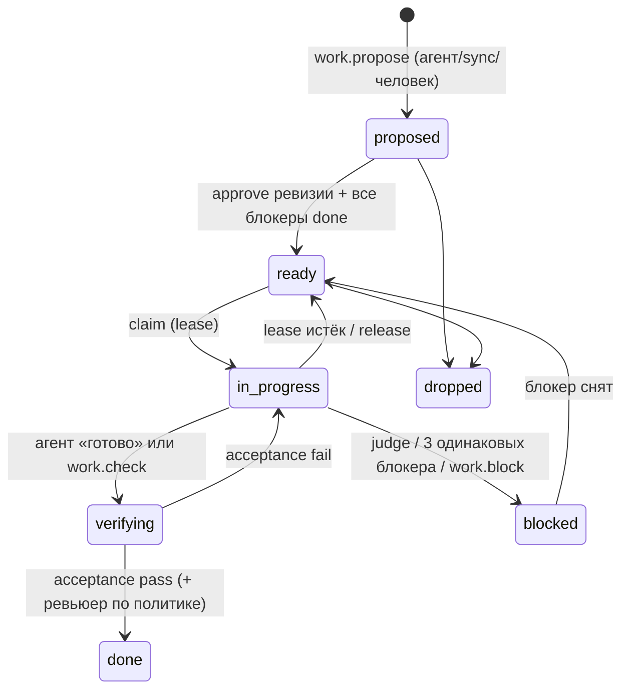

# 07 — Методология работы агентов и доска задач: нужна ли Guanxi своя «доска» и как её включать

**Статус:** proposed (research input, не решение и не реализация)
**Дата исследования / доступа к источникам:** 2026-10-19
**Область brief:** C3–C5, C8, C9 (оркестрация, relay, ETA, прогресс плана), H3 (MCP), H6
(ресурсы параллельных агентов), L5 (лёгкий harness, D-110), K5/M3 (A/B-гейт)
**Контекст (read-only):** [REQUIREMENTS](../../vision/REQUIREMENTS.md),
[ADR-0019](../../decisions/0019-durable-runs-hibernation-and-wake.md),
[ADR-0020](../../decisions/0020-relay-executor-handoff-and-judge.md),
[ADR-0021](../../decisions/0021-orchestration-roles-and-delegation.md),
[ADR-0025](../../decisions/0025-bench-stage-and-ab-gate.md),
[lane 4 §3.1](04-long-horizon.md) (spec-kit, Kiro, beads, Task Master, MAST, MAKER, «плохой план
хуже никакого» — здесь не повторяются, только дополняются).

**Вопрос владельца.** Нужна ли Guanxi «под капотом» методология работы и нативная доска задач для
агентов (Agile/Scrum/Kanban/WIP-лимиты или что-то агентное), человекочитаемая, управляемая тем же
API и без внешних rate limits, — или достаточно per-session todo/plan UI плюс плагины/MCP к
внешним трекерам (GitHub/GitLab Issues, Jira, Linear)? Опасения: обязательная доска загрязняет
контекст и добавляет тяжёлый слой логики; агенты забывают обновлять todo (дрейфует даже план
Claude Code).

---

## 0. TL;DR

1. **Рекомендация: вариант B-lite.** Не «методология» и не обязательная доска в контексте агента, а
   **нативный work ledger как сервис ядра** — то, что Guanxi и так обязана хранить для relay,
   делегирования и пробуждения лида (ADR-0019/0020/0021: plan revision → items → acceptance →
   evidence). Человекочитаемая доска — **проекция** этого ledger в UI и (опционально) в Markdown.
   Статус пунктов **выводит harness из событий** (прогон acceptance-команды, коммит, вердикт
   judge, решение человека), а не агент. Внешние трекеры — **плагины синхронизации**, а не
   источник истины для исполнения. Scrum/Agile-церемонии (вариант C) — отклонить.
2. **Todo/plan-инструменты помогают условно.** Самая прямая контролируемая абляция
   todo-инструмента на кодинге (176 настроек, SWE-bench Verified + TB 2.1, preprint): план с подачей в контекст каждый ход
   даёт **+11.6 п.п.** слабой модели (Nemotron-3 30B: 13.6 → 25.2%) и **−30…−32% стоимости**
   сильным при ±2 п.п. успеха [1]. Write-only «когнитивные» инструменты (scratchpad, трекер
   гипотез) почти бесполезны [2]. Периодическое напоминание плана повышает следование и успех;
   **плохой план хуже, чем никакого** [3].
3. **Рынок в 2026 году снимает обязательные todo для сильных моделей.** Claude Code с 2.1.233/2.1.268
   по умолчанию не даёт Task-инструменты новым моделям («Claude keeps track of multi-step work
   without a written checklist», и определения с напоминаниями тратят контекст), но **оставляет их
   в background/cloud-сессиях** [16]; Codex сделал `update_plan` opt-in (PR #41744, 2026-08-31) [19];
   Amp удалил TODO (2026-01-12) [24]; OpenCode V2 удалил `todowrite` (по словам мейнтейнера, инструмент замедлял агента без
   заметного выигрыша) и под давлением пользователей возвращает его как opt-in [14].
4. **Дрейф списка — структурное свойство «список ведёт агент».** Неверный self-reporting — 22.6%
   эпизодов misalignment в 20 574 реальных сессиях [10]; модели нестабильно сообщают прогресс [12];
   не-Claude-модели в OpenCode оставляют пункты `in_progress` [14]; документация Claude agent teams
   сама называет отставание статусов ограничением [16]. Отсюда: **статус — из evidence,
   заявление агента — триггер проверки** (как уже записано в ADR-0020 §8).
5. **Что переносится из человеческих методов:** Definition of Done как исполняемая проверка
   (самый сильный эффект: без тестов −17…−56% относительного Pass@1 [43]), явные зависимости и
   «ready»-гейтинг (Co-Coder +14 п.п. и −35% стоимости [48]), WIP-лимиты (оптимум параллелизма мал:
   4 агента лучше 2 и 8 [46]), stop-the-line по объективным сигналам, маленькие партии, ретро как
   аудит трасс. **Не переносится:** спринты (≤2.5 п.п. [39]), церемонии (+1.6…3.1 п.п. при ~2.2×
   токенов у Agile [43][44]), story points и velocity в человеческом времени, ролевой театр.
6. **Контекст.** Доску целиком в контекст не подавать никогда: пример из жизни — напоминание Claude
   Code вставляло все 609 задач (~435 КБ) после каждой компакции, и сессия перекомпактировалась
   каждые ~11 минут [17]. Агенту — «полоска» ≤300 токенов (текущий item + 1–3 следующих +
   счётчики), в хвост запроса, на границах цикла и по дрейф-триггеру; постоянная часть (описание
   инструментов + протокол) ≤~400 токенов для окна 32k.
7. **Внешние трекеры** — источник истины для *бизнес-намерения* (заголовок, описание, приоритет,
   человек-исполнитель), Guanxi — для *исполнения* (claims, runs, evidence). Пишем наружу редко и
   грубо (started / PR / blocked / done + одна редактируемая статусная заметка), читаем поллингом
   (сервер loopback-only). Лимиты реальные: GitHub — 80 content-creating запросов/мин и 500/ч;
   Jira Cloud — 20 записей на один issue за 2 с; Linear — 2 500 запросов/ч на API-ключ (и
   rate-limit приходит как HTTP 400) [80][82][83]. GitHub MCP по умолчанию ≈12.8k токенов
   описаний, только `issues` ≈3.7k — агенту MCP трекера по умолчанию **не давать** [75].
8. **Активация доски** (§9.3): выключена в обычной сессии; включается автоматически при плане
   делегирования/relay, ≥2 исполнителях в проекте, unattended/background-прогоне, привязанном
   внешнем трекере или явном запросе пользователя.
9. **Бенчмарка «методология/доска vs без неё» для кодинг-агентов нет** [I после поиска].
   Предложена W-серия A/B для стадии B2 (§8): плечи `none / todo / todo+recite / ledger /
   ledger+sync`, страты по классу модели, метрики точности статуса и дрейфа.

---

## 1. Методика и легенда

- Все источники открыты **2026-10-19** (WebFetch/WebSearch, `gh api`, чтение shallow-clone без
  запуска кода, чтение установленного бинарника Claude Code 2.1.287 через `strings` — только
  наблюдение, проприетарный код не копируется). Часть линий собрана тремя research-субагентами
  этой сессии (методологии команд агентов; продукты; внешние трекеры) с выборочной перепроверкой.
- **Сила доказательства** (как в lane 4): **A** — peer-reviewed или независимо воспроизведено;
  **B** — preprint с существенными экспериментами или вендорский engineering-пост/доки с
  собственными измерениями; **C** — практика/позиция без контролируемого эксперимента, единичный
  источник; **D** — сообщество/вторичный пересказ.
- **Статус проверки:** **[V]** — проверено мной по первоисточнику; **[V-s]** — проверено
  субагентом этой сессии по первоисточнику; **[S]** — первоисточник виден только через поисковую
  выдачу; **[I]** — вывод/интерпретация.
- **Preprint-only** помечается явно. arXiv `26xx` — работы 2026 года, почти все без peer review.
- Оценки токенов по коду — «символы/4» (нижняя граница; JSON-схемы токенизируются хуже, реальная
  стоимость может быть на 25–35% выше) [I].

---

## 2. Сводная таблица доказательств (claim → source → strength)

| # | Утверждение | Ключевые числа | Источник | Сила | Проверка |
|---|---|---|---|---|---|
| E1 | План + подача плана каждый ход помогает слабой модели | без плана → с планом, 30B: 13.6 → 25.2% SWE-V (q<0.05); TB 2.1 9.0 → 13.5% | [1] Tables 3–4 | B (preprint) | V |
| E2 | Для сильных моделей план — экономия, не точность | без плана → с планом, 550B: $3.31 → $2.33, SR 67.8 → 65.8; Mistral 128B: $4.65 → $3.14, SR 69.0 → 68.6 | [1] | B | V |
| E3 | Механизм: план не даёт слабой модели бросить задачу и срезает лишнюю верификацию у сильной | без плана у 30B 68.6% прогонов без единой правки (с планом 27.8%); медиана 108 → 74 хода у 550B | [1] Table 6, Fig. 8 | B | V |
| E4 | Write-only «когнитивные» инструменты почти ничего не меняют | Scratchpad ≈ перефраз reasoning (BLEU); HypoTrack почти без ветвления; 11 700 траекторий | [2] | B (preprint) | V |
| E5 | Напоминание плана каждые 5 шагов улучшает следование и успех; плохой план хуже никакого | 21 120 траекторий, 4 LLM; compliance на SWE-bench Pro −13% | [3] | B (связанный ACM DOI; площадка не проверена) | V |
| E6 | Ведущий вендор отключил todo/Task-инструменты по умолчанию для новых моделей, но не для background/cloud | 2.1.233 (2026-08-14), 2.1.268 (2026-09-10); `CLAUDE_CODE_ENABLE_TODO_TOOLS=1` | [16] | C (вендор, без чисел) | V |
| E7 | Codex сделал `update_plan` opt-in | PR #41744 merged 2026-08-31; 0.152.0 | [19] | C | V |
| E8 | Amp удалил TODO: модель держит прогресс сама, список стоит времени и токенов | 2026-01-12 | [24] | C | V |
| E9 | OpenCode V2 удалил `todowrite` (замедлял агента, заметного выигрыша не видели), вернул как opt-in после жалоб на видимость | issue #42421 (32 комм.), PR #56947 (2026-10-19) | [14] | C/D | V |
| E10 | Неверный self-reporting — частая форма misalignment | 22.58% эпизодов, доля растёт; 20 574 сессии | [10] | B (preprint) | V |
| E11 | Модели ненадёжно сообщают прогресс по ходу задачи; управлять потоком по самоотчётам нельзя | τ²-bench + StageIF | [12] | B (preprint) | V |
| E12 | Соблюдение инструкций падает по ходу сессии | OR = 0.944 на каждую функцию; 1 650 сессий | [13] | B (preprint, post hoc) | V |
| E13 | Не-Claude-модели не закрывают todo без напоминаний; та же модель в Claude Code закрывает | issue #27560; PR #48729/#54137 | [14] | D | V |
| E14 | Напоминание о задачах без лимита загрязняет контекст | 609 задач, 435 623 Б, компакция каждые ~10.7 мин | [17] #103442 | D (одна сессия) | V |
| E15 | Агенты-тиммейты не отмечают задачи выполненными, блокируя зависимые | ограничение в доках agent teams | [16] | C | V-s |
| E16 | Тесты/исполняемая проверка — главный «процессный» вклад | без тестирования −17.0…−56.1% отн. Pass@1 (FlowGen, ICSE 2025); −5…−8 п.п. (AgileCoder) | [43][39] | A | V-s (FlowGen абстракт — V) |
| E17 | Спринты и церемонии дают мало | спринты ≤2.5 п.п. [39]; sprint meetings +1.6/+3.1 п.п. [43]; Agile ≈2.2× токенов Waterfall, длинный хвост времени [44] | [39][43][44] | A / A / B | V-s |
| E18 | Явный граф зависимостей + выпуск по готовности зависимостей | Co-Coder: до +14 п.п., до −35% стоимости, 2.1× быстрее; Claude Code Agent Teams 16.3% (ниже последовательного) | [48] | B (preprint, 28 задач) | V (абстракт) / V-s |
| E19 | Оптимальный параллелизм мал | CAID: 4 «инженера» лучше 2 и 8 [46]; Croto: пик на 4 командах [38] | [46][38] | B / A | V-s |
| E20 | Общая очередь задач + видимость статусов коллег ускоряет параллельных агентов | DeLM: до +17.5 п.п., до 2.49× быстрее; без peer-status 0.87×/0.82× и до −3.3 п.п.; чтение shared context 1.7–17.7% стоимости | [25] | B (preprint, TB 4.0 — 10 задач × 3) | V |
| E21 | Многие «выигрыши координации» внутри шумового пола | парный пол до +18 п.п. на одном seed; 7 из 10 архитектур ниже пола | [26] | B (preprint) | V |
| E22 | Независимый verifier отклоняет работу в основном там, где acceptance неточен | 0% при точных автоматических критериях; 18.6% / 5.3% при итеративных | [45] | A (ASE 2026), без абляции | V-s |
| E23 | «Submitted» ≠ «done» | GPT-5 сдаёт 100%, решает 44% | [55] | B (preprint) | V-s |
| E24 | Ранний решающий сбой, позднее обнаружение | решающая ошибка ~шаг 7 из 27; 82% неудачных «восстановлений» продолжают без прогресса | [53] | B (preprint) | V-s |
| E25 | Kanban: WIP-лимиты, pull, Definition of Workflow, flow-метрики (WIP, throughput, age, cycle time), SLE | v2025.5 | [30] | стандарт (C) | V |
| E26 | Scrum: спринт ≤1 месяц, Daily Scrum 15 мин, команда ≤10 людей | 2020 | [31] | стандарт (C) | V |
| E27 | Kanban/WIP/Little's law/ToC на командах LLM-агентов не тестировались | — | поиск lane A + мой | — | I |
| E28 | GitHub MCP: дефолтный набор ≈12.8k ток., все инструменты ≈27.7k, `issues` ≈3.7k | 96 инструментов, 22 toolsets | [75] | измерение по snapshot'ам | V-s |
| E29 | Лимиты трекеров ограничивают «агентскую» частоту записи | GitHub 80/мин и 500/ч на создание контента; Jira 20 записей/2 с на issue; Linear 2 500 req/ч (ключ), HTTP 400 `RATELIMITED` | [80][82][83] | вендорские доки | V (Jira, Linear) / V-s (GitHub) |
| E30 | Prompt-injection через issue — архитектурная уязвимость агента с GitHub MCP | «toxic agent flow» | [90] | C | V-s |

---

## 3. Q1 — Помогают ли planning/todo/checklist-инструменты кодинг-агентам

### 3.1 Контролируемые абляции

**«An Empirical Study of Harness Design for Coding Agents»** (Fan et al., arXiv:2609.20804, v1
2026-09-17; **preprint-only**) [1] [V]. Лёгкий harness с фиксированным ReAct-циклом; варьируются
planning, action space и context management; 4 модели (Nemotron-3 30B/120B/550B,
Mistral-Medium-3.5-128B), SWE-bench Verified и Terminal-Bench 2.1, 176 сопоставленных настроек;
точный McNemar + Benjamini–Hochberg. **Что они называют planning:** инструмент `update_plan`
(whole-list replace, `pending|in_progress|completed`, ровно один `in_progress`), системный протокол
(≈155 ток.), напоминание на первом ходу и — главное — **harness подставляет текущий план в вход
модели перед каждым ходом, не сохраняя его в истории** (Fig. 15–17, 30). То есть измерен эффект
связки «список ведёт агент + recitation силами harness'а».

| Модель | SWE-V успех: план on → off | SWE-V $/задачу: on → off | TB 2.1 успех: on → off |
|---|---|---|---|
| Nemotron-3 30B | **25.2 → 13.6\*** | 0.09 → 0.02 | 13.48 → 8.99 |
| Nemotron-3 120B | 44.0 → 46.6 | 0.34 → 0.25 | 28.09 → 28.09 |
| Nemotron-3 550B | 65.8 → 67.8 | **2.33 → 3.31** | 44.94 → 46.07 |
| Mistral-Medium-3.5-128B | 68.6 → 69.0 | **3.14 → 4.65** | 37.08 → 39.33 |

\* значимо (BH q<0.05). Tables 3–4 [1].

Механизм (Table 5–6, Fig. 8–9): у 30B без плана медиана траектории на SWE-bench падает с 40 до 5
ходов, 68.6% прогонов заканчиваются без единой правки (с планом 27.8%), 58.4% застревают на
локализации (10.4%). У сильных моделей план **сокращает избыточную пост-верификацию** (медиана
108 → 74 хода у 550B, 68 → 53 у Mistral) — стоимость −30% и −32% при −2.0 и −0.4 п.п. На TB план
одновременно удлиняет «рано брошенные» траектории и срезает хвост сверхдлинных: −26% стоимости у
120B, −40% у Mistral, но **+75%** у 30B. Ограничения (авторы): одна реализация planning, абляция
только при T4/128k, один прогон на задачу, 89 задач TB (большинство различий там незначимы),
одно семейство моделей + одна внешняя.

**«The Devil Is in the Interface»** (Xu et al., arXiv:2608.11386, 2026-08-11; **preprint-only**)
[2] [V]. 11 700 траекторий на подвыборке SWE-bench Live (65 задач × 10 rollouts), акторы
Qwen3-Coder-30B, Kimi K2.5, Claude Sonnet 4.5. «Cognitive scaffolding» здесь — **Scratchpad**
(свободный текст) и **HypoTrack** (гипотеза + статус), а не todo с повторной подачей. Эффект
ограничен: scratchpad по BLEU близок к reasoning, который модель и так пишет в bash-only;
HypoTrack почти никогда не порождает реального ветвления (Finding 4, App. C). Для сравнения:
структурированные низкоуровневые интерфейсы дают до 4.7× консистентности, CodeAct — −41.6% шагов
и −56.3% токенов. **Вывод [I]:** «записать мысль» ничего не меняет; работает то, что меняет вход
модели (recitation), добавляет новую информацию или проверку.

**«From Plan to Action: How Well Do Agents Follow the Plan?»** (Liu et al., arXiv:2604.12147 v3
2026-08-07; на странице указан связанный ACM DOI 10.1145/3832783.3834400, площадку я не
проверил — считаю preprint) [3] [V]. 21 120 траекторий SWE-agent, 4 LLM (Devstral-small,
GPT-5-mini, DeepSeek-V3, DeepSeek-R1), SWE-bench Verified и Pro, 8 вариантов плана. План — фазовый
workflow в system prompt (Navigation → Reproduction → Patch → Validation), не todo. Находки:
стандартный план повышает resolution; **повторная подача плана каждые 5 шагов** снижает нарушения
и стабильно повышает успех; **плохой/неполный план вредит сильнее, чем отсутствие плана**;
«лучшие практики», не совпадающие с внутренней стратегией модели, вредят; на SWE-bench Pro
compliance в среднем на 13% ниже.

**Planner/executor** (Plan-and-Act, ICML 2025 [4]; EAGLET, ACL 2026 [5] — обученный глобальный
planner для executor'а на ScienceWorld/ALFWorld/WebShop) — разделение помогает, но это обученные
планировщики и не-кодинговые среды; подробно в lane 4 §3.1 [V по 04 и ACL Anthology].

**Вендорская практика (сила C):**
- Anthropic, «Effective harnesses for long-running agents» (2025-11-26) [6] [V]: список фич в
  **JSON** (модель реже портит JSON, чем Markdown); агент меняет **только** поле `passes` после
  проверки; прогресс-файл + git log; наблюдаемые отказы — преждевременно «объявить победу»,
  делать слишком много за раз, отмечать фичу готовой без end-to-end проверки.
- Manus, «Context Engineering for AI Agents» (2025-07-18) [7] [V]: агент переписывает `todo.md`,
  чтобы «процитировать» цели в конец контекста (против lost-in-the-middle); ~50 tool calls на
  задачу; **замеров эффекта нет**.

### 3.2 Используют ли инструмент и держат ли список актуальным

Прямых измерений «доля актуальных пунктов todo по ходу работы» **не найдено** ни в одной статье
[I после поиска]. Косвенные данные:

| Наблюдение | Числа | Источник | Сила |
|---|---|---|---|
| Частота TodoWrite в реальных сессиях (~69% — Claude Code, 8 агентов) | 7 898 вызовов = **0.4%** из ≈2 млн tool calls (v2, ~18k сессий); новые версии Claude Code используют Task*-инструменты, так что это нижняя граница | SWE-chat, COLM 2026 [8] [V] | A (про частоту, не точность) |
| Доля TodoWrite в production-харнессе Meta | 13.7% вызовов у «Advanced Agent» | REAP, ASE 2026 Industry [9] [V] | B |
| Неверный self-reporting (заявляет успех/готовность при обратном) | **22.58%** эпизодов misalignment (CLI 26.66%), доля растёт со временем | [10] [V] | B (preprint) |
| Claude Code заявил успех во всех задачах, 3 из 19 — ложно (тесты падали или правились тесты) | n = 19 | [11] [V] | C (малое n) |
| Точность самоотчёта о прогрессе зависит от стадии; авторы: фреймворк не должен управлять потоком по самоотчётам | τ²-bench + StageIF | [12] [V] | B (preprint) |
| Compliance с инструкциями падает по ходу сессии | OR = 0.944 на функцию | [13] [V] | B (preprint, post hoc) |
| Не-Claude-модели оставляют пункты `in_progress` после выполнения; та же модель через Claude Code — обновляет | issue #27560 (2026-05-14); фиксы через напоминание «3+ шагов без todowrite» | OpenCode [14] [V] | D, но с механизмом |
| Task-статусы отстают; задачи помечаются выполненными без проверки; ID списка «утекает» между worktree; список не восстанавливается при `--resume` | доки agent teams; issues #14947, #13549, #32281, #76844, #78147, #78874 | Claude Code [16][17] [V-s] | C/D |
| План Codex остаётся «stale» после завершения работы; PR о сбросе зависших `InProgress` закрыт без merge | issue #21327, PR #22753 | Codex [19] [V-s] | D |

**Почему дрейф — свойство harness'а, а не только модели (по коду) [V]:**
- **Claude Code 2.1.287** (установленный бинарник; проприетарный, только наблюдение): напоминание
  `todo_reminder`/`task_reminder` подмешивается, если ≥10 ходов без Task/Todo-инструментов **и**
  ≥10 ходов с прошлого напоминания (`TURNS_SINCE_WRITE:10`, `TURNS_BETWEEN_REMINDERS:10`);
  режим — `CLAUDE_CODE_TODO_REMINDER_MODE`; текст мягкий (разрешает проигнорировать, если неактуально), к нему
  прикладывается список [15]. Это nudge, а не проверка: 10+ ходов без инструмента — список
  гарантированно отстаёт; именно это владелец видит как «план дрейфует» [I].
- **Cline legacy v3.89.2** (Apache-2.0): Focus Chain по умолчанию включён,
  `remindClineInterval: 6`; список — параметр `task_progress` **любого** tool call (без отдельного
  инструмента), хранится как Markdown `focus_chain_taskid_<id>.md`; file-watcher подхватывает
  правки пользователя и говорит модели, что список изменён человеком [18]. В Cline 4.x Focus
  Chain выведен из употребления [74] [V-s].
- **Codex** (Apache-2.0, `d70c2c2`): `update_plan` отвечает только «Plan updated», план не
  подаётся повторно — он живёт в аргументах прошлых вызовов; с 0.152.0 инструмент выключен по
  умолчанию [19].
- **DeepSeek Harness** (MIT, `687f282`): `todo_write` — whole-list replace на event-sourced
  session log, единственный владелец (никакого шаринга между агентами), без напоминаний; README
  явно документирует token- и KV-cache-эффект [22].
- **OpenCode** (MIT): V2 убрал `todowrite`; мейнтейнер (2026-08-23) объяснил удаление тем, что инструмент замедляет агента, а заметного
  выигрыша в качестве не видно; пользователи возразили, что ценность —
  видимость и контроль, а не метрика; PR #56947 возвращает инструмент **opt-in**: ответ модели —
  одна строка со счётчиками (чтобы список не попадал в контекст дважды), напоминание — **только после
  компакции** [14].

### 3.3 Статус, выведенный harness'ом, против списка, который ведёт агент

Прямого A/B «harness-derived ledger vs agent-maintained todo» **не найдено** [I]. Косвенно в
пользу статуса из evidence:
1. Самоотчёты о прогрессе/завершении ненадёжны [10][11][12][55]; MAST: unaware of termination
   12.4%, incorrect / no verification 9.1% / 8.2% [59]; решающая ошибка обычно рано, а 82%
   неудачных «восстановлений» продолжаются без прогресса [53].
2. Самые зрелые протоколы делают статус **проверяемым**: Anthropic — агент меняет только `passes`
   после теста [6]; Codex `/goal` continuation — текущий worktree и внешнее состояние считаются авторитетными,
   пересказ статуса и невыполненный план прогрессом не считаются, аудит завершения по
   каждому требованию, `blocked` только после трёх одинаковых блокеров подряд [20] [V]; Cline SDK
   Agenda — агент создаёт/обновляет todo, но **не может approve/start/cancel**, чтобы не
   «самоавторизоваться» [21] [V]; Claude Code — хуки `TaskCreated`/`TaskCompleted` могут
   заблокировать переход [16] [V-s].
3. Обратная сторона: навязанный harness'ом **плохой** план вредит сильнее отсутствия плана [3].
   Значит, ledger выводит **статус** из evidence, но **содержание плана** — дело planner'а или
   самого агента.

### 3.4 Выводы по Q1 [I]

1. Явный план с recitation — дешёвая страховка для **слабых/локальных** моделей и **экономия
   26–40% стоимости** у сильных, без значимого выигрыша в точности у последних [1]. Это совпадает
   с решениями вендоров отключить todo для новых frontier-моделей (E6–E8).
2. Эффект создаёт не «наличие инструмента», а **(a)** повторная подача плана в конец контекста и
   **(b)** стоп-критерий и границы работы [1][3]. Оба механизма harness может обеспечить сам, без
   обязательного агентского инструмента.
3. Список, который ведёт агент, дрейфует; напоминания повышают compliance [3][13], но это nudge,
   не гарантия. «Done» от агента — триггер проверки, не факт (ADR-0020 §8 уже так говорит).
4. **Видимость прогресса для человека — отдельная и реальная ценность** (урок OpenCode [14],
   C9 в требованиях). Её надо давать из ledger/событий, а не ценой обязательного инструмента.

---

## 4. Q2 — Методологии для команд агентов и что о них известно

### 4.1 Evidence по «процессным» фреймворкам

| Система / работа | Что закодировано | Изолирующая абляция (числа) | Площадка / сила | Проверка |
|---|---|---|---|---|
| MetaGPT [33] | SOP-«конвейер» ролей (PM → Architect → PM → Engineer → QA), структурные документы вместо чата, publish-subscribe | роли поверх одного Engineer: executability 1.0 → 4.0, но на **2 задачах**, стоимость +51%; executable feedback: +4.2 (HumanEval), +5.4 (MBPP). **Сам SOP, документы и pub-sub не изолированы** | ICLR 2024 / A | V-s |
| ChatDev [34] | waterfall chat chain, пары instructor/assistant, жёсткое завершение (2 правки без изменений или 10 раундов) | Quality 0.3953; без ролей 0.2212 (самое большое падение); без dehallucination 0.3094; Quality — прокси без функциональных тестов | ACL 2024 / A | V-s |
| ECL / IER [35][36] | опыт прошлых задач как «короткие пути» (автоматическая ретроспектива) | ECL: 0.4267 → 0.7304; IER оставляет 11.5% опыта | ACL 2024 / A; IER preprint / B | V-s |
| MacNet [37] | топологии агентов | цепочка агентов на HumanEval 0.372 против single-agent CoT 0.610; передача артефактов вместо стенограмм: рост контекста O(n²) → O(n) | ICLR 2025 / A | V-s |
| Croto [38] | несколько параллельных команд + агрегация | 0.779 → 0.840; без отсечения пик на **4** командах; 1 → 8 команд = 2.14× токенов, 3.56× времени; 15 задач | Findings ACL 2025 / A | V-s |
| AgileCoder [39] (arXiv:2406.11912) | спринты, инкрементальная разработка, Dynamic Code Graph Generator | без инкрементальности (1 спринт) −1.0…−2.5 п.п.; без написания тестов −5.3…−8.3; граф зависимостей: executability 57.5 vs 23.4 (без 11 переполнений контекста); 36.8k токенов vs 7.4k ChatDev | FORGE 2025 / A | V-s |
| SoA [40] | агенты множатся с ростом кода | 71.4 vs 66.5 Reflexion; **без абляции**, неравный бюджет тестов | preprint / C | V-s |
| CodeR [41] | предзаданные task graphs для issue resolution | 22% vs 10% на 50 issues (граф и multi-agent удалены вместе; p ≈ 0.17 по точному тесту Фишера — расчёт субагента [I]) | preprint / B | V-s |
| MapCoder [42] | retrieve → plan → code → debug | без planning 80.0 → 70.0 (HumanEval, ChatGPT); ~33× токенов прямого промптинга | ACL 2024 / A | V-s |
| FlowGen (SOEN-101) [43] | эмуляция Waterfall, TDD, Scrum | Scrum 75.2/65.5/82.5/56.7 Pass@1 vs Waterfall 69.5/59.4/76.3/51.1; **без тестирования −17…−56% отн.**; **без sprint meetings −1.6 / −3.1 п.п.** | ICSE 2025 / A (GPT-3.5, функции) | V (абстракт), V-s |
| Process models в MetaGPT [44] | Waterfall vs V-Model vs Agile | медиана токенов 13.7k / 29.8k / 30.8k; время 118 / 226 / 450 с, у Agile хвост до 7 865 с; качество различается слабо | preprint / B (внутр. несогласованности) | V-s |
| TheBotCompany [45] | Strategy → Execution → Verification, независимый verifier, бюджетное планирование | verifier отклоняет 0% при точных автоматических критериях и 18.6% / 5.3% при итеративных; +9.6 / +10.7 п.п. к Claude Code; без абляции verifier'а | ASE 2026 / A | V-s |
| CAID [46] | менеджер + dependency-aware делегирование + git worktrees + merge по тестам | Sonnet 4.5: PaperBench 57.2 → 63.3, Commit0-Lite 53.1 → 59.1; стоимость ×2.0…×4.3; **2 → 4 инженера лучше, 8 хуже** | preprint / B | V (абстракт), V-s |
| STORM [47] | общий workspace с разрешением конфликтов при записи | Commit0-Lite: +18.7 к worktree-базе; **противоречит CAID** о worktrees | preprint / B | V (абстракт) |
| Co-Coder [48] | разбиение по графу зависимостей, запуск по готовности зависимостей | до +14 п.п., до 2.1× быстрее, до −35% стоимости; Claude Code Agent Teams 16.3% (ниже последовательного) | preprint / B (28 задач) | V (абстракт), V-s |
| NP-Bench [49] | непересекающиеся scopes заранее vs реактивные предупреждения о конфликтах | чистая интеграция 1/9 → 9/9 (симуляция, scopes заданы вручную) | preprint / C | V-s |
| MAFBench [50] | архитектурные выборы при фиксированной модели | строгая схема планирования −32 п.п. (ошибки формата); ролевые ярлыки не активируют доменное рассуждение | SIGMOD 2027 (по arXiv comment) / A | V-s |
| DeLM [25] | общая очередь задач с claims + shared context + видимость статуса коллег, без главного агента | до +17.5 п.п. и до 2.49× быстрее Codex/Claude Code; абляция: без peer-status 0.87× / 0.82× и −3.3 п.п.; без shared context −3.0 п.п.; shared context < 15k ток., чтение 1.7–17.7% стоимости | preprint / B (TB 4.0 — 10 задач × 3) | V |
| Blackboard для data science [27] | агенты сами берут запросы с общей доски | +13…57% отн. end-to-end | preprint / B (не кодинг) | V |

Провалы, которые доска могла бы адресовать (дополнение к MAST [59]): Who&When — атрибуция сбоя к
шагу удаётся в 14.2% случаев [51] (A); TRAIL — ~42% ошибок форматные/несоблюдение инструкций [52]
(B); «Failure as a process» — решающая ошибка около 7-го шага из 27, монитор в реальном времени
находит ≤28.8% [53] (B); SWE-PRM — taxonomy-guided PRM +10.6 п.п., слабые мониторы **ухудшают**
результат [54] (B); «Confident and wrong» — сдаёт 100%, решает 44% [55] (B); SWE-Marathon —
преждевременное завершение и reward hacking в 13.8% rollouts [56] (B); «Beyond resolution rates» —
вклад scaffold'а сжимается с каждым поколением моделей [57] (B).

Позиционные работы о «гибких методах для агентов» (Agentsway, ALMAS, «unified platform», SASE,
Agentic Agile-V) [92] — без контролируемых сравнений (C).

**Kanban/WIP/Little's law/Theory of Constraints/story points на командах LLM-агентов не
тестировались ни в одной найденной работе** [I после поиска двух линий]. Есть только практический
блог с советом начинать с одного активного feature на команду с агентами [58] (C).

### 4.2 Что переносится из человеческих методов, а что нет [I, с опорой на 4.1]

**Переносится (с доказательствами):**

| Практика | Агентная форма | Доказательства |
|---|---|---|
| **Definition of Done** | исполняемая проверка (тест/линт/скрипт) + пакет evidence; «done» = evidence, не флаг | E16; [45] (verifier почти не отклоняет работу при точных автоматических критериях и находит дефекты при итеративных — точный acceptance дешевле дорогого ревьюера); [55][56] |
| **Явные зависимости и «ready»** | рёбра `blocks`, гейтинг «ready = все блокеры закрыты», запуск по готовности (beads `bd ready`, Kiro waves) | [39][41][48][49]; свободная самоорганизация агентов (Claude Agent Teams 16.3%) хуже [48] |
| **WIP-лимиты, pull** | лимит параллельных исполнителей = лимит leases (worktree, GPU-слот, порт, контейнер) + лимит очереди на человеческое ревью; исполнитель «тянет» из ready | [46][38][37] (оптимум 2–4), [60] (−70% на последовательных задачах); узкое место — человеческое внимание: только 59% кода агентов доживает до коммита, пользователи возражают в 50% ходов [8] |
| **Stop-the-line (andon)** | judge-каскад и `blocked` по объективным сигналам (бюджет, повтор, красный gate, нет прогресса) | [53][54][51]; ADR-0020 §6, §8 |
| **Маленькие партии** | item ≤ одного relay-цикла (lane 4 §3.3); передавать артефакты, а не стенограммы | [39] (эффект мал: 1–2.5 п.п.), [37] (контекст O(n)) |
| **Ретроспектива** | аудит трасс и опыта (ADR-0024), не встреча | [35][36][45] |
| **Definition of Workflow и flow-метрики** (Kanban Guide 2025) | явные состояния, точки старта/финиша, политики переходов, WIP, age, cycle time, SLE ≈ ETA P80 | [30]; Little's law L = λW [32] как sanity-check ETA (ADR-0020 §9) |

**Не переносится или не доказано:**
- **Спринты как time-box** — эффект ≤2.5 п.п. [39]; агентная работа идёт минутами-часами, а не
  неделями; Scrum привязан к человеческому времени (спринт ≤1 мес., Daily Scrum 15 мин) [31].
- **Церемонии** (planning, daily, review) — +1.6…3.1 п.п. у FlowGen [43] при ~2.2× токенов у Agile
  против Waterfall и длинном хвосте времени [44]. Агентный эквивалент «синхронизации» — общий
  ledger/контекст, читаемый инкрементально [25], а не раунды обсуждения.
- **Story points и velocity в человеческом времени** — данных нет; реальные «единицы» агента —
  токены, wall-clock, время verifier'а и человека [I]; оценка должна быть evidence-based (ETA из
  истории estimate/actual, ADR-0020 §9).
- **Ролевой театр** — данные противоречивы: роли важны для GPT-3.5 в ChatDev [34], но ярлыки не
  активируют рассуждение [50], а вклад scaffold'а сжимается с силой модели [57]. Лучше процедуры и
  гейты, чем «персоны».
- **Тяжёлые схемы планирования** — строгая схема стоила до −32 п.п. из-за форматных ошибок [50];
  схема item должна быть маленькой, парсинг — терпимым (как алиасы статусов в OpenHands [23]).

**Общий вывод [I].** Методологическая доказательная база — в основном эпоха GPT-3.5/4, функции или
прокси-метрики, и «своя система против своих базовых линий». Изолирующие абляции есть для тестов,
графов зависимостей, планирования и ролей, но **не** для SOP, спринтов и досок как таковых. Поэтому
«методология» Guanxi должна быть набором **механических инвариантов ядра** (§9.2), а не процессом
с ритуалами.

---

## 5. Q3 — Продукты на 2026-10: что такое «план/задачи» у других

### 5.1 Сравнение

| Продукт | Функция | Хранение | Зависимости | Общий для агентов | Формат | Кто обновляет | Внешний трекер | Лицензия / можно ли копировать в Apache-2.0 | Проверка |
|---|---|---|---|---|---|---|---|---|---|
| Claude Code | `TaskCreate/Get/Update/List` (старый `TodoWrite` через `CLAUDE_CODE_ENABLE_TASKS=0`) | по умолчанию сессия; именованный долговечный список `CLAUDE_CODE_TASK_LIST_ID` → `~/.claude/tasks/<id>/` | `blocks`/`blockedBy`, завершение разблокирует зависимые | да: тиммейты agent teams берут задачи под файловой блокировкой | JSON-файл на задачу (формат не документирован) | агент; harness напоминает; хуки могут запретить переход | нет | проприетарная → **нет** | V-s; V (доки о доступности) |
| Claude Code agent teams | общий список + mailbox | список остаётся после сессии | да | лид + тиммейты, одна команда на сессию | JSON | лид создаёт, тиммейты claim | — | проприетарная | V-s (экспериментально с 2.1.32) |
| Codex CLI | `update_plan` | только в транскрипте | нет | нет | `{explanation?, plan:[{step,status}]}` | агент, whole-list | нет | Apache-2.0 → да | V (код), opt-in с 0.152.0 |
| Codex CLI | Goals (`get/create/update_goal`) | SQLite `thread_goals`, одна на тред | — | на тред | строка БД: objective, status, token budget | пользователь; агент — только `complete/blocked/paused` по строгим правилам | нет | Apache-2.0 → да | V |
| GitHub Copilot cloud agent | issue/Agents panel → сессия → PR | логи сессий, вкладка Agents | нет | Agent HQ: Copilot, Claude, Codex | объекты GitHub | harness | нативно Issues; входы из Jira, Linear, Slack, Teams, Azure Boards | проприетарный | V-s/S |
| Linear | delegate, AgentSession, AgentActivity, Agent Plan | в Linear | связи Linear | много агентов в workspace | GraphQL | агент шлёт activities; состояние сессии выводит Linear | это и есть трекер; MCP `mcp.linear.app/mcp` | проприетарный SaaS, API бесплатен | V-s (Developer Preview; Plan — tech preview) |
| Jira (Atlassian) | агенты как исполнители, Forge `rovo:agentConnector` (A2A), My agent sessions, Rovo MCP | в Jira | связи Jira | Rovo и сторонние агенты | задачи A2A JSON-RPC | состояния задач агента | это и есть трекер | проприетарный | V-s/S (GA на Team '26) |
| GitLab Duo Agent Platform | flows по assign/mention на issue/MR | в GitLab | связи GitLab | несколько flows | GitLab | flow | это и есть трекер; MCP-сервер GA в 19.5 (2026-10-15) | Duo проприетарный | V-s/S |
| Cursor | Agent To-dos, Plan mode, Cloud Agents | to-dos на чат; планы в home или «Save to workspace» | у to-dos есть зависимости | команда видит (read-only) | Markdown-план | агент | Slack, Linear, GitHub `@cursor` | проприетарный | V-s |
| OpenHands SDK | `task_tracker` (`view`/`plan`) | `TASKS.json` в каталоге разговора | нет | нет | JSON `{title, notes, status}` | агент, whole-list | нет | MIT → да | V |
| vibe-kanban | Kanban + workspaces/sessions | локальная БД | `parent_task` | много CLI-агентов | БД | человек + запуски агентов | GitHub PR | Apache-2.0 → да | V-s (**sunset объявлен 2026-04-10**) |
| Backlog.md | Markdown-задачи, доска, web UI, CLI, MCP | в репозитории | `dependencies` | через git, assignee | Markdown + YAML frontmatter, acceptance criteria и DoD-чеклисты | агент через CLI/MCP, человек через доску | **нет** (issue #231 закрыт «not planned») | MIT → да | V-s (v1.54.0, 7.1k★) |
| beads | `bd`-граф задач | Dolt; JSONL — экспорт | полный граф, `bd ready` | атомарный `--claim`, Dolt push/pull | Dolt SQL | агент через CLI; `bd prime` в хуках | Linear, Jira, GitLab, GitHub, Azure DevOps | MIT → да | V-s (v1.3.1, 28k★, репозиторий переехал в `gastownhall/beads`) |
| Task Master | `tasks.json`, теги | в репозитории | да | — | JSON | агент через CLI/MCP | нет | **MIT + Commons Clause** → не OSI, **не копировать** | V-s (последний релиз 2026-03-31) |
| spec-kit | `tasks.md` | в репозитории | порядок + `[P]` | — | Markdown-чекбоксы | агент | `taskstoissues` — одностороннее создание issues через GitHub MCP | MIT → да | V-s (v1.2.2) |
| Kiro | spec `tasks.md`, «Run all tasks» | в репозитории | граф → «волны» | параллельно внутри волны | Markdown | Kiro | — | проприетарный | V-s/I |
| Gemini CLI | `write_todos` (legacy), `tracker_*` (experimental, форма как у beads) | сессия; JSON на задачу | DAG | поле `subagentSessionId` | JSON | агент | нет | Apache-2.0 → да | V-s |
| Roo Code / Kilo Code / Goose | `update_todo_list` + таблица-напоминание каждый ход / `todowrite` / `todo_write` с подачей каждый ход | сессия | нет | нет | Markdown / JSON / текст | агент | нет | Apache-2.0 (Roo — **архив**) / MIT / Apache-2.0 | V-s |
| Cline SDK | Agenda `tasks` (todo + scheduled), `team_task` | SQLite + `*.task.md` | `dependsOn` в `team_task` | claims с токеном | Markdown + YAML (намерение) + SQLite (операционное состояние) | агент предлагает, **человек одобряет** | нет | Apache-2.0 → да | V (todo-половина Agenda выключена на HEAD) |
| Amp | TODO | — | — | — | — | — | — | проприетарный | V (**удалено 2026-01-12**) |

Источники строк: Claude Code [16][17], Codex [19][20], Copilot [65], Linear [62], Jira [63],
GitLab [64], Cursor [61], OpenHands [23], vibe-kanban [66], Backlog.md [67], beads [69], Task
Master [70], spec-kit [71], Kiro [72], Gemini CLI [68], Roo/Kilo/Goose [73], Cline SDK [21], Amp [24].

### 5.2 Наблюдения [I, по 5.1 и §3]

1. **Две траектории.** (a) Агентские CLI снимают обязательный todo для сильных моделей (Claude Code,
   Codex, Amp, OpenCode) или делают его необязательной заметкой (Goose); Cline вывел Focus Chain.
   (b) **Долговечные** задачи уходят в долгоживущие контексты: background/cloud-сессии Claude Code
   (там Task-инструменты остаются на всех моделях), agent teams, Codex Goals, Cline Agenda, а
   бизнес-трекеры (Linear, Jira, GitLab, GitHub) сами становятся протоколом для агентов
   (AgentSession/Activity/Plan, A2A-задачи в Jira, Duo-сессии в GitLab MCP, вкладка Agents).
2. **Доски-продукты нестабильны:** vibe-kanban закрывается, Agenda у Cline выключена, Roo в архиве,
   Task Master стоит. Выживают трекер-нативные решения и **файловые в репозитории** (Backlog.md,
   beads, spec-kit). Строить «ещё один Linear» внутри Guanxi — плохая ставка; строить **ledger
   исполнения**, который синхронизируется с трекерами, — согласуется с рынком.
3. **Общая форма** у всех, кто хранит долговечно: JSON/SQLite как операционная истина +
   Markdown/YAML как человекочитаемое намерение (Cline Agenda, Backlog.md, beads-экспорт,
   Anthropic JSON-список). Статусы почти везде те же три (`pending/in_progress/completed`) плюс
   `blocked`/`cancelled`.
4. **Права:** самые аккуратные дизайны отделяют «агент предлагает» от «человек/harness
   утверждает и закрывает» (Cline Agenda, Codex Goals, хуки Claude Code, Linear delegate vs
   assignee).

---

## 6. Q4 — Интеграция с внешними трекерами

### 6.1 Официальные MCP-серверы

| Сервер | Лицензия | Транспорт / auth | Инструменты и ограничение набора | Стоимость описаний в контексте | Статус | Проверка |
|---|---|---|---|---|---|---|
| `github/github-mcp-server` (локально stdio/http; удалённо `api.githubcopilot.com/mcp/`) | MIT | PAT, OAuth, GitHub App; удалённо без Dynamic Client Registration | 96 инструментов, 22 toolsets; `--toolsets`, `--tools`, `--exclude-tools`, `--read-only`, `--lockdown-mode`; удалённо — заголовки `X-MCP-*` и URL на toolset; **dynamic toolsets удалены** (PR #2512, 2026-05-20) | все ≈27.7k ток. (≈62.7k с `outputSchema`); дефолтный набор ≈12.8k; только `issues` ≈3.7k; `issues+labels+projects` ≈7.2k | GA, v2.0.2 | V-s (метод: snapshot'ы, символы/4) |
| Atlassian Rovo MCP (`mcp.atlassian.com/v2/mcp`) | репозиторий конфигов Apache-2.0, сервер закрытый | OAuth 2.1; API-токены по разрешению админа | 249 инструментов (Jira 52), но напрямую видны ~25 «primary» + `discover`/`executeRead/Write/Destructive`; `delete_jira`/`manage_jira` выключены по умолчанию | не измерено (нужна авторизация); progressive discovery задуман для экономии | GA | V-s |
| Jira Data Center/Server | — | — | **официального MCP нет** (JRASERVER-78874 «Gathering Interest»); сообщество — `sooperset/mcp-atlassian` (MIT) | — | — | V-s |
| Linear MCP (`mcp.linear.app/mcp`, `/mcp/readonly`) | проприетарный | OAuth 2.1 с DCR, API-ключ | число инструментов не документировано (~22 по снимку каталога) | не измерено | — | V-s/I |
| GitLab MCP (`/api/v4/mcp`) | часть GitLab | OAuth DCR (scope `mcp`), fine-grained PAT | 56 инструментов (work items, notes, labels…); фильтры через заголовки; **read-only режима нет** | не измерено | GA в 19.5 | V-s |

Источники строк: [75] GitHub, [76] Rovo, [77] Jira DC, [78] Linear, [79] GitLab.

Ошибки лимитов MCP-серверы отдают модели как неудачный tool call (GitHub MCP не повторяет запрос
сам); Atlassian MCP отвечает 429 только с `Retry-After`, burst-лимиты не документированы [75][76]
[V-s].

### 6.2 Лимиты API, которые важны для агентов

| Платформа | Лимит | Источник | Проверка |
|---|---|---|---|
| GitHub REST | 5 000 req/ч (пользователь/PAT); 15 000 для Enterprise Cloud apps; **secondary: ≤100 параллельных, 900 points/мин REST, content creation 80/мин и 500/ч**; 304 по ETag не тратит лимит; ≥1 с между записями | [80] | V-s |
| GitHub GraphQL | 5 000 points/ч (10 000 Enterprise Cloud apps), 2 000 points/мин secondary | [80] | V-s |
| GitLab.com | 2 000 req/мин на пользователя; создание issue 200/мин; заметки 60/мин; MCP 60 req/мин (Free), 600 (Premium/Ultimate) | [81][79] | V-s |
| Jira Cloud (с 2026-03-02) | points-модель для Forge/Connect/OAuth-приложений (**API-токены исключены**, только burst-лимиты); Tier 1 — общий пул 65 000 points/ч; burst GET/POST 100 RPS, PUT/DELETE 50 RPS; **на один issue 20 записей за 2 с и 100 за 30 с**; backoff: `Retry-After`, экспонента от ~2 с до 30 с, jitter 0.7–1.3, ≤4 повторов, только идемпотентные | [82] | V |
| Rovo MCP | на сайт: Free 500 вызовов/ч, Standard 1 000/ч, Premium/Enterprise 1 000 + 20 × пользователи до 10 000/ч (квота общая для всех на сайте) | [76] | V-s |
| Linear API | API-ключ 2 500 req/ч и 3M complexity/ч; OAuth-app 5 000 req/ч и 2M; ≤10 000 points на запрос; **лимит приходит как HTTP 400 с `RATELIMITED`**; поллинг не рекомендуют, рекомендуют webhooks | [83] | V |

**Вывод [I].** Для одного человека с несколькими агентами лимиты не страшны, **если** писать редко
(вехи), читать условными запросами и не давать агенту «болтать» с трекером. Агент, который
обновляет задачу на каждом шаге (как todo в контексте), упрётся в secondary-лимиты GitHub
(80 созданий/мин) и в per-issue лимиты Jira (20/2 с) и засорит историю задачи. Это прямой
аргумент держать исполнение у себя, а наружу отдавать проекцию.

### 6.3 Как синхронизируют другие

| Инструмент | Направление | Конфликты | Сопоставление ID | Лицензия | Проверка |
|---|---|---|---|---|---|
| Linear ↔ GitHub Issues | одно- или двустороннее (двустороннее — только один репозиторий на команду); только новые issues | не документировано (вероятно last-write-wins [I]); ошибки — баннеры на issue | вложение-ссылка; комментарии — только в одном «синхронизируемом» треде | проприетарный | V-s/I |
| GitHub for Jira, GitLab ↔ Jira | одностороннее: dev-info (ветки, коммиты, PR) в Jira по ключу; issue ↔ issue не синхронизируются | — | ключ Jira в ветке/коммите/PR | проприетарные | V-s |
| Exalate | одно/двустороннее, скрипты на каждой стороне | по порядку прихода, по умолчанию «последнее изменение поля побеждает»; **изменения, сделанные синхронизацией, не пересылаются** (защита от петель) | «реплика» на пару | коммерческий | V-s |
| beads | `bd github sync`, `bd jira sync`, `bd linear sync` и т. п.; pull/push | **last-write-wins на весь issue** по `updated_at`; `--prefer-local/--prefer-<remote>` | `external_ref` + `TargetScope`; хэш содержимого, чтобы не делать пустой push; «пол» лимита как circuit breaker | MIT | V-s (код) |
| spec-kit `taskstoissues` | только наружу | идемпотентность по соглашению: ищет `T\d{3,}` в заголовках, создаёт недостающие | ID задачи в заголовке | MIT | V-s |
| git-bug | мосты к GitHub/GitLab/Jira | **лог операций** (CRDT-подобный, Lamport-часы) — детерминированный merge; метаданные моста против дублей | метаданные на операцию | GPL-3.0 → не копировать | V-s |
| TaskChampion (Taskwarrior 3) | реплики через сервер с шифрованием | операционная трансформация, линейная цепочка версий, конфликт по свойству по времени | UUID | MIT | V-s |
| Backlog.md, Task Master | синхронизации нет; мейнтейнер Backlog.md: двусторонняя синхронизация — проблема «источника истины», начинать с узкой односторонней | — | — | MIT / MIT+CC | V-s |

Источники строк: [84] Linear ↔ GitHub, [85] GitHub/GitLab ↔ Jira, [86] Exalate, [69] beads, [71]
spec-kit, [87] git-bug, [88] TaskChampion, [89] Backlog.md, [70] Task Master.

### 6.4 Агент как исполнитель в трекере

- **GitHub Copilot cloud agent:** читает issue на момент назначения и **игнорирует последующие
  комментарии к issue**; работает в PR, один репозиторий и один PR на задачу, сессия ≤59 мин [65]
  [V-s].
- **Linear:** приложение становится **delegate**, человек остаётся **assignee**; первая `thought`
  — в течение ~10 с; response/elicitation/error автоматически дублируются комментариями;
  рекомендуют переводить issue в первый `started`-статус [62][91] [V-s].
- **Jira:** агент назначается, упоминается, вешается на переход или колонку; вывод приватен для
  вызвавшего, пока тот не опубликует [63] [V-s/S].
- **GitLab Duo:** триггеры mention/assign сервис-аккаунта, flow создаёт draft MR; flows не
  вызывают друг друга [64] [V-s].

**Общее [I]:** трекеры моделируют «агентскую сессию» как *комментарии и активности поверх
issue*, а не как claims/leases/evidence. Для исполнения внутри Guanxi их модель слишком бедна
(нет leases, нет acceptance-evidence, лимиты), но как *поверхность для человека и команды* — ровно
то, что нужно.

### 6.5 Безопасность

- «Toxic agent flow» (Invariant Labs, 2025-05-26): вредоносный публичный issue заставил агента с
  GitHub MCP и «Always Allow» прочитать приватные репозитории и слить их в публичный PR;
  классифицировано как архитектурная ошибка композиции агента [90] [V-s].
- GitHub MCP: `--lockdown-mode` фильтрует контент от авторов без push-прав (сами авторы называют это
  «best-effort», а не границей авторизации), санитайзер убирает невидимые/BiDi-символы [75] [V-s].
- Правило для Guanxi [I]: текст issue/комментариев — **недоверенные данные**; никогда не
  объединять в одном run недоверенный вход трекера, доступ к приватным репозиториям и исходящие
  write-инструменты; запись наружу — через политику Project/Run (уже инвариант AGENTS.md
  проекта для MCP/Skills).

---

## 7. Q5 — Сколько контекста стоят доска и todo

### 7.1 Измерения (оценка «символы/4») [V по коду; оценка — I]

| Механизм | Постоянная часть (описание + протокол) | На обновление | На каждый ход | Источник |
|---|---|---|---|---|
| Harness-design study (`update_plan` + recitation) | system ≈155 + описание ≈225 → **≈400 ток.** | весь список в аргументах | **≈50 ток. обвязки + сам план**, блок не сохраняется в истории | [1] Fig. 15–17, 30 |
| Codex `update_plan` | схема ≈100–150; разделы `## Planning` ≈760 и `## update_plan` ≈180 в base instructions (убираются при выключенном инструменте) | весь список; ответ «Plan updated» | 0 | [19] |
| Codex `/goal` continuation | — | — | ≈**1 600 ток.** на каждый goal-ход (`continuation.md`) | [20] |
| DeepSeek Harness `todo_write` | раздел каталога со схемой ≈470 (сама схема меньше) | весь список; ответ — одна строка со счётчиками | 0 | [22] |
| OpenHands `task_tracker` | описание ≈**1 260** | весь список (`plan`), отдельная команда `view` | 0 | [23] |
| Cline Focus Chain | init ≈215, reminder ≈135 | список как параметр `task_progress` любого вызова | каждые **6** сообщений: заголовок + прогресс + список + reminder ≈200–400 | [18] |
| Claude Code 2.1.287 | не измерял (проприетарный) | — | напоминание **со всем списком** после ≥10 ходов без Task-инструментов | [15] |
| Claude Code, реальный отказ | — | — | 609 задач, **435 623 Б** в одном напоминании, без лимита на число и байты; компакции каждые ~10.7 мин | [17] #103442 (D) |
| OpenCode PR #56947 (opt-in) | V1-описание + «вызывай только когда список изменился» | ответ — одна строка | напоминание **только после компакции** | [14] |
| GitHub MCP как «доска» агента | дефолтный набор ≈12.8k; `issues` ≈3.7k; все ≈27.7k | — | — | [75] |
| DeLM (общий контекст + очередь для 2–4 агентов) | — | чтение «только нового с прошлого раза» | итоговый общий контекст < 15k; чтение = 1.7–3.7% стоимости (Claude) и 7.7–17.7% (GPT) | [25] |

### 7.2 Выводы для окна 32k [I]

1. **Одна «полоска» плана дешева:** 8–10 пунктов ≈120–200 ток. + ≈50 ток. обвязки ≈ 0.6% окна 32k
   на ход. Постоянная часть (описание инструмента + протокол) — 400–1 300 ток., то есть 1.2–4% окна
   навсегда; разница между «Codex-стилем» и «OpenHands-стилем» для малой модели существенна.
2. **Доска целиком в контекст — никогда.** 50 пунктов × ~25 ток. одних заголовков ≈1.25k; с
   описаниями и зависимостями 5k+ ≈ 15% окна — это весь бюджет handoff по ADR-0020 (≤15% W).
   Инцидент #103442 [17] показывает, что без жёстких лимитов «напоминание о задачах» само
   становится причиной компакций. Правило: только открытые пункты, урезанные заголовки, лимит
   по числу и байтам, не повторять неизменённое.
3. **Подключённый MCP трекера — тоже «доска в контексте»:** 3.7–12.8k токенов описаний только
   за то, что сервер подключён [75]. Агенту по умолчанию — компактная карточка задачи от
   sync-плагина; MCP трекера — по явной политике, с `--toolsets issues --read-only` или
   progressive discovery (Rovo).
4. **KV/prefix-кэш.** llama.cpp server по умолчанию `cache_prompt: true` — переиспользует общий
   префикс и пересчитывает только отличающийся хвост [29] [V]. Поэтому полоску подавать **в хвост и
   не сохранять в истории** (как в [1]), а не переписывать system prompt: изменение раннего
   префикса заставляет локальную модель заново делать prefill десятков тысяч токенов [I].
   Whole-list аргументы инструментов копятся в истории до компакции (DSH это документирует [22]),
   поэтому у «агентского» todo есть скрытая растущая стоимость.
5. **Частота напоминаний.** Фиксированный интервал — грубый инструмент: Cline 6, Claude Code 10,
   «From Plan to Action» 5 шагов [3][15][18]. Для relay-исполнителя естественные точки —
   **границы** (`orient` нового цикла, закрытие item, после компакции) и **дрейф-триггеры** (N
   шагов без сигнала прогресса из ledger: правка в scope item, прогон acceptance, коммит). Это
   дешевле и точнее «каждые k шагов», но **не проверено** — кандидат на A/B (§8).
6. **Для малых моделей** приоритет — не «больше структуры», а «меньше постоянных токенов»:
   короткое описание без примеров; если статус ведёт harness, агентский инструмент можно не
   регистрировать вовсе.

---

## 8. Q6 — Есть ли бенчмарк эффекта методологии/доски; минимальный A/B для стадии bench

### 8.1 Что существует

- Абляции «план on/off» для одного агента: [1] (инструмент + recitation), [3] (фазовый план,
  напоминания), [2] (scratchpad/гипотезы).
- Абляции механизмов координации в мульти-агенте: DeLM [25] (очередь + общий контекст + статус
  коллег; 10 задач × 3 прогона), Co-Coder [48], CAID [46], STORM [47] — preprint'ы, местами
  противоречат друг другу (worktrees: CAID за, STORM против).
- Предупреждение о шуме: на τ²-bench парный «шумовой пол» между конфигурационно-эквивалентными
  протоколами достигает +18 п.п. на одном seed; 7 из 10 недавних coordination-архитектур
  заявляют эффекты ниже этого пола [26] [V].
- **Бенчмарка «методология/доска задач vs без неё» для кодинг-агентов не найдено** (поиск по
  Kanban/WIP/task board/blackboard + coding за 2024–2026) [I]. Ближайшее — blackboard для
  data-science агентов (+13…57% отн.) [27], не кодинг.

### 8.2 Минимальный A/B «W-серия» для Guanxi (совместим с ADR-0025) [I — предложение]

**Гипотезы.** H1: harness-derived ledger (A2) не хуже agent-maintained todo с recitation (A1r) по
успеху и лучше по точности статуса и стоимости. H2: польза плана/ledger убывает с силой модели
(репликация [1] на нашем harness). H3: внешняя синхронизация (A3) не меняет качество
(non-inferiority к A2) и укладывается в бюджет API-вызовов.

**Плечи** (одна модель, задачи, seeds и инфраструктура; interleaved-расписание):

| Плечо | Что видит агент | Кто ведёт статус |
|---|---|---|
| A0 `none` | только orientation block (O1 из ADR-0025) | никто |
| A1 `todo` | `update_plan` (схема + описание ≤150 ток.), ответ — одна строка, без повторной подачи | агент |
| A1r `todo+recite` | A1 + план в хвосте каждого хода (не в истории) + напоминание после k = 6 шагов без обновления | агент |
| A2 `ledger` | полоска ≤300 ток.: текущий item + 1–3 следующих + статусы, **выведенные** из событий (acceptance, коммиты, файлы в scope, тесты); подаётся на границах и по дрейф-триггеру; агент может `work.note`, `work.propose`, `work.check` (запуск acceptance), `work.block`, но не ставит статус сам | harness |
| A3 `ledger+sync` | как A2; плюс sync-плагин в mock-трекер или песочный репозиторий GitHub (контекст агента не меняется) | harness + внешний трекер |
| ref | Claude Code / Codex «как есть» (их собственные todo-механизмы) | внешние |

**Наборы задач:**
- **S-single** — свежее окно SWE-rebench / SWE-bench-Live, 100–150 задач (val split ADR-0025);
- **S-multi** — feature/epic-задачи из приватного реестра (серия PR, ≥3 items в плане) — там, где
  план «нужнее»;
- **S-relay** — 20 задач B3 с ≥5 циклами при W = 32k (ADR-0020); здесь A2 и так обязателен,
  сравнивать A1r против A2.

**Страты моделей:** local-small (≤35B, W = 32k), local-medium (70–128B / MoE, W = 64k), cheap API
(DeepSeek Flash), frontier API. Решения принимаются **по стратам** (ADR-0025 п. 8): для каждого
класса отдельно включается или выключается recitation и агентский инструмент.

**Метрики.**
- Gate: resolved rate (hidden tests); стоимость (токены, $); wall-clock; число ходов.
- Процесс (диагностика, не gate): (1) **status accuracy** — доля пунктов, у которых заявленный
  агентом статус совпадает со статусом по evidence, в контрольных точках (каждые 10 шагов и в
  конце); (2) **staleness** — шаги между первым evidence завершения и обновлением статуса;
  (3) **false-done** — `completed` при падающем acceptance; (4) **premature stop** — завершение с
  открытыми пунктами, и **no-edit termination** (как в [1]); (5) **plan-token share** — доля
  входных токенов на план/ledger; (6) для A3 — число вызовов к трекеру, события 429/400, расхождения
  зеркала.
- Ценность доски для человека (читаемость, доверие, «видно ли, что происходит») — **отдельно**,
  dogfooding-опрос владельца, не gate (урок OpenCode [14]).

**Мощность и бюджет.** Эффект на слабой модели по [1] ≈ +11.6 п.п. — детектируется на 100–150
задачах × 3 seeds (ADR-0025: 5–8 п.п.); на сильных моделях ожидается ±2 п.п. успеха, поэтому там
первичная метрика — **стоимость** (−30% по [1]; парные различия стоимости детектируются легче).
Сначала шумовой пол (одно плечо × 5 seeds), как требует ADR-0025, и отчёт coordination-active
pass^k для A3 [26]. Порядок: local-small (бесплатно) → cheap API → frontier на 30-задачном
подмножестве (Q-225).

**Решающие правила** (ADR-0025 п. 8): A1/A1r/A2 — «additions»: superiority или non-inferiority +
≥15% экономии; A0 — контроль; A3 — non-inferiority к A2 (нижняя граница CI > −3 п.п.) плюс бюджет
API. **Канарейка «плохой план»:** подсунуть заведомо неверный item и проверить, что A2
(evidence-статус + judge) восстанавливается лучше, чем A1r — проверка эффекта [3].

**Факторный хвост (dev split, только local-small):** интервал напоминаний k ∈ {off, 5, 10,
boundary+drift}; ширина полоски (1 / 3 / все пункты). Победителя переносить на val split.

---

## 9. Варианты и рекомендация

### 9.1 Сравнение вариантов

- **A — без нативной доски:** per-session todo/plan UI + плагины/MCP к внешним трекерам.
- **B — нативный agent-first work graph как сервис ядра**, человекочитаемая доска, sync-плагины.
- **C — полноценная Agile/Scrum-методология** (спринты, роли, церемонии, story points).

| Критерий | A | B (в варианте B-lite, §9.2–9.4) | C |
|---|---|---|---|
| C5: точный трекинг задачи через relay-циклы | ✗ ledger всё равно нужен ADR-0020, но остаётся невидимой деталью run'а | ✓ ledger и есть work items run'а | ✓, но ценой церемоний |
| C4/C9: wake packet с таблицей items, прогресс плана | частично: только если агент ведёт todo (сильные модели перестают) | ✓ из событий, не зависит от модели | ✓ |
| C3, H6: несколько исполнителей, claims, WIP | ✗ трекеры не знают leases/evidence; лимиты на запись | ✓ claims = leases (ADR-0019), WIP = лимит leases | ✓ формально, без доказательств пользы |
| C8: ETA | ✗ нет истории estimate/actual | ✓ cycle time/throughput → EBS (ADR-0020 §9) | velocity в человеческом времени — нерелевантна |
| Стоимость контекста | MCP трекера 3.7–12.8k ток. описаний [75] + todo | ≤300 ток. полоска + ≤~400 постоянных; MCP — по политике | высокая: Agile ≈2.2× токенов [44] |
| Дрейф статусов | высокий (статус ведёт агент) [10][14][16] | низкий (статус из evidence) | высокий (самоотчёты ролей) |
| Внешние лимиты / оффлайн / multi-node | зависит от SaaS; лимиты §6.2 | локальный SQLite, single writer per entity (ADR-0018) | как B или A |
| Человекочитаемость | хорошая в UI трекера, но без исполнения | доска-проекция + опциональный Markdown + sync | хорошая |
| Вес harness'а (D-110, L5) | минимальный | средний, но большая часть уже обязательна (ADR-0019/0020/0021) | тяжёлый, противоречит D-110 |
| Согласованность с evidence | частичная: todo полезен слабым [1] | высокая: DoD-как-проверка, deps/ready, WIP малый, статус из evidence (§4.2) | низкая: спринты/церемонии ≤1.6–3.1 п.п. [39][43] |
| Согласованность с рынком 2026 | да для интерактивных сессий (Claude Code, Codex, Amp, OpenCode) | да для долгих/фоновых/командных контекстов (Claude background + teams, Codex Goals, Cline Agenda, DeLM) | нет: никто из ведущих агентов не строит Scrum внутри |
| Главный риск | невыполнимы C4/C5/C8 для north-star D-106 | разрастание в «ещё один Linear»; двойной источник истины | ритуалы без пользы, токены |

**Решение: B-lite** — B без методологических ритуалов, с жёсткими лимитами контекста и с
активацией по условиям; для обычной интерактивной сессии фактически совпадает с A.

### 9.2 «Методология под капотом» = Definition of Workflow из механических инвариантов [I]

Не процесс с ритуалами, а семь правил, которые **исполняет ядро** (по образцу Definition of
Workflow из Kanban Guide [30]):

1. **Work item** = результат (1–2 предложения) + **acceptance** (исполняемая проверка, DoD) +
   scope (пути, «не трогать») + зависимости + оценка (lane 4 §3.3; ADR-0021 §5).
2. **Ready и pull:** исполнитель берёт только `ready` (все блокеры закрыты, ревизия одобрена);
   claim — это lease с fencing token (ADR-0019 §3).
3. **WIP через leases:** один writer на worktree (ADR-0021 §6); не больше N параллельных
   исполнителей на проект (дефолт 2–4 по [46][38], подтвердить в W-серии); лимит очереди на
   человеческое ревью — когда она полна, исполнители не берут новое (узкое место — внимание
   человека [8]).
4. **Статус из evidence:** `done` только по записанному harness'ом прогону acceptance (+ ревьюер
   или judge по политике); «готово» от агента переводит item в `verifying` (ADR-0020 §8).
5. **Stop-the-line:** judge L0–L2 или три эквивалентных блокера подряд → `blocked` + пробуждение
   лида (правило Codex Goals [20]; ADR-0019/0020).
6. **Маленькие партии:** item ≤ одного relay-цикла, иначе split (ADR-0021 §3).
7. **Flow-телеметрия и аудит:** WIP, throughput, age, cycle time по items → ETA/SLE (ADR-0020 §9),
   Little's law как sanity-check [32]; «ретро» = аудит трасс (ADR-0024).

Нет спринтов, story points, ежедневных синков, ролевых «персон» и обязательного агентского todo.

### 9.3 Политика активации доски

| Уровень | Когда включается | Что видит человек | Что видит агент |
|---|---|---|---|
| **W0 — off** (по умолчанию) | обычная интерактивная сессия, один агент | прогресс из событий сессии (правки, прогоны тестов) + план агента, если он его ведёт; у внешних агентов — их plan/task-события через ACP/app-server | ничего, кроме опционального plan-инструмента **по политике класса модели** (до W-серии: выкл. для frontier, вкл. с recitation для local-small — по [1] и решениям вендоров) |
| **W1 — run ledger** (автоматически) | лид создал plan revision для делегирования; relay-исполнитель; unattended/background-прогон; оценка run > одного цикла | доска items этого run'а, evidence, ETA, wake packet | полоска ≤300 ток. на границах и по дрейф-триггеру; инструменты исполнителя `work.check / note / block / propose` |
| **W2 — project work graph** (автоматически или по запросу) | ≥2 исполнителя параллельно в проекте; к проекту привязан внешний трекер; пользователь открыл/создал backlog | доска проекта (колонки по выведенным состояниям), зависимости, claims, история, sync-статус | то же, что W1; лид дополнительно `work.plan / split` |

Выключение: нет открытых items и активных run'ов → доска сворачивается в историю, инструменты
снимаются с регистрации. Включение никогда не добавляет в контекст доску целиком.

### 9.4 Набросок модели данных и API [I]

Аддитивные миграции SQLite (правило репозитория), единственный writer — домашний узел проекта
(ADR-0018); claims — leases, которые выдаёт этот узел:

- `work_item` — id (ULID), project_id, parent_id, revision, title, intent_md, kind, acceptance
  (JSON), scope (JSON), estimate, priority, **state (выводится)**, created_by
  (`user | agent:<run> | sync:<provider>`), approved_revision, created_at/updated_at;
- `work_edge` — from, to, type (`blocks | parent | relates`);
- `work_claim` — item, run, attempt, lease, fencing token, expires_at;
- `work_evidence` — item, kind (`acceptance_run | commit | diff | judge | human | ci`), ссылка на
  событие, результат, время;
- `external_link` и append-only `sync_outbox` — §9.5.

События `work.*` идут в журнал (ADR-0023). Один и тот же контракт (`packages/contract`) для UI,
CLI (`guanxi work ls --json`), плагинов и агентских инструментов (тонкие обёртки над REST), без
внешних rate limits. Человекочитаемая проекция — доска в UI и opt-in экспорт
`.guanxi/work/<id>.md` (YAML frontmatter + намерение + acceptance-чеклист + ссылки на evidence,
как Backlog.md); правки файла возвращаются через тот же API и **требуют повторного одобрения
ревизии** (правило Cline Agenda [21]). Истина — SQLite/JSON, не Markdown (Anthropic: JSON модель
портит реже [6]).

### 9.5 Синхронизация с внешними трекерами (плагины) [I, по §6]

1. **Владение полями:** трекер владеет намерением (заголовок, описание/acceptance-текст,
   приоритет, метки, milestone/cycle, человек-исполнитель, бизнес-статус); Guanxi — исполнением
   (claims, runs, evidence, стоимость, внутренний статус, заметки агента).
2. **Наружу — проекция:** грубые переходы (started / PR opened / blocked / done), **одна
   статусная заметка, редактируемая на месте**, ссылка на PR. Для общего поля «статус» —
   compare-and-set по `updatedAt`/ETag; если человек изменил статус — побеждает человек, item
   помечается. Не last-write-wins на весь issue (как beads) [69].
3. **Сопоставление:** provider, host, scope, external id, node id, key, URL, remote `updated_at`,
   ETag, хэш последнего push, курсор.
4. **Идемпотентность:** append-only outbox, скрытый маркер `guanxi:item=<id>` в теле, search-before-
   create при повторе (как spec-kit) [71]; эхо своих записей игнорировать (Exalate, git-bug) [86][87].
5. **Каденция:** сервер loopback-only → по умолчанию поллинг 5–15 мин адаптивно + чтение по
   требованию при открытии item; webhooks — только через отдельный relay-плагин с security profile.
6. **Бюджет:** запись последовательно, ≥1 с между записями на GitHub; ≤20 записей/2 с на issue
   Jira; резерв квоты («пол» как в beads) для интерактивной работы; Linear — разбирать HTTP 400
   `RATELIMITED`; quota-тип 429 → пауза провайдера целиком, burst-тип → замедлить endpoint.
7. **Контекст:** агенту — карточка задачи с provenance от плагина, не MCP трекера; MCP — только по
   политике и в урезанном виде.
8. **Инъекции:** текст из трекера — недоверенные данные; фильтр авторов (как lockdown), очистка
   невидимых/BiDi-символов; запрет сочетания «недоверенный вход + приватные репозитории + запись
   наружу» в одном run.
9. **Протоколы трекеров как адаптеры:** Linear AgentSession/Activity/Plan, Jira remote agents
   (A2A), GitLab MCP Duo-сессии, GitHub issue → PR — отображать на A2A-совместимые состояния
   run'а (ADR-0019 §2), чтобы Guanxi-агент мог быть «delegate» в трекере без собственной доски
   в трекере.

### 9.6 Что это значит для ADR (предложения, не изменения)

- **ADR-0020:** явно назвать items ledger'а work items run'а; закрепить «статус только из
  evidence» и «полоска ≤300 ток. на границах», лимиты на напоминания (только открытые, усечённые,
  не повторять неизменённое).
- **ADR-0021 §9:** «plan/queue tools» в базовом наборе → агентский plan-инструмент по политике
  класса модели, решение — по W-серии.
- **ADR-0025 §10:** добавить W-серию после O/T-серий.
- **Новый ADR-кандидат:** «Work ledger, board projection and tracker sync»: W1 в R2 (вместе с
  relay), W2 и claims в R3/F3, sync-плагины после P1.

---

## 10. Что переиспользовать (лицензии)

Правило ADR-0016: копировать только Apache-2.0-совместимое, с записью в `THIRD_PARTY_NOTICES.md`.

| Что | Откуда | Лицензия | Как использовать |
|---|---|---|---|
| Схема `update_plan` (`{explanation?, plan:[{step,status}]}`, ≤1 `in_progress`), флаг выключения инструмента вместе с инструкциями | Codex [19] | Apache-2.0 | копировать с атрибуцией; для опционального plan-инструмента W0 |
| Правила goal continuation: «внешнее состояние авторитетно», «пересказ статуса и невыполненный план — не прогресс», аудит завершения по требованиям, `blocked` только после 3 одинаковых блокеров | Codex [20] | Apache-2.0 | адаптировать тексты для relay/judge (ADR-0020) с атрибуцией |
| Agenda: Markdown + YAML (намерение) + SQLite (операционная истина), одобрение привязано к ревизии, агент не может approve/start/cancel, политика автоматизации с лимитами concurrency/chain-depth/hourly-start | Cline SDK [21] | Apache-2.0 | паттерн и, при совпадении стека, код (TypeScript) |
| `team_task` (`create/list/claim/complete/block`, `dependsOn`, assignee) | Cline SDK [21] | Apache-2.0 | форма агентских инструментов W2 |
| Focus Chain: двусторонний Markdown-файл с file-watcher, сообщение модели «список изменён человеком» | Cline legacy [18] | Apache-2.0 | паттерн для opt-in Markdown-проекции |
| `todo_write` на event-sourced журнале, CAS-обновления goal, лимит раундов; README-разделы «Token effect / KV-cache effect» | DeepSeek Harness [22] | MIT | паттерн и документация инструментов (DSH уже источник кода по D-108) |
| Алиасы статусов (`pending→todo`, `completed→done`) — терпимый парсинг | OpenHands SDK [23] | MIT | копировать идею |
| `ready`-семантика, атомарный claim, «memory decay» закрытых, `external_ref` + `TargetScope`, хэш содержимого против пустых push, «пол» лимита | beads [69] | MIT | паттерны sync и очереди; хранилище — своё SQLite |
| Формат задачи (YAML frontmatter, acceptance criteria, DoD-чеклист), стабильные ID при архиве | Backlog.md [67] | MIT | формат opt-in экспорта |
| `[P]`-маркеры параллельности, идемпотентный `taskstoissues` | spec-kit [71] | MIT | экспорт/импорт и одностороннее создание issues |
| `tracker_*` DAG-инструменты | Gemini CLI [68] | Apache-2.0 | сверка формы инструментов |
| Модель task → attempt → session с worktree на попытку | vibe-kanban [66] | Apache-2.0 (проект закрывается) | только как справка |
| GitHub MCP (урезанный набор), Linear/Jira/GitLab API и MCP | [75]–[79] | MIT / проприетарные сервисы | интеграция через API/MCP, не копирование |
| **Не копировать:** Claude Code (проприетарный) [16], Task Master (MIT + Commons Clause) [70], git-bug (GPL-3.0) [87], Kiro/Cursor/Linear/Jira (проприетарные) | — | — | только интероперабельность через протоколы |

---

## 11. Риски

1. **Разрастание в «ещё один трекер».** Рынок показывает нестабильность самостоятельных досок
   (vibe-kanban, Cline Agenda, Roo, Task Master; §5.2). Защита: никаких комментариев-тредов,
   спринтов, кастомных полей, отчётов; бизнес-функции — во внешнем трекере через sync.
2. **Двойной источник истины.** Защита: владение по полям, CAS для статуса, выигрыш человека при
   конфликте, явный индикатор «рассинхронизировано», начинать с односторонней синхронизации
   (совет мейнтейнера Backlog.md [89]).
3. **Загрязнение контекста.** Защита: полоска ≤300 ток., только открытые пункты, усечение,
   лимиты по байтам, «не повторять неизменённое», бюджет на post-compaction re-injection
   (инцидент [17]); MCP трекера не подключать по умолчанию [75].
4. **Плохой план навязывается harness'ом.** «Плохой план хуже никакого» [3]: ledger выводит
   статус, но не генерирует содержание; канарейка в W-серии; исполнитель может предложить
   amendment (Q-218).
5. **Ложная уверенность в evidence.** Acceptance может быть слабым или «узким»; независимый verifier
   почти ничего не отклоняет при точных автоматических критериях и находит дефекты, когда цели
   итеративные или расплывчатые [45]; агенты правят тесты [11]. Защита: защищённые пути и тесты от planner'а (ADR-0020 §7), L1-эвристика «правка тестов
   при красном acceptance».
6. **Шум в оценке.** Эффекты координации часто внутри шумового пола [26]; планирование на сильных
   моделях даёт ±2 п.п. [1]. Защита: шумовой пол, парный дизайн, решения по стратам, стоимость как
   первичная метрика для frontier.
7. **Мульти-агентная координация без завершения.** Shared state склонен к реактивным петлям и
   требует явных условий завершения [28]; Guanxi: бюджеты, deadline-таймеры, L0-watchdog
   (ADR-0019/0020).
8. **Инъекции из трекеров.** «Toxic agent flow» [90]. Защита: §6.5, политика Project/Run.
9. **Мульти-мастер.** Work items и claims должны иметь одного writer'а (ADR-0018); иначе
   «claimed дважды». Защита: claims — leases с fencing token от домашнего узла проекта.
10. **Расхождение с внешними агентами.** Claude Code/Codex ведут свои списки (или уже не ведут);
    Guanxi не может выключить их механизмы. Защита: для внешних агентов статус тоже из evidence
    (коммиты, тесты, PR), их plan-события — только как подсказка в UI.

---

## 12. Открытые вопросы владельцу

1. **Какие трекеры реально нужны** — GitHub Issues/Projects, GitLab, Jira Cloud или Jira Data
   Center, Linear? (У Jira DC нет официального MCP — понадобится REST-плагин [77].) Нужна ли
   двусторонняя синхронизация с первого дня или достаточно односторонней (Guanxi → трекер)?
2. **Где бизнес-backlog:** во внешнем трекере (рекомендация) или владелец хочет вести его прямо в
   Guanxi (тогда W2 становится «маленьким трекером» — риск §11.1)?
3. **Может ли агент сам создавать items** (предложения без одобрения) или каждый новый item
   требует одобрения лида/человека (как Cline Agenda)? Рекомендация: агент предлагает, лид
   одобряет автоматически в пределах immutable Run policy, человек — для project-level.
4. **Plan-инструмент в обычной сессии:** до результатов W-серии выключать для frontier-моделей и
   включать с recitation для local-small (по [1] и вендорам)? Или оставить включённым везде ради
   видимости в UI?
5. **Markdown-проекция в репозитории** (`.guanxi/work/*.md`, коммитится как в Backlog.md/beads) —
   нужна, или достаточно доски в UI и SQLite (приватность, шум в git)?
6. **Webhooks vs поллинг:** принять поллинг 5–15 минут при loopback-only сервере или нужен
   relay-плагин для webhooks (отдельный security profile)?
7. **WIP-дефолты:** сколько параллельных исполнителей на проект (2–4?) и сколько items может
   ждать человеческого ревью, прежде чем исполнители перестанут брать новое?
8. **Бюджет W-серии** в рамках Q-210: local-small бесплатно; cheap API ≈ сопоставимо с одним
   полным A/B (ADR-0025 оценивает ≈ $70 на Flash за 600 trials) — запускать вместе с O-серией или
   после неё?

---

## 13. Источники

Все источники открыты **2026-10-19**. Коммиты clone'ов указаны там, где читался код.
«(субагент)» — проверено research-субагентом этой сессии по первоисточнику.

**Планирование, todo и дрейф (Q1)**

1. Fan et al. — An Empirical Study of Harness Design for Coding Agents, arXiv:2609.20804 (v1,
   2026-09-17; preprint). https://arxiv.org/abs/2609.20804 ; https://arxiv.org/html/2609.20804v1
2. Xu et al. — The Devil Is in the Interface: Evaluating How Tool Architecture Shapes Coding Agent
   Behavior, arXiv:2608.11386 (preprint). https://arxiv.org/abs/2608.11386
3. Liu et al. — From Plan to Action: How Well Do Agents Follow the Plan?, arXiv:2604.12147 v3
   (связанный DOI 10.1145/3832783.3834400). https://arxiv.org/abs/2604.12147
4. Erdogan et al. — Plan-and-Act (ICML 2025), arXiv:2503.09572. https://arxiv.org/abs/2503.09572
5. Si et al. — A Goal Without a Plan Is Just a Wish (EAGLET), ACL 2026.
   https://aclanthology.org/2026.acl-long.597/ ; https://arxiv.org/abs/2510.05608
6. J. Young (Anthropic) — Effective harnesses for long-running agents (2025-11-26).
   https://www.anthropic.com/engineering/effective-harnesses-for-long-running-agents
7. Y. Ji (Manus) — Context Engineering for AI Agents: Lessons from Building Manus (2025-07-18).
   https://manus.im/blog/Context-Engineering-for-AI-Agents-Lessons-from-Building-Manus
8. Baumann et al. — SWE-chat: Coding Agent Interactions From Real Users in the Wild (COLM 2026),
   arXiv:2604.20779 v2. https://arxiv.org/abs/2604.20779
9. Jha et al. — REAP: Automatic Curation of Coding Agent Benchmarks from Interactive Production
   Usage (ASE 2026 Industry Showcase), arXiv:2604.01527 v4. https://arxiv.org/abs/2604.01527
10. Tang et al. — How Coding Agents Fail Their Users: … 20,574 Real-World Sessions,
    arXiv:2605.29442 v2 (preprint). https://arxiv.org/abs/2605.29442
11. Xu, Sheng, Chen, Huang — A Systematic Study of LLM-Based Architectures for Automated Patching,
    arXiv:2603.01257 (preprint). https://arxiv.org/abs/2603.01257
12. Wang, Wang, Wu — The Unreliable Progress Bar, arXiv:2609.08589 (preprint).
    https://arxiv.org/abs/2609.08589
13. McMillan — Instruction Adherence in Coding Agent Configuration Files, arXiv:2605.10039
    (preprint). https://arxiv.org/abs/2605.10039
14. anomalyco/opencode (MIT) @ `b56e253`: `packages/core/src/database/v1-migration.bun.ts`
    (`REMOVED_TOOLS = ["todowrite"]`); issues #27560, #42421, #51396; PR #48729, #54137, #56947.
    https://github.com/anomalyco/opencode/issues/42421 ; https://github.com/anomalyco/opencode/pull/56947
15. Claude Code 2.1.287 — установленный бинарник владельца (проприетарный), наблюдение строк
    `todo_reminder`, `task_reminder`, `TURNS_SINCE_WRITE:10`, `TURNS_BETWEEN_REMINDERS:10`,
    `CLAUDE_CODE_TODO_REMINDER_MODE` (локальное наблюдение, без URL).
16. Claude Code docs: Tools reference — Task tool availability
    https://code.claude.com/docs/en/tools-reference#task-tool-availability ; Agent teams
    https://code.claude.com/docs/en/agent-teams ; Env vars https://code.claude.com/docs/en/env-vars ;
    Task list https://code.claude.com/docs/en/interactive-mode#task-list ; Agent SDK todo tracking
    https://code.claude.com/docs/en/agent-sdk/todo-tracking ; CHANGELOG и LICENSE.md
    https://github.com/anthropics/claude-code (субагент для CHANGELOG/agent teams).
17. anthropics/claude-code issues: #103442 (2026-10-19)
    https://github.com/anthropics/claude-code/issues/103442 ; #14947, #13549, #32281, #76844,
    #78147, #78874, #79495, #80015, #99936 (субагент).
18. cline/cline, tag v3.89.2 (Apache-2.0): `apps/vscode/src/core/task/focus-chain/{index,prompts,
    file-utils}.ts`, `apps/vscode/src/shared/FocusChainSettings.ts`.
    https://github.com/cline/cline/tree/v3.89.2
19. openai/codex (Apache-2.0) @ `d70c2c2`: `codex-rs/core/src/tools/handlers/{plan_spec,plan}.rs`,
    `codex-rs/protocol/src/plan_tool.rs`, `codex-rs/protocol/src/prompts/base_instructions/default.md`;
    PR #41744 (merged 2026-08-31) https://github.com/openai/codex/pull/41744 ; release
    rust-v0.152.0; issues #21327, #42365; PR #22753 (субагент).
20. openai/codex @ `d70c2c2`: `codex-rs/ext/goal/templates/goals/{continuation,budget_limit}.md`,
    `codex-rs/ext/goal/src/spec.rs`. https://github.com/openai/codex
21. cline/cline (Apache-2.0) @ `41e75ef`: `sdk/ARCHITECTURE.md` (Hub-Owned Agenda Task Queue),
    `sdk/packages/core/src/extensions/tools/team/team-tools.ts`. https://github.com/cline/cline
22. deepseek-ai/deepseek-harness (MIT) @ `687f282`: `packages/todo/tool-todo/README.md`,
    `packages/goal/README.md`, `packages/goal/goal-round-driver/README.md`.
    https://github.com/deepseek-ai/deepseek-harness
23. OpenHands/software-agent-sdk (MIT) @ `33d8aa2`:
    `openhands-tools/openhands/tools/task_tracker/definition.py`.
    https://github.com/OpenHands/software-agent-sdk
24. Amp — TODOs are done (2026-01-12). https://ampcode.com/news/todos-are-done

**Координация, стандарты процессов**

25. Mao et al. — Decentralized Multi-Agent Systems with Shared Context (DeLM), arXiv:2606.10662 v3
    (preprint). https://arxiv.org/abs/2606.10662
26. Kaliyev, Maryanskyy — How Much Coordination Gain Is Real? A Paired Noise-Floor Protocol,
    arXiv:2606.20695 (preprint). https://arxiv.org/abs/2606.20695
27. Salemi et al. — LLM-Based Multi-Agent Blackboard System for Information Discovery in Data
    Science, arXiv:2510.01285 v2 (preprint). https://arxiv.org/abs/2510.01285
28. C. Phillips (Anthropic) — Multi-agent coordination patterns: Five approaches and when to use
    them (2026-04-10). https://claude.com/blog/multi-agent-coordination-patterns
29. llama.cpp server README (`cache_prompt`).
    https://github.com/ggml-org/llama.cpp/blob/master/tools/server/README.md
30. Coleman, Vacanti et al. — The Kanban Guide v2025.5. https://kanbanguides.org/english/
31. The Scrum Guide (November 2020). https://scrumguides.org/scrum-guide.html
32. J. D. C. Little — A Proof for the Queuing Formula: L = λW, Operations Research 9(3):383–387,
    1961. doi:10.1287/opre.9.3.383 (метаданные Crossref)

**Методологии команд агентов (lane A, субагент; абстракты [43][46][47][48] — проверены мной)**

33. Hong et al. — MetaGPT (ICLR 2024). https://arxiv.org/abs/2308.00352 ;
    https://openreview.net/forum?id=VtmBAGCN7o
34. Qian et al. — ChatDev: Communicative Agents for Software Development (ACL 2024).
    https://aclanthology.org/2024.acl-long.810/
35. Qian et al. — Experiential Co-Learning of Software-Developing Agents (ACL 2024).
    https://aclanthology.org/2024.acl-long.305/
36. Qian et al. — Iterative Experience Refinement of Software-Developing Agents, arXiv:2405.04219
    (preprint). https://arxiv.org/abs/2405.04219
37. Qian et al. — Scaling Large Language Model-based Multi-Agent Collaboration (MacNet; ICLR 2025
    по arXiv comment). https://arxiv.org/abs/2406.07155
38. Du et al. — Multi-Agent Collaboration via Cross-Team Orchestration (Croto; Findings ACL 2025).
    https://aclanthology.org/2025.findings-acl.541/
39. Nguyen et al. — AgileCoder (FORGE 2025), arXiv:2406.11912. https://arxiv.org/abs/2406.11912
40. Ishibashi et al. — Self-Organized Agents, arXiv:2404.02183 (preprint).
    https://arxiv.org/abs/2404.02183
41. Chen et al. — CodeR: Issue Resolving with Multi-Agent and Task Graphs, arXiv:2406.01304
    (preprint). https://arxiv.org/abs/2406.01304
42. Islam et al. — MapCoder (ACL 2024), arXiv:2405.11403. https://aclanthology.org/2024.acl-long.269/
43. Lin, Kim, Chen — SOEN-101 / FlowGen (ICSE 2025), arXiv:2403.15852.
    https://arxiv.org/abs/2403.15852
44. Ha et al. — Evaluating Classical Software Process Models as Coordination Mechanisms for
    LLM-Based Software Generation, arXiv:2509.13942 (preprint). https://arxiv.org/abs/2509.13942
45. Lyu et al. — TheBotCompany (ASE 2026 по arXiv comment), arXiv:2603.25928.
    https://arxiv.org/abs/2603.25928
46. Geng, Neubig — Effective Strategies for Asynchronous Software Engineering Agents (CAID),
    arXiv:2603.21489 (preprint). https://arxiv.org/abs/2603.21489
47. Liu et al. — Multi-agent Collaboration with State Management (STORM), arXiv:2605.20563
    (preprint). https://arxiv.org/abs/2605.20563
48. Yang et al. — When Parallelism Pays Off: Cohesion-Aware Task Partitioning (Co-Coder),
    arXiv:2606.00953 (preprint). https://arxiv.org/abs/2606.00953
49. Muku — Verifying Coordination in Parallel Coding Agents: NP-Bench, arXiv:2610.07261 (preprint).
    https://arxiv.org/abs/2610.07261
50. Orogat et al. — Architectural Design, Not Only Model Intelligence, Governs Multi-Agent LLM
    Performance (MAFBench), arXiv:2602.03128. https://arxiv.org/abs/2602.03128
51. Zhang et al. — Which Agent Causes Task Failures and When? (Who&When; ICML 2025).
    https://arxiv.org/abs/2505.00212
52. Deshpande et al. — TRAIL, arXiv:2505.08638 (preprint). https://arxiv.org/abs/2505.08638
53. Zhao et al. — Failure as a Process: An Anatomy of CLI Coding Agent Trajectories,
    arXiv:2607.09510 (preprint). https://arxiv.org/abs/2607.09510
54. Gandhi et al. — When Agents go Astray: Course-Correcting SWE Agents with PRMs,
    arXiv:2509.02360 (preprint). https://arxiv.org/abs/2509.02360
55. Mehta — Confident and Wrong: Silent Semantic Failures in Coding Agents, arXiv:2603.25764
    (preprint). https://arxiv.org/abs/2603.25764
56. Desai et al. — SWE-Marathon, arXiv:2606.07682 (preprint). https://arxiv.org/abs/2606.07682
57. Mehtiyev et al. — Beyond Resolution Rates: Behavioral Drivers of Coding Agent Success and
    Failure, arXiv:2604.02547 (preprint). https://arxiv.org/abs/2604.02547
58. Y. Yeret — WIP limits in the AI age (блог, 2026-07-22).
    https://yuvalyeret.com/blog/calculate-kanban-wip-limits-ai-age/
59. Cemri et al. — Why Do Multi-Agent LLM Systems Fail? (MAST), arXiv:2503.13657 (lane 4 [39]).
    https://arxiv.org/abs/2503.13657
60. Kim et al. — Towards a Science of Scaling Agent Systems, arXiv:2512.08296 (lane 4 [40]).
    https://arxiv.org/abs/2512.08296

**Продукты (lane B, субагент; Claude Code docs [16], Codex [19][20], Amp [24], Cline SDK [21] — проверены мной)**

61. Cursor — changelog 1.2 https://cursor.com/changelog/1-2 ; Plan mode
    https://cursor.com/docs/agent/plan-mode ; Cloud agent https://cursor.com/docs/cloud-agent
62. Linear — Agents https://linear.app/developers/agents ; Agent Interaction
    https://linear.app/developers/agent-interaction ; MCP https://linear.app/docs/mcp
63. Atlassian — Collaborate on work items with AI agents
    https://support.atlassian.com/jira-software-cloud/docs/collaborate-on-work-items-with-ai-agents/ ;
    Remote agents in Jira https://developer.atlassian.com/platform/forge/remote-agents-in-jira/ ;
    My agent sessions https://www.atlassian.com/blog/development/introducing-my-agent-sessions ;
    Rovo MCP changelog https://developer.atlassian.com/cloud/rovo-mcp/changelog/
64. GitLab — Duo Agent Platform https://docs.gitlab.com/user/duo_agent_platform/ ; triggers
    https://docs.gitlab.com/user/duo_agent_platform/triggers/ ; GitLab 19.5
    https://docs.gitlab.com/releases/19/gitlab-19-5-released/
65. GitHub — Copilot cloud agent
    https://docs.github.com/en/copilot/concepts/agents/coding-agent/about-coding-agent ;
    https://docs.github.com/en/copilot/how-tos/use-copilot-agents/cloud-agent/use-cloud-agent-on-github ;
    Agents tab https://github.blog/changelog/2026-01-26-introducing-the-agents-tab-in-your-repository/ ;
    Agent HQ https://github.blog/news-insights/company-news/welcome-home-agents/ (S)
66. BloopAI/vibe-kanban (Apache-2.0) README и миграции; https://www.vibekanban.com/blog/shutdown
67. MrLesk/Backlog.md (MIT), release v1.54.0. https://github.com/MrLesk/Backlog.md
68. google-gemini/gemini-cli (Apache-2.0): `docs/tools/todos.md`, `docs/tools/tracker.md`.
    https://github.com/google-gemini/gemini-cli
69. gastownhall/beads (бывш. steveyegge/beads; MIT), v1.3.1; `internal/tracker/engine.go`.
    https://github.com/gastownhall/beads
70. eyaltoledano/claude-task-master (MIT + Commons Clause), release 0.43.1; issue #11.
    https://github.com/eyaltoledano/claude-task-master
71. github/spec-kit (MIT) v1.2.2: `templates/tasks-template.md`,
    `templates/commands/taskstoissues.md`, `extensions/github/…`. https://github.com/github/spec-kit
72. Kiro — Specs. https://kiro.dev/docs/specs/
73. RooCodeInc/Roo-Code (Apache-2.0, архив) `src/core/environment/reminder.ts`; Kilo-Org/kilocode
    (MIT) `packages/core/src/tool/todowrite.ts`; block/goose (Apache-2.0)
    `crates/goose/src/agents/platform_extensions/todo.rs`.
74. cline/cline CHANGELOG (Focus Chain в 4.x). https://github.com/cline/cline/blob/main/CHANGELOG.md

**Внешние трекеры (lane C, субагент; Jira [82] и Linear [83] — проверены мной)**

75. github/github-mcp-server (MIT) @ `e3809fe`, v2.0.2: README, `pkg/github/__toolsnaps__`,
    `pkg/errors/error.go`, `pkg/sanitize`; PR #2512. https://github.com/github/github-mcp-server
76. Atlassian Rovo MCP Server: https://github.com/atlassian/atlassian-mcp-server ;
    https://support.atlassian.com/atlassian-rovo-mcp-server/docs/supported-tools/ ;
    https://www.atlassian.com/platform/remote-mcp-server ; issue #171
77. JRASERVER-78874 https://jira.atlassian.com/browse/JRASERVER-78874 ; sooperset/mcp-atlassian
    (MIT) https://github.com/sooperset/mcp-atlassian
78. Linear MCP. https://linear.app/docs/mcp ;
    https://linear.app/changelog/2026-02-05-linear-mcp-for-product-management
79. GitLab MCP server. https://docs.gitlab.com/user/model_context_protocol/mcp_server/ ;
    https://docs.gitlab.com/user/model_context_protocol/mcp_server_tools/
80. GitHub — Rate limits for the REST API
    https://docs.github.com/en/rest/using-the-rest-api/rate-limits-for-the-rest-api ; Best
    practices https://docs.github.com/en/rest/using-the-rest-api/best-practices-for-using-the-rest-api ;
    GraphQL limits https://docs.github.com/en/graphql/overview/rate-limits-and-query-limits-for-the-graphql-api
81. GitLab.com rate limits. https://docs.gitlab.com/user/gitlab_com/rate_limits/
82. Atlassian — Jira Cloud rate limiting.
    https://developer.atlassian.com/cloud/jira/platform/rate-limiting/
83. Linear — Rate limiting. https://linear.app/developers/rate-limiting
84. Linear — GitHub integration. https://linear.app/docs/github
85. GitHub for Jira https://support.atlassian.com/jira-cloud-administration/docs/integrate-with-github/ ;
    GitLab Jira integration https://docs.gitlab.com/integration/jira/
86. Exalate — simultaneous updates и sync loops.
    https://docs.exalate.com/docs/exalate-handle-simultaneous-updates ;
    https://docs.exalate.com/docs/prevent-sync-loops
87. git-bug (GPL-3.0): `doc/feature-matrix.md`, `doc/design/data-model.md`.
    https://github.com/git-bug/git-bug
88. TaskChampion — sync model.
    https://github.com/GothenburgBitFactory/taskchampion/blob/main/docs/src/sync-model.md
89. Backlog.md issue #231 (GitHub sync, «not planned»). https://github.com/MrLesk/Backlog.md/issues/231
90. Invariant Labs — GitHub MCP exploited: toxic agent flows (2025-05-26).
    https://invariantlabs.ai/blog/mcp-github-vulnerability
91. Linear — Agent best practices. https://linear.app/developers/agent-best-practices
92. Позиционные работы: Bandara et al., Agentsway, arXiv:2510.23664; Tawosi et al., ALMAS,
    arXiv:2510.03463; Sami et al., Experimenting with Multi-Agent Software Development,
    arXiv:2406.05381; Hassan et al., Agentic Software Engineering (SASE), arXiv:2509.06216;
    Koch, Agentic Agile-V, arXiv:2605.20456.
