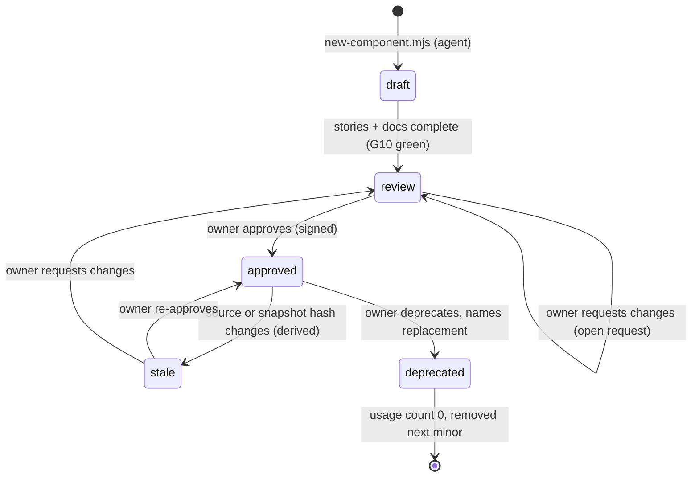

# Design-system tooling for a UI changed by many agents in parallel

**Status:** research, `proposed` (nothing here is accepted or implemented) · **Date:** 2026-10-20 ·
**Scope:** stage U1 ([ROADMAP](../../plans/ROADMAP.md)), [ADR-0022](../../decisions/0022-plugin-trust-tiers-ui-slots-and-design-tokens.md) §§4–5,
REQ-F1, REQ-F2, REQ-F5, REQ-K4 · **Web sources accessed:** 2026-10-20 unless a source says otherwise

Legend: **[V]** checked in a primary source (official docs, the repository, its LICENSE, release
notes, the npm registry, or this repository's own files); **[I]** inference or recommendation.
Package versions and licences come from `npm view` and the GitHub API on 2026-10-20 [50] [51].

## 1. Recommendation in one page

1. **Tokens.** Author tokens in DTCG 2025.10 JSON, with colours in `oklch` and a `hex` fallback.
   Describe themes, density and motion with one DTCG **Resolver 2025.10** file. Build with
   **Style Dictionary 5.7** (Apache-2.0). Style Dictionary does not read resolver files yet, so a
   short Guanxi script expands the resolver contexts and calls Style Dictionary once per
   context. Outputs: CSS custom properties, a Tailwind v4 `@theme inline` file that clears the
   default palette, TypeScript token types, and the MCP Apps `styles.variables` map. All output
   is generated, committed and drift-checked. [V for the spec and tool status; I for the design]
2. **One source, two catalogs.** Each component lives in its own folder with
   `*.stories.tsx` (CSF 3), `*.docs.md` and `*.review.json`. **Storybook 10.6** (MIT) reads the
   same files as the developer and test harness: interaction tests, axe checks, the component
   manifest and the MCP server for agents. A lazy-loaded **Settings → Developer → Components**
   route in the product renders the same stories with a small CSF-3 interpreter and no
   Storybook runtime. It shows live examples, states, usage notes, code, token swatches and
   the approval status. [V for the Storybook features; I for the interpreter]
3. **Enforcement.** Seventeen falsifiable gates (§4): token validity, drift, contrast, `var()`
   resolution, no literal colour, spacing or motion values (Tailwind palette cleared, plus
   `eslint-plugin-better-tailwindcss` and `stylelint-declaration-strict-value`), import
   boundaries, primitive reuse, catalog completeness, status policy, signed approvals, visual
   snapshots in a pinned Playwright Docker image, axe, i18n and reduced motion. Each gate ships
   with a seeded violation fixture that must fail. Migrating the existing interim UI uses ESLint
   bulk suppressions as a ratchet that may only shrink. [V for the tools; I for the gate design]
4. **Agents** get a `guanxi-ui` Agent Skill (§5): find the component in the catalog first, reuse
   it before extending it and extend it before adding a new one, use tokens only, cover every
   state, use locale keys and motion tokens, then run `npm run ui:check`. Agents never set
   `approved`. [I]
5. **Approval.** Each component has a lifecycle `draft → review → approved → deprecated`,
   stored per component in the repository. An approval is bound to the hash of the component's
   source and to its snapshot hashes, so any later change marks it **stale**. During slices,
   CI blocks only `draft` components on product screens and new uses of deprecated ones; the
   release gate blocks anything not approved. [I]
6. **Motion.** CSS-only for U1, using six duration tokens (0–400 ms) and five easings taken from
   M3, Fluent 2 and Carbon. Reduced motion is a token-level mode with a separate in-app
   setting. Motion (MIT) is allowed later, only behind a `@guanxi/ui` wrapper for layout and
   reorder animations. [V for the scales; I for the selection]

## 2. Where the web package stands today (local evidence)

All items below come from this repository at `517e080`, read on 2026-10-20 [V].

| Fact | Evidence | Consequence |
| --- | --- | --- |
| React 19, Vite 6, Tailwind v4 via `@tailwindcss/vite`; no ESLint or stylelint config anywhere | `packages/web/package.json`, `vite.config.ts`, repo root | Lint gates are greenfield |
| Tokens are hand-written CSS variables in `index.css` (oklch), with dark mode as a `.dark` class; `@theme` defines only fonts, `text-2xs` and four `fit-*` colours | `packages/web/src/index.css` | The default Tailwind palette is still enabled |
| **683** class usages of the form `bg-[var(--x)]` across 44 `.tsx` files | grep over `packages/web/src` | Semantic utilities (`bg-surface`) would remove most arbitrary values; this can be codemodded |
| `--warning` and `--focus` are referenced 11 times but **never defined** | `LauncherPage.tsx`, `ContextPanel.tsx`, `ChatPage.tsx`, `ChatRetentionInfo.tsx`, `HuggingFaceDiscovery.tsx` vs `index.css` | Warning text and focus rings silently fall back. Gate G4 would have caught this |
| 3 literal palette classes (`bg-white`, `bg-black/45`, `bg-black/55`), 9 arbitrary px values, 24 inline `style={{…}}` | grep | A small but real literal surface |
| 21 primitives exported from one 728-line `components/ui.tsx`; 77 exported PascalCase components in total | grep | A catalog has to start from this inventory |
| Locale catalogue is one 3,464-line `lib/locale.ts` with a typed `Record<LocaleKey, string>` for en/ru | `lib/locale.ts` | en/ru key parity is already checked by the type system; JSX literal strings are not checked |
| Reduced motion is a global `0.01ms !important` kill switch; every Playwright test runs with `reducedMotion: 'reduce'` | `index.css`, `playwright.config.ts` | The full-motion path is never tested |
| Brand colours are ink `#182322` (oklch 0.245 0.016 189) and ivory `#F4F2E9` (oklch 0.960 0.012 96), contrast 14.4:1; the app accent is blue `oklch(0.55 0.2 264)` | `assets/brand/guanxi-gx-v1/README.md`; local computation | The brand and the UI palette are not reconciled yet (open question Q1) |

## 3. Token pipeline

### 3.1 Standard status

| Item | Status on 2026-10-20 | Notes |
| --- | --- | --- |
| DTCG Format Module 2025.10 | Final CG report, 2025-10-28; "considered stable"; not a W3C Standard [1] [4] | Types: color, dimension `{value, unit: px\|rem}`, fontFamily, fontWeight, duration `{value, unit: ms\|s}`, cubicBezier, number, strokeStyle, border, transition, shadow, gradient, typography. Aliases use `{group.token}`; property-level references use JSON Pointer `$ref`; groups use `$extends` and `$root` [V] |
| DTCG Color Module 2025.10 | Final CG report, 2025-10-28 [2] | `colorSpace` is one of `srgb`, `srgb-linear`, `hsl`, `hwb`, `lab`, `lch`, `oklab`, `oklch`, `display-p3`, `a98-rgb`, `prophoto-rgb`, `rec2020`, `xyz-d65`, `xyz-d50`, plus `components`, optional `alpha` and optional `hex` fallback [V] |
| DTCG Resolver Module 2025.10 | Final CG report, 2025-10-28 [3] | `sets`, `modifiers` with `contexts` (its examples are `light`, `dark`, `lightHighContrast`, `darkHighContrast` and sizes `small/medium/large`) and `resolutionOrder`; files use `*.resolver.json` with `version: "2025.10"` [V]. A next-edition draft is dated 2026-09-08 [4] |
| Style Dictionary 5.7.0 | Apache-2.0, released 2026-10-16 [6] | Of the 2025.10 items: color objects since 5.3.0, dimension objects since 5.4.0, duration objects since 5.7.0. Gradient is in progress and the **resolver is not supported**; tracking issue #1590 is open [7] [V] |
| Terrazzo (`@terrazzo/cli` 2.9.0) | MIT, active [8] [51] | Claims "full DTCG format" support; has CSS, JS/TS, Tailwind and Storybook plugins and `check`, `lint` and `bundle` (resolver) commands. Its own docs say some resolver features arrive in 2.0 [V]. Smaller community (477 stars) [V] |
| Tokens Studio (`@tokens-studio/sd-transforms` 2.0.3) | MIT [9] | Built for the Tokens Studio Figma plugin. The owner does not use Figma, so it adds nothing here [I] |

**Choice:** keep Style Dictionary, as ADR-0022 says. Add a resolver-expansion script of about 150 lines. Keep
Terrazzo `check` as an optional second validator, and as the fallback if Style Dictionary has not shipped
resolver support by U1 [I].

### 3.2 Token architecture

```text
packages/ui/tokens/
  primitive/color.tokens.json        # ink/ivory ramps, accent, status hues — oklch + hex
  primitive/size.tokens.json         # 4px grid, radii, borders, font sizes (rem)
  primitive/motion.tokens.json       # durations, cubicBezier easings, distances
  semantic/color.light.tokens.json   # background/text/border/ring × role, aliases only
  semantic/color.dark.tokens.json
  semantic/color.light-hc.tokens.json
  semantic/color.dark-hc.tokens.json
  semantic/density.compact.tokens.json
  semantic/density.comfortable.tokens.json
  semantic/motion.full.tokens.json
  semantic/motion.reduced.tokens.json
  component/*.tokens.json            # only where a component needs its own knob
  contrast-pairs.json                # fg/bg pairs + required ratio per theme
  guanxi.resolver.json               # DTCG Resolver 2025.10
packages/ui/src/generated/           # committed, never hand-edited
  tokens.css   theme.css   tokens.ts   mcp-apps-variables.ts   tokens.flat.json
```

- **Tiers:** primitive values, then semantic aliases, then optional component aliases. Feature
  code and plugins may reference only semantic tokens. Gate G5 enforces this, because
  primitive tokens are emitted to CSS but not to Tailwind [I].
- **Semantic vocabulary aligned with MCP Apps.** The MCP Apps spec (2026-01-26) standardises
  host variables `--color-{background,text,border,ring}-{primary,secondary,tertiary,inverse,ghost,info,danger,success,warning,disabled}`,
  `--font-{sans,mono}`, `--font-{text,heading}-*-{size,line-height}`, `--font-weight-*`,
  `--border-radius-*`, `--border-width-regular` and `--shadow-*`. It **deliberately excludes
  spacing** [49] [V]. Naming Guanxi's semantic colour tokens after this vocabulary makes the
  T2-iframe mapping (ADR-0022 §4) an identity function [I].
- **Colour:** keep OKLCH, which the code already uses. Ramps are generated at fixed L steps,
  so lightness is perceptually even across hues [I]. The `hex` fallback is required on every
  primitive so that non-CSS outputs (Expo, Swift) and old tools keep working [V for the field; I for the policy].
- **Themes:** `light`, `dark`, `light-hc` and `dark-hc` are contexts of one `theme` modifier
  [3]. The CSS uses `:root[data-theme=…]`. The `system` mode follows `prefers-color-scheme`,
  and `prefers-contrast: more` selects the HC variant automatically; that media feature has
  been Baseline widely available since 2022 [48]. `forced-colors: active` keeps system colours,
  as `index.css` already does for some cards [V for the media features; I for the mapping].
- **Density:** a `density` modifier with `compact` (today's 13px base) and `comfortable`.
  Tailwind v4 derives the whole spacing scale from the single `--spacing` variable [10] [V],
  so a density context can change `--spacing` and the base `--text-*` sizes under
  `[data-density=comfortable]` without touching components [I]. DTCG has no density type; the
  resolver's size modifier shows the pattern [3] [V].
- **Motion:** a `motion` modifier with `full` and `reduced` contexts (§6).

Example primitive and resolver (illustrative values) [I]:

```json
{
  "color": {
    "$type": "color",
    "ink": {
      "900": { "$value": { "colorSpace": "oklch", "components": [0.245, 0.016, 189], "hex": "#182322" } }
    },
    "ivory": {
      "50": { "$value": { "colorSpace": "oklch", "components": [0.96, 0.012, 96], "hex": "#f4f2e9" } }
    }
  },
  "motion": {
    "duration": {
      "$type": "duration",
      "moderate": { "$value": { "value": 150, "unit": "ms" } }
    },
    "easing": {
      "$type": "cubicBezier",
      "standard": { "$value": [0.2, 0, 0, 1] }
    }
  }
}
```

```json
{
  "version": "2025.10",
  "name": "guanxi",
  "sets": [{ "name": "primitives", "sources": [{ "$ref": "primitive/color.tokens.json" }] }],
  "modifiers": [
    { "name": "theme", "default": "light", "contexts": {
      "light": [{ "$ref": "semantic/color.light.tokens.json" }],
      "dark": [{ "$ref": "semantic/color.dark.tokens.json" }],
      "light-hc": [{ "$ref": "semantic/color.light-hc.tokens.json" }],
      "dark-hc": [{ "$ref": "semantic/color.dark-hc.tokens.json" }] } },
    { "name": "density", "default": "compact", "contexts": { "compact": [], "comfortable": [] } },
    { "name": "motion", "default": "full", "contexts": { "full": [], "reduced": [] } }
  ],
  "resolutionOrder": ["primitives", "theme", "density", "motion"]
}
```

The exact `$ref` and inline-set shapes must be checked against [3] when implementing.

### 3.3 Outputs

| Output | Consumer | Content |
| --- | --- | --- |
| `tokens.css` | every client | `:root` (defaults) plus one selector block per modifier context; modifiers are orthogonal, so we emit per-modifier blocks rather than all 4×2×2 permutations [I] |
| `theme.css` | Tailwind v4 | `@theme inline { --color-*: initial; --ease-*: initial; --animate-*: initial; --color-surface: var(--color-background-secondary); … }`. `initial` removes the default palette, so `bg-red-500` stops existing [10] [V]. `inline` keeps runtime theme switching through `var()`, as shadcn does [11] [V] |
| `tokens.ts` | TS code, tests, catalog | `type ColorToken = 'background-primary' \| …`, values per context, `cssVar(name)` helper |
| `mcp-apps-variables.ts` | T2 iframes (ADR-0022) | `Record<McpAppsVariable, string>` per theme, using `light-dark()` values as the spec recommends [49] [V] |
| `tokens.flat.json` | catalog Foundations pages, `guanxi-ui` skill | name, value per context, description, deprecated flag |

## 4. Component catalog

### 4.1 Options

| Option | Licence, version, activity | Fit for Guanxi | Agent features | Tests | Verdict |
| --- | --- | --- | --- | --- | --- |
| **Storybook 10.6.2** (`storybook`, `@storybook/react-vite`) | MIT; 10.6.2 released 2026-10-12; 11.0 in alpha [19] [50] | React + Vite native; Storybook 10 is ESM-only and needs Node 20.16+, 22.19+ or 24+ [20] [V] | `@storybook/addon-mcp` (preview) with tools `docs-list`, `docs-show`, `docs-show-story`, `stories-preview`, `stories-find-by-component`, `get-storybook-story-instructions`, `stories-changed`, `review-create`, `test-run` [16] [V]; the component manifest at `/manifests/components.json` is generated in dev and build, but "schema is not yet stable" [17] [V] | `@storybook/addon-vitest` (Vitest 3–5 browser mode) and `@storybook/addon-a11y`; axe fails a test only with `parameters.a11y.test: 'error'` [21] [V]; Visual Tests addon = Chromatic SaaS (excluded) | **Adopt as the dev/test/agent harness** |
| Ladle (`@ladle/react` 5.1.1) | MIT; last npm publish 2025-11-04; repo pushed 2026-06 [51] | Vite-based Storybook alternative [25] [V] | none found | Exports a story index for Playwright [25] [V] | Lighter, but no agent surface, so its activity risk is not worth it |
| Histoire 1.0.0-beta.1 | MIT; active repo [51] | Vue-first; a React guide exists, but the demos are Vue and Svelte only [26] [V] | none | — | Reject |
| React Cosmos 7.4.1 | MIT; active [27] [51] | Fixture files, static export, Vite integration [27] [V] | not mentioned | — | Viable fallback |
| **Custom in-app route** | ours | Runs in the real runtime, theme and plugins, including inside Electron | Only what we build | Our own Vitest and Playwright | **Adopt as the second renderer of the same files** |

### 4.2 Own shadcn registry: useful, but not for primitives

- How registries work [V]: a root `registry.json` lists items; `shadcn build` writes static
  `public/r/<name>.json` files; consumers install with `shadcn add <url>` or a namespace
  (`registries: { "@acme": "https://…/{name}.json" }` in `components.json`, with optional auth
  headers) [12] [14]. `registry-item.json` has `type` (`registry:ui`, `block`, `component`,
  `lib`, `hook`, `page`, `file`, `style`, `theme`, `base`, `font`, `item`), `files`,
  `dependencies`, `registryDependencies`, `cssVars`, `css`, `docs`, `categories` and a free-form
  `meta` [13].
- shadcn MCP (`npx shadcn@latest mcp`, or `mcp init --client claude`) exposes
  `get_project_registries`, `list_items_in_registries`, `search_items_in_registries`,
  `view_items_in_registries`, `get_item_examples_from_registries`, `get_add_command_for_items`
  and `get_audit_checklist`. The checklist is a generic text: imports, dependencies, lint,
  types [14] [V, read from source]. shadcn CLI v4 (March 2026) also ships an official
  `shadcn` Agent Skill [15] [I: seen in the search snippet of the official page, not opened].
- **Use for Guanxi:** a namespace `@guanxi` registry of **blocks and plugin templates** that
  *import* `@guanxi/ui` (for example "settings page skeleton" or "tool-result renderer"),
  served by the node for plugin authors and agents. **Never copy primitives into plugins
  through the registry.** Copy-in forks the primitive and defeats the single catalog. The
  primitives themselves were copied in once from shadcn on Base UI (ADR-0022) and live only in
  `@guanxi/ui` [I].

### 4.3 In the product or a separate site

| Concern | In-product route (Settings → Developer → Components) | Separate dev site (Storybook) |
| --- | --- | --- |
| Fidelity | Real fonts, theme plugins, Electron renderer, locale, density | Isolated iframe; decorators approximate the app |
| Owner review | In the app he uses daily, on any node, including the PWA | Requires `npm run storybook` from a checkout |
| Theme and plugin authors | Can preview a data-only theme plugin (ADR-0022 §6) against every component | Only with extra wiring |
| Agent tooling | None unless we build it | MCP, manifest, test-run, change detection |
| Tests | Our own Playwright over the route | Vitest addon, a11y addon, interactions |
| Cost and risk | Bundle size (mitigated by a lazy chunk), fixtures shipped to users, a dev surface in a release build | A heavy dev-only dependency tree, Storybook 11 migration in 2027 |
| Writes (approval) | Must not write in release builds | Not designed for it |

**Can one source feed both?** Yes, if stories follow a "portable CSF 3" profile [I]:

- default export `{ title, component, args, argTypes, parameters: { guanxi: { states, level } } }`,
  named exports `{ name, args, render? }`, and decorators imported from one shared
  `catalog/decorators.tsx`;
- no `loaders`, no `play` in stories that are tagged `catalog`. Interaction tests live in
  separate `*.test.stories.tsx` files that only Storybook runs;
- the in-app route uses `import.meta.glob('…/*.stories.tsx')` plus a ~100-line interpreter
  (`render ?? (args) => <Component {...args}/>`, wrapped in the shared decorators), together
  with `*.docs.md` (rendered by the existing Markdown component) and the generated props
  table.

CSF Next (preview in 10.x) adds `story.Component` and `story.run()` for rendering outside
Storybook [23] [V]. It requires `definePreview` from the framework package, which would pull
Storybook runtime into the product bundle [I], so we revisit it when Storybook 11 makes
factories the default. A codemod exists (`npx storybook automigrate csf-factories`) [23] [V].

### 4.4 Folder convention (one source)

```text
packages/ui/src/components/button/
  button.tsx               # implementation (shadcn on Base UI, copied in)
  button.stories.tsx       # portable CSF 3: one story per declared state
  button.test.stories.tsx  # optional: play/interaction tests, Storybook only
  button.docs.md           # frontmatter + required sections
  button.review.json       # lifecycle status (section 7)
  index.ts
packages/ui/catalog/
  decorators.tsx  interpreter.tsx  manifest.json (generated)  status.schema.json
```

`button.docs.md` frontmatter: `id`, `level` (`primitive | pattern | feature`), `states`
(for example `[default, hover, focus, disabled, loading, error]`), `tokens` (component tokens
used) and `since`. Required headings: **Purpose**, **When to use**, **When not to use**,
**Anatomy and variants**, **States**, **Accessibility**, **Content and i18n**, **Motion**,
**Do / Don't**. `manifest.json` is generated by `react-docgen-typescript` (props) and
ts-morph (exports, imports). Agents and the in-app route read our own manifest instead of
Storybook's unstable one [I].

## 5. Enforcement: gates as falsifiable checks

Each gate has a command, an assertion, a **seeded violation** in
`packages/ui/test/gate-fixtures/` that must make the gate fail (gate G17 runs them all), a
mode, and the stage that introduces it [I]. This satisfies AGENTS.md readiness rule 4: every
claimed property needs an assertion that fails when the property is violated.

| # | Gate | Assertion (fails when…) | Seeded violation | Tool | Mode |
| --- | --- | --- | --- | --- | --- |
| G1 | Tokens valid | any token has a broken alias, a wrong `$type`, or a colour without `hex` | alias `{color.missing}` | Style Dictionary build, broken references set to throw; optional `terrazzo check` | error |
| G2 | Generated output fresh | regenerating changes `src/generated/**` | hand-edit `tokens.css` | `tokens:build && git diff --exit-code` | error |
| G3 | Contrast | any pair in `contrast-pairs.json` is below its ratio in any theme (text 4.5:1, large/UI 3:1, HC themes 7:1) | darken `text-tertiary` in dark | `colorjs.io` (MIT) WCAG 2 ratio; `apca-w3` is excluded because its "Limited W3 License" fails `check:licenses` [50] | error |
| G4 | `var()` resolves | any `var(--x)` in TS/TSX/CSS of web, ui or plugins is not a generated token or an allow-listed local variable | `text-[var(--warning)]` (the real bug in §2) | custom script, about 60 lines | error |
| G5 | No literal colour or arbitrary value in classes | a class is unknown to the compiled theme (default palette cleared) or matches `\[[^\]]*\]` outside an allow-list | `bg-red-500`, `text-[#fff]`, `w-[300px]` | `eslint-plugin-better-tailwindcss` 4.10 `no-unknown-classes` and `no-restricted-classes` (regex, message, autofix with capture groups) [28] | error with ratchet |
| G6 | No literal values in CSS | `color`, `background*`, `border*-color`, `outline-color`, `fill`, `stroke`, `box-shadow`, `margin*`, `padding*`, `gap`, `font-size`, `z-index`, `transition*`, `animation*` hold a raw value | `.x { color: #fff }` | `stylelint` 17 + `stylelint-declaration-strict-value` 1.12 (`expandShorthand`, `ignoreFunctions: false`) [30]; generated files excluded | error |
| G7 | No literal motion | `duration-[…]`, `ease-[…]`, `delay-[…]`, raw ms or `cubic-bezier` in TS or CSS | `duration-[275ms]` | G5 and G6 patterns | error |
| G8 | Import boundaries | `features/**` or plugins import `@guanxi/ui/src/**` internals, `@base-ui/react`, `lucide-react` or `motion` directly | `import { Dialog } from '@base-ui/react/dialog'` in a feature | ESLint `no-restricted-imports` + `eslint-plugin-boundaries` 7.2 (MIT) | error |
| G9 | Reuse primitives | a feature renders raw `<button> <input> <select> <textarea> <dialog>`, or a `style` prop other than allow-listed CSS custom properties for geometry | `<button className=…>` in `features/chat` | `react/forbid-elements` (eslint-plugin-react) / `no-restricted-syntax` | error with ratchet |
| G10 | Catalog completeness | an exported component of `@guanxi/ui` (or a slot contribution) lacks a story per declared state, a docs file with all required headings, or a review file; or an entry is orphaned | export `NewThing` with no files | `ui:catalog-check` (ts-morph 28, react-docgen-typescript 2.4) | error |
| G11 | Status policy | product or plugin code imports a `draft` component; deprecated usage count rises above baseline | import a `draft` into `features/` | react-scanner 1.2 usage report [32] + checker | error (slice); `review` and `stale` warn |
| G12 | Approval integrity | a commit that sets `status: approved` (or changes `approved.*`) is not signed by an owner key in `allowed_signers` | agent commit flips status | `git log -p` + `git verify-commit` | error |
| G13 | Visual regression | any catalog story × {light, dark} (+ {light-hc, dark-hc} for primitives) differs from its baseline | change one semantic token | Playwright `toHaveScreenshot` [33] against the static Storybook build, run **only** in `mcr.microsoft.com/playwright:v1.64.1-noble`, matching `@playwright/test` [34] | error |
| G14 | Accessibility | any serious/critical axe violation in any story, or in the new-session and settings flows | icon button without a name | `@storybook/addon-a11y` (`a11y.test: 'error'`) [21]; `@axe-core/playwright` 4.14 (MPL-2.0, allowed by ADR-0016) | error |
| G15 | i18n | JSX text or a user-facing attribute is a literal; a story fails to render in `ru` or a pseudo-locale (+40% length) without clipping | `<span>Save</span>` | `eslint-plugin-i18next` 6.1 (ISC) `no-literal-string`; key parity is already typed | error |
| G16 | Reduced motion | under emulated `reducedMotion: 'reduce'` (or `data-motion=reduced`) a catalog story still animates `transform`, `translate` or `scale`, or a looping animation runs | `animate-spin` without a reduced variant | Playwright, reading `getAnimations()` and computed styles | error |
| G17 | Gates self-test | any seeded fixture above passes its gate | — | `ui:gates:selftest` | error |

**Migration of interim UI.** The ROADMAP U1 exit gate already requires "lint forbids literal
colours across the whole web package". Enable G5–G9 as `error` on day one, record existing
violations with ESLint **bulk suppressions** (`--suppress-rule`, a committed
`eslint-suppressions.json`), and fail on unused suppressions so the file can only shrink
[31] [V]. U1 exits when the colour rules have zero suppressions. A codemod rewrites the 683
`[var(--x)]` classes to semantic utilities, using the `fix` capture groups of
`no-restricted-classes` [28] [V/I].

**Visual-regression tool choice.** Lost Pixel is **archived and sunset**: its team joined
Figma [35] [V], so it is excluded. reg-suit (MIT, active) is useful only for hosted HTML
diff reports [36]. Chromatic is SaaS. Playwright snapshots committed per component suffice
locally and in CI. Baselines are generated only inside the pinned Docker image, because
rendering differs across OS, hardware and headless mode [33] [V]. On this Mac, that means
Colima via the `workstation-dev` skill.

**Aggregate command:** `npm run ui:check` = G1–G12 + G15 + G17 (fast, no browser);
`npm run ui:check:browser` = G13, G14 and G16. Both emit JSON (`--json`) for agents [I].

## 6. Agent-facing guidance

### 6.1 How others do it

| Mechanism | What it is | Relevance |
| --- | --- | --- |
| `AGENTS.md`, nested | Plain Markdown; Cursor merges nested files, with more specific files taking precedence [39] [V]; MIT format repository [40] | Put a short `packages/ui/AGENTS.md` (rules, commands, links) next to the code |
| Agent Skills | `SKILL.md` with `name` (≤64 characters, must equal the directory name) and `description` (≤1,024 characters, saying what and when), optional `scripts/`, `references/` and `assets/`; body under 5k tokens and under 500 lines; validate with `skills-ref validate` [38] [V] | ADR-0022 §10 already discovers `.agents/skills/` and `.claude/skills/` |
| Cursor rules | `.cursor/rules/*.mdc` with `description`, `globs`, `alwaysApply`. Cursor advises keeping rules under 500 lines and letting linters enforce style instead of copying style guides into rules [39] [V] | Same principle: **rules in linters, intent in skills** |
| Storybook MCP | Recommends adding `AGENTS.md`/`CLAUDE.md` lines telling the agent to use `docs-list`, `docs-show` and `test-run` before building UI [16] [V] | Optional; needs a running dev server per checkout |
| shadcn skill + MCP | Official skill (CLI v4, March 2026) plus registry MCP [14] [15] | We use our own registry namespace; agents must not `shadcn add` primitives into features (G8) |

### 6.2 `guanxi-ui` skill outline

```text
.agents/skills/guanxi-ui/          # canonical; .claude/skills/guanxi-ui -> symlink
  SKILL.md
  references/
    tokens.md            # GENERATED from tokens.flat.json: semantic names, intent, per-theme values
    components.md        # GENERATED from catalog manifest: id, level, status, import, when to use / not
    patterns.md          # layouts: dense list, inspector panel, run timeline, empty/error/offline states
    motion.md            # token table + interaction matrix (section 7)
    content-i18n.md      # locale keys, glossary, tone, pseudo-locale rule
    review-checklist.md  # section 6.3
  scripts/
    find-component.mjs   # fuzzy search over manifest.json -> JSON
    ui-check.mjs         # runs npm run ui:check --json, summarises failures with fix hints
    new-component.mjs    # scaffolds folder with draft review.json, stories per state, docs template
```

The `SKILL.md` frontmatter: `name: guanxi-ui`, with a description like "Build or change Guanxi web UI, plugin UI, themes or
components with the design system. Use whenever a .tsx/.css file under packages/web,
packages/ui or a plugin's UI is edited, a component or token is added, or UI review is
requested." The body is about 150 lines:

1. **Orient:** read `packages/ui/AGENTS.md`; run `find-component.mjs "<need>"` before you write
   any JSX.
2. **Decision ladder:** use an approved component, then add a variant to an existing component
   (a change to an approved component), then compose a pattern from primitives, and only then
   create a new component (`new-component.mjs`, status `draft`). Never restyle a primitive
   through `className` colour or typography in a feature.
3. **Tokens only:** use semantic utilities (`bg-surface`, `text-muted`, `gap-2`), never
   palette or arbitrary values. If no token fits, stop and propose one in the PR description;
   do not invent one.
4. **States:** every interactive surface covers default, hover, focus-visible, active,
   disabled, loading, empty, error and offline, plus selected or expanded where relevant.
   Each declared state needs a story.
5. **Content:** locale keys only (English source, curated Russian); check the glossary.
6. **Motion:** use motion tokens; spatial motion must be removed under reduced motion; follow
   the interaction matrix.
7. **Accessibility:** a name for every control, keyboard path, focus return, `aria-live` for
   streaming and status, and hit areas of at least 24 px (WCAG 2.2 AA target size) [I].
8. **Verify:** run `ui-check.mjs`; update snapshots only in Docker (`npm run ui:snapshots`);
   never edit `src/generated/**`; never set `approved`, which is reserved for the owner (G12).
9. **Hand-off:** list the components touched and their status changes (`approved → stale`),
   and attach the catalog URL of each changed story for the owner.

### 6.3 Review checklist (independent reviewer sub-agent, per WORKFLOW)

- [ ] `npm run ui:check` and `ui:check:browser` are green; the suppressions file did not grow.
- [ ] No new component exists where an existing one or a variant would do (cite the
  `find-component` query).
- [ ] Every new or changed component has stories for all declared states, complete docs
  headings and a `review.json` set to `draft` or `review`.
- [ ] Light, dark and both HC themes, and both densities, look correct in the catalog;
  snapshot diffs were inspected, not just accepted.
- [ ] Keyboard-only walk-through of the changed flow; screen-reader names and live regions
  checked; focus is visible in forced-colours mode.
- [ ] Motion: only tokens; reduced-motion story checked; no animation on streaming text.
- [ ] Strings: no literals; the Russian translation is present and fits; the pseudo-locale
  does not clip.
- [ ] Plugin UI (if any) uses only `@guanxi/ui` and semantic tokens; a T2 iframe takes its
  colours from `mcp-apps-variables`.
- [ ] Residual risks and any `stale` approvals are listed for the owner.

## 7. Motion system

### 7.1 Reference scales

| System | Durations | Easings | Source |
| --- | --- | --- | --- |
| Material 3 | short1–4: 50/100/150/200 ms; medium1–4: 250/300/350/400; long1–4: 450–600; extra-long1–4: 700–1000 | standard `(0.2,0,0,1)`, standard-decelerate `(0,0,0,1)`, standard-accelerate `(0.3,0,1,1)`, emphasized-decelerate `(0.05,0.7,0.1,1)`, emphasized-accelerate `(0.3,0,0.8,0.15)` | material-web tokens, Apache-2.0 [41] [V] |
| IBM Carbon | fast-01 70, fast-02 110, moderate-01 150, moderate-02 240, slow-01 400, slow-02 700 | productive standard `(0.2,0,0.38,0.9)`, entrance `(0,0,0.38,0.9)`, exit `(0.2,0,1,0.9)`; expressive variants. "Productive" is for task focus, "expressive" for significant moments, used sparingly | [42] [V] |
| Fluent 2 | ultraFast 50, faster 100, fast 150, normal 200, gentle 250, slow 300, slower 400, ultraSlow 500 | decelerateMid `(0,0,0,1)`, accelerateMid `(1,0,1,1)`, easyEase `(0.33,0,0.67,1)`, and others | `@fluentui/tokens` source [43] [V]; Fluent 2 guidance: offer an in-app no-motion setting, keep motion local to the focused element, use ARIA live regions [44] [V] |
| Apple HIG | no public numeric scale; purposeful, brief motion; honour Reduce Motion by replacing movement with fades | — | [45] [I: page did not render for the fetch tool] |

### 7.2 Proposed Guanxi tokens (productive by default)

| Token | Value | Use | Aligned with |
| --- | --- | --- | --- |
| `motion.duration.instant` | 0 ms | theme switch, density switch, streaming append | — |
| `motion.duration.fast` | 100 ms | hover/press colour, toggles, status-chip colour | M3 short2, Fluent faster, Carbon fast-02 |
| `motion.duration.moderate` | 150 ms | tool-call/reasoning expand, tooltip, menu | M3 short3, Fluent fast, Carbon moderate-01 |
| `motion.duration.medium` | 200 ms | popover, toast enter, panel slide | M3 short4, Fluent normal |
| `motion.duration.slow` | 300 ms | dialog, large inspector panel | M3 medium2, Fluent slow |
| `motion.duration.slower` | 400 ms | rare full-surface transitions only | Carbon slow-01, Fluent slower |
| `motion.easing.standard` | `(0.2, 0, 0, 1)` | most transitions | M3 standard |
| `motion.easing.enter` | `(0, 0, 0, 1)` | elements appearing | M3 standard-decelerate, Fluent decelerateMid |
| `motion.easing.exit` | `(0.3, 0, 1, 1)` | elements leaving (use one step shorter than enter) | M3 standard-accelerate |
| `motion.easing.emphasized` | `(0.05, 0.7, 0.1, 1)` | new-session screen, first-run moments only | M3 emphasized-decelerate |
| `motion.easing.linear` | `(0, 0, 1, 1)` | progress, spinners | — |
| `motion.distance.{sm,md,lg}` | 4 / 8 / 16 px | translate offsets | — |

In the **`reduced`** context, distances become 0, spatial durations become 0, and opacity fades
are capped at `fast`. Looping indicators become a static glyph plus text. The current global
`0.01ms !important` rule stays only as a safety net [I]. The in-app setting
`Motion: system | reduced | full` sets `data-motion`, following the Fluent advice [44] [V for
the advice]. REQ-F1 lists "animations" as a plugin surface, and motion tokens are data, so a
motion plugin is just another resolver context [I].

### 7.3 What moves in a dense agent UI

| Interaction | Motion | Reduced | Why |
| --- | --- | --- | --- |
| Streaming tokens | none; append instantly; no typewriter or fade per token | same | 50–100 tokens/s of animated text costs CPU and hurts readability [I] |
| Auto-scroll while streaming | instant `scrollTop`; never `behavior: 'smooth'` | same | Smooth scrolling fights the stream [I] |
| Tool-call / reasoning expand | `moderate`, `standard`; `grid-template-rows: 0fr→1fr` plus opacity; no animation for "expand all" | instant | `interpolate-size` is not Baseline yet [48] [V] |
| Inspector or side panel | `medium` enter / `fast` exit, `transform` only | crossfade `fast` | — |
| Menus, popovers, tooltips | Base UI `[data-starting-style]` / `[data-ending-style]` CSS transitions, which can reverse mid-flight [47] [V]; `@starting-style` is Baseline 2024 [48] [V] | opacity only | No JS library needed |
| Dialogs | `slow` scale 0.98→1 + fade | fade `fast` | — |
| Toasts / notification center (ADR-0033) | `medium` enter (translate `sm` + fade), `fast` exit; pause the timer on hover or focus; `aria-live` | fade only | — |
| Run-status chips, cost meters | colour crossfade `fast`; numbers update without count-up | instant | Numbers are evidence, not decoration |
| Timeline insertions | none (no layout animation while streaming) | none | Layout shift in logs is harmful [I] |
| Skeletons | slow shimmer | static | — |
| Board drag/reorder (ADR-0032) | later: Motion `LazyMotion` layout animation | instant | The only case that needs JS layout animation |

**Library choice.** U1 uses CSS only, through Tailwind utilities generated from motion tokens
(`--ease-*` and `--animate-*` cleared to `initial`, then redefined) [10] [V]. **Motion**
(`motion` 14.4.0, MIT) costs about 43 kB for the full `motion` component, just over 5 kB for
`m` with `LazyMotion` (plus 24 kB for `domAnimation` features), 3.3 kB for mini `useAnimate`,
and about 1 kB for `useReducedMotion` alone [46] [V]. Allow it later only through
`@guanxi/ui/motion` (G8), which reads the duration and easing tokens [I].

## 8. Approval workflow

### 8.1 Lifecycle



`stale` is **derived** by `ui:catalog-check` and never stored, so agents cannot forget to set
it [I].

### 8.2 Storage, one file per component to avoid merge conflicts between parallel agents [I]

```json
{
  "$schema": "../../../catalog/status.schema.json",
  "id": "button",
  "level": "primitive",
  "status": "approved",
  "approved": {
    "at": "2026-11-02",
    "sourceHash": "sha256:…",
    "snapshotHashes": { "light": "sha256:…", "dark": "sha256:…" }
  },
  "requests": [
    { "id": "r1", "at": "2026-11-01", "text": "Comfortable density padding feels loose", "state": "resolved" }
  ],
  "deprecated": null
}
```

`sourceHash` covers the component folder, minus `review.json` and `*.docs.md`. The snapshot
hashes bind the approval to what the owner actually saw: an accepted baseline update turns
the component `stale` [I].

### 8.3 How the owner approves

- **In the catalog (dev builds):** Approve / Request changes / Deprecate buttons call a
  Vite **dev-server-only** middleware (`apply: 'serve'`, loopback only). It edits
  `*.review.json` and does not change `packages/contract` or the product server. In release
  builds the buttons copy an equivalent command instead [I].
- **In the terminal:** `npm run ui:review -- approve button` or
  `request-changes button "text"`.
- **Commit:** the owner commits approvals with his SSH signing key; G12 rejects unsigned or
  non-owner approval commits. A "request changes" entry may also become a work item for agents
  through the work ledger (ADR-0032) [I].
- **Catalog display:** a status badge on every entry; filters for `draft`, `review`, `stale`
  and `deprecated`; per-component usage count (react-scanner) and "used by" list; open
  requests. Storybook shows the same status through tags (sidebar filtering) and
  `storybook-addon-tag-badges` (MIT) [I].

### 8.4 CI policy matrix

| Situation | Slice gate (every PR or commit) | Release / stage-exit gate |
| --- | --- | --- |
| Product screen or plugin imports `draft` | **error** | error |
| Imports `review` or `stale` | warn (listed in hand-off) | **error** |
| New use of `deprecated` (count above baseline) | **error** | error |
| Existing deprecated use | warn | error after one minor (matches ADR-0022 §8) |
| Catalog-only use of `draft` | allowed | allowed |

Blocking every slice on owner approval would serialise many agents behind one reviewer;
blocking only releases keeps work moving while making approval debt visible [I].

## 9. Recommended toolchain

Versions are the npm `latest` on 2026-10-20. Pin exact versions in the lockfile; prefer
releases at least 14 days old (supply-chain hygiene) [I]. Run `npm run check:licenses` after
installing, because the Storybook dependency tree has not been checked yet.

| Role | Package | Version | Licence |
| --- | --- | --- | --- |
| Token build | `style-dictionary` | 5.7.0 | Apache-2.0 |
| Token validation (optional or fallback) | `@terrazzo/cli` | 2.9.0 | MIT |
| Colour maths and contrast | `colorjs.io` | 0.7.1 | MIT |
| CSS framework | `tailwindcss`, `@tailwindcss/vite` | 4.3.3 | MIT |
| Primitives | `@base-ui/react` (1.0 stable since 2025-12-11 [47]) | 1.9.0 | MIT |
| Copy-in source, registry, MCP | `shadcn` (CLI, dev only) | 4.22.1 | MIT |
| Icons | `lucide-react` (already present) | — | ISC |
| Catalog harness | `storybook`, `@storybook/react-vite`, `@storybook/addon-docs`, `@storybook/addon-a11y`, `@storybook/addon-vitest`, `@storybook/addon-themes`, `@storybook/addon-mcp`, `eslint-plugin-storybook` | 10.6.2 | MIT |
| Component tests | `vitest`, `@vitest/browser-playwright` | 5.0.5 | MIT |
| Browser, snapshots | `@playwright/test`, Docker `mcr.microsoft.com/playwright:v1.64.1-noble` | 1.64.1 | Apache-2.0 |
| a11y | `axe-core`, `@axe-core/playwright` | 4.14.0 | MPL-2.0 |
| ESLint core | `eslint`, `typescript-eslint` | 10.13.0, 8.72.0 | MIT |
| Tailwind lint | `eslint-plugin-better-tailwindcss` (preferred over `eslint-plugin-tailwindcss` 4.4.0, MIT, which also supports v4 and has `no-arbitrary-value` [29]) | 4.10.0 | MIT |
| React lint | `eslint-plugin-react`, `eslint-plugin-react-hooks`, `eslint-plugin-jsx-a11y` | 7.37.5, 7.1.1, 6.10.2 | MIT |
| Boundaries | `eslint-plugin-boundaries` | 7.2.0 | MIT |
| i18n lint | `eslint-plugin-i18next` | 6.1.5 | ISC |
| CSS lint | `stylelint`, `stylelint-config-standard`, `stylelint-declaration-strict-value` | 17.16.0, 40.0.0, 1.12.1 | MIT |
| Catalog check | `ts-morph`, `react-docgen-typescript` | 28.0.0, 2.4.0 | MIT |
| Usage scan | `react-scanner` (last publish 2024-10; a ts-morph scanner can replace it) | 1.2.0 | MIT |
| Motion (later) | `motion` | 14.4.0 | MIT |

Excluded: Chromatic (SaaS), Lost Pixel (archived), `apca-w3` (licence), Tokens Studio
(Figma-centred), Histoire (Vue-first).

## 10. U1 slicing suggestion [I]

1. **U1-a Tokens:** DTCG sources, resolver, build script, generated outputs, G1–G4. This also
   fixes `--warning` and `--focus`.
2. **U1-b Lint and ratchet:** ESLint and stylelint configs, G5–G9 with bulk suppressions,
   codemod for `[var(--x)]`, G15.
3. **U1-c `@guanxi/ui` and catalog:** split `ui.tsx` into folders, shadcn on Base UI
   primitives, portable stories, docs, review files, G10–G12, Storybook, the in-app Developer
   route.
4. **U1-d Visual, a11y and motion:** Docker snapshots, axe, motion tokens, reduced-motion mode,
   G13, G14, G16, G17.
5. **U1-e Brand book and style guide:** `docs/design/BRAND.md` (logo usage from
   `assets/brand/guanxi-gx-v1`, clear space, ink/ivory, voice and tone, brand-boundary rule),
   `docs/design/STYLE_GUIDE.md` (layout, density, typography, iconography, states, content,
   motion), and a token reference generated from `tokens.flat.json`. The skill and
   `packages/ui/AGENTS.md` are written last.

## 11. Risks

- **DTCG resolver gap.** Style Dictionary has no resolver support (#1590), so our expansion
  script is extra code to own. Terrazzo is the fallback.
- **Storybook churn.** The MCP addon, manifests, change detection and CSF Next are all
  "preview", and the manifest schema is explicitly unstable [16] [17] [18] [23].
  Storybook 11 (CSF factories default) is expected around spring 2027 [20]. Our own manifest
  and portable-CSF profile limit the blast radius.
- **Parallel agents.** Several Storybook dev servers need separate ports and MCP URLs.
  Snapshot baselines and generated files can conflict; regeneration and baseline updates
  should take the shared lock described in the workstation navigator.
- **Snapshot flakiness.** Snapshots are deterministic only inside the pinned image. Font
  availability in Docker must match the token fonts (Inter and SF Mono are not in the Linux
  image, so a bundled or open font fallback is needed).
- **Owner bottleneck.** One reviewer means `stale` approvals pile up. The release gate makes
  this visible but does not shrink it.
- **Shipping the catalog.** Fixtures and docs enter the product bundle, so it needs a lazy
  chunk and a Developer-mode toggle, and it must never offer writes in release builds.
- **Migration size.** 683 arbitrary-value classes and 77 components need migrating. The
  ratchet and codemod help, but U1's estimate (3–5 sessions) is tight [I].

## 12. Open questions for the owner

1. **Palette.** Should ink `#182322` and ivory `#F4F2E9` become the neutral base, and which
   accent hue replaces today's blue?
2. **Catalog in release builds.** Ship a read-only Settings → Developer → Components in
   release builds behind a Developer-mode toggle, or in dev builds only?
3. **Blocking policy.** Block only releases on `review` and `stale` (recommended), or block
   every slice?
4. **Signed approvals.** Do you have Git SSH commit signing, so that G12 can verify that only
   you approve?
5. **Storybook.** Accept Storybook as the dev, test and agent harness alongside the in-app
   catalog?
6. **Catalog scope.** Should every feature component (77 today) need a catalog entry, or only
   `@guanxi/ui` exports plus plugin slot contributions, with screens covered by page-level
   stories?
7. **HC and density in U1.** Make high-contrast themes and the `comfortable` density
   first-class in U1, or defer them?
8. **Token naming.** Use MCP Apps vocabulary verbatim (`background-primary`) or shadcn-style
   short names (`surface`, `muted`) as the Tailwind utility names?

## Sources

1. W3C DTCG — Design Tokens Format Module 2025.10 (CG Final Report, 2025-10-28). <https://www.w3.org/community/reports/design-tokens/CG-FINAL-format-20251028/> — accessed 2026-10-20.
2. W3C DTCG — Design Tokens Color Module 2025.10. <https://www.w3.org/community/reports/design-tokens/CG-FINAL-color-20251028/> — accessed 2026-10-20.
3. DTCG — Resolver Module 2025.10. <https://www.designtokens.org/tr/2025.10/resolver/> — accessed 2026-10-20.
4. DTCG — Technical reports list and drafts (draft dated 2026-09-08). <https://www.designtokens.org/technical-reports/>, <https://www.designtokens.org/tr/drafts/> — accessed 2026-10-20.
5. Style Dictionary — DTCG support page. <https://styledictionary.com/info/dtcg/> — accessed 2026-10-20.
6. Style Dictionary releases (5.3.0 colour, 5.4.0 dimension, 5.7.0 duration, 2026-10-16); repository Apache-2.0. <https://github.com/style-dictionary/style-dictionary/releases> — accessed 2026-10-20.
7. Style Dictionary issue #1590 "Support for DTCG v2025.10" (open, updated 2026-10-12). <https://github.com/style-dictionary/style-dictionary/issues/1590> — accessed 2026-10-20.
8. Terrazzo docs and repository (MIT). <https://terrazzo.app/docs/>, <https://github.com/terrazzoapp/terrazzo> — accessed 2026-10-20.
9. Tokens Studio sd-transforms (MIT). <https://github.com/tokens-studio/sd-transforms> — accessed 2026-10-20.
10. Tailwind CSS v4 — Theme variables. <https://tailwindcss.com/docs/theme> — accessed 2026-10-20.
11. shadcn/ui — Theming. <https://ui.shadcn.com/docs/theming> — accessed 2026-10-20.
12. shadcn/ui — Registry: getting started. <https://ui.shadcn.com/docs/registry/getting-started> — accessed 2026-10-20.
13. shadcn/ui — registry-item.json. <https://ui.shadcn.com/docs/registry/registry-item-json> — accessed 2026-10-20.
14. shadcn/ui — MCP server docs and source `packages/shadcn/src/mcp/index.ts`. <https://ui.shadcn.com/docs/mcp>, <https://github.com/shadcn-ui/ui/blob/main/packages/shadcn/src/mcp/index.ts> — accessed 2026-10-20.
15. shadcn/ui — Skills; CLI v4 changelog (March 2026). <https://ui.shadcn.com/docs/skills>, <https://ui.shadcn.com/docs/changelog/2026-03-cli-v4> — seen in search results 2026-10-20 (not opened).
16. Storybook — MCP overview (10.6 docs). <https://storybook.js.org/docs/ai/mcp/overview> — accessed 2026-10-20.
17. Storybook — Manifests. <https://storybook.js.org/docs/ai/manifests> — accessed 2026-10-20.
18. Storybook — Change detection. <https://storybook.js.org/docs/configure/user-interface/change-detection> — accessed 2026-10-20.
19. Storybook releases (10.6.1, 10.6.2; 11.0 alphas). <https://github.com/storybookjs/storybook/releases> — accessed 2026-10-20.
20. Storybook 10 announcement (2025-10-28). <https://storybook.js.org/blog/storybook-10/> — via search 2026-10-20.
21. Storybook — Accessibility tests. <https://storybook.js.org/docs/writing-tests/accessibility-testing> — accessed 2026-10-20.
22. Storybook — Portable stories in Vitest. <https://storybook.js.org/docs/api/portable-stories/portable-stories-vitest> — accessed 2026-10-20.
23. Storybook — CSF Next. <https://storybook.js.org/docs/api/csf/csf-next> — accessed 2026-10-20.
24. storybookjs/mcp README (archived; moved into the Storybook monorepo as of 10.6.0; MIT). <https://github.com/storybookjs/mcp> — accessed 2026-10-20.
25. Ladle docs; repository tajo/ladle (MIT). <https://ladle.dev/docs/> — accessed 2026-10-20.
26. Histoire guide. <https://histoire.dev/guide/> — accessed 2026-10-20.
27. React Cosmos docs; repository react-cosmos/react-cosmos (MIT). <https://reactcosmos.org/docs> — accessed 2026-10-20.
28. eslint-plugin-better-tailwindcss README and `no-restricted-classes` rule (MIT). <https://github.com/schoero/eslint-plugin-better-tailwindcss>, <https://github.com/schoero/eslint-plugin-better-tailwindcss/blob/main/docs/rules/no-restricted-classes.md> — accessed 2026-10-20.
29. eslint-plugin-tailwindcss README (MIT; "Made for Tailwind CSS v4"). <https://github.com/francoismassart/eslint-plugin-tailwindcss> — accessed 2026-10-20.
30. stylelint-declaration-strict-value README (MIT). <https://github.com/AndyOGo/stylelint-declaration-strict-value> — accessed 2026-10-20.
31. ESLint — Bulk suppressions. <https://eslint.org/docs/latest/use/suppressions> — accessed 2026-10-20.
32. react-scanner README (MIT). <https://github.com/moroshko/react-scanner> — accessed 2026-10-20.
33. Playwright — Visual comparisons. <https://playwright.dev/docs/test-snapshots> — accessed 2026-10-20.
34. Playwright — Docker. <https://playwright.dev/docs/docker> — accessed 2026-10-20.
35. Lost Pixel repository (archived; "Lost Pixel is joining Figma", product sunset). <https://github.com/lost-pixel/lost-pixel> — accessed 2026-10-20.
36. reg-suit repository (MIT). <https://github.com/reg-viz/reg-suit> — accessed 2026-10-20.
37. axe-core repository (MPL-2.0). <https://github.com/dequelabs/axe-core> — accessed 2026-10-20.
38. Agent Skills specification. <https://agentskills.io/specification> — accessed 2026-10-20.
39. Cursor — Rules (project rules, AGENTS.md, nested). <https://cursor.com/docs/context/rules> — accessed 2026-10-20.
40. agentsmd/agents.md (MIT). <https://github.com/agentsmd/agents.md> — accessed 2026-10-20.
41. material-web motion tokens `tokens/versions/v0_192/_md-sys-motion.scss` (Apache-2.0). <https://github.com/material-components/material-web/blob/main/tokens/versions/v0_192/_md-sys-motion.scss> — accessed 2026-10-20.
42. IBM Carbon — Motion overview. <https://carbondesignsystem.com/elements/motion/overview/> — accessed 2026-10-20.
43. Fluent UI `@fluentui/tokens` global durations and curves. <https://github.com/microsoft/fluentui/tree/HEAD/packages/tokens/src/global> — accessed 2026-10-20.
44. Fluent 2 — Motion. <https://fluent2.microsoft.design/motion> — accessed 2026-10-20.
45. Apple HIG — Motion. <https://developer.apple.com/design/human-interface-guidelines/motion> — attempted 2026-10-20 (content not rendered; claims marked [I]).
46. Motion — Reduce bundle size; repository motiondivision/motion (MIT). <https://motion.dev/docs/react-reduce-bundle-size> — accessed 2026-10-20.
47. Base UI — Animation handbook; Releases (1.9.0, 2026-10-09; 1.0 on 2025-12-11). <https://base-ui.com/react/handbook/animation>, <https://base-ui.com/react/overview/releases> — accessed 2026-10-20.
48. MDN — `interpolate-size` (limited availability), `@starting-style` (Baseline 2024), `prefers-contrast` (Baseline widely available). <https://developer.mozilla.org/en-US/docs/Web/CSS/interpolate-size>, <https://developer.mozilla.org/en-US/docs/Web/CSS/@starting-style>, <https://developer.mozilla.org/en-US/docs/Web/CSS/@media/prefers-contrast> — accessed 2026-10-20.
49. MCP Apps specification 2026-01-26 (host style variables; spacing excluded; `light-dark()`). <https://github.com/modelcontextprotocol/ext-apps/blob/main/specification/2026-01-26/apps.mdx> — accessed 2026-10-20.
50. npm registry metadata (`npm view <pkg> version license`) for every package named in §9. <https://registry.npmjs.org/> — accessed 2026-10-20.
51. GitHub REST API repository metadata (licence, stars, last push, archived flag). <https://api.github.com/repos/> — accessed 2026-10-20.
52. Local evidence: `packages/web/package.json`, `packages/web/src/index.css`, `packages/web/src/components/ui.tsx`, `packages/web/src/lib/locale.ts`, `packages/web/playwright.config.ts`, `assets/brand/guanxi-gx-v1/README.md`, `scripts/check-licenses.mjs` at commit `517e080` — read 2026-10-20.
