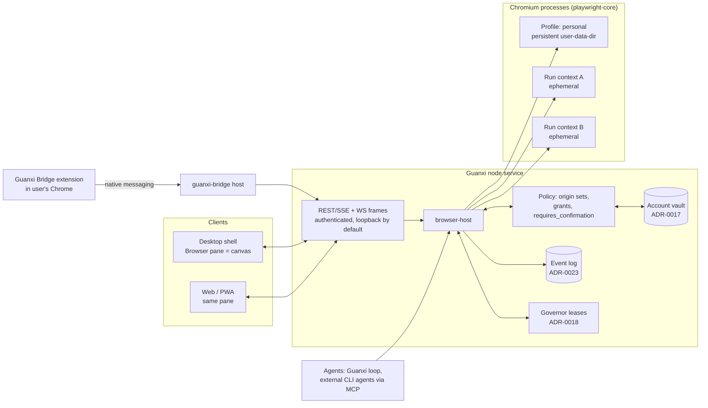

# Agent browser and customisable workspace layout — research for Guanxi

**Status:** research (proposed input for stages C1, U1 and a future browser ADR; nothing here is
accepted or implemented) · **Date:** 2026-10-20 · **Sources accessed:** 2026-10-20 unless noted

**Scope.**

- **Lane A (main):** a built-in, open-source **agent browser** that agents prefer over the user's
  default browser. The user can watch it and take over, it follows Guanxi's design, and it can
  bring over the user's sessions from Chrome or another browser with consent, one site at a time.
- **Lane B (secondary):** a **customisable workspace layout**: dockable blocks, floating groups,
  popouts, saved layouts, two density presets and two experience modes.

**Inputs from Guanxi:**

- [REQUIREMENTS](../../vision/REQUIREMENTS.md): REQ-A5, REQ-D3, REQ-F1–F3, REQ-H2, REQ-L1, REQ-N1.
- [ADR-0016](../../decisions/0016-licensing-and-third-party-reuse.md): licence allowlist;
  process-only use of GPL, AGPL and SSPL code.
- [ADR-0017](../../decisions/0017-model-access-connections-and-secrets.md): vault, `secret://`
  references and the egress scrubber.
- [ADR-0018](../../decisions/0018-federation-ownership-and-leases.md): leases and the
  `owner_device` and `cloud_ephemeral` node classes.
- [ADR-0022](../../decisions/0022-plugin-trust-tiers-ui-slots-and-design-tokens.md): typed
  slots, T2 UI and DTCG tokens.
- [ADR-0026](../../decisions/0026-clients-desktop-web-mobile.md): a thin Electron shell over the
  node service.
- [ADR-0027](../../decisions/0027-accounts-sharing-and-access-modes.md): Full access and
  Read-only modes.
- [ADR-0029](../../decisions/0029-computer-use-tiers.md): computer-use tiers and leases.
- D-118 and D-122: no approval prompts; an empty `requires_confirmation` list by default.
- [01-harness-ui-patterns](01-harness-ui-patterns.md): the right drawer of blocks and panes
  (§5.4) and interaction principle 12.
- Lane 5 of the [2026-10-19 landscape](../2026-10-19-landscape/05-self-evolve-voice-cu.md):
  computer-use tooling and the `browser-profile` lease.

**Legend.**

- **[V]** — verified in a primary source listed under [Sources](#sources): an official doc,
  release notes, a security blog, a repository file or `LICENSE`, the GitHub API or a paper.
- **[S]** — a primary source seen only through a search-engine summary. The page itself refused
  automated fetching with HTTP 403; this applies to openai.com and help.openai.com.
- **[I]** — inferred, or backed only by secondary reporting.

Numbers in square brackets point to the source list.

---

## Contents

1. [Summary](#1-summary)
2. [Agentic browsers on the market](#2-agentic-browsers-on-the-market)
3. [Open-source foundations and where the engine should live](#3-open-source-foundations-and-where-the-engine-should-live)
4. [Importing sessions and data](#4-importing-sessions-and-data)
5. [Agent ergonomics and the security model](#5-agent-ergonomics-and-the-security-model)
6. [Lane B: layout engines compared](#6-lane-b-layout-engines-compared)
7. [Lane B: recommended layout design](#7-lane-b-recommended-layout-design)
8. [Lane B: layout persistence schema](#8-lane-b-layout-persistence-schema)
9. [Risks](#9-risks)
10. [Open questions for the owner](#10-open-questions-for-the-owner)
11. [Sources](#sources)

---

## 1. Summary

**What the market shows.**

- Every agentic browser that shipped in 2025–2026 imports Chrome data with a one-click wizard.
  - Comet imports bookmarks, passwords, cookies, history and extensions [6] [V].
  - Atlas added "Site Data (cookies)" import from Chrome in January 2026 [2] [S].
  - Edge can re-import Chrome data on every launch [16] [I].
- On macOS this works by reading Chrome's profile with the user's consent to the
  "Chrome Safe Storage" Keychain item [1] [52] [S/V].
- **ChatGPT Atlas was discontinued.** OpenAI announced the deprecation on 2026-07-09 and switched
  Atlas off on 2026-08-09. Its agentic browsing moved into the new ChatGPT desktop app, which has
  a built-in browser, and into a Chrome extension [4] [5] [I].
- **The closest open-source match to the owner's idea is BrowserOS neo**, "a second browser,
  just for your AI agents". It offers one-click Chrome login import, any MCP agent, live watching
  and replay [20] [V]. It is **AGPL-3.0**, so Guanxi may use it only as an external process
  (ADR-0016).

**Security is the defining problem, not features.**

- Indirect prompt injection broke Comet several times: hidden Reddit text, near-invisible text
  in screenshots, and "CometJacking" URLs [9] [10] [11] [V/I].
- A June 2026 University of Washington study found that four of seven agentic browsers allowed
  same-origin-policy bypass, including Atlas, Chrome with Gemini and Claude for Chrome [21] [V].
- The strongest published architecture is Chrome's [17] [V]:
  - a **User Alignment Critic** that sees only action metadata;
  - **Agent Origin Sets** (read-only and read-writable origins per task);
  - a deterministic check on model-generated URLs;
  - no model access to stored passwords;
  - a work log with pause and take-over.

**Chrome itself is closing the door on copying sessions out.**

- **App-Bound Encryption** (Chrome 127, Windows) blocks other apps from decrypting cookies [50] [51] [V].
- **Chrome 136** ignores `--remote-debugging-port` on the default profile [53] [V].
- **Chrome 137** ignores `--load-extension` in branded builds [54] [I].
- **Device Bound Session Credentials** (Chrome 146, Windows; macOS later) bind Google-account
  sessions to a TPM or Secure Enclave key, so copied cookies stop refreshing [55] [I].
- Third-party Chromium builds lost Chrome Sync in 2021 [56] [S].
- Brave deliberately stopped importing Chrome cookies in 2019, for privacy reasons [62] [V].

**Recommendations, all [I].**

- **A1 — The engine lives in the node service, not in the Electron shell.**
  - A `browser-host` service owns Chromium processes through `playwright-core` (Apache-2.0).
  - Each account browser profile gets one persistent profile, and each run gets an ephemeral
    context.
  - Every client (desktop, web, phone PWA) shows the browser as a **screencast pane**: Playwright
    1.59+ `page.screencast` frames, input sent back over CDP [39] [41] [V].
  - A "pop out to a real window" path handles passkeys and other OS-bound flows.
  - Why: Electron says it "is not a web browser" and is not intended for arbitrary untrusted
    content [30] [V]. Native `WebContentsView`s cannot sit under HTML overlays or inside floating
    dock groups [33] [V]. Runs must survive a closed window (ADR-0026).
- **A2 — Sessions are born in Guanxi first, then imported one site at a time.**
  - Sessions enter Guanxi in three ways: logging in inside the Guanxi browser, a per-site session
    grant through a Guanxi-owned Chrome extension (native messaging, optional host permissions
    requested per site), or delegated control of the user's live Chrome for sites that resist
    copying (DBSC, hardware 2FA).
  - Bookmarks and history import from files. Passwords stay in the password manager and are
    filled by the harness from `secret://` references.
  - **No bulk cookie import and no direct decryption of Chrome profile files in core.**
- **A3 — Origin-scoped credentials per run.**
  - A run's context receives cookies only for sites its policy grants.
  - Read-only mode maps every origin to read-only; Full access makes granted sites
    read-writable.
  - This is deterministic, so it holds even when the model is fooled. It fits D-118: no prompts
    by default, only the project's `requires_confirmation` list.
- **B1 — Use Dockview** (`dockview-core` and `dockview-react`, MIT) for the workspace dock.
  - Floating groups, popout windows, serialization, ARIA and focus navigation are free.
  - Keyboard docking and auto-hide edge groups are in the proprietary `dockview-enterprise`
    package [65] [66] [V]. Guanxi must build its own "Move block to…" commands and keep the
    enterprise package out through the licence gate.
  - Fallback: FlexLayout (MIT).
- **B2 — Persist a versioned `guanxi.layout/1` document** for each account × project × mode ×
  device class. It wraps the engine state and resolves from device, then project, then account,
  then built-in default (§8).

---

## 2. Agentic browsers on the market

### 2.1 Products (status on 2026-10-20)

| Product | Status | Engine | Import from Chrome (what, how) | What the agent can do | Notable safety design |
| --- | --- | --- | --- | --- | --- |
| **ChatGPT Atlas** (OpenAI) | **Discontinued.** Launched 2025-10-21 (macOS only). Deprecation announced 2026-07-09; shut down 2026-08-09 [4] [5] [I] | Chromium | Wizard: "Import data from another browser", then **allow Keychain Access** for passwords [1] [S]. Component re-import (passwords, bookmarks, extensions, history) from 2025-12-18; **Site Data (cookies)** from 2026-01-15; per-ChatGPT-account profiles from 2026-03-10 [2] [S] | Agent mode clicked and typed in tabs. Agent could not reach the file system, saved passwords or autofill [1] [S] | **Logged-out agent mode** (no existing cookies unless approved) [S]. RL-trained automated red-teaming (2025-12-22). OpenAI calls prompt injection a long-term problem [3] [S] |
| **ChatGPT desktop app** (successor) | Shipped 2026-07-09 for macOS and Windows; Linux preview 2026-08-14 [4] [I] | Built-in browser plus a cloud browser [I] | n/d | Chat, Work and Codex can use the built-in browser or the user's Chrome through a plugin [4] [I] | n/d |
| **Perplexity Comet** | Active | Chromium | Detects installed browsers. Imports **bookmarks, passwords, cookies, history, extensions** [6] [V]. Extension *data* does not transfer [7] [S] | Assistant sidebar and agentic tasks in the user's logged-in session | BrowseSafe: a fine-tuned Qwen3-30B classifier on raw HTML, structured prompts marking content untrusted, and confirmations for sensitive actions; Trail of Bits audit [8] [S]. Lasso reports a 36% bypass of BrowseSafe with encodings [12] [I] |
| **Dia** (The Browser Company, Atlassian) | Active. Atlassian closed the acquisition 2025-10 [I] | Chromium | Bookmarks, extensions, passwords and history from Chrome, Safari, Edge and Arc [13] [S]. Cookies not listed [I] | Chat with tabs and actions [I] | n/d |
| **Opera Neon** | Active. Shipped 2025-09-30; free tier from 2026-08 [14] [I] | Chromium | n/d | "Neon Do" acts in the user's logged-in session using a **textual representation** of pages, with pause and take-over [14] [S]. **MCP Connector** (2026-03-31) lets external agents (Claude, ChatGPT) drive the live browser [14] [I] | Authenticated MCP endpoint through a proxy [I] |
| **Edge Copilot Mode** (Microsoft) | Active. Actions and Journeys in a US preview since 2025-10 [15] [V] | Chromium | Edge can import Chrome data **on every launch**: passwords, history, cookies and open tabs (2022 description) [16] [I]. The `AutoImportAtFirstRun` policy includes cookies [16] [S] | Copilot Actions navigates and clicks. History use is opt-in through Page Context [15] [V] | Visual indicators while acting [15] [V]. Strict, balanced and light levels [I] |
| **Chrome with Gemini "auto browse"** (Google) | Desktop since 2026-01-28 (AI Pro and Ultra, US); Android from late June 2026 [18] [I/V] | Chrome | n/a (the user's own Chrome) | Multi-step tasks in a tab. Pauses before sign-in and purchases | **Alignment Critic, Agent Origin Sets, URL check, sensitive-site list, password-manager sign-in only with confirmation, injection classifier, work log** [17] [V] |
| **Claude in Chrome** (Anthropic extension) | Active | The user's Chrome | n/a | Acts in tabs. Auto-approve or manual-approve modes | Per-site permissions; asks before financial sites; two classifiers (content and action); blocklists; reported attack success below 0.08% internally, "not zero" [19] [V]. Advises a separate profile without bank, health or government accounts [19] [V] |
| **Arc** | Maintenance mode since 2025-05 [I] | Chromium | Wizard (bookmarks, passwords, history) [I] | — | — |
| **BrowserOS neo** (open source) | Active, v0.51 (2026-10-13) [20] [35] [V] | Chromium fork | "Import your logins from Chrome in one click": logins, bookmarks, extensions [20] [V] | Any MCP agent (Claude Code, Codex, Cursor, …). Parallel agents in their own tabs. Live dashboard. **Every session saved as a scrubbable video with an action timeline**. Local-only data [20] [V] | Positioned as a *secondary* browser next to Chrome [20] [V]. **AGPL-3.0** [35] [V] |

### 2.2 Incidents and research

| Date | Finding | Affected | Source |
| --- | --- | --- | --- |
| 2025-08 | Hidden text behind a Reddit spoiler made "Summarize this page" read the Gmail address and an OTP | Comet | Brave [9] [S] |
| 2025-08 | "Scamlexity": the agent completed purchases on fake shops and filled phishing forms | Comet | Guardio, via [11] [I] |
| 2025-10 | "CometJacking": a crafted URL made the agent exfiltrate e-mail and calendar data, base64-encoded | Comet | LayerX, via [11] [I] |
| 2025-10-21 | Near-invisible text in screenshots was executed via OCR. In Fellou, navigating to a page was enough to exfiltrate Gmail data | Comet, Fellou | Brave [10] [S] |
| 2025-10 | "Tainted memories": CSRF injected instructions into ChatGPT memory | Atlas | LayerX, via [5] [I] |
| 2025-12 | ShadowPrompt: a permissive origin allowlist plus DOM XSS let any site message the extension | Claude in Chrome (patched 2026-01) | via [19] search summary [I] |
| 2026-03 to 2026-09 | A US district court enjoined Comet on Amazon (CFAA). **The Ninth Circuit vacated the injunction 2026-08-04**; the case continues | Comet | [23] [I] |
| 2026-06-30 | **4 of 7 agentic browsers allowed SOP bypass.** A proof of concept worked against Atlas. Memory poisoning mixed origins | Atlas, Chrome+Gemini, Claude for Chrome, Comet | UW [21] [V] |
| 2026-06 | SOPBench: both *passive* (unreliability) and *proactive* (injection) SOP violations, across 5 browsers and 6 LLMs | various | arXiv:2606.14027 [22] [S] |

### 2.3 Lessons for Guanxi [I]

1. **Do not compete with Chrome as a daily browser.** BrowserOS neo and Claude's guidance both
   point to a *second* browser or profile dedicated to agents [19] [20]. Atlas folded in less than
   ten months. Guanxi's browser should be the agents' browser: the user can watch and take over,
   and can use it, but it is not marketed as a Chrome replacement.
2. **Import is table stakes, but cookies are the risky part.** Atlas added cookie import late.
   Brave removed it for privacy reasons [62]. Copied Google sessions stop refreshing under DBSC
   [55]. Per-site, user-chosen session grants are the defensible middle ground.
3. **Model-level defences are necessary but never enough.** Even vendor-trained classifiers are
   bypassed: 36% against BrowseSafe [12]. Perplexity classified the CometJacking reports as
   having "no security impact" [11]. Guanxi needs **deterministic** limits: origin-scoped credentials, URL checks and secret
   fill outside the model. It should also adopt Chrome's critic pattern as an optional,
   benchmarked layer (D-110: scaffolding must earn its place).
4. **Exposing the browser over MCP is the winning integration pattern.** Examples: Opera Neon's
   MCP Connector, BrowserOS neo, Playwright's `browser.bind`, Chrome DevTools MCP `--autoConnect`.
   Guanxi's browser should be an MCP-shaped tool surface that both Guanxi's own agents and
   external CLI agents (Claude Code, Codex as sub-agents, ADR-0017) can use, under Guanxi's
   policy.

---

## 3. Open-source foundations and where the engine should live

### 3.1 Candidates (licences checked through the GitHub API and `LICENSE` files [35])

| Project | What it is | Licence [V] | Activity (stars, last push) | Use in an Apache-2.0 Electron app? | Restyle? | Role for Guanxi |
| --- | --- | --- | --- | --- | --- | --- |
| **Electron `WebContentsView`** | A native view hosting a Chromium `WebContents` in the shell [25] | MIT (Electron) | Electron 44.9.1, 2026-10-20 | Yes | Guanxi draws the browser chrome; page content is not restyled | Optional fast local view (§3.2). Not the agent engine |
| **Electron `<webview>`** | A guest view tag | MIT | — | Discouraged: "We currently recommend to not use the `webview` tag" [26] [V] | — | Do not use |
| **CEF** | Chromium Embedded Framework for native apps | BSD-3-Clause [47] [V] | 4.8k, 2026-10-16 | Pointless inside Electron, which already ships Chromium | Yes | Only if a non-Electron native shell appears |
| **Playwright / `playwright-core`** | Launches Chromium, Firefox and WebKit. Persistent contexts, `storageState`, tracing, `page.screencast` (1.59+), `browser.bind` (1.59+), `page.webmcp` (1.64) [39] [V] | Apache-2.0 | 98k, 2026-10-20 | **Yes** (dependency) | n/a (engine) | **Core of `browser-host`** |
| **Playwright MCP** | MCP server: accessibility-snapshot refs, `--isolated`, `--storage-state`, `--extension`, `--secrets` (redacts matches in tool output) [36] [V] | Apache-2.0 | 38k; v0.0.83 | Yes (dependency or process) | n/a | Tool-surface reference; can attach to a Guanxi-bound browser (`--endpoint`) [39] |
| **Chrome DevTools MCP** | CDP tools: performance traces, network, console, screenshots. `--isolated`, `--headless`, `--slim`; `--autoConnect` to a live Chrome 144+ after an in-browser consent dialog [37] [38] [V/S] | Apache-2.0 | 54k; v1.11.0 | Yes | n/a | Developer and debug tools; live-Chrome delegation path. Sends usage statistics and CrUX lookups by default; opt out [37] [V] |
| **Stagehand** (Browserbase) | `act`, `extract`, `observe` SDK | MIT | 26k | Yes | n/a | Idea source for self-healing actions [I] |
| **Browser Use** | Python agent library | MIT | 119k | Process (Python) | n/a | Benchmark baseline [I] |
| **agent-browser** (Vercel Labs) | Rust CLI: `snapshot` refs (`@e2`), CDP connect, WebMCP listing [44] [V] | Apache-2.0 | 44k; v0.39.1 | Yes (process) | n/a | CLI-agent ergonomics reference |
| **Steel Browser** | Self-hosted browser API: sessions, cookies, proxies, extensions, session viewer [43] [V] | Apache-2.0 | 7.8k; v0.5.4-beta | Yes (process or reference) | n/a | Design reference for the session API |
| **Nanobrowser** | Chrome extension with a multi-agent loop in the user's browser | Apache-2.0 | 14k | Code may be copied | n/a | Reference for the Guanxi Bridge extension |
| **BrowserOS / BrowserOS neo** | Chromium fork plus an agent platform | **AGPL-3.0** | 14k; 2026-10-19 | **Process-only**: the user installs it; Guanxi talks MCP | — | Optional external "browser connection" |
| **Lightpanda** | Headless browser in Zig with a CDP server; claims about 16× less memory than Chromium [42] [V] | **AGPL-3.0** | 37k; 1.0.1 | **Process-only** | n/a (no visual rendering) | Optional cheap fetch/scrape backend for tier 0/1 |
| **browserless** | Headless browser service | **SSPL-1.0 or commercial** [45] [V] | 14k | **No** (SSPL is process-only and unattractive) | — | Avoid |
| **electron-browser-shell / electron-chrome-extensions** | Chrome-extension APIs for Electron | **GPL-3.0** [46] [V] | 0.7k | **No** | — | Avoid |
| **rrweb** | DOM session recording and replay | MIT | 20k | Yes | — | Optional lightweight replay of user takeovers [I] |
| **neko** | Self-hosted virtual browser over WebRTC | Apache-2.0 | 23k | Process or reference | — | Tier-2 multi-viewer reference |
| **noVNC** | VNC in the browser | MPL-2.0 core [48] [V] | 14k | Yes (MPL file level) | — | Tier-2 viewer (already in ADR-0029) |

### 3.2 Where the engine runs: options

| Option | Description | For | Against |
| --- | --- | --- | --- |
| **E — In the Electron shell** (`WebContentsView` + `webContents.debugger`) | The desktop process hosts pages; agents drive them over Electron's CDP transport [27] | Best local fidelity: real input, IME, audio, smooth scrolling; easy restyling of chrome | (1) Exists only while the desktop app runs. ADR-0026 says the shell "never owns" the runtime, and runs must survive a closed window. (2) Electron "is not a web browser… displaying arbitrary content from untrusted sources poses a severe security risk that Electron is not intended to handle" [30] [V]. (3) No Safe Browsing (feature request closed) [34] [I]. Only a subset of the extensions API [29] [V]. Chromium patches lag Chrome [30]. (4) Native views draw **above** all HTML: menus, drag overlays and floating dock groups cannot cover them [33] [V]. (5) No phone or web viewing without a second streaming path |
| **N — In the node service** (`browser-host` with `playwright-core`) | One Chromium process per browser profile. The UI shows a **screencast**; user input returns over CDP `Input.dispatch*` | Matches ADR-0026 and ADR-0018 (runtime and leases live on the node). Works on headless nodes and for remote viewers (phone PWA, REQ-B3). The pane is plain DOM, so it can float, pop out and dock. Playwright 1.59+ gives real-time JPEG frames, action overlays, a cursor, chaptered **video receipts**, `browser.bind` for several clients, and HAR and tracing [39] [V] | Screencast fidelity: frames, no audio, IME and drag-and-drop are harder [I]. Passkeys and platform authenticators need a headed window. Playwright's defaults weaken at-rest cookie encryption (`--password-store=basic`, `--use-mock-keychain`) [40] [V]; Guanxi must override them or keep sessions in its own vault (§4.4). One more large process per profile |
| **X — External browser** | The user's Chrome through an extension or CDP `--autoConnect`, or BrowserOS neo over MCP | The user's real logins; zero import | Disturbs the user's browser; the live-profile risk the owner wanted kept opt-in (ADR-0029, Q-222). Vendor tools may collect telemetry [37] |

**Recommendation [I].**

- **Default to option N for agents and for watching.**
  - In the desktop app, the Browser pane renders the screencast in a `<canvas>`.
  - **"Pop out to window"** relaunches the same profile headed for flows that need the OS:
    passkeys, Touch ID, file pickers, DRM video. This takes a `display` lease on Linux nodes
    (tier 2).
- **Option E** may come later as a *user-only* fast view, if usage data justifies it. It would
  never host agent runs.
- **Option X** stays an opt-in connection kind (`browser:live-chrome`, `browser:browseros`).

### 3.3 Proposed `browser-host` component [I]



- **Tool surface.**
  - Tools are MCP-shaped: `browser.open`, `snapshot` (accessibility refs), `act` (click, fill or
    press on a ref), `navigate`, `extract`, `network.list`, `console.list`, `download.list`,
    `fill_secret(ref, secret://…)`, `request_takeover(reason)`, `webmcp.list` and `webmcp.call`.
  - Implemented with `playwright-core` and CDP. Playwright MCP's ref model is the reference [36].
- **External agents.** They attach through `browser.bind`-style endpoints that `browser-host`
  issues per run. Each endpoint is scoped to the run's context, never to the whole browser.
- **Never expose** `--remote-debugging-port` of the Electron shell. It would hand any local
  process the Guanxi UI with its tokens.

---

## 4. Importing sessions and data

### 4.1 Where browsers keep secrets, and who can read them

| Browser / OS | Store | Protection | Can a third-party app read it? | Source |
| --- | --- | --- | --- | --- |
| Chrome, macOS | `Cookies`, `Login Data` (SQLite) in the profile | AES-128-CBC. The key is derived (PBKDF2, 1003 iterations) from the Keychain item **"Chrome Safe Storage"** (account "Chrome"); prefix `v10` | Only after the user grants Keychain access. This is the prompt Atlas asks for [1] | [52] [V], [1] [S] |
| Chrome, Linux | Same files | `v11` with a key from libsecret, KWallet or the XDG Secret portal. Without a keyring: `v10` with the fixed key "peanuts" (effectively plaintext) | Yes, as the same user (keyring unlock) | [52] [V], [50] [V] |
| Chrome, Windows | Same files | DPAPI. Since **Chrome 127**, cookies use **App-Bound Encryption**: a SYSTEM elevation service checks the caller's identity and path. Google intends to extend this to passwords and payment data | **No** for cookies without SYSTEM rights or code injection, which antivirus software flags. Policy `ApplicationBoundEncryptionEnabled` exists | [50] [51] [V] |
| Chrome, all | Remote debugging | Since **Chrome 136**, `--remote-debugging-port` and `--remote-debugging-pipe` are ignored for the default user-data dir. Since **Chrome 144**, an agent may request a CDP session to the running Chrome only after the user enables it in `chrome://inspect` and accepts a dialog | Only with explicit in-browser consent | [53] [V], [38] [S] |
| Chrome, all | Sessions bound to the device (**DBSC**) | Since Chrome 146 on Windows, later macOS, short-lived cookies are refreshed by proving a TPM or Secure Enclave key. On by default for Google accounts | Copied cookies work only until the short-lived cookie expires | [55] [I] |
| Chrome Sync | Google account | Private API, closed to third-party Chromium builds since 2021-03-15 | **No** | [56] [S] |
| Chrome export | Bookmarks HTML; passwords **CSV, unencrypted** (Google says to delete it after use) | — | User-driven | [57] [S] |
| Firefox | `cookies.sqlite`; `logins.json` + `key4.db` (NSS, optional primary password) | Cookies unencrypted at rest; passwords encrypted with NSS | Cookies: yes. Passwords: yes unless a primary password is set | [59] [I] (Mozilla page did not load) |
| Safari, macOS | `Cookies.binarycookies` inside the Safari container | Sandboxed container; needs Full Disk Access (TCC) | Only with Full Disk Access | [I] |
| Safari 18.2+ export | `.zip`: bookmarks HTML, history JSON, passwords CSV, extensions, cards; **not encrypted** | — | User-driven | [58] [S] |
| Electron's own cookies | Chromium cookie DB | **Plaintext unless** the `cookieEncryption` fuse is on (one-way; needs code signing on macOS) | — | [31] [V] |
| Playwright-launched Chromium | Profile in `user-data-dir` | Default args `--password-store=basic` and `--use-mock-keychain`: no real OS keystore | Effectively readable by the same user | [40] [V] |

### 4.2 Import methods compared

| # | Method | Imports | Consent unit | Works on | Verdict [I] |
| --- | --- | --- | --- | --- | --- |
| M1 | **Log in inside the Guanxi browser** | Nothing copied; the session is born in Guanxi | Each login by the user | all | **Default.** Simplest and safest. Credentials come from the password manager (M5) |
| M2 | **Guanxi Bridge extension** in the user's Chrome, Edge or Brave: `cookies` permission plus `optional_host_permissions` requested **per site** at runtime; native-messaging host pinned to the extension ID [60] [61] [V] | Cookies (including partitioned) for the chosen registrable domain; optionally localStorage of an open tab | Chrome's own per-site permission prompt **and** a Guanxi grant screen | Chromium browsers on every OS. **Bypasses ABE legitimately**: the browser itself hands the data over | **Recommended for "bring my session".** Sync modes: once, on run start, or live (`cookies.onChanged`) |
| M3 | **Delegated control of the live browser**: the Bridge extension drives a dedicated tab group (`chrome.debugger`, the Playwright Extension pattern [49]) or CDP `--autoConnect` (Chrome 144+, dialog per session [38]) | Nothing copied; the agent acts in the user's Chrome | Per connection (ADR-0029 opt-in) plus per-site grant | Chrome and Edge | For DBSC-bound or hardware-2FA sites and SSO. Shown as a live-profile connection |
| M4 | **File import of non-secret data**: Chrome `Bookmarks` (JSON), `History` (SQLite copy), HTML or Safari ZIP exports, Firefox `places.sqlite` | Bookmarks, history (and the open-tab list) | One screen, per data type | all | **Allowed.** Read-only, local; no keychain needed. Brave's MPL-2.0 importer shows the same copy-then-read pattern [62] |
| M5 | **Password-manager integration instead of copying passwords**: OS keychain, 1Password and Bitwarden CLIs, or Google Password Manager staying in Chrome; future FIDO **CXP/CXF** transfer [63] | `secret://` references only | Per item or vault | all | **Recommended.** `fill_secret` injects at the DOM boundary; snapshots are scrubbed (Playwright MCP's `--secrets` precedent [36]) |
| M6 | **Direct decryption of the Chrome profile** (Keychain, libsecret, DPAPI) | Everything, in bulk | One OS prompt for *all* secrets | macOS and Linux; **blocked for cookies on Windows** by ABE | **Rejected for core.** Bulk by nature; looks like infostealer behaviour [50]; breaks under ABE and DBSC. At most a user-installed T2 plugin "at own risk" (mirrors ADR-0017 §2) |
| M7 | **Password CSV export, then import into Guanxi** | Plaintext passwords | — | all | **Rejected.** Route CSVs into a password manager, never into Guanxi |
| M8 | Chrome Sync | — | — | — | **Unavailable** [56] |

### 4.3 The "import assistant" agent [I]

The owner asked for an agent that finds the best import path or sets up sync, with explicit
approval. It is safe only if the agent **plans** and deterministic code **executes**.

1. **Detect.** `import.detect()` lists installed browsers, profile *names* and whether the Bridge
   extension is present. It returns no file contents and no cookie values.
2. **Propose.** The agent builds an `ImportPlan` from typed steps (M1–M5 only). Example: install
   Bridge, then grant `github.com` and `linear.app` (sync on run start), then import bookmarks
   from file, then link Bitwarden. It ranks options and explains them, for example: "Google
   accounts use device-bound sessions; use a live delegation or log in inside Guanxi instead."
3. **Approve.** The user sees a per-site checklist: domain, what is copied, where it is stored,
   sync mode, expiry and which projects may use it. Approval is a user action in the UI. It is a
   setup flow, not a run-time approval prompt, so D-118 is not affected.
4. **Execute.**
   - The importer code or the Bridge does the work; the model sees only counts, domains, earliest
     expiry and errors.
   - Results become event-log records (ADR-0023) with no values.
   - Chrome's own permission prompt for the site appears inside Chrome.

### 4.4 Recommended data model and lifecycle [I]

| Entity | Fields (non-secret metadata visible to agents) | Secret part (vault only, ADR-0017) |
| --- | --- | --- |
| `BrowserProfile` | `id`, `account`, `kind` (`personal` \| `run-ephemeral` \| `live-chrome` \| `external`), `node`, `createdAt` | Persistent `user-data-dir` encryption: real OS keystore (override Playwright's defaults [40]) or vault-held storage |
| `SiteGrant` | `site` (registrable domain), `source` (`guanxi-login` \| `bridge:chrome/Profile 1` \| `live`), `syncMode`, `scopes` (projects, runs, roles), `access` (`read` \| `read-write`), `dbscBound` (`yes` / `no` / `unknown` with `observedAt`), `expiresAt`, `lastUsedAt` | — |
| `SessionBundle` | `site`, `cookieCount`, `earliestExpiry`, `importedAt`, `hash` | Cookies and localStorage as a Playwright `storageState` subset, encrypted with the account data key |

- **Storage.** Bundles live in the per-account vault on opted-in `owner_device` nodes only.
  - They never go to `cloud_ephemeral` nodes by default. If the owner allows it, an expiring
    per-attempt grant is possible (ADR-0018 §2).
  - They never enter model context, logs, traces or exports. The egress scrubber gains a rule
    for cookie values (ADR-0017 §4).
- **Use in a run.**
  - `browser-host` creates an ephemeral context per run and loads **only** the bundles granted
    to that run's project and role (`browserContext.setStorageState`, Playwright 1.59 [39]).
  - At run end the context is destroyed. Cookie changes are written back only for grants marked
    `persist-updates`.
- **Revocation.**
  - Revoking a grant closes live contexts using it (fenced through the lease), deletes the
    bundle, and tells the Bridge to stop syncing. The user can also remove the host permission
    in Chrome.
  - The UI states the limit honestly: copied cookies stay valid on the server until they expire
    or the user signs that session out on the site. It links to the site's "active sessions"
    page when one is known.
- **Visibility.** A Connections → Browser page lists every grant with its source, last use,
  using runs and an indicator for live sync. The status line shows "Browser: 3 sites shared".

### 4.5 What must never happen

1. Silent or bulk export of the user's cookie jar, or any import whose unit is "all sites".
2. Reading Chrome, Firefox or Safari secret stores (Keychain item, DPAPI, libsecret, Full Disk
   Access) in core code. Any attempt to bypass App-Bound Encryption through elevation, injection
   or the user's default profile with remote debugging.
3. Cookie values, passwords or OTPs in prompts, tool results, snapshots, screenshots sent to
   remote models, logs, traces or handoffs.
4. Session bundles replicated to non-owner devices or other accounts, or shared between accounts
   (vendor terms forbid account sharing; ADR-0017).
5. Live sync without a visible indicator and a one-click stop.
6. An agent installing the Bridge extension, granting itself host permissions, or editing its
   own grants.
7. Exposing the Electron shell's remote-debugging endpoint, or binding `browser-host` beyond
   loopback without the security profile required by AGENTS.md.

### 4.6 Legal and terms-of-service notes [I]

- **Site terms.** Many sites forbid automated access or credential sharing.
  - *Amazon v. Perplexity*: a preliminary CFAA injunction against Comet was granted in March 2026
    and vacated by the Ninth Circuit on 2026-08-04. The holding is narrow and tied to Comet's
    architecture; the court pointed site owners towards terms-of-service claims instead [23].
  - Guanxi should show a per-site notice and keep automation user-initiated and attributable.
  - It must not disguise automation to evade detection, which Amazon alleged against Comet [23].
- **Chrome Web Store.** The Bridge extension handles authentication data, so it needs a precise
  privacy disclosure and limited-use compliance. It must avoid remote code. Publishing it is an
  owner decision.
- **Google accounts.** Moving DBSC-bound or Google sessions is ineffective and may trigger
  security alerts. Prefer M1 or M3.
- **Licences.** All recommended code is MIT or Apache-2.0. BrowserOS and Lightpanda stay
  external processes. Brave's importer (MPL-2.0) is a reference only.

---

## 5. Agent ergonomics and the security model

### 5.1 Why an agent-optimised browser helps

| Capability | Benefit to agents | Mechanism | Evidence |
| --- | --- | --- | --- |
| Accessibility-tree snapshots with stable refs | Cheaper and more robust than screenshots; works with non-vision models (REQ-C1 routine roles) | CDP `Accessibility.getFullAXTree`; Playwright ARIA snapshots, `find in snapshot` | [36] [41] [V] |
| Network and console capture | Debugging, API discovery, verifying side effects | CDP Network and Log; HAR through `tracing.startHar` (1.60) | [39] [V] |
| Deterministic waits | Fewer flaky steps than sleeps | Playwright auto-wait and locator assertions | [39] [V] |
| Session recording and replay | Evidence for the user and judges (ADR-0020); post-mortems | `page.screencast` with action overlays, chapters and **video receipts**; Playwright traces; rrweb for takeovers | [39] [V] |
| Per-run isolated contexts | Parallel agents never share cookies or tabs (REQ-H6) | Ephemeral contexts in one profile process; `browser-profile` lease for persistent profiles | [36] [V] |
| Human takeover | Captchas, 2FA, ambiguous choices | The pane switches input to the user; the agent is paused | [17] [20] [V] |
| Visible agent cursor | The user sees intent before the effect | Drawn by the Guanxi UI from action events (no page injection). Playwright 1.63+ also has an eased cursor in recordings | [39] [V] |
| Site-declared tools | Structured actions instead of clicking | **WebMCP** (`navigator.modelContext` / `document.modelContext`; Chrome 146 flag, origin trial from 149); `page.webmcp` in Playwright 1.64 | [39] [64] [V/S] |

### 5.2 Security model [I unless cited]

1. **Origin sets per run** (adapted from Chrome's Agent Origin Sets [17] [V]).
   - **Readable set:** origins whose content may enter model context. Iframes from other
     origins are dropped from snapshots.
   - **Writable set:** origins where the agent may click and type. It starts as the origins of
     the run's `SiteGrant`s with `read-write` access, plus origins the user typed in the prompt.
   - **Adding an origin** happens only through a deterministic gate: the run-policy allowlist, or
     a link present on an already-readable page with a clean URL. Model-generated URLs carrying
     data in path or query are refused, following Chrome's "known, public URLs" check [17].
2. **Access modes (D-111).**
   - **Read-only:** every origin is read-only. Navigation and reading are allowed; typing, form
     submission, uploads and downloads are not.
   - **Full access:** granted sites become writable.
3. **Credential scoping.** A run's context holds cookies only for granted sites; everything else
   loads logged out. An injected "go to mail.example and forward…" lands on a login page.
4. **Confirmations (D-118, D-122).** No prompts by default.
   - `browser-host` classifies actions: purchase or payment submit, send or post, delete, change
     credentials or security settings, OAuth consent, file upload.
   - A run stops for the user **only** if the project's `requires_confirmation` list names that
     class.
   - Pages that need a human (captcha, 2FA, passkey) raise `input_required`.
   - Proposal for the owner: a suggested, not default, preset list for profiles that hold
     imported sessions (Q-B5).
5. **Content isolation.**
   - Page text enters context in delimited, labelled "untrusted page content" blocks
     (spotlighting).
   - Hidden and near-invisible text is flagged.
   - Screenshots go to remote models only when the run uses vision.
   - An optional **action critic** (a small local model that sees only the action metadata and
     the user goal, after Chrome's design [17]) is benchmarked before it is enabled (D-110,
     ADR-0025).
6. **Secrets.**
   - `fill_secret` resolves `secret://` at the DOM boundary.
   - The value is scrubbed from snapshots, the screencast stream (the field is masked in frames
     sent to models), traces and video receipts.
   - Agents never read password-manager items (ADR-0017 invariant).
7. **Egress.**
   - Network requests from run contexts pass the node egress proxy and its allowlist, as for
     MCP servers in ADR-0022 §9.
   - Downloads land in a per-run quarantine folder, not the project tree, until a tool moves
     them.
8. **Memory.** Browser observations are not written to long-term memory without their origin
   tag. This prevents cross-origin "memory poisoning" [21].
9. **Testing (validation for a future ADR).**
   - An injection page (hidden text, OCR text, a crafted URL) causes no out-of-scope action,
     extending the ADR-0029 validation.
   - A planted cookie value never appears in events, logs or model requests (extending ADR-0017).
   - Revoking a grant closes the context within one lease TTL.
   - A Read-only run cannot submit a form (an explicit assertion, not visibility).

### 5.3 Fit with tiers and leases

| ADR-0029 tier | Browser surface | Lease (governor, ADR-0018) |
| --- | --- | --- |
| 0 | HTTP fetch and APIs; optional Lightpanda (external, AGPL) | none |
| 1 | `browser-host` headless Chromium, ephemeral context | `browser-context:<run>` (child of the run fence) |
| 1 | `browser-host` with the **personal** persistent profile | `browser-profile:<account>/<profile>` (exclusive, since Chromium locks a profile to one process; Playwright notes "one browser instance at a time" [36]); contexts as children |
| 1-L (live, opt-in) | The user's Chrome through the Bridge or `--autoConnect` | `browser-live:<device>/<chrome-profile>` (exclusive), and only when the connection is enabled |
| 2 | Headed Chromium on Xvfb or in a VM (pop-out on remote Linux nodes, or noVNC/neko viewing) | `display:<id>` plus `browser-profile` |
| 3–4 | Not used for browser tasks | — |

- **Takeover.** It is a control token inside the profile or context lease. The states are
  `agent_driving`, `user_driving` and `agent_resuming`.
  - The agent's run shows `input_required` while the user drives.
  - Handing back records a user note in the event log.
- **Cost.** Each Chromium profile process typically uses hundreds of MB [I]. The governor counts
  browser leases against node memory.

---

## 6. Lane B: layout engines compared

All licences, versions and downloads were checked on 2026-10-20 [35] [65] [74].

| Engine | Licence | Latest | Weekly npm downloads | Tabs and groups | Floating | Popout windows | Edge sidebars | Serialization | Keyboard and accessibility | Notes |
| --- | --- | --- | --- | --- | --- | --- | --- | --- | --- | --- |
| **Dockview** (`dockview-core`, `dockview-react`) | **MIT**; `dockview-enterprise` is **proprietary** (since 2026-07) [65] [V] | 8.6.1 (2026-10-19) | about 401k (core) | Yes; tab group chips; maximize | **Yes** (nested layouts in floating windows) | **Yes**, multi-group popouts with a same-origin `popoutUrl`; Electron note: close windows through the shell [67] [V] | "Edge groups" free; **auto-hide and dock-to-edge are enterprise** [66] [V] | `toJSON` / `fromJSON` (`grid`, `panels`, `activeGroup`, `floatingGroups`, `popoutGroups`, `edgeGroups`) [68] [V] | ARIA roles, screen-reader announcements, focus indicators and focus navigation free. **Spatial navigation and keyboard docking are enterprise** [66] [V] | Zero dependencies; vanilla core plus React, Vue and Angular bindings; Shadow DOM; strict CSP; render modes; `onWillMutateLayout` transactions |
| **FlexLayout** (Caplin) | MIT | 0.11.1 (2026-09-26) | about 63k | Yes; pinned tabs; tab groups | Yes ("floating panels") | Yes | **Borders** (split or overlay, auto-hide) free [69] [V] | `Model.toJson` / `fromJson` (`global`, `borders`, `layout`, `subLayouts`) | ARIA tabs and separators; configurable keymap; focus next or previous tabset; no keyboard *move* listed [69] [V] | React only; ESM only; mature since about 2017 [I] |
| **react-mosaic** | Apache-2.0 [70] [V] | 7.2.1 (2026-09-28) | about 45k | Tabs as a node type (v7) | No [I] | No [I] | No | n-ary tree JSON | Not documented | Tiling only; depends on react-dnd |
| **rc-dock** (ticlo) | Apache-2.0 | 4.1.0 | about 11k | Yes; groups | Yes (float box) | Yes | Collapsible side columns | `saveLayout` / `loadLayout` with `saveTab` / `loadTab` [71] [V] | Not documented | Small community |
| **Golden Layout** | MIT | 2.6.0 (**2022-09**) | about 23k | Yes | Partial | Yes | No | JSON config | Weak [I] | Effectively in maintenance; not React-native |
| **allotment** | MIT | 1.20.6 | about 148k | No | No | No | — | Sizes only | Splitter keyboard | Split panes derived from VS Code |
| **react-resizable-panels** | MIT | 4.14.7 | about 18.8M | No | No | No | — | `defaultLayout`, `getLayout`, `setLayout` [73] [V] | ARIA separators with keyboard resize | Split panes only; ideal for a fixed outer frame |

**Reading of the table [I].**

- Only Dockview and FlexLayout meet the owner's full list: sidebars, a centre grid,
  floating, popouts and saved layouts.
- Dockview wins on adoption, a framework-agnostic core, strict-CSP and Shadow DOM support (useful
  next to T2 iframes) and multi-group popout and floating windows.
- FlexLayout wins on free edge "borders" and a configurable keymap.
- **Neither offers free keyboard docking.** WCAG 2.2 SC 2.5.7 (AA) requires a single-pointer,
  non-drag alternative for drag operations [75] [V]. SC 2.1.1 requires keyboard operation.
  Guanxi must ship its own "Move block to…" command whichever engine it picks.

---

## 7. Lane B: recommended layout design

### 7.1 Engine choice [I]

Use **Dockview** (`dockview-core` and `dockview-react`, MIT) behind a thin `WorkspaceLayout`
adapter, so a switch to FlexLayout costs one adapter.

- **Licence gate.** Add `dockview-enterprise` to an explicit deny list in `check:licenses`.
  Never import its code: it is proprietary, so "never copied" applies (ADR-0016).
- **Spike exit criteria (before U1 locks the choice).**
  1. Left, right and bottom zones are built from locked, headerless grid groups that collapse,
     using only free APIs.
  2. "Move block to…" works by keyboard and pointer without dragging, and announces the result.
  3. A popout works in the Electron renderer with `sandbox` and `contextIsolation`, through
     `setWindowOpenHandler` limited to the same-origin `popout.html`.
  4. A terminal (xterm) and the Browser canvas keep their state across move, float and popout.
  5. A layout with 30 blocks restores in a measured budget set by the U1 gate.

### 7.2 Zones, blocks and slots

- **Fixed navigation.** The app sidebar (New, Projects, Models, Settings) stays fixed (REQ-F3,
  principle 12 in [01](01-harness-ui-patterns.md)). Only the **session workspace** is dockable.
  The owner's "everything anywhere" wish meets REQ-F3 here (Q-B1).
- **Zones** inside the workspace: `left`, `right`, `bottom` (collapsible columns and rows), `top`
  (status lines), `center` (a grid of groups; several blocks can be visible at once), `floating`
  and `popout`.
- **Status lines** are a `list` slot strip (top or bottom). A status item can be promoted to a
  full block.
- **Blocks** are an ADR-0022 **keyed slot** `workspace.block`. Each contribution declares:

```ts
// contributes.blocks[] in a plugin manifest (proposed)
interface BlockContribution {
  id: string;                     // "guanxi.core/terminal"
  title: LocaleKey;               // locale keys, never literals (AGENTS.md)
  icon: string;                   // Lucide name
  modes: ("developer" | "visual")[];
  defaultZone: "left" | "right" | "top" | "bottom" | "center";
  multiInstance: boolean;         // Browser, Terminal: true; Quota: false
  keepAlive: boolean;             // render even when hidden (terminal, browser)
  minSize?: { w: number; h: number };
  card?: ComponentRef;            // compact rail card (the "block" of 01 §5.4)
  pane: ComponentRef | { mcpApp: string };  // T2 UI = MCP App iframe (ADR-0022 §3)
}
```

- **Built-in blocks:** Context, Quota, Plan, Changes, Files, Terminal, Processes, Connectors,
  Outputs and Artifacts, Environment, Browser, Sub-agents, Board, Notifications and Status.
- **Unloading a plugin** removes its blocks (ADR-0022 invariant). Saved layouts keep a
  placeholder: "Block unavailable — plugin X disabled".

### 7.3 Modes and presets

| | **Developer** (IDE-like) | **Visual** (no code) |
| --- | --- | --- |
| Centre | Chat plus Changes or diff; Terminal at the bottom | Chat plus Artifacts and Preview grid; Browser |
| Right | Context, Plan, Processes, Environment | Plan, Outputs, Quota |
| Hidden by default | Board | Files, Changes, Terminal, Processes (filtered by `modes`) |

- **Presets** `comfortable` and `compact` are **density token sets** (DTCG, ADR-0022 §4). They
  are not different layouts: switching density never moves blocks.
- **Mode switch.** Switching mode swaps the active layout document (§8). It never deletes the
  other mode's layout.
- **Phone PWA.** No docking. Blocks appear as a stacked tab list ordered by the layout's
  `priority` (REQ-B3).

### 7.4 Accessibility and performance [I]

- **Keyboard.**
  - F6 and Shift+F6 cycle zones.
  - Dockview's free focus navigation moves within groups.
  - The block menu and the command palette offer "Move to → zone or group", "Float", "Pop out",
    "Hide" and "Reset layout".
  - A live region announces each move. This meets SC 2.5.7, 2.1.1 and 2.4.3 [75].
- **Motion.** Drag previews respect reduced motion (01 §8).
- **Rendering.** Use `always` for `keepAlive` blocks (Terminal, Browser) and render only when
  visible for heavy charts.
- **Browser pane.** It is a canvas (§3.2), so it floats and pops out like any block. A native
  `WebContentsView` could not [33].

---

## 8. Lane B: layout persistence schema

```ts
// Proposed. Stored in the account settings store (multi-writer, merges per D-116).
interface LayoutDocV1 {
  schema: "guanxi.layout/1";
  id: string;                               // ULID
  name: string;                             // "Default", "Review", user-named
  scope: {
    account: string;
    project?: string;                       // absent = account default
    mode: "developer" | "visual";
    deviceClass: "desktop" | "desktop-narrow" | "tablet";
  };
  density: "comfortable" | "compact";       // token preset, not geometry
  basedOn?: { builtin: string; version: number };  // for "reset" and migrations
  engine: {
    name: "dockview";
    major: number;                          // 8
    state: unknown;                         // SerializedDockview, validated by the adapter
  };
  blocks: Record<string /* panelId */, {
    block: string;                          // "guanxi.core/terminal"
    plugin: { id: string; version: string };
    params?: Record<string, unknown>;       // non-secret only (e.g. browser profile id)
    priority: number;                       // order for phone and narrow layouts
  }>;
  hidden: string[];                         // enabled blocks not on screen
  statusLine: { top: string[]; bottom: string[] };
  rev: number;                              // monotonic per document
  updatedAt: string;                        // ISO 8601
  updatedBy: { device: string; node: string };
}

// Device-local, never replicated: popout and floating window geometry differs per screen.
interface LayoutDeviceStateV1 {
  schema: "guanxi.layout-device/1";
  layoutId: string;
  popouts: { panelIds: string[]; bounds: { x: number; y: number; w: number; h: number };
             display?: string }[];
}
```

**Rules [I].**

- **Resolution order:** device override, then `project` + `mode`, then account + `mode`, then the
  built-in layout for the mode.
- **Saved layouts:** several named documents per scope. "Save as" copies; "Reset" re-applies
  `basedOn`.
- **Replication and merge:** the document replicates like other account settings. Conflicts
  resolve **whole-document last-writer-wins** by `(rev, updatedAt, device)`. A conflict keeps the
  losing copy as "Recovered layout" instead of merging trees.
- **Validation and recovery.**
  - The document is checked with a schema (zod).
  - Unknown blocks become placeholders.
  - An engine major-version change runs `migrate(state)`. If that fails, the built-in layout
    loads and the old document is kept.
  - Safe mode ignores plugin blocks (ADR-0022).
- **Privacy:** no secret values. `params` may hold IDs and paths but not cookies, keys or tokens.
  The egress scrubber applies to exports.

---

## 9. Risks

| Risk | Impact | Mitigation |
| --- | --- | --- |
| Prompt injection drives a logged-in agent | Data exfiltration, unwanted posts or purchases | Credential scoping per run, origin sets, URL gate, optional confirmation classes, egress proxy; benchmark the critic [17] [21] |
| Screencast fidelity is too low for daily use | Users fall back to Chrome | Pop-out headed window; measure FPS and latency in the C1 gate; consider option E later for user-only browsing |
| Copied sessions break (DBSC, IP or device checks) | Frustration and lockouts | Prefer M1 and M3 for those sites; show `dbscBound` and expiry with provenance (REQ-N1) |
| Bridge extension rejected or delayed by the Chrome Web Store | No M2 or M3 | Ship unpacked for developers (Load unpacked; Chrome 137 blocks only the CLI flag [54]); fall back to M1 |
| At-rest cookie exposure in Playwright profiles | Local theft by same-user malware | Override `--password-store=basic` and `--use-mock-keychain` [40], or keep only vault bundles and ephemeral contexts |
| Dockview's open-core drift (more features go enterprise) | Lock-in pressure | Adapter boundary; MIT core can be forked; FlexLayout fallback |
| Legal action by sites against automation | Account bans, legal exposure | User-initiated, attributable automation; no evasion; per-site ToS notice [23] |
| Chromium security lag in a bundled build | Exploits | Track Playwright's Chromium (weekly releases [I]); an auto-update channel for `browser-host` separate from the shell |

---

## 10. Open questions for the owner

1. **Q-B1 — Navigation.** Keep the app sidebar fixed (REQ-F3) and make only the session
   workspace dockable? Or should the sidebar become dockable too, which would change REQ-F3?
2. **Q-B2 — Daily browsing.** Should the Guanxi browser be marketed only as the agents' browser,
   which the user can also use? Or does the owner want a full daily browser? The second option
   makes option E and Safe Browsing-class protection necessary.
3. **Q-B3 — Bridge extension.** Publish a Guanxi Bridge extension on the Chrome Web Store (privacy
   review, maintenance), or ship it unpacked only?
4. **Q-B4 — Live Chrome delegation (M3).** Allowed on the main MacBook? Q-222 currently proposes
   "no live profile".
5. **Q-B5 — Confirmation preset.** For runs that use imported sessions, offer a *suggested*
   `requires_confirmation` preset (payment, send or post, delete, credential change), still off
   by default per D-122? Or keep the list strictly empty?
6. **Q-B6 — Cloud nodes.** May session bundles ever reach `cloud_ephemeral` nodes as expiring
   grants, or never?
7. **Q-B7 — External browsers.** Offer BrowserOS neo (AGPL, process-only) as an optional browser
   connection for users who already use it?
8. **Q-B8 — Layout scope default.** Per project, or account-wide with project overrides? The
   proposal is account-wide per mode, with optional project overrides.
9. **Q-B9 — Visual mode.** Should Visual mode hide the Terminal and Changes entirely, even when an
   agent edits code, or show a one-line "N files changed" status item?

---

## Sources

All accessed **2026-10-20** unless noted. Tags:

- **[primary]** — official docs, a blog, release notes or a repository;
- **[snippet]** — a primary source seen only through a search summary (direct fetch refused or
  failed);
- **[secondary]** — a third-party report.

### Products and incidents

- [1] OpenAI Help, "Setting up the Atlas browser". <https://help.openai.com/en/articles/12628461-setting-up-the-atlas-browser> [snippet]
- [2] OpenAI Help, "ChatGPT Atlas — Release Notes". <https://help.openai.com/en/articles/12591856-chatgpt-atlas-release-notes> [snippet]
- [3] OpenAI, "Continuously hardening ChatGPT Atlas against prompt injection" (2025-12-22). <https://openai.com/index/hardening-atlas-against-prompt-injection/> [snippet]
- [4] 9to5Mac, "OpenAI is discontinuing ChatGPT Atlas" (2026-07-09). <https://9to5mac.com/2026/07/09/openai-is-discontinuing-chatgpt-atlas-its-standalone-desktop-browser/> [secondary]
- [5] Wikipedia, "ChatGPT Atlas" (timeline, shutdown 2026-08-09, LayerX "Tainted Memories"). <https://en.wikipedia.org/wiki/ChatGPT_Atlas> [secondary]
- [6] Perplexity Comet Help, "Import data". <https://www.perplexity.ai/help-center/comet/en/articles/12657736-import-data> [primary]
- [7] Perplexity Help, "Comet for Enterprise". <https://www.perplexity.ai/help-center/en/articles/12781449-comet-for-enterprise> [snippet]
- [8] Perplexity, "BrowseSafe" and "How we engineer safer agents"; arXiv:2511.20597. <https://www.perplexity.ai/hub/blog/browsesafe>, <https://www.perplexity.ai/hub/blog/how-we-engineer-safer-agents> [snippet]
- [9] Brave, "Agentic browser security: indirect prompt injection in Perplexity Comet" (2025-08). <https://brave.com/blog/comet-prompt-injection/> [snippet]
- [10] Brave, "Unseeable prompt injections in agentic browsers" (2025-10-21); Simon Willison's notes. <https://brave.com/blog/unseeable-prompt-injections/>, <https://simonwillison.net/2025/Oct/21/unseeable-prompt-injections/> [snippet]
- [11] The Hacker News, "CometJacking" (2025-10). <https://thehackernews.com/2025/10/cometjacking-one-click-can-turn.html> [secondary]
- [12] Lasso Security, "Red teaming BrowseSafe". <https://www.lasso.security/blog/red-teaming-browsesafe-perplexity-prompt-injections-risks> [secondary]
- [13] Dia, import information (diabrowser.com) and @diabrowser post (2026-08-03). <https://www.diabrowser.com/> [snippet]
- [14] Opera, "Opera Neon ships" (2025-09-30); gHacks, "Opera Neon adds MCP Connector" (2026-04-02). <https://blogs.opera.com/news/2025/09/opera-neon-agentic-ai-browser-release/>, <https://www.ghacks.net/2026/04/02/opera-neon-adds-mcp-connector-to-let-external-ai-tools-safely-control-live-browser-sessions/> [snippet / secondary]
- [15] Microsoft Edge Blog, "Meet Copilot Mode in Edge" (2025-10-23). <https://blogs.windows.com/msedgedev/2025/10/23/meet-copilot-mode-in-edge-your-ai-browser/> [primary]
- [16] 9to5Google, "Edge import on each launch" (2022-05-30); Microsoft Learn, `AutoImportAtFirstRun` policy. <https://9to5google.com/2022/05/30/microsoft-edge-google-chrome-data/>, <https://learn.microsoft.com/en-ie/deployedge/microsoft-edge-browser-policies/autoimportatfirstrun> [secondary / snippet]
- [17] Google Security Blog, "Architecting Security for Agentic Capabilities in Chrome" (2025-12-08). <https://security.googleblog.com/2025/12/architecting-security-for-agentic.html> [primary]
- [18] 9to5Google, "Chrome auto browse" (2026-01-28); Chrome for Developers, "15 updates from Google I/O 2026". <https://9to5google.com/2026/01/28/chrome-gemini-auto-browse/>, <https://developer.chrome.com/blog/chrome-at-io26> [secondary / primary]
- [19] Claude Help Center, "Use Claude in Chrome safely"; Claude blog, "Piloting Claude in Chrome". <https://support.claude.com/en/articles/12902428-use-claude-in-chrome-safely>, <https://www.claude.com/blog/claude-for-chrome> [primary / snippet]
- [20] BrowserOS repository README (BrowserOS neo). <https://github.com/browseros-ai/BrowserOS> [primary]
- [21] UW News, "Some agentic AI browsers come with major cybersecurity risks" (2026-06-30). <https://www.washington.edu/news/2026/06/30/some-agentic-ai-browsers-come-with-major-cybersecurity-risks-uw-study-finds/> [primary]
- [22] arXiv:2606.14027, "Same-Origin Policy for Agentic Browsers". <https://arxiv.org/abs/2606.14027> [snippet]
- [23] CNBC, "Amazon wins court order to block Perplexity's AI shopping agent" (2026-03-10); PYMNTS on the Ninth Circuit ruling (2026-08). <https://www.cnbc.com/2026/03/10/amazon-wins-court-order-to-block-perplexitys-ai-shopping-agent.html>, <https://www.pymnts.com/news/artificial-intelligence/2026/ninth-circuit-narrows-cfaa-reach-in-perplexity-agentic-commerce-ruling/> [secondary]
- [24] Arc maintenance status — secondary trackers only (supasidebar.com). [secondary]

### Foundations

- [25] Electron docs, `WebContentsView`. <https://github.com/electron/electron/blob/main/docs/api/web-contents-view.md> [primary]
- [26] Electron docs, `<webview>` tag (warning). <https://github.com/electron/electron/blob/main/docs/api/webview-tag.md> [primary]
- [27] Electron docs, `Debugger`. <https://github.com/electron/electron/blob/main/docs/api/debugger.md> [primary]
- [28] Electron docs, `session.fromPartition`. <https://github.com/electron/electron/blob/main/docs/api/session.md> [primary]
- [29] Electron docs, "Chrome Extension Support". <https://github.com/electron/electron/blob/main/docs/api/extensions.md> [primary]
- [30] Electron docs, "Security" tutorial. <https://github.com/electron/electron/blob/main/docs/tutorial/security.md> [primary]
- [31] Electron docs, "Fuses" (`cookieEncryption`). <https://github.com/electron/electron/blob/main/docs/tutorial/fuses.md> [primary]
- [32] Electron docs, `safeStorage`. <https://github.com/electron/electron/blob/main/docs/api/safe-storage.md> [primary]
- [33] Electron issues #44867, #15899 and #42061 (`WebContentsView` z-order). <https://github.com/electron/electron/issues/44867>, <https://github.com/electron/electron/issues/15899>, <https://github.com/electron/electron/issues/42061> [primary / snippet]
- [34] Electron issue #4440, "Safe Browsing integration" (closed). <https://github.com/electron/electron/issues/4440> [snippet]
- [35] GitHub REST API repository metadata (licence SPDX, stars, last push, latest release) for every repository named in §3.1 and §6; `LICENSE` files of CEF, react-mosaic, Dockview and browserless. <https://api.github.com/repos/{owner}/{repo}> [primary]
- [36] Playwright MCP README. <https://github.com/microsoft/playwright-mcp> [primary]
- [37] Chrome DevTools MCP README. <https://github.com/ChromeDevTools/chrome-devtools-mcp> [primary]
- [38] Chrome for Developers, "Let your coding agent debug your browser session with Chrome DevTools MCP" and the configuration guide (`--autoConnect`, M144). <https://developer.chrome.com/blog/chrome-devtools-mcp-debug-your-browser-session>, <https://developer.chrome.com/docs/devtools/agents/get-started/configuration> [snippet]
- [39] Playwright JS release notes 1.59–1.64 (`page.screencast`, `browser.bind`, `setStorageState`, `tracing.startHar`, `page.webmcp`); npm release dates 1.59.0 = 2026-04-01 and 1.64.0 = 2026-10-07. <https://github.com/microsoft/playwright/blob/main/docs/src/release-notes-js.md> [primary]
- [40] Playwright `chromiumSwitches.ts` (`--password-store=basic`, `--use-mock-keychain`). <https://github.com/microsoft/playwright/blob/main/packages/playwright-core/src/server/chromium/chromiumSwitches.ts> [primary]
- [41] Chrome DevTools Protocol PDL: `Page.startScreencast` (experimental), `Accessibility.getFullAXTree`. <https://github.com/ChromeDevTools/devtools-protocol/tree/master/pdl/domains> [primary]
- [42] Lightpanda README. <https://github.com/lightpanda-io/browser> [primary]
- [43] Steel Browser README. <https://github.com/steel-dev/steel-browser> [primary]
- [44] agent-browser README. <https://github.com/vercel-labs/agent-browser> [primary]
- [45] browserless `LICENSE` (SSPL-1.0 or commercial). <https://github.com/browserless/browserless> [primary]
- [46] electron-browser-shell (GPL-3.0). <https://github.com/samuelmaddock/electron-browser-shell> [primary]
- [47] CEF `LICENSE.txt` (BSD). <https://github.com/chromiumembedded/cef> [primary]
- [48] noVNC `LICENSE.txt` (MPL-2.0); neko (Apache-2.0). <https://github.com/novnc/noVNC>, <https://github.com/m1k1o/neko> [primary]
- [49] Playwright MCP docs, "Browser extension" mode. <https://playwright.dev/mcp/configuration/browser-extension> [snippet]

### Import and platform security

- [50] Google Security Blog, "Improving the security of Chrome cookies on Windows" (2024-07-30). <https://security.googleblog.com/2024/07/improving-security-of-chrome-cookies-on.html> [primary]
- [51] Chromium source, `chrome/browser/os_crypt/README.md` (App-Bound protection levels). <https://chromium.googlesource.com/chromium/src/+/main/chrome/browser/os_crypt/README.md> [primary]
- [52] Chromium source, `components/os_crypt`: `common/keychain_password_mac.mm` ("Chrome Safe Storage"), `async/browser/keychain_key_provider.mm` (v10, 1003 iterations), `posix_key_provider.cc` (v10, "peanuts"), `freedesktop_secret_key_provider.cc` (v11). <https://chromium.googlesource.com/chromium/src/+/main/components/os_crypt/> [primary]
- [53] Chrome for Developers, "Changes to remote debugging switches to improve security" (2025-03-17). <https://developer.chrome.com/blog/remote-debugging-port> [primary]
- [54] Chromium Extensions group, "PSA: Removing `--load-extension` flag in Chrome branded builds"; Chrome 137 enterprise release notes. <https://groups.google.com/a/chromium.org/g/chromium-extensions/c/1-g8EFx2BBY/m/S0ET5wPjCAAJ> [snippet]
- [55] Help Net Security, "Chrome ships device-bound session credentials" (2026-04-10); The Hacker News (2026-04). <https://www.helpnetsecurity.com/2026/04/10/google-chrome-device-bound-session-credentials/>, <https://thehackernews.com/2026/04/google-rolls-out-dbsc-in-chrome-146-to.html> [secondary]
- [56] Chromium Blog, "Limiting Private API availability in Chromium" (2021-01-15). <https://blog.chromium.org/2021/01/limiting-private-api-availability-in.html> [snippet]
- [57] Google Chrome Help, "Import or export passwords and passkeys with Chrome". <https://support.google.com/chrome/answer/13068232> [snippet]
- [58] Apple Support, "Import and export browsing data in Safari on Mac". <https://support.apple.com/guide/safari/ibrwebf10132/mac> [snippet]
- [59] Mozilla Support, "Profiles — where Firefox stores user data" (page failed to load; facts marked [I]). <https://support.mozilla.org/en-US/kb/profiles-where-firefox-stores-user-data> [I]
- [60] Chrome for Developers, `chrome.cookies` API. <https://developer.chrome.com/docs/extensions/reference/api/cookies> [primary]
- [61] Chrome for Developers, "Native messaging". <https://developer.chrome.com/docs/extensions/develop/concepts/native-messaging> [primary]
- [62] brave-core `utility/importer/chrome_importer.cc` and `browser/importer/brave_password_importer.cc` (MPL-2.0); brave-browser issue #7044 "Chrome/Firefox importers should not import cookies" (2019-11-20). <https://github.com/brave/brave-core>, <https://github.com/brave/brave-browser/issues/7044> [primary]
- [63] FIDO Credential Exchange (CXP/CXF) status: Bitwarden blog and secondary reports. <https://bitwarden.com/blog/security-vendors-join-forces-to-make-passkeys-more-portable-for-everyone/> [secondary]
- [64] WebMCP draft Community Group report. <https://webmachinelearning.github.io/webmcp/>, <https://github.com/webmachinelearning/webmcp> [snippet]

### Layout

- [65] Dockview `LICENCE.md`, README and `packages/dockview-enterprise` (proprietary EULA v1.5, introduced 2026-07-07). <https://github.com/dockview/dockview> [primary]
- [66] Dockview, "Licence" feature matrix (free versus enterprise). <https://dockview.dev/docs/overview/licence> [primary]
- [67] Dockview, "Popout groups". <https://dockview.dev/docs/core/groups/popoutGroups> [primary]
- [68] Dockview source, `dockviewComponent.ts` (`SerializedDockview`). <https://github.com/dockview/dockview/blob/master/packages/dockview-core/src/dockview/dockviewComponent.ts> [primary]
- [69] FlexLayout README and `docs/accessibility.md`. <https://github.com/caplin/FlexLayout> [primary]
- [70] react-mosaic README and `LICENSE` (Apache-2.0). <https://github.com/nomcopter/react-mosaic> [primary]
- [71] rc-dock documentation. <https://ticlo.org/rc-dock/> [primary]
- [72] Golden Layout repository (last release 2.6.0, 2022-09-26). <https://github.com/golden-layout/golden-layout> [primary]
- [73] allotment and react-resizable-panels READMEs. <https://github.com/johnwalley/allotment>, <https://github.com/bvaughn/react-resizable-panels> [primary]
- [74] npm downloads API, last week (2026-10-20). <https://api.npmjs.org/downloads/point/last-week/{package}> [primary]
- [75] W3C, "Understanding SC 2.5.7 Dragging Movements" (WCAG 2.2, AA). <https://www.w3.org/WAI/WCAG22/Understanding/dragging-movements.html> [primary]

### Known gaps

- openai.com and help.openai.com refused automated fetches (HTTP 403). Atlas facts come from
  search summaries of those pages and from secondary reports.
- Dia, Comet and the Edge on-launch import list for *cookies* were not confirmed on a current
  primary page.
- The Firefox and Safari storage details were not confirmed in a primary source today.
- Screencast latency and FPS, Chromium memory per profile, and the Dockview spike criteria are
  untested. They belong to the C1 and U1 gates.
